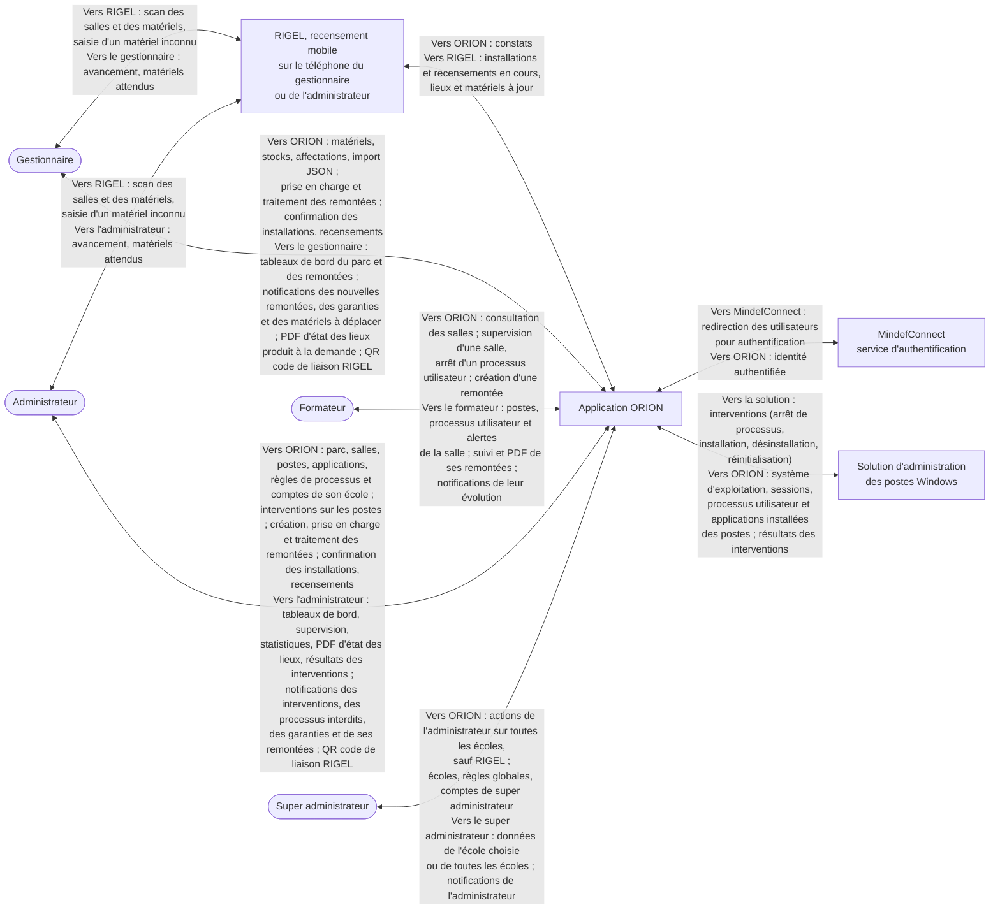

# Diagramme de contexte de l'application ORION

<!-- version:debut : généré par versions.py, ne pas modifier à la main -->
| Version | Mise à jour | Destination | Dernière évolution | Historique |
| --- | --- | --- | --- | --- |
| 5.1 | 16/11/2026 | Production destinée à la remise | Adopter la numérotation locale du dossier ; Actualiser les liens après la renumérotation | [9 versions](../../../archive/README.md#01-diagramme-contexte) |
<!-- version:fin -->

