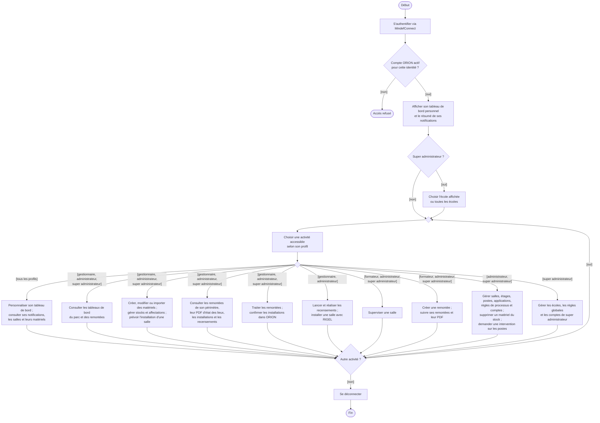
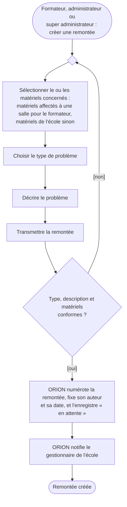
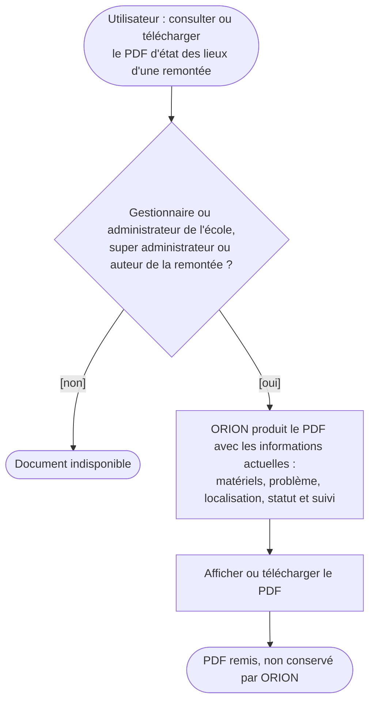
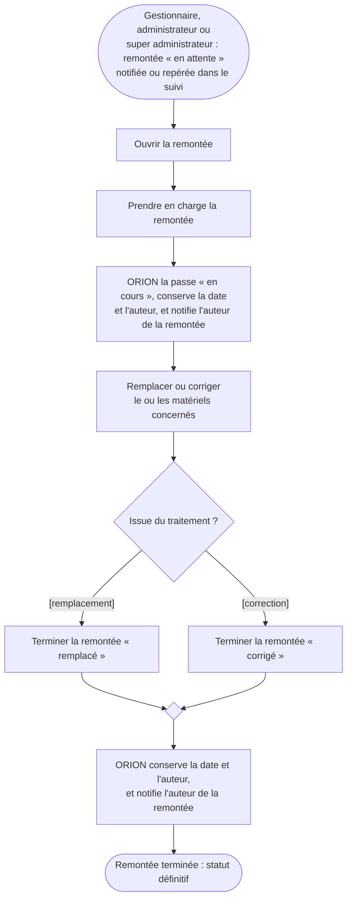
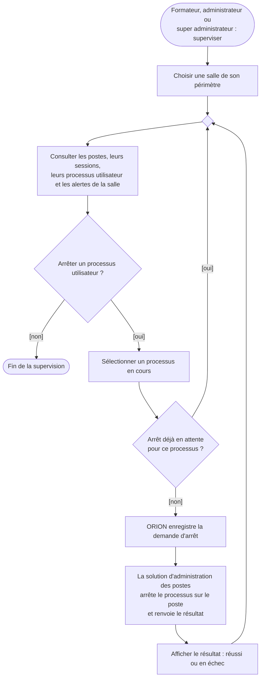
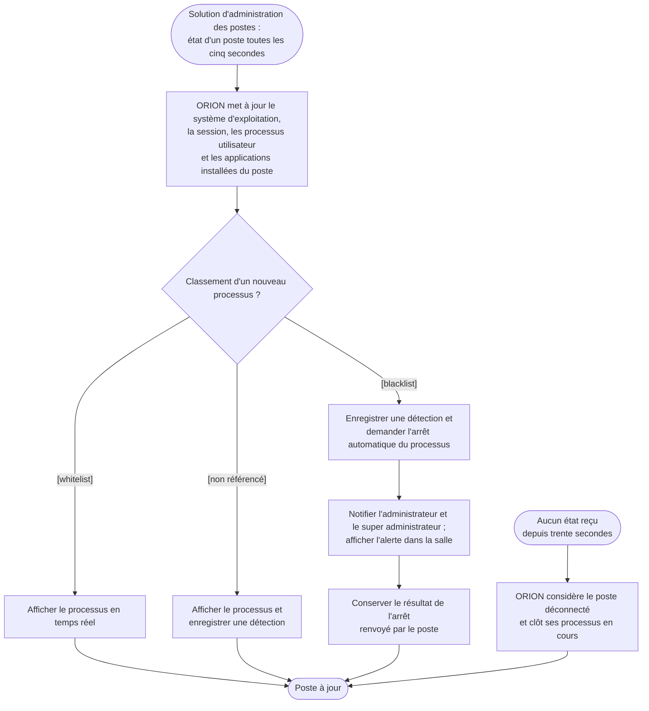
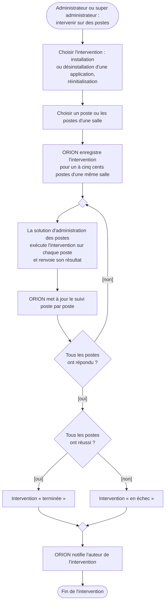
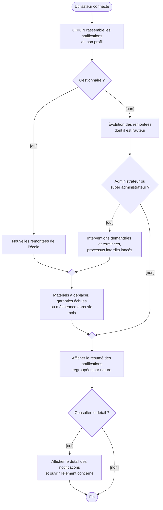
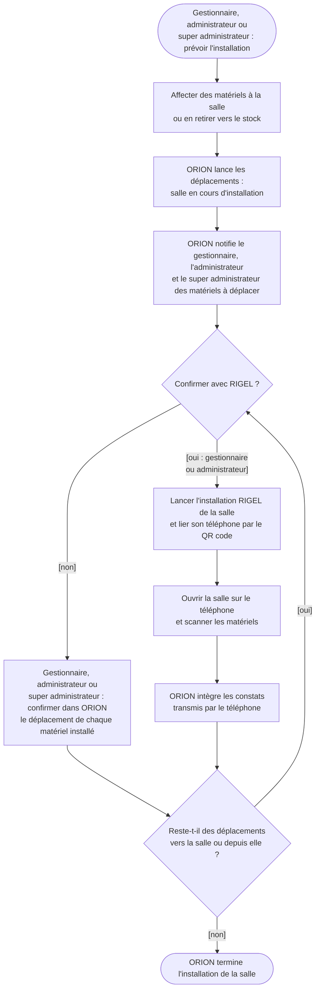
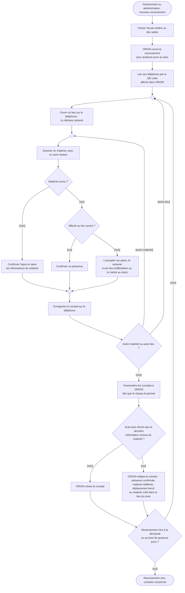

# Diagrammes d'activité de l'application ORION

<!-- version:debut : généré par versions.py, ne pas modifier à la main -->
| Version | Mise à jour | Destination | Dernière évolution | Historique |
| --- | --- | --- | --- | --- |
| 4.0 | 16/11/2026 | Production destinée à la remise | Appliquer les droits de l’administrateur, corriger les écarts avec le code et remettre en page à angles droits | [12 versions](../../../archive/README.md#02-diagrammes-activite) |
<!-- version:fin -->

## Parcours général

## Création d'une remontée

## Consultation d'un état des lieux

## Traitement d'une remontée

## Supervision des processus

## Remontée de l'état d'un poste

## Intervention sur les postes

## Consultation des notifications

## Installation d'une salle

## Recensement avec RIGEL

