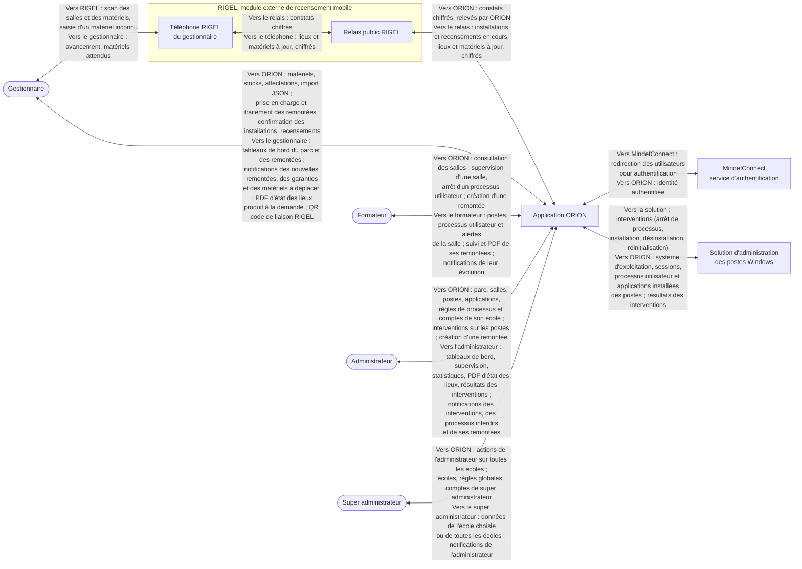

# Diagramme de contexte de l'application ORION

<!-- version:debut : généré par versions.py, ne pas modifier à la main -->
| Version | Mise à jour | Destination | Dernière évolution | Historique |
| --- | --- | --- | --- | --- |
| 3.0 | 14/11/2026 | Production destinée à la remise | Mise à jour d’après l’état actuel : super administrateur, MindefConnect, RIGEL, solution d’administration des postes, PDF à la demande, traitement par le gestionnaire | [6 versions](../../../archive/README.md#06-diagramme-contexte) |
<!-- version:fin -->

