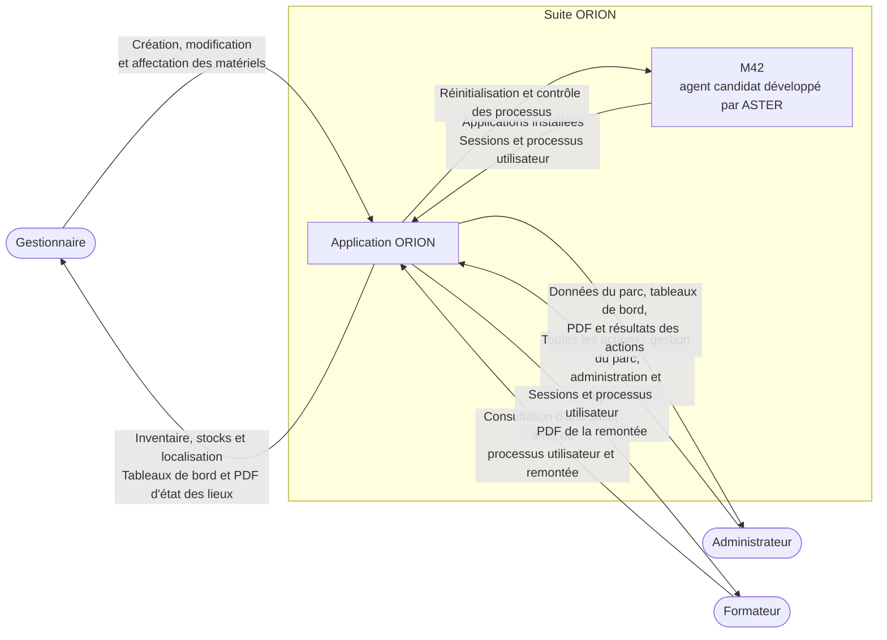

# Diagramme de contexte de l'application ORION

<!-- version:debut : généré par versions.py, ne pas modifier à la main -->
| Version | Mise à jour | Destination | Dernière évolution | Historique |
| --- | --- | --- | --- | --- |
| 2.0 | 14/11/2026 | Production destinée à la remise | Nommer M42 comme agent candidat | [5 versions](../../../archive/README.md#06-diagramme-contexte) |
<!-- version:fin -->

