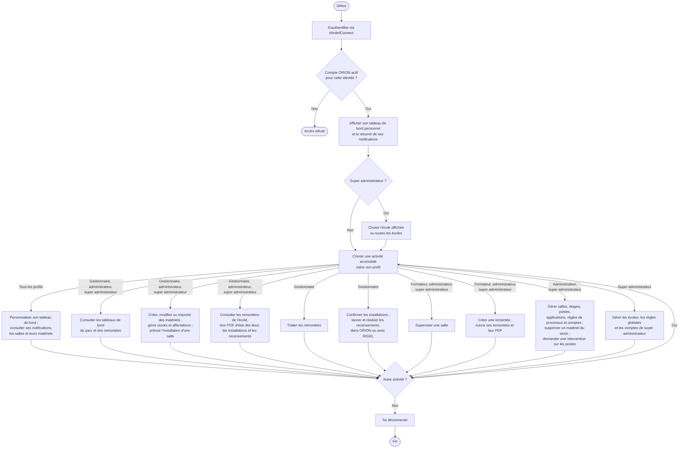
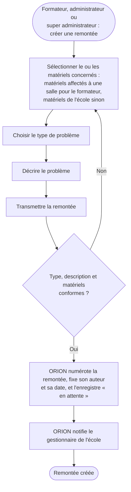
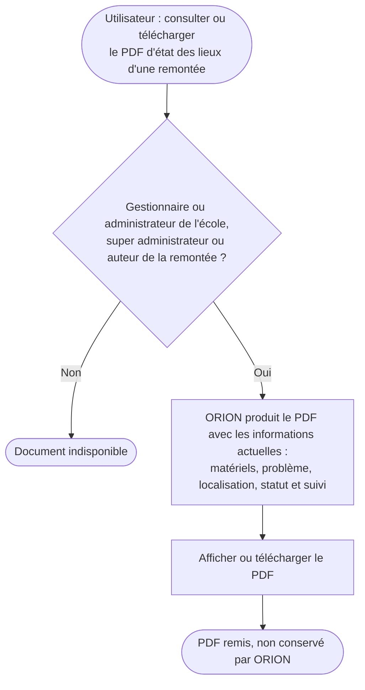
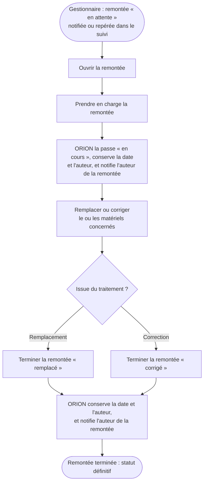
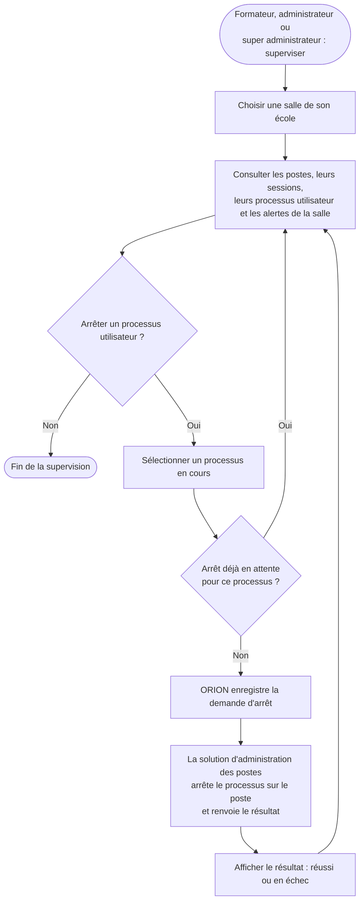
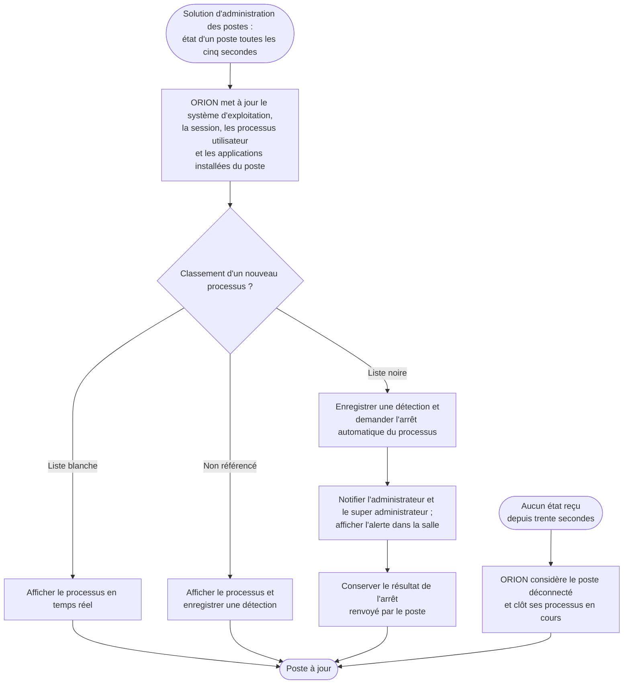
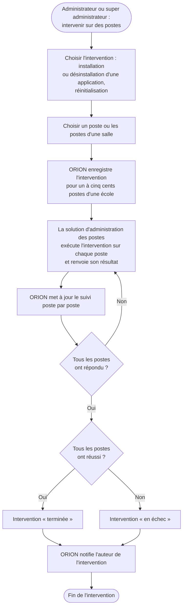
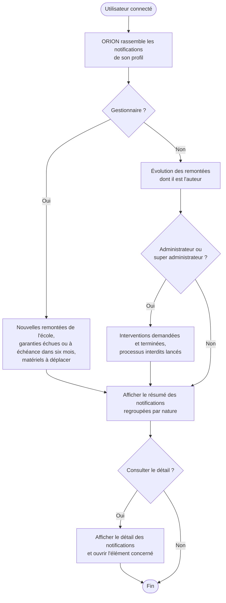
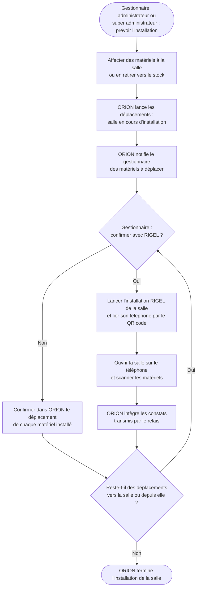
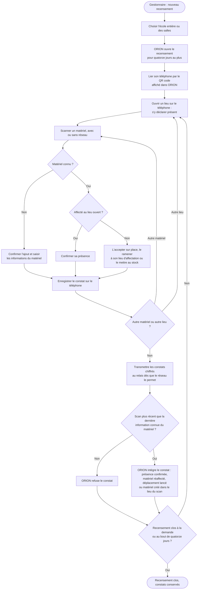

# Diagrammes d'activité de l'application ORION

<!-- version:debut : généré par versions.py, ne pas modifier à la main -->
| Version | Mise à jour | Destination | Dernière évolution | Historique |
| --- | --- | --- | --- | --- |
| 2.0 | 14/11/2026 | Production destinée à la remise | Mise à jour d’après l’état actuel : super administrateur, MindefConnect, RIGEL, solution d’administration des postes, PDF à la demande, traitement par le gestionnaire | [7 versions](../../../archive/README.md#07-diagrammes-activite) |
<!-- version:fin -->

## Parcours général

## Création d'une remontée

## Consultation d'un état des lieux

## Traitement d'une remontée par le gestionnaire

## Supervision des processus

## Remontée de l'état d'un poste

## Intervention sur les postes

## Consultation des notifications

## Installation d'une salle

## Recensement avec RIGEL

