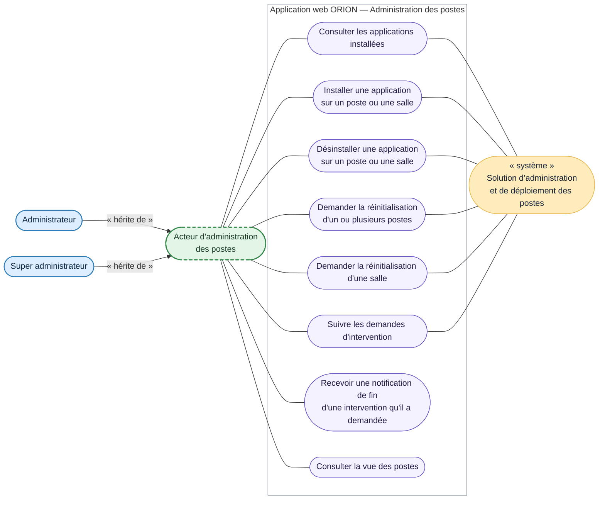

# DCU — Administrer les postes

<!-- version:debut : généré par versions.py, ne pas modifier à la main -->
| Version | Mise à jour | Destination | Dernière évolution | Historique |
| --- | --- | --- | --- | --- |
| 4.0 | 16/11/2026 | Production destinée à la remise | Appliquer les droits de l’administrateur, corriger les écarts avec le code et remettre en page à angles droits | [11 versions](../../../archive/README.md#04-dcu-administration-postes) |
<!-- version:fin -->

