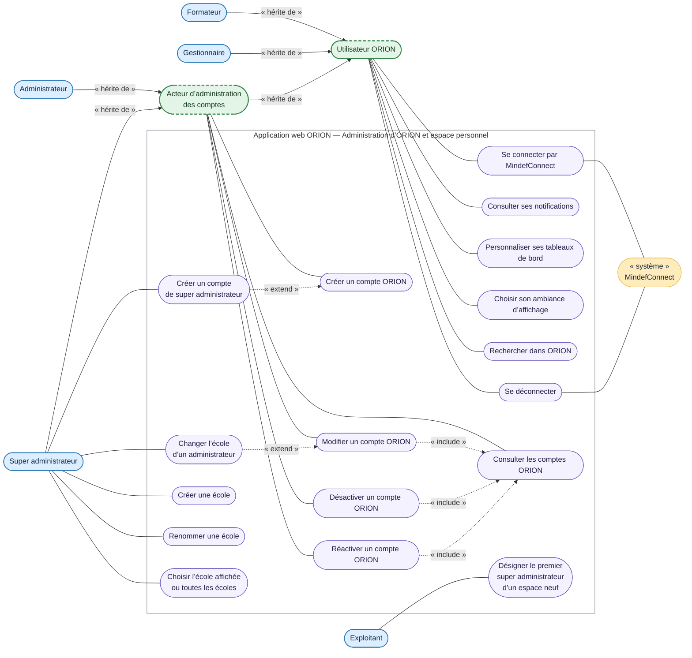

# DCU — Administrer ORION et personnaliser son espace

<!-- version:debut : généré par versions.py, ne pas modifier à la main -->
| Version | Mise à jour | Destination | Dernière évolution | Historique |
| --- | --- | --- | --- | --- |
| 3.1 | 17/11/2026 | Production destinée à la remise | Employer l’apostrophe typographique | [5 versions](../../../archive/README.md#07-dcu-administrer-orion) |
<!-- version:fin -->

