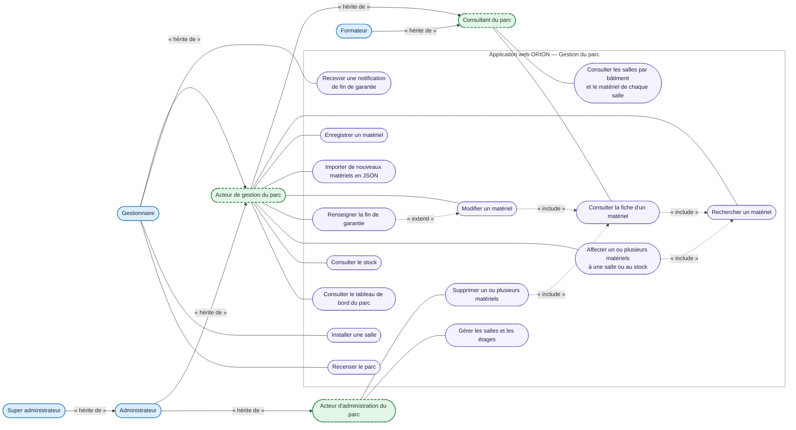

# DCU — Gérer le parc

<!-- version:debut : généré par versions.py, ne pas modifier à la main -->
| Version | Mise à jour | Destination | Dernière évolution | Historique |
| --- | --- | --- | --- | --- |
| 1.5 | 14/11/2026 | Production destinée à la remise | RIGEL : installation et recensement consolidés, notion de campagne retirée | [6 versions](../../../archive/README.md#08-dcu-gestion-parc) |
<!-- version:fin -->

