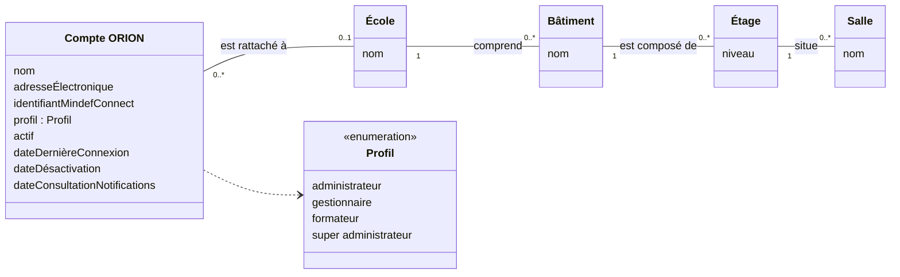
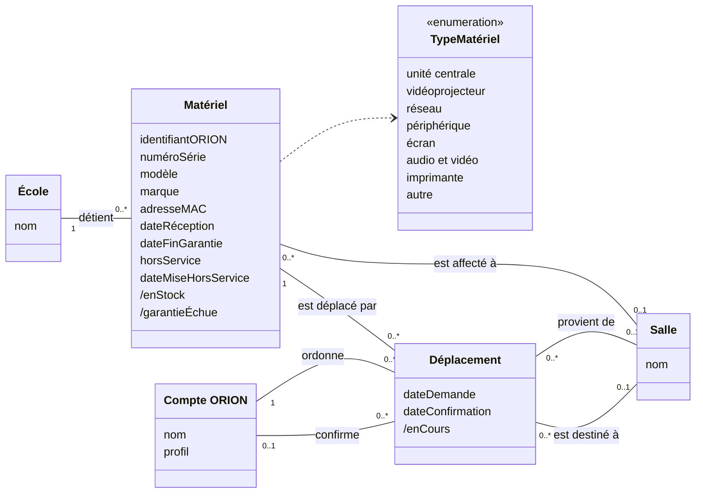
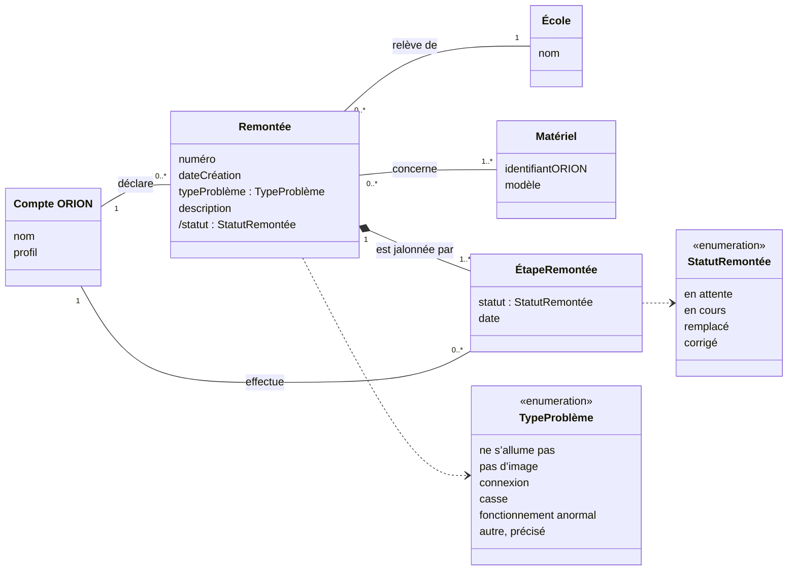
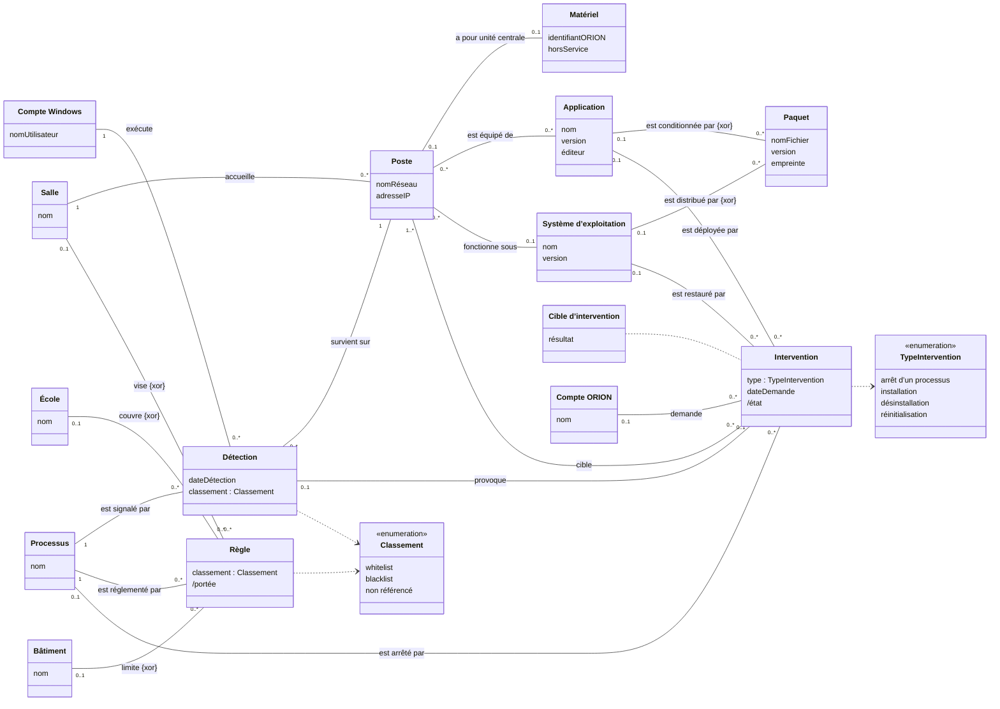
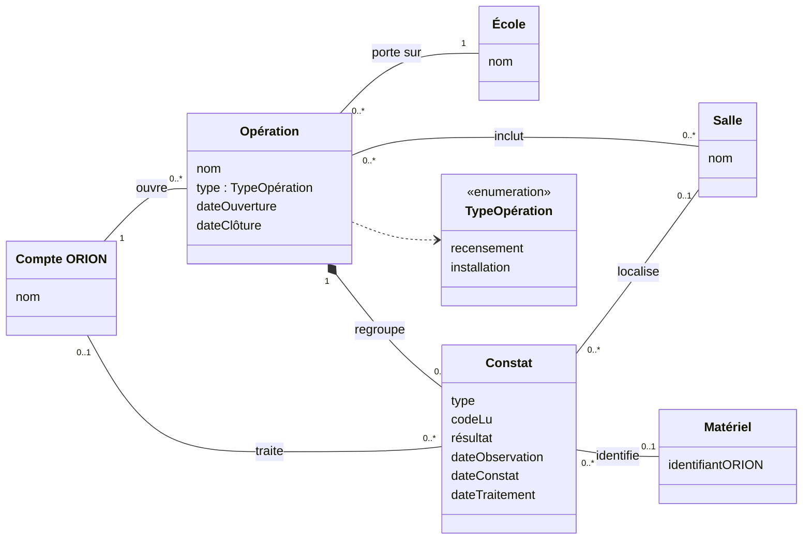

# Diagramme de classes métier — modèle du domaine ORION

<!-- version:debut : généré par versions.py, ne pas modifier à la main -->
| Version | Mise à jour | Destination | Dernière évolution | Historique |
| --- | --- | --- | --- | --- |
| 2.1 | 16/11/2026 | Production destinée à la remise | Adopter la numérotation locale du dossier ; Actualiser les liens après la renumérotation | [3 versions](../../../archive/README.md#09-diagramme-classes-metier) |
<!-- version:fin -->

## 1. Organisation des écoles et comptes ORION

## 2. Parc

## 3. Remontées utilisateur

## 4. Supervision des postes et interventions

## 5. Installation et recensement avec RIGEL

