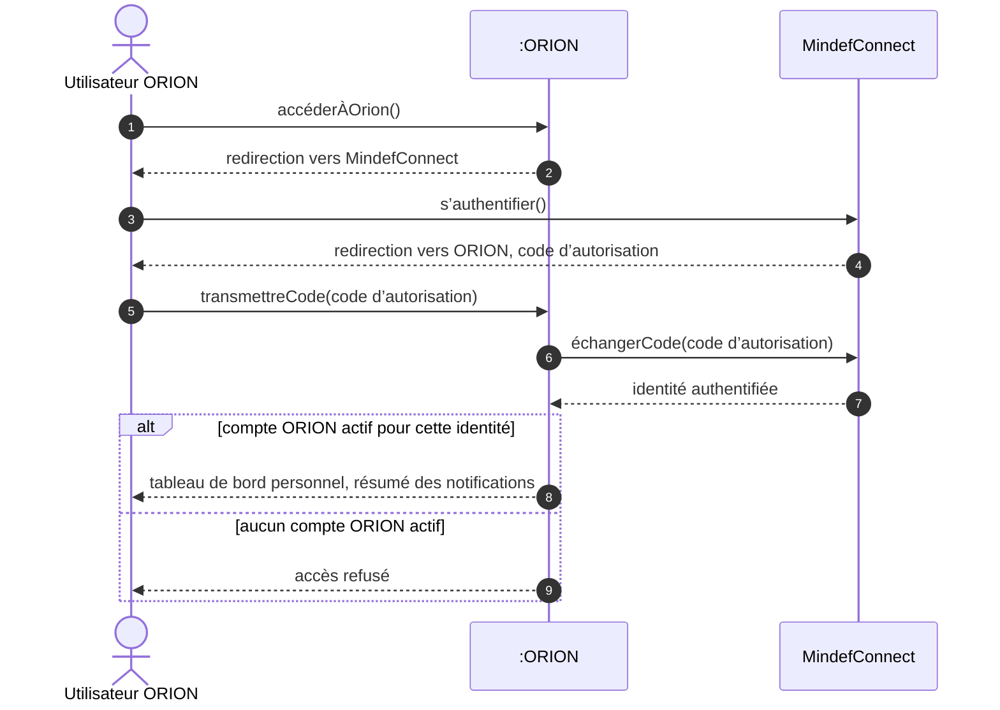
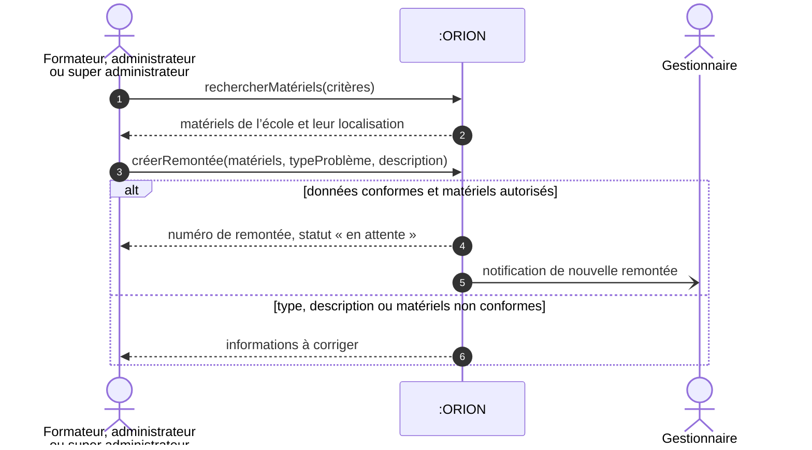
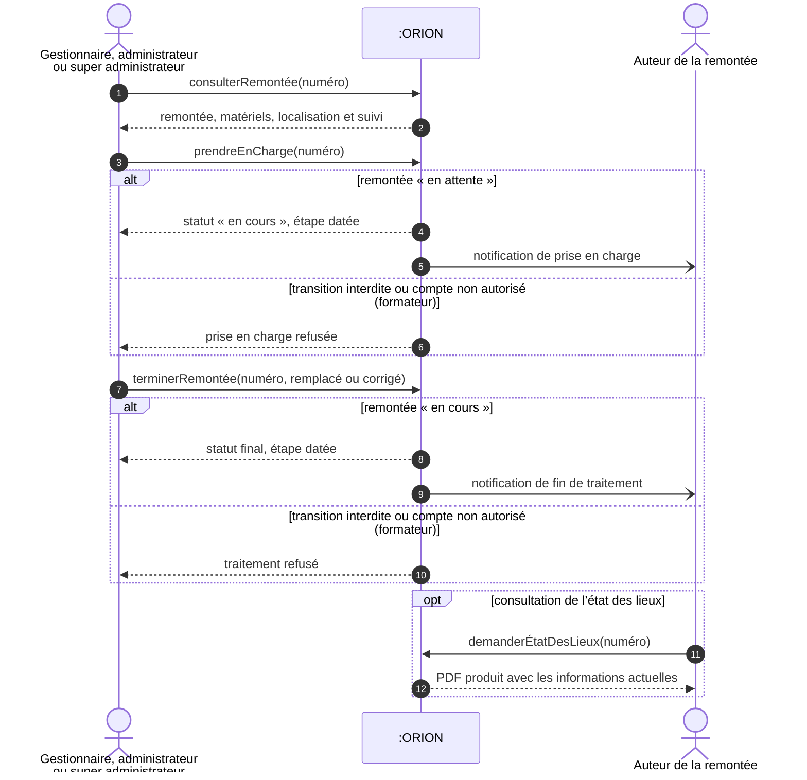
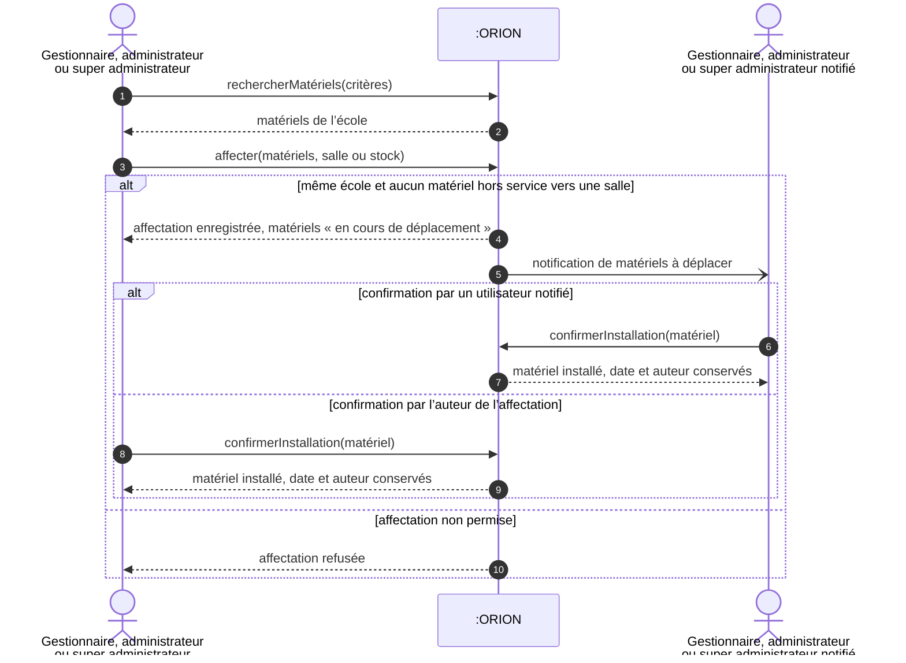
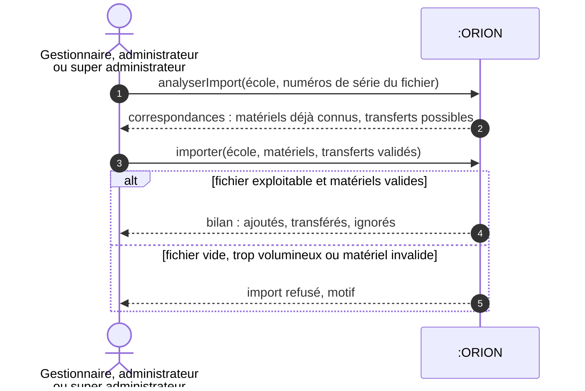
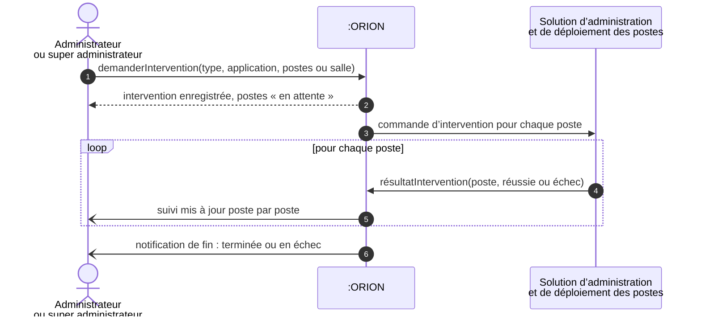
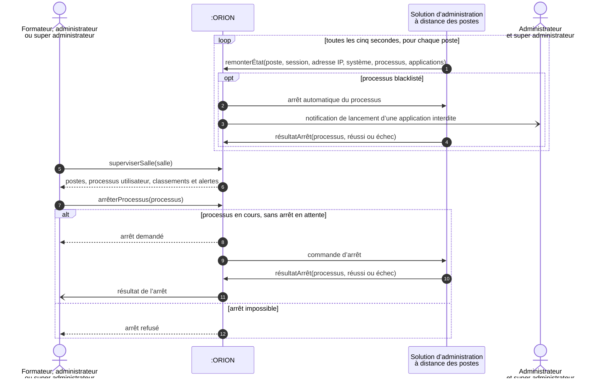
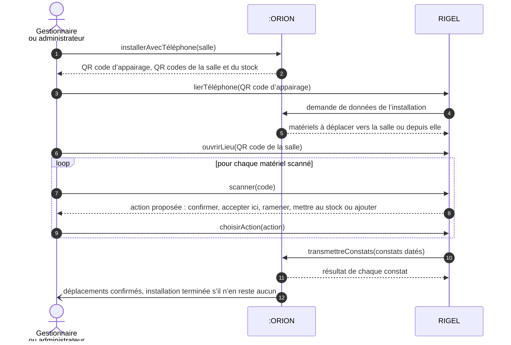
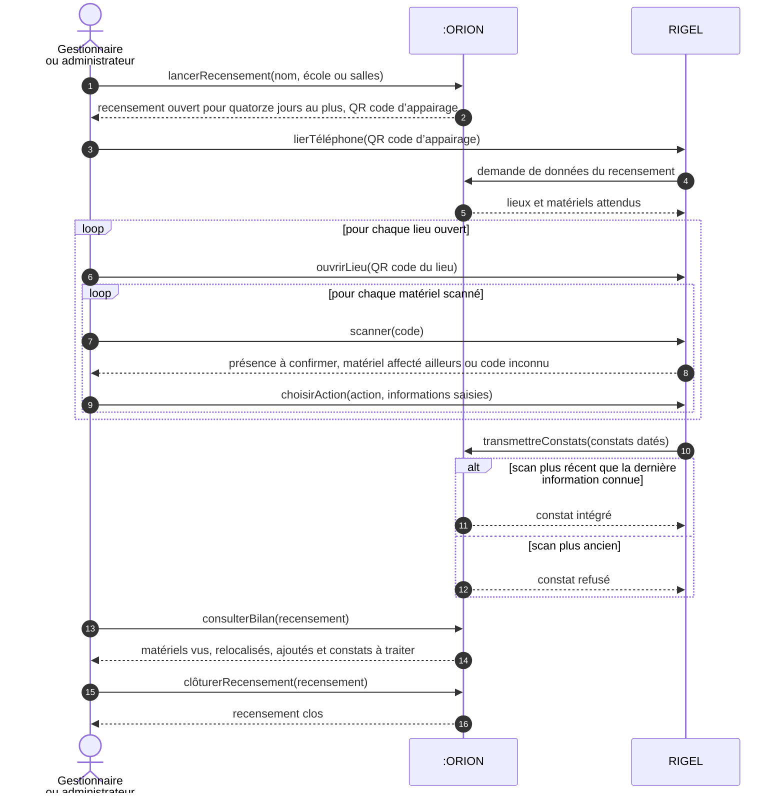

# Diagrammes de séquence système ORION

<!-- version:debut : généré par versions.py, ne pas modifier à la main -->
| Version | Mise à jour | Destination | Dernière évolution | Historique |
| --- | --- | --- | --- | --- |
| 3.2 | 17/11/2026 | Production destinée à la remise | Notifier les matériels à déplacer aux gestionnaires et administrateurs | [6 versions](../../../archive/README.md#10-diagrammes-sequence-systeme) |
<!-- version:fin -->

## 1. Se connecter par MindefConnect

## 2. Créer une remontée

## 3. Traiter une remontée

## 4. Affecter ou déplacer un matériel

## 5. Importer des matériels en JSON

## 6. Demander une intervention sur les postes

## 7. Superviser une salle et arrêter un processus

## 8. Installer une salle avec RIGEL

## 9. Recenser le parc avec RIGEL

