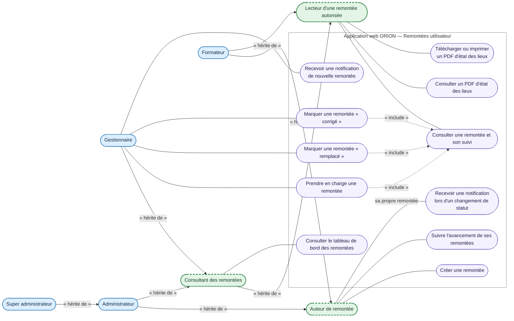

# DCU — Créer une remontée et consulter son état des lieux

<!-- version:debut : généré par versions.py, ne pas modifier à la main -->
| Version | Mise à jour | Destination | Dernière évolution | Historique |
| --- | --- | --- | --- | --- |
| 3.1 | 14/11/2026 | Production destinée à la remise | Déplacer dans docs/02-ANALYSE/02-CAPTURE-DES-BESOINS/ | [7 versions](../../../archive/README.md#11-dcu-remontees-utilisateur) |
<!-- version:fin -->

