# Fiche descriptive — Gestionnaire

<!-- version:debut : généré par versions.py, ne pas modifier à la main -->
| Version | Mise à jour | Destination | Dernière évolution | Historique |
| --- | --- | --- | --- | --- |
| 6.0 | 16/11/2026 | Production destinée à la remise | Adopter le format formel des cas d’utilisation (récit, critères, scénarios numérotés) ; Adopter le format formel des cas d’utilisation (récit, critères, scénarios numérotés) | [15 versions](../../../archive/README.md#12-fiche-descriptive-gestionnaire) |
<!-- version:fin -->

- **Statut :** établie à partir des décisions en vigueur et de l’application ORION.
- **Profil :** gestionnaire.
- **Rattachement :** une école.
- **Périmètre :** toutes les données du parc de son école, sans restriction à un bâtiment.
- **Finalité :** tenir l’inventaire du parc, réaliser l’installation des salles et le recensement avec RIGEL, et traiter les remontées.

## Périmètre fonctionnel

| Domaine | Capacités |
| --- | --- |
| Accès | Connexion par MindefConnect, avec un compte ORION actif de son école ; recherche globale, préférences d’affichage et déconnexion |
| Tableaux de bord | « Mon tableau de bord » personnalisable, tableaux spécialisés « Parc » et « Remontées », tableaux ajoutés, renommés ou supprimés par le compte |
| Salles et stock | Vue éclatée des bâtiments, détail d’une salle, stock ; affecter un ou plusieurs matériels à une salle ou au stock (glisser-déposer, sélection ou « Équiper la salle ») ; déclarer un matériel hors service ou en service |
| Matériels | Inventaire filtrable, fiche, création et modification d’un matériel, date de fin de garantie, import JSON |
| Installation des salles | Prévoir les déplacements dans ORION ; les réaliser et les confirmer, sur place avec RIGEL ou dans « Déplacements » ; suivre l’avancement dans le backlog des installations |
| Recensement | Lancer un recensement depuis ORION, y lier son téléphone professionnel, imprimer les étiquettes, scanner les matériels, traiter dans ORION les anciens constats, clore le recensement |
| RIGEL | Application mobile : appairage, exploration des salles, inventaire d’un lieu, scan des codes ou lecture du numéro de série, saisie manuelle, travail hors connexion, synchronisation, dissociation du téléphone |
| Remontées | Consulter toutes les remontées de son école ; les prendre en charge puis les terminer en « remplacé » ou « corrigé » ; relocaliser ou remplacer un matériel hors service ; état des lieux PDF |
| Notifications | Nouvelles remontées, matériels à déplacer, garanties échues ou arrivant à échéance |
| Exclusions | Suppression d’un matériel, gestion des salles et des étages, création de remontée, supervision, administration des postes, listes de processus et comptes ORION |

Les droits détaillés sont consolidés dans la [matrice des droits](11-MATRICE-DROITS.md).

## UC-GEST-01 — Gérer le parc matériel

**En tant que** gestionnaire, **je souhaite** enregistrer, retrouver, corriger et affecter les matériels du parc de mon école **afin de** tenir un inventaire fiable et connaître la localisation de chaque matériel.

- **Déclencheur :** un matériel doit être enregistré, retrouvé, corrigé ou affecté.
- **Acteurs secondaires :** aucun.

### Critères d’acceptation

- Chaque matériel possède un identifiant ORION et ses données obligatoires.
- Il est affecté au plus à une salle de son école ou reste en stock ; un matériel en stock n’a pas de salle et reste rattaché à son école.
- Une opération d’affectation peut porter sur plusieurs matériels, tous d’une même école.
- Un matériel hors service ne peut aller qu’au stock.
- La suppression d’un matériel n’est pas proposée au gestionnaire.
- Aucun historique des mouvements n’est exigé ; les déplacements en cours restent tracés jusqu’à leur confirmation.

### Règles de gestion

RG-03 à RG-10, RG-16 à RG-18, RG-25 à RG-27, RG-69, RG-72, RG-86, RG-87 et RG-92.

### Besoins non fonctionnels

- Chaque enregistrement est confirmé à l’écran (« MAT-… enregistré », « MAT-… modifié », « … affecté à C202, à installer », « … remis en stock, à ranger »).
- La garantie est facultative ; un matériel est signalé « À échéance » six mois avant la date de fin, puis « Hors garantie » à cette date.

### Interface

- **Matériels › Inventaire** : recherche par modèle, identifiant ORION ou numéro de série ; filtres par type, état, salle ou stock et garantie (« Hors garantie », « À échéance », « En cours », « Non renseignée ») ; tri par identifiant, matériel ou date de réception ; pagination ; sélection multiple (case par ligne ou par page) et **Affecter** ; la suppression n’est pas proposée.
- **Ajouter un matériel**, dans l’inventaire ou dans le stock, formulaire conforme aux données confirmées : type, modèle et date de réception obligatoires ; marque, numéro de série, adresse MAC, affectation (salle ou stock), indication « hors service » (non par défaut) et date de fin de garantie facultatives ; l’identifiant ORION est attribué à l’enregistrement.
- Fiche d’un matériel, ouverte depuis l’inventaire, une salle, le stock, une remontée ou la recherche, avec **Modifier**.
- **Salles** : vue éclatée des bâtiments, détail d’une salle, dont les matériels sont regroupés par type, et stock, qui regroupe les matériels sans salle ; sélection et glisser-déposer d’un matériel ou d’une sélection vers une salle ou le stock ; affectation d’un matériel du stock depuis sa fiche ou par **Équiper la salle** ; bascule **En service** / **Hors service** ; corbeille désactivée.

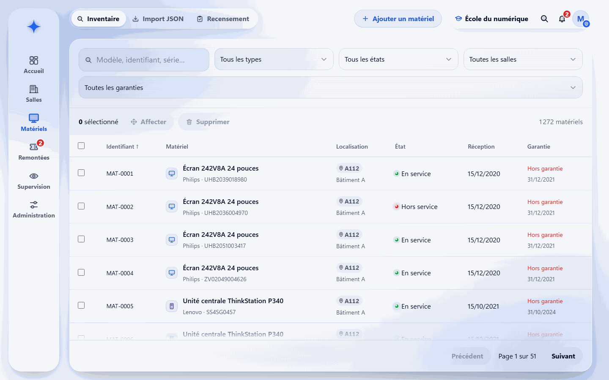

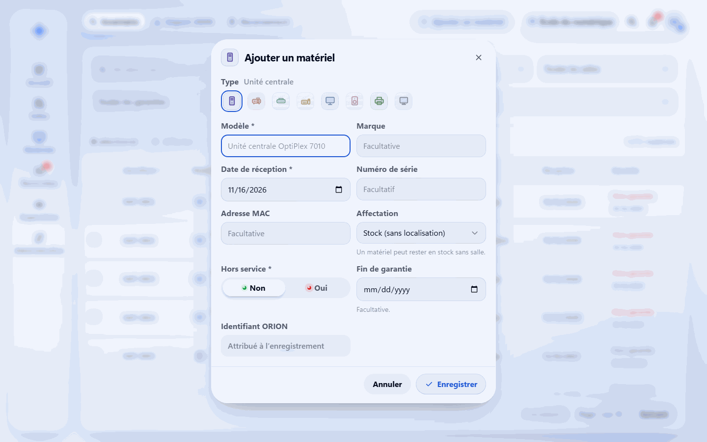

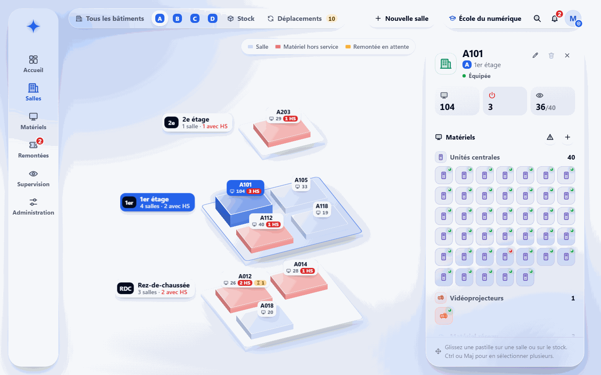

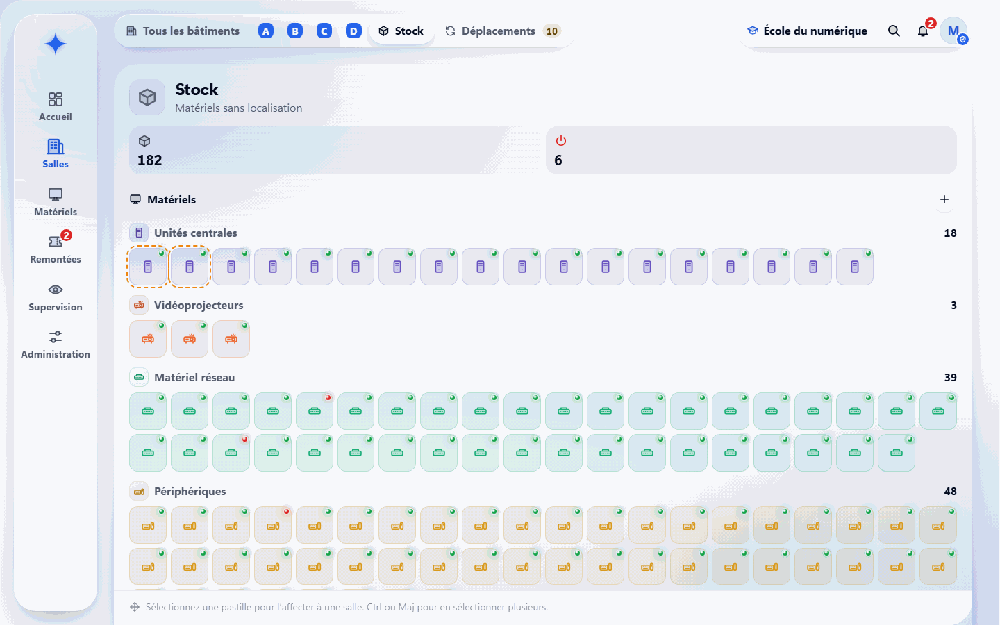

[Diagramme d’activité – Enregistrer ou modifier un matériel](08-DIAGRAMMES-ACTIVITE-CAS-UTILISATION.md#2-enregistrer-ou-modifier-un-matériel)

[Diagramme d’activité – Affecter un ou plusieurs matériels à une salle ou au stock](08-DIAGRAMMES-ACTIVITE-CAS-UTILISATION.md#4-affecter-un-ou-plusieurs-matériels-à-une-salle-ou-au-stock)

### Préconditions

- Le gestionnaire est connecté.
- Les salles de destination appartiennent à son école.

### Scénario nominal

| Acteur | ORION |
| --- | --- |
| 1. Le gestionnaire ouvre **Matériels › Inventaire**. | 2. ORION présente les matériels de son école, avec leur identifiant ORION, leur localisation, leur état et leur garantie. |
| 3. Le gestionnaire recherche par modèle, identifiant ORION ou numéro de série, filtre par type, état, salle ou stock et garantie, trie par identifiant, matériel ou date de réception et parcourt les pages. | 4. ORION présente les matériels correspondants. |
| 5. Pour enregistrer un matériel, le gestionnaire clique sur **Ajouter un matériel**, dans l’inventaire ou dans le stock, choisit le type, saisit le modèle et la date de réception (obligatoires) puis, s’il les connaît, la marque, le numéro de série, l’adresse MAC, l’affectation (salle ou stock), l’indication « hors service » (non par défaut) et la date de fin de garantie, et enregistre. | 6. ORION attribue l’identifiant ORION et confirme « MAT-… enregistré ». |
| 7. Pour corriger un matériel, le gestionnaire ouvre sa fiche depuis l’inventaire, une salle, le stock, une remontée ou la recherche, clique sur **Modifier**, corrige et enregistre. | 8. ORION enregistre la modification, l’identifiant ORION n’étant pas modifiable, et confirme « MAT-… modifié ». |
| 9. Pour affecter, le gestionnaire sélectionne un ou plusieurs matériels dans l’inventaire, clique sur **Affecter**, choisit la destination et enregistre ; ou, dans **Salles**, il glisse un matériel ou une sélection sur une salle ou sur le stock ; ou il choisit **Équiper la salle** en indiquant le nombre de postes complets (unité centrale, écran et périphériques) et de matériels secondaires demandés. | 10. ORION enregistre aussitôt l’affectation, en prenant pour **Équiper la salle** les matériels dans le stock en service, et l’annonce (« … affecté à C202, à installer » ou « … remis en stock, à ranger ») ; le matériel est « en cours de déplacement » jusqu’à la confirmation sur place (UC-GEST-04). |

### Scénario alternatif 1 — basculer un matériel hors service ou en service

| Étape | Déroulement |
| --- | --- |
| 9a1.1 | Dans le détail d’une salle ou du stock, le gestionnaire bascule un matériel entre **En service** et **Hors service**. |
| 9a1.2 | ORION enregistre et confirme le nouvel état. |
| Suite | Fin du cas d’utilisation. |

### Scénario alternatif 2 — importer un fichier de matériels

| Étape | Déroulement |
| --- | --- |
| 5a2.1 | Le gestionnaire importe en une fois un fichier de matériels (UC-GEST-02). |
| Suite | Fin du cas d’utilisation. |

### Scénario d’exception 1 — matériel hors service affecté à une salle

| Étape | Déroulement |
| --- | --- |
| 9e1.1 | Le gestionnaire affecte à une salle un matériel hors service. |
| 9e1.2 | ORION refuse toute autre destination que le stock : « Un matériel hors service ne peut aller qu’au stock ». |
| Suite | Retour à l’étape 9. |

### Scénario d’exception 2 — suppression d’un matériel

| Étape | Déroulement |
| --- | --- |
| 9e2.1 | Dans le détail d’une salle ou du stock, le gestionnaire veut supprimer un matériel. |
| 9e2.2 | ORION laisse la corbeille désactivée, avec le motif « Suppression réservée aux administrateurs ». |
| Suite | Fin du cas d’utilisation. |

### Questions ouvertes

- Exports de l’inventaire.
- Contrôle des doublons de numéro de série lors d’une saisie manuelle.

## UC-GEST-02 — Importer des matériels en JSON

**En tant que** gestionnaire, **je souhaite** importer un fichier JSON de matériels **afin d’**enregistrer en une fois un inventaire existant.

- **Déclencheur :** le gestionnaire dispose d’un fichier JSON de matériels.
- **Acteurs secondaires :** aucun.

### Critères d’acceptation

- Les nouveaux matériels et les transferts validés figurent dans l’inventaire de l’école ; un matériel transféré garde son identifiant ORION.
- Chaque matériel est enregistré là où le fichier le déclare, sans déplacement à confirmer et sans validation métier préalable.
- Un matériel déjà présent dans l’école, ou répété dans le fichier, n’est pas traité.
- Le bilan indique le résultat de chaque ligne.

### Règles de gestion

RG-03 à RG-05, RG-28, RG-29, RG-69, RG-72 et RG-87.

### Besoins non fonctionnels

- Un fichier compte au plus 2 000 matériels et 2 Mo.
- Format : un tableau de matériels ; `modele` et `dateReception` obligatoires ; `type`, `marque`, `serie`, `mac`, `hs`, `salleId` et `garantieFin` facultatifs. L’école est celle du gestionnaire ; sans salle, le matériel entre en stock.
- Les numéros de série sont rapprochés de tout le parc.

### Interface

- **Matériels › Import** : format attendu et exemple ; choix d’un fichier ou JSON collé, analysé dès qu’il est choisi.
- Aperçu de chaque matériel (modèle, type, numéro de série, réception, destination) avec la suite qui lui sera donnée, signalant les doublons et les matériels d’une autre école ; choix des transferts ; **Importer n matériels** ; résultat ligne par ligne.

[Diagramme d’activité – Importer de nouveaux matériels en JSON](08-DIAGRAMMES-ACTIVITE-CAS-UTILISATION.md#3-importer-de-nouveaux-matériels-en-json)

### Préconditions

- Le gestionnaire est connecté.
- Le fichier contient un tableau de matériels.

### Scénario nominal

| Acteur | ORION |
| --- | --- |
| 1. Le gestionnaire ouvre **Matériels › Import**. | 2. ORION présente le format attendu et un exemple. |
| 3. Le gestionnaire choisit un fichier ou colle le JSON. | 4. ORION analyse aussitôt le contenu, rapproche ses numéros de série de tout le parc et présente l’aperçu : chaque matériel (modèle, type, numéro de série, réception, destination) et la suite qui lui sera donnée : ajouté, déjà présent dans l’école, répété dans le fichier, ou connu dans une autre école. |
| 5. Pour un matériel connu dans une autre école, le gestionnaire active ou non son transfert. | 6. ORION met à jour l’aperçu. |
| 7. Le gestionnaire clique sur **Importer n matériels**. | 8. ORION ajoute les nouveaux matériels, avec leur identifiant ORION, et les transferts validés, qui gardent le leur, chacun là où le fichier le déclare ; il confirme le bilan (« … ajoutés, … transférés, … non traités ») et garde la liste affichée avec le résultat de chaque ligne. |

### Scénario alternatif 1 — matériel déjà présent ou répété

| Étape | Déroulement |
| --- | --- |
| 4a1.1 | Le fichier contient un matériel déjà présent dans l’école ou répété dans le fichier. |
| 4a1.2 | ORION l’indique dans l’aperçu et ne le traite pas. |
| Suite | Retour à l’étape 5. |

### Scénario d’exception 1 — transfert impossible

| Étape | Déroulement |
| --- | --- |
| 5e1.1 | Un matériel connu dans une autre école est cité par une remontée en cours dans son école, ou est hors service et destiné à une salle. |
| 5e1.2 | ORION refuse son transfert ; un matériel hors service ne peut être transféré que vers le stock. |
| Suite | Retour à l’étape 5. |

### Scénario d’exception 2 — fichier refusé

| Étape | Déroulement |
| --- | --- |
| 4e2.1 | Le fichier est illisible, vide, trop volumineux ou contient un matériel incomplet ou invalide. |
| 4e2.2 | ORION refuse le fichier en entier et affiche le motif (par exemple « Matériel 3 : … »). |
| Suite | Fin du cas d’utilisation. |

## UC-GEST-03 — Consulter et traiter les remontées

**En tant que** gestionnaire, **je souhaite** consulter les remontées de mon école, les prendre en charge et les terminer **afin de** traiter les problèmes déclarés sur les matériels et en informer leurs auteurs.

- **Déclencheur :** une nouvelle remontée est créée ou une remontée doit être traitée.
- **Acteurs secondaires :** l’auteur de la remontée (formateur, administrateur ou super administrateur), notifié de chaque changement de statut.

### Critères d’acceptation

- Une remontée peut concerner plusieurs matériels ; elle n’a qu’un statut : « en attente », « en cours », « remplacé » ou « corrigé ».
- Le statut s’applique à toute la remontée ; chaque changement est conservé avec sa date et son auteur.
- L’auteur, quel que soit son profil, est informé dans ORION de chaque changement de statut.
- La prise en charge est obligatoire avant « remplacé » ou « corrigé » ; une remontée terminée ne change plus de statut. Son contenu n’est ni modifié ni supprimé.
- Le gestionnaire traite les remontées, comme l’administrateur et le super administrateur ; il n’en crée pas.

### Règles de gestion

RG-11 à RG-14, RG-23 à RG-25, RG-34 à RG-38, RG-64, RG-66, RG-67, RG-69, RG-79, RG-80, RG-87 et RG-89.

### Besoins non fonctionnels

- Les notifications sont affichées dans ORION ; aucun courriel n’est envoyé.
- L’état des lieux est produit par ORION à chaque demande, avec les informations du moment, dont le statut et le suivi ; il n’est pas conservé.

### Interface

- **Remontées**, onglet **Remontées** : backlog en trois colonnes, **En attente**, **En cours** et **Terminées** (30 derniers jours), filtrable par bâtiment et par recherche (matériel, identifiant, description, auteur) ; une carte ouvre le détail où se trouvent les actions.
- **Remontées**, onglet **Toutes** : liste de toutes les remontées de l’école.
- Détail d’une remontée : problème, auteur, date, description, matériels concernés avec leur localisation et l’accès à leur fiche, suivi daté ; **Prendre en charge**, bascule en service ou hors service, relocalisation dans le stock, remplacement, **Lancer le déplacement**, **Remplacé**, **Corrigé** et **état des lieux** PDF.

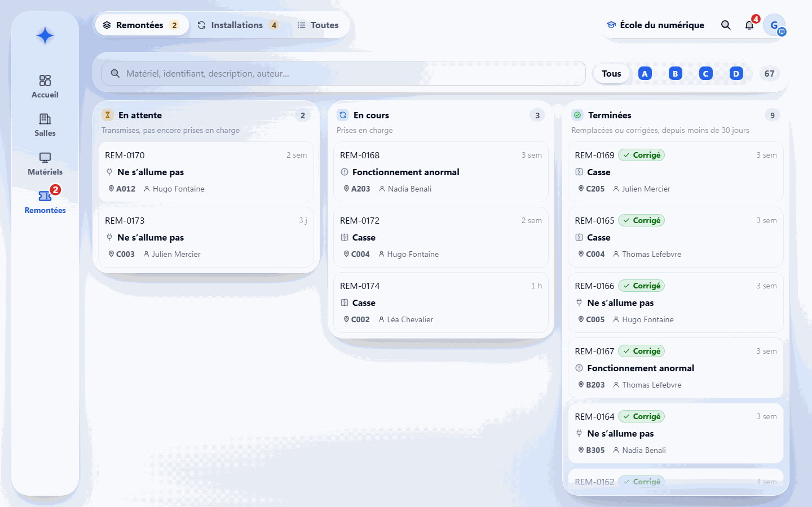

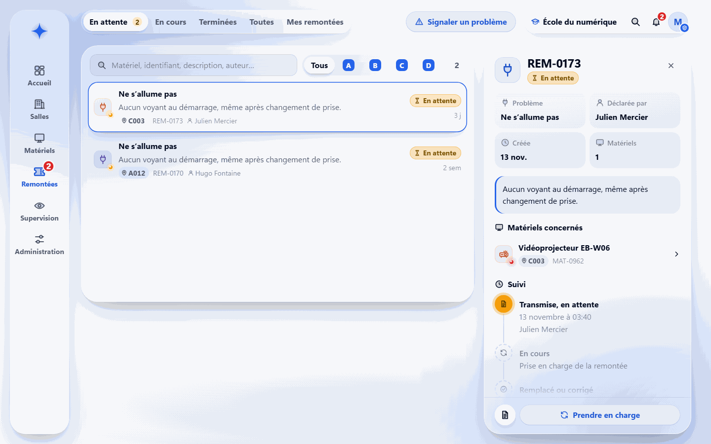

[Diagramme d’activité – Traiter une remontée](08-DIAGRAMMES-ACTIVITE-CAS-UTILISATION.md#9-traiter-une-remontée)

[Diagramme d’activité – Consulter ou télécharger le PDF d’état des lieux](08-DIAGRAMMES-ACTIVITE-CAS-UTILISATION.md#10-consulter-ou-télécharger-le-pdf-détat-des-lieux)

### Préconditions

- Le gestionnaire est connecté.
- La remontée appartient à son école.

### Scénario nominal

| Acteur | ORION |
| --- | --- |
| 1. Le gestionnaire reçoit la notification « nouvelle remontée », émise par ORION à la création d’une remontée, et ouvre **Remontées**. | 2. ORION présente le backlog en trois colonnes et l’onglet **Toutes**. |
| 3. Le gestionnaire ouvre une carte. | 4. ORION affiche le problème, l’auteur, la date, la description, les matériels concernés avec leur localisation et le suivi daté ; chaque matériel ouvre sa fiche. |
| 5. Le gestionnaire clique sur **Prendre en charge**. | 6. ORION passe la remontée « en cours », confirme « REM-… : en cours » et notifie l’auteur. |
| 7. Le gestionnaire termine la remontée par **Remplacé** ou **Corrigé**. | 8. ORION enregistre le statut, la date et le gestionnaire dans le suivi, et notifie l’auteur. |
| 9. Le gestionnaire ouvre l’**état des lieux**. | 10. ORION produit le PDF, avec les informations du moment, à consulter, télécharger ou imprimer. |

### Scénario alternatif 1 — déclarer l’état des matériels, relocaliser et remplacer un matériel hors service

| Étape | Déroulement |
| --- | --- |
| 7a1.1 | Pendant le traitement, le gestionnaire déclare chaque matériel concerné en service ou hors service. |
| 7a1.2 | ORION enregistre le nouvel état. |
| 7a1.3 | Pour un matériel hors service d’une salle, le gestionnaire peut le **relocaliser dans le stock** et le **remplacer** par un matériel en service du stock du même type, puis cliquer sur **Lancer le déplacement**. |
| 7a1.4 | ORION crée les déplacements correspondants, à confirmer sur place (UC-GEST-04). |
| Suite | Retour à l’étape 7. |

### Scénario d’exception 1 — terminer sans prise en charge

| Étape | Déroulement |
| --- | --- |
| 7e1.1 | La remontée est encore « en attente ». |
| 7e1.2 | ORION ne permet de la terminer en « remplacé » ou « corrigé » qu’après sa prise en charge. |
| Suite | Retour à l’étape 5. |

### Scénario d’exception 2 — remontée terminée

| Étape | Déroulement |
| --- | --- |
| 5e2.1 | La remontée est « remplacé » ou « corrigé ». |
| 5e2.2 | ORION n’en change plus le statut ; son contenu n’est ni modifié ni supprimé. |
| Suite | Retour à l’étape 9. |

### Questions ouvertes

- Répartition des remontées entre plusieurs gestionnaires d’une même école, qui reçoivent chacun la notification.
- Qualification, affectation à un intervenant, priorités et délais de traitement.
- Doublons et pièces jointes.
- Règles de calcul des indicateurs du tableau de bord des remontées.

## UC-GEST-04 — Installer une salle avec RIGEL

**En tant que** gestionnaire, **je souhaite** réaliser sur place les déplacements prévus dans ORION et confirmer l’installation de chaque matériel **afin que** la localisation enregistrée dans ORION corresponde à la réalité constatée sur place.

- **Déclencheur :** des matériels ont été affectés à une salle ou en sont retirés et sont « en cours de déplacement ».
- **Acteurs secondaires :** l’administrateur ou le super administrateur, qui peut affecter les matériels à la salle (étape 1).

### Critères d’acceptation

- Chaque matériel déplacé est confirmé « installé » dans sa salle, ou « rangé » au stock.
- La localisation enregistrée dans ORION correspond à la réalité constatée sur place.
- L’installation se termine d’elle-même quand plus aucun matériel n’est à déplacer vers la salle ou depuis elle.
- Un matériel hors service n’est jamais accepté dans une salle ; il ne peut aller qu’au stock.
- Une installation et un recensement peuvent être en cours en même temps dans une salle : son détail propose alors **Installation en cours** et **Recensement en cours**.
- L’administrateur réalise l’installation comme le gestionnaire ; le super administrateur confirme les installations dans ORION, sans RIGEL ; le formateur n’a pas accès à RIGEL.

### Règles de gestion

RG-26, RG-27, RG-87, RG-92, RG-94, RG-95 et RG-96.

### Besoins non fonctionnels

- RIGEL s’utilise sur le téléphone professionnel du gestionnaire, appairé à ORION ; ses échanges avec ORION sont chiffrés.
- Hors connexion, RIGEL garde les scans et les transmet chiffrés au retour du réseau.

### Interface

- **Salles › Déplacements** : une carte par trajet vers une salle, avec ses matériels à installer et son avancement, et une seule carte des matériels à ramener au stock, avec **Terminer le restockage** ; le point d’un matériel passe de l’orange au vert lorsque son installation est confirmée, dans ORION ou avec RIGEL.
- **Installer avec un téléphone** : QR code d’appairage et QR codes de la salle et du stock.
- **Remontées › Installations** : backlog des installations, avec les salles en attente (aucun déplacement confirmé), en cours et terminées depuis moins de 30 jours ; une carte ouvre les déplacements de la salle.
- RIGEL : salle ouverte, **Réaliser l’installation**, scanner, **Confirmer l’installation** ; matériel affecté ailleurs, accepté ici, ramené dans sa salle ou mis au stock ; code inconnu, ajouté au parc seulement après confirmation et saisie de son type et de son modèle.

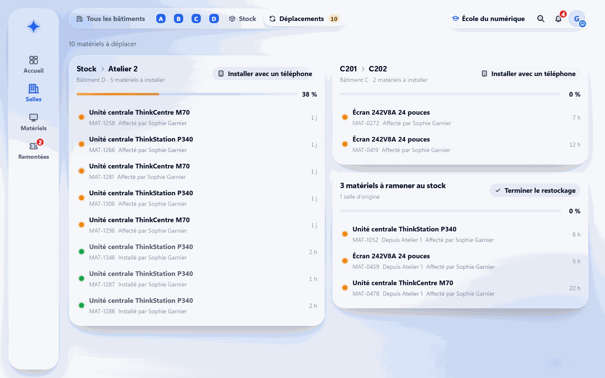

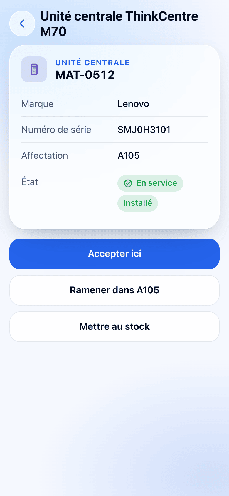

[Diagramme d’activité – Installer une salle](08-DIAGRAMMES-ACTIVITE-CAS-UTILISATION.md#6-installer-une-salle)

### Préconditions

- Le gestionnaire dispose de son téléphone professionnel.
- La salle a au moins un déplacement en cours.

### Scénario nominal

| Acteur | ORION |
| --- | --- |
| 1. Le gestionnaire, un administrateur ou un super administrateur affecte des matériels à une salle (UC-GEST-01). | 2. ORION les marque « en cours de déplacement » et notifie le gestionnaire. |
| 3. Le gestionnaire ouvre **Salles › Déplacements**. | 4. ORION présente une carte par trajet vers une salle et une seule carte des matériels à ramener au stock ; chaque matériel porte un point orange tant que son déplacement n’est pas confirmé. |
| 5. Sur la carte du trajet, le gestionnaire clique sur **Installer avec un téléphone**. | 6. ORION lance l’installation de la salle, ou reprend celle en cours, et affiche le QR code d’appairage ainsi que ceux de la salle et du stock. |
| 7. Le gestionnaire scanne le QR code d’appairage avec son téléphone. | 8. ORION lie le téléphone à l’installation ; RIGEL ne présente que la salle et le stock (UC-GEST-06). |
| 9. Sur place, le gestionnaire ouvre la salle dans RIGEL en scannant son QR code, ce qui revient à déclarer qu’il s’y trouve, puis choisit **Réaliser l’installation** et scanne chaque matériel. | 10. RIGEL présente le matériel scanné et les actions utiles dans la salle. |
| 11. Pour un matériel attendu, le gestionnaire choisit **Confirmer l’installation**. | 12. Le point passe au vert dans ORION ; quand plus aucun matériel n’est à déplacer vers la salle ou depuis elle, ORION termine l’installation, au nom du gestionnaire dont la confirmation l’a achevée. |

### Scénario alternatif 1 — matériel affecté ailleurs

| Étape | Déroulement |
| --- | --- |
| 9a1.1 | Le gestionnaire scanne un matériel affecté ailleurs. |
| 9a1.2 | RIGEL propose **Accepter ici**, **Ramener dans <salle d’affectation>** ou **Mettre au stock** ; au stock, **Ranger au stock** ou **Ramener dans <salle d’affectation>**. |
| 9a1.3 | Le gestionnaire choisit l’une de ces actions. |
| 9a1.4 | ORION l’enregistre ; ramener ou mettre au stock lance un déplacement, à confirmer à l’arrivée. |
| Suite | Retour à l’étape 9. |

### Scénario alternatif 2 — code inconnu

| Étape | Déroulement |
| --- | --- |
| 9a2.1 | Le gestionnaire scanne un code inconnu. |
| 9a2.2 | RIGEL avertit que le matériel ne provient probablement pas du stock. |
| 9a2.3 | Le gestionnaire choisit **Installer ici** et saisit ses informations (UC-GEST-06, scénario alternatif 2). |
| 9a2.4 | ORION ajoute le matériel au parc dans la salle. |
| Suite | Retour à l’étape 9. |

### Scénario alternatif 3 — confirmation sans téléphone

| Étape | Déroulement |
| --- | --- |
| 5a3.1 | Sans téléphone, le gestionnaire clique sur le point orange d’un matériel, ou sur **Terminer le restockage** pour tous les matériels de la carte du stock, puis confirme. |
| 5a3.2 | ORION confirme les déplacements concernés. |
| Suite | Fin du cas d’utilisation. |

### Scénario d’exception 1 — matériel hors service

| Étape | Déroulement |
| --- | --- |
| 9e1.1 | Le matériel scanné est hors service. |
| 9e1.2 | ORION ne l’accepte pas dans la salle : il ne peut aller qu’au stock. |
| Suite | Retour à l’étape 9. |

### Scénario d’exception 2 — scan trop ancien

| Étape | Déroulement |
| --- | --- |
| 9e2.1 | Un scan transmis après une période hors connexion est plus ancien que la dernière information connue sur le matériel. |
| 9e2.2 | ORION refuse le scan. |
| Suite | Retour à l’étape 9. |

### Questions ouvertes

- Révocation d’un téléphone appairé perdu ou remplacé.

## UC-GEST-05 — Recenser le parc avec RIGEL et traiter les anciens constats

**En tant que** gestionnaire, **je souhaite** recenser toute mon école ou certaines de ses salles avec mon téléphone professionnel et traiter les constats **afin de** vérifier que chaque matériel se trouve dans son lieu d’affectation et aligner ORION sur la réalité.

- **Déclencheur :** le gestionnaire décide de recenser toute son école ou certaines de ses salles.
- **Acteurs secondaires :** aucun.

### Critères d’acceptation

- Chaque matériel recensé est confirmé dans son lieu, relocalisé ou fait l’objet d’un constat traité.
- ORION conserve l’ensemble des constats et de leurs traitements ; les constats ne sont jamais supprimés.
- Le traitement d’un constat est daté, attribué à son auteur et définitif.
- Le recensement ne confirme pas d’installation.
- Un recensement dure au plus 14 jours ; il peut être clos plus tôt et, une fois clos, n’est ni rouvert ni supprimé.
- Le gestionnaire ou l’administrateur de l’école lance et réalise un recensement ; le super administrateur le suit en lecture seule ; le formateur n’y a pas accès.

### Règles de gestion

RG-72, RG-87, RG-93, RG-94, RG-95 et RG-96.

### Besoins non fonctionnels

- RIGEL fonctionne hors connexion ; chaque scan devient un constat daté par le serveur.
- Le QR code d’appairage est valable jusqu’à l’échéance du recensement.

### Interface

- **Matériels › Recensement** : liste des recensements de l’école avec leur périmètre, leur échéance, leur avancement et le nombre de constats à traiter ; **Nouveau recensement** (nom proposé modifiable, **Toute l’école** ou **Salles choisies**, par salle ou par bâtiment) et **Lancer le recensement**.
- Bilan d’un recensement : matériels vus sur matériels attendus, relocalisés et ajoutés au parc, constats à traiter, avancement par salle et derniers constats ; **Appairer un téléphone**, **Copier le lien**, **Étiquettes** et **Clôturer**.
- RIGEL : salles de l’opération et inventaire d’un lieu ; chaque lieu affiche les matériels vus sur les matériels attendus ; ouvrir une salle, c’est déclarer s’y trouver, puis la recenser ou l’installer.

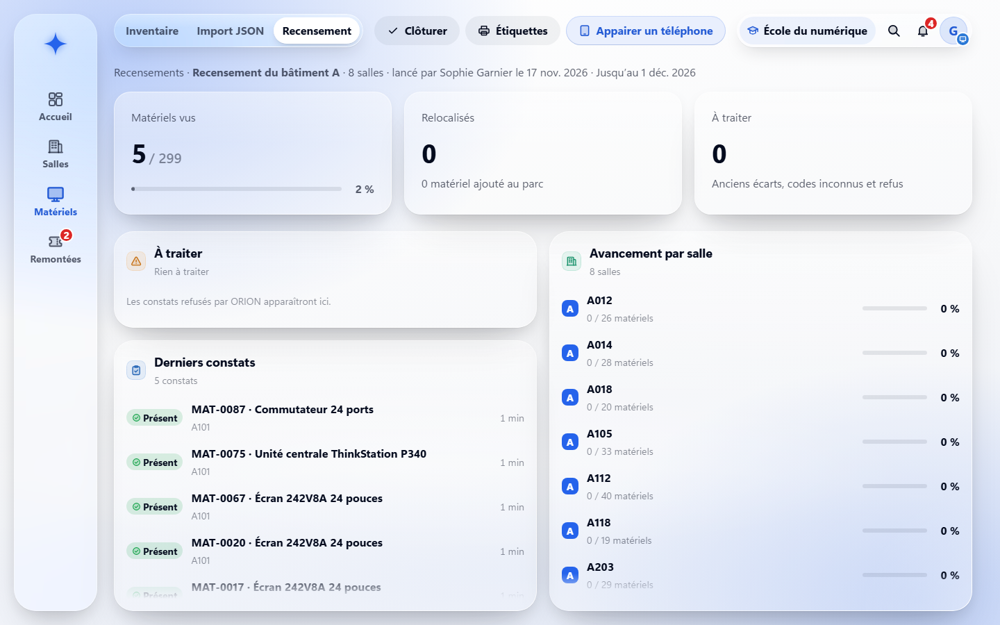

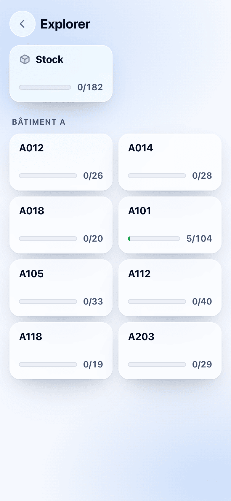

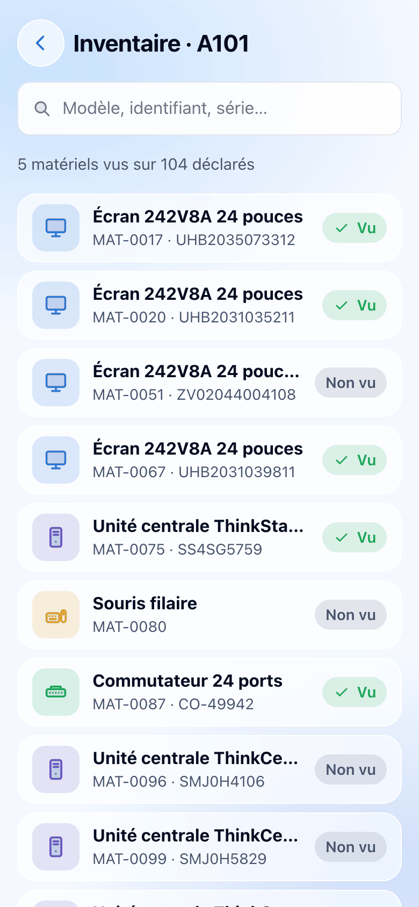

[Diagramme d’activité – Recenser le parc](08-DIAGRAMMES-ACTIVITE-CAS-UTILISATION.md#7-recenser-le-parc)

### Préconditions

- Le gestionnaire est connecté à ORION.
- Il dispose de son téléphone professionnel.

### Scénario nominal

| Acteur | ORION |
| --- | --- |
| 1. Le gestionnaire ouvre **Matériels › Recensement**. | 2. ORION présente les recensements de l’école avec leur périmètre, leur échéance, leur avancement et le nombre de constats à traiter. |
| 3. Le gestionnaire choisit **Nouveau recensement**, garde ou modifie le nom proposé, choisit **Toute l’école** ou **Salles choisies** (par salle ou par bâtiment), puis **Lancer le recensement**. | 4. ORION ouvre le recensement et présente son bilan. |
| 5. Le gestionnaire clique sur **Appairer un téléphone**. | 6. ORION affiche le QR code d’appairage, valable jusqu’à l’échéance, et **Copier le lien**. |
| 7. Le gestionnaire scanne le QR code avec son téléphone, puis clique sur **Étiquettes**. | 8. ORION lie le téléphone au recensement (UC-GEST-06) et affiche, pour impression, les QR codes des salles du recensement et du stock, à coller à leur entrée. |
| 9. Dans chaque salle, ou au stock, le gestionnaire scanne le QR code du lieu, puis choisit **Faire le recensement** et scanne les matériels ; pour un matériel du lieu, il choisit **Confirmer la présence**. | 10. ORION reçoit chaque scan comme un constat daté par le serveur et présente le bilan : matériels vus sur matériels attendus, relocalisés et ajoutés au parc, constats à traiter, avancement par salle et derniers constats. |
| 11. Le gestionnaire traite les anciens constats : pour un matériel vu dans un autre lieu, **Remettre au stock** ou **Ramener dans <salle d’affectation>** (déplacement à confirmer), ou **Réaffecter ici** (immédiat ; **Ranger au stock** s’il a été vu au stock) ; pour un ancien code inconnu, **Ajouter au parc**, qui ouvre la fiche du matériel préremplie, ou **Écarter** ; pour un constat refusé, **Traité**. | 12. ORION applique chaque traitement, daté, attribué au gestionnaire et définitif. |
| 13. Le gestionnaire clique sur **Clôturer** et confirme. | 14. ORION clôt le recensement : les téléphones appairés ne peuvent plus envoyer de constats. |

### Scénario alternatif 1 — matériel affecté ailleurs ou code inconnu

| Étape | Déroulement |
| --- | --- |
| 9a1.1 | Le gestionnaire scanne un matériel affecté ailleurs ou un code inconnu. |
| 9a1.2 | ORION le traite comme pendant une installation (UC-GEST-04, scénarios alternatifs 1 et 2). |
| Suite | Retour à l’étape 9. |

### Scénario alternatif 2 — code inconnu scanné plusieurs fois

| Étape | Déroulement |
| --- | --- |
| 11a2.1 | Un même code inconnu a été scanné plusieurs fois. |
| 11a2.2 | ORION le présente sur une seule ligne (« Vu n fois »), traitée en une fois ; si son numéro de série est déjà au parc, **Ajouter au parc** propose seulement de marquer le constat traité, sans doublon. |
| Suite | Retour à l’étape 11. |

### Scénario d’exception 1 — matériel hors service vu ailleurs

| Étape | Déroulement |
| --- | --- |
| 11e1.1 | Le constat porte sur un matériel hors service vu hors de son lieu. |
| 11e1.2 | ORION ne permet que de le remettre au stock. |
| Suite | Retour à l’étape 11. |

### Scénario d’exception 2 — scan trop ancien

| Étape | Déroulement |
| --- | --- |
| 9e2.1 | Un scan transmis après une période hors connexion est plus ancien que la dernière information connue sur le matériel. |
| 9e2.2 | ORION refuse le constat. |
| Suite | Retour à l’étape 9. |

### Questions ouvertes

- Révocation d’un téléphone appairé perdu ou remplacé.

## UC-GEST-06 — Utiliser RIGEL sur le téléphone

**En tant que** gestionnaire, **je souhaite** utiliser RIGEL sur mon téléphone professionnel pour scanner les lieux et les matériels **afin de** réaliser sur place une installation ou un recensement, même sans réseau.

- **Déclencheur :** le gestionnaire ouvre RIGEL sur son téléphone professionnel.
- **Acteurs secondaires :** aucun.

### Critères d’acceptation

- Chaque scan devient un constat transmis à ORION, qui l’intègre au nom du gestionnaire, même s’il a été fait hors connexion.
- Chaque action s’affiche aussitôt sur le téléphone.
- La lecture du numéro de série ne valide jamais seule : le gestionnaire choisit le matériel ou corrige le texte.

### Règles de gestion

RG-87, RG-93, RG-94, RG-95 et RG-96.

### Besoins non fonctionnels

- Aucune connexion n’est demandée sur le téléphone : le QR code d’appairage donne accès à la seule opération, jusqu’à son échéance.
- Hors connexion, les constats attendent sur le téléphone ; ils sont chiffrés à l’envoi.
- La synchronisation est automatique à l’ouverture, au retour du réseau et régulièrement, et possible à la demande.

### Interface

- Appairage : **Associer ce téléphone**, par scan du QR code affiché dans ORION ou saisie du lien d’appairage.
- Accueil : opération (installation ou recensement, école, nom, échéance), état de la synchronisation, **Scanner** (salle ou matériel), **Explorer** (salles et stock) et **Saisie manuelle**.
- Détail d’un lieu : **Faire le recensement** (ou **Réaliser l’installation**) et **Voir l’inventaire** : matériels déclarés, filtrables, chacun « Vu », « Non vu », « En cours d’installation » ou vu dans un autre lieu, puis les matériels vus ici mais affectés ailleurs.
- Scanner : lecture en continu des QR codes, Data Matrix et codes-barres ; **Numéro de série**, **Lire le numéro** et **Rechercher**.
- Fiche d’un matériel, avec les seules actions utiles dans le lieu ouvert, ou **Lieu constaté** et **Constater ici** hors d’un lieu ; saisie d’un matériel inconnu.
- **Synchronisation** : constats à intégrer, constats intégrés avec leur résultat, **Synchroniser** ; **Dissocier ce téléphone**.

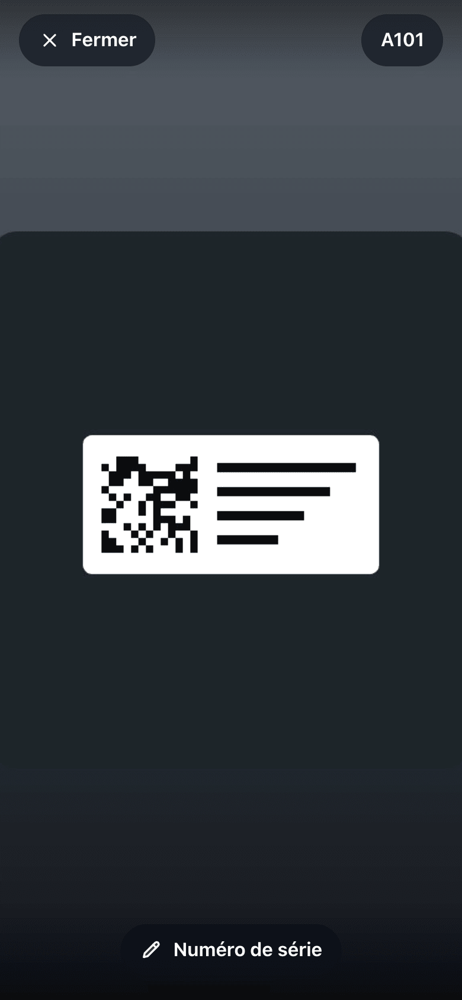

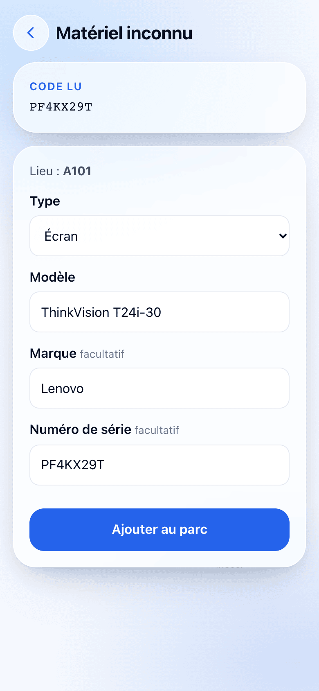

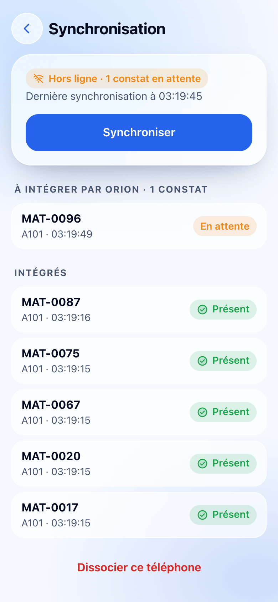

### Préconditions

- Une installation ou un recensement est en cours.
- ORION affiche son QR code d’appairage.

### Scénario nominal

| Acteur | ORION |
| --- | --- |
| 1. Le gestionnaire ouvre RIGEL sur un téléphone non lié. | 2. RIGEL affiche **Associer ce téléphone**. |
| 3. Le gestionnaire scanne le QR code d’appairage affiché dans ORION, ou saisit le lien d’appairage. | 4. ORION lie le téléphone à l’opération, sans demander de connexion ; l’accueil présente l’opération (installation ou recensement, école, nom, échéance), l’état de la synchronisation et les accès **Scanner**, **Explorer** et **Saisie manuelle**. |
| 5. Le gestionnaire choisit **Explorer**. | 6. RIGEL présente le stock et les salles de l’opération par bâtiment, avec les matériels vus sur les matériels attendus. |
| 7. Le gestionnaire ouvre une salle ou le stock. | 8. RIGEL présente son détail : **Faire le recensement** (ou **Réaliser l’installation**), qui ouvre le scanner dans ce lieu, et **Voir l’inventaire**. |
| 9. Le gestionnaire scanne une étiquette ou un matériel, lit un numéro de série par **Numéro de série** puis **Lire le numéro**, ou saisit un identifiant ORION, un numéro de série ou un code par **Saisie manuelle**. | 10. RIGEL ouvre le lieu de l’étiquette, la fiche du matériel (type, identifiant ORION, marque, numéro de série, affectation, état) ou le signalement du code inconnu ; pour un numéro de série lu, il propose les matériels correspondants, parmi lesquels le gestionnaire choisit, ou dont il corrige le numéro avant **Rechercher**. |
| 11. Sur la fiche, le gestionnaire choisit l’une des seules actions utiles dans le lieu ouvert (UC-GEST-04, étape 11 et scénario alternatif 1 ; UC-GEST-05, étape 9). | 12. RIGEL affiche aussitôt l’action et la transmet à ORION comme un constat. |
| 13. Le gestionnaire ouvre **Synchronisation** et, s’il le souhaite, clique sur **Synchroniser**. | 14. RIGEL présente les constats à intégrer par ORION (« En attente », « Transmis ») et les constats intégrés avec leur résultat (« Présent », « Installation confirmée », « Relocalisé », « Rangé au stock », « Retour lancé », « Mise au stock lancée », « Ajouté au parc » ou « Refusé » avec son motif). |

### Scénario alternatif 1 — fiche ouverte hors d’un lieu

| Étape | Déroulement |
| --- | --- |
| 11a1.1 | La fiche du matériel est ouverte hors d’un lieu ; RIGEL demande le **Lieu constaté**. |
| 11a1.2 | Le gestionnaire choisit le lieu, puis **Constater ici**. |
| Suite | Retour à l’étape 12. |

### Scénario alternatif 2 — code inconnu

| Étape | Déroulement |
| --- | --- |
| 11a2.1 | Pour un code inconnu, le gestionnaire choisit **Installer ici**. |
| 11a2.2 | RIGEL demande le lieu, s’il n’est pas déjà dans un lieu, le type et le modèle (obligatoire), ainsi que la marque et le numéro de série, préremplis lorsqu’ils figurent sur l’étiquette lue. |
| 11a2.3 | Le gestionnaire complète les informations, puis choisit **Ajouter au parc**. |
| Suite | Retour à l’étape 12. |

### Scénario alternatif 3 — nouveau QR code d’appairage

| Étape | Déroulement |
| --- | --- |
| 3a3.1 | Le gestionnaire lit un nouveau QR code d’appairage pendant une autre opération. |
| 3a3.2 | RIGEL demande confirmation : **Remplacer** efface les données du téléphone, dont les constats non intégrés, signalés ; **Garder l’appairage actuel** ignore le nouveau QR code. |
| Suite | Retour à l’étape 4. |

### Scénario alternatif 4 — dissocier le téléphone

| Étape | Déroulement |
| --- | --- |
| 5a4.1 | Le gestionnaire choisit **Dissocier ce téléphone** et confirme. |
| 5a4.2 | RIGEL efface du téléphone les données de l’opération et les constats non intégrés. |
| Suite | Fin du cas d’utilisation. |

### Scénario d’exception 1 — opération close ou expirée

| Étape | Déroulement |
| --- | --- |
| 5e1.1 | L’opération est close ou a expiré. |
| 5e1.2 | RIGEL indique « Accès retiré » et propose de dissocier le téléphone. |
| Suite | Fin du cas d’utilisation. |

### Scénario d’exception 2 — accès à la caméra refusé

| Étape | Déroulement |
| --- | --- |
| 9e2.1 | L’accès à la caméra est refusé. |
| 9e2.2 | RIGEL l’indique et propose **Réessayer** ; la saisie manuelle reste disponible. |
| Suite | Retour à l’étape 9. |

### Questions ouvertes

- Révocation d’un téléphone appairé perdu ou remplacé.

## UC-GEST-07 — Suivre son activité : tableaux de bord et notifications

**En tant que** gestionnaire, **je souhaite** consulter mes notifications et mes tableaux de bord **afin de** repérer ce qui demande une action : remontées, déplacements, garanties.

- **Déclencheur :** connexion à ORION ou consultation de l’accueil.
- **Acteurs secondaires :** aucun.

### Critères d’acceptation

- Le gestionnaire est informé dans ORION de chaque nouvelle remontée, des matériels à déplacer et des garanties à surveiller.
- Il reçoit les alertes de garantie, comme l’administrateur et le super administrateur.
- Chaque notification et chaque carte de tableau de bord mènent à l’écran concerné.

### Règles de gestion

RG-24, RG-36 à RG-38, RG-67, RG-84 et RG-86.

### Besoins non fonctionnels

- Aucune notification n’est envoyée par courriel.
- Les préférences d’affichage sont conservées pour les connexions suivantes.

### Interface

- Cloche de la barre supérieure, avec le nombre de notifications et leur résumé par sujet ; page **Notifications**, regroupée par sujet : nouvelles remontées, matériels à déplacer, garanties échues ou proches de l’échéance.
- **Accueil › Mon tableau de bord** : stock, matériels hors service, remontées à traiter et avancement de l’installation des salles, d’un coup d’œil ; **Personnaliser** et **Terminé** ; **+** du sous-menu de l’accueil.
- Tableaux **Parc** (état du parc et des stocks, part hors service par bâtiment, salles à surveiller) et **Remontées**.
- Recherche globale et menu du compte dans la barre supérieure.

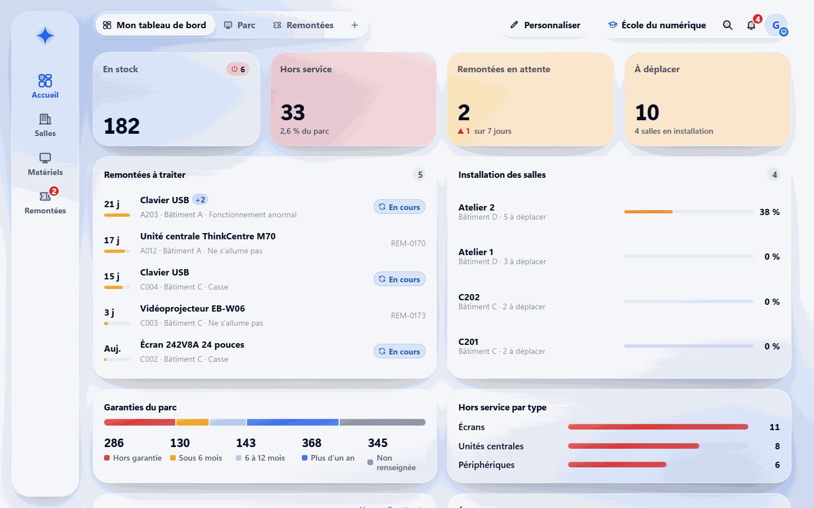

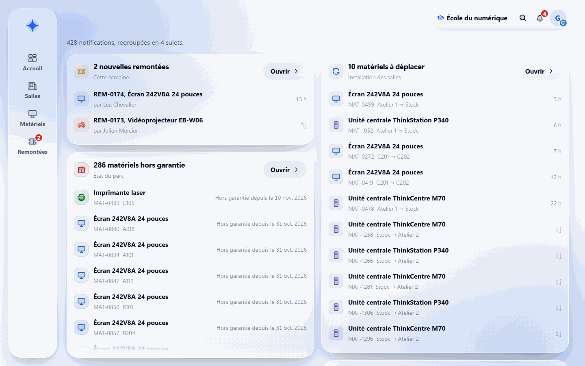

[Diagramme d’activité – Personnaliser ses tableaux de bord](08-DIAGRAMMES-ACTIVITE-CAS-UTILISATION.md#19-personnaliser-ses-tableaux-de-bord)

### Préconditions

- Le gestionnaire est connecté.

### Scénario nominal

| Acteur | ORION |
| --- | --- |
| 1. Le gestionnaire clique sur la cloche de la barre supérieure, qui indique le nombre de ses notifications. | 2. ORION ouvre leur résumé par sujet : nouvelles remontées de la semaine, matériels à déplacer, matériels hors garantie, matériels arrivant à échéance dans les six mois. |
| 3. Le gestionnaire clique sur **Voir toutes les notifications**. | 4. ORION ouvre la page **Notifications**, qui les détaille ; chaque élément mène à l’écran concerné. |
| 5. Le gestionnaire ouvre **Accueil › Mon tableau de bord**. | 6. ORION présente notamment le stock, les matériels hors service, les remontées en attente, les matériels à déplacer, l’installation des salles et les garanties du parc. |
| 7. Le gestionnaire clique sur **Personnaliser**, déplace, redimensionne ou retire une carte, en ajoute depuis un catalogue par catégorie ou revient à la disposition par défaut, puis clique sur **Terminé**. | 8. ORION enregistre la disposition. |
| 9. Le gestionnaire ouvre les tableaux **Parc** et **Remontées**. | 10. ORION présente respectivement l’état du parc et des stocks, la part hors service par bâtiment et les salles à surveiller, puis la file des remontées. |

### Scénario alternatif 1 — créer un autre tableau de bord

| Étape | Déroulement |
| --- | --- |
| 7a1.1 | Le gestionnaire clique sur le **+** du sous-menu de l’accueil. |
| 7a1.2 | ORION crée un autre tableau, que le gestionnaire peut ensuite renommer ou supprimer. |
| Suite | Retour à l’étape 9. |

### Scénario alternatif 2 — rechercher dans ORION

| Étape | Déroulement |
| --- | --- |
| 9a2.1 | Le gestionnaire recherche, dans la barre supérieure, une salle, un matériel (y compris du stock) ou une remontée par son nom, son modèle, son identifiant ORION, son numéro de série, son numéro ou sa description. |
| 9a2.2 | ORION trouve l’élément et ouvre l’écran concerné. |
| Suite | Fin du cas d’utilisation. |

### Scénario alternatif 3 — régler ses préférences ou se déconnecter

| Étape | Déroulement |
| --- | --- |
| 9a3.1 | Le gestionnaire ouvre le menu du compte. |
| 9a3.2 | ORION rappelle son nom, son profil et son école, et propose l’ambiance (Orion ou Minarm), le mode clair ou sombre, la couleur d’accent de l’ambiance Orion, le verre (liquide ou opaque) et **Se déconnecter**. |
| 9a3.3 | Le gestionnaire règle ses préférences ou choisit **Se déconnecter**. |
| 9a3.4 | ORION conserve les préférences pour ses connexions suivantes, ou le déconnecte. |
| Suite | Fin du cas d’utilisation. |

### Questions ouvertes

- Indicateurs attendus et règles de calcul des tableaux de bord.

## Écrans de l’application

Les écrans du gestionnaire sont présentés dans la section « Interface » du cas d’utilisation qui les emploie. Aucun écran ne lui propose la suppression d’un matériel, la supervision, l’administration des postes ni la gestion des comptes.

| Écran | Cas d’utilisation |
| --- | --- |
| Mon tableau de bord, notifications | [UC-GEST-07](#uc-gest-07--suivre-son-activité--tableaux-de-bord-et-notifications) |
| Inventaire, ajout d’un matériel, détail d’une salle, stock | [UC-GEST-01](#uc-gest-01--gérer-le-parc-matériel) |
| Import JSON | [UC-GEST-02](#uc-gest-02--importer-des-matériels-en-json) |
| Backlog et détail d’une remontée | [UC-GEST-03](#uc-gest-03--consulter-et-traiter-les-remontées) |
| Déplacements ; RIGEL : salle ouverte, matériel affecté ailleurs, code inconnu | [UC-GEST-04](#uc-gest-04--installer-une-salle-avec-rigel) |
| Bilan d’un recensement ; RIGEL : salles de l’opération, inventaire d’une salle | [UC-GEST-05](#uc-gest-05--recenser-le-parc-avec-rigel-et-traiter-les-anciens-constats) |
| RIGEL : appairage, accueil, scanner, saisie d’un matériel inconnu, synchronisation | [UC-GEST-06](#uc-gest-06--utiliser-rigel-sur-le-téléphone) |

## Contraintes transversales

- Application web utilisée avec les versions de Firefox installées sur les postes de l’équipe.
- Réseau interne NP disposant d’un accès à Internet.
- Authentification via MindefConnect ; modalités d’intégration à préciser (cadrage § 18).
- Un seul profil par utilisateur.
- RIGEL s’utilise sur le téléphone professionnel du gestionnaire, appairé à ORION ; ses échanges avec ORION sont chiffrés.

## Sources

[Consignes du projet](../../01-CONTEXTE/02-CONSIGNES.md), [cadrage §§ 3 à 7, 13 à 18 et 23](../../01-CONTEXTE/03-CADRAGE.md), [glossaire](../../01-CONTEXTE/01-GLOSSAIRE.md), [règles de gestion](01-REGLES-DE-GESTION.md), [DCU — Gestion du parc](03-DCU-GESTION-PARC.md), [DCU — Remontées utilisateur](06-DCU-REMONTEES-UTILISATEUR.md), [matrice des droits](11-MATRICE-DROITS.md), [diagrammes d’états](../03-ANALYSE/01-DIAGRAMMES-ETATS.md) et application ORION.
