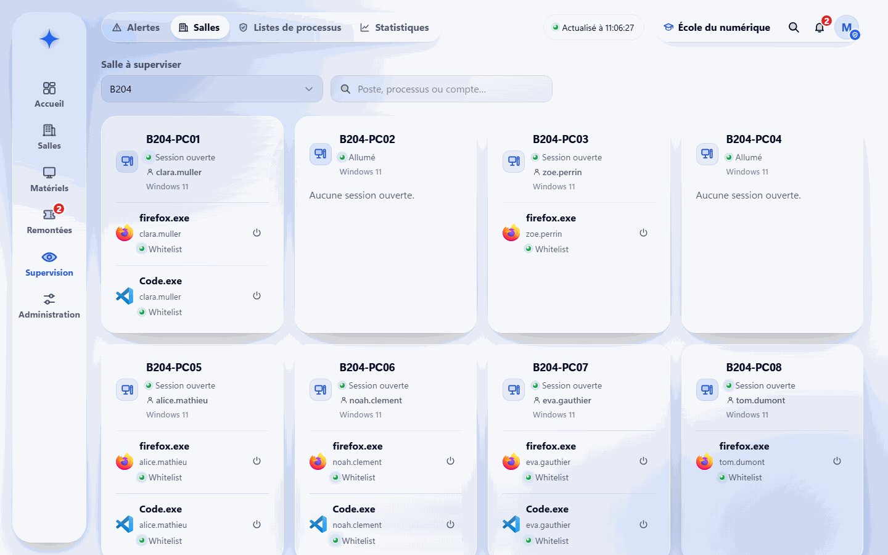
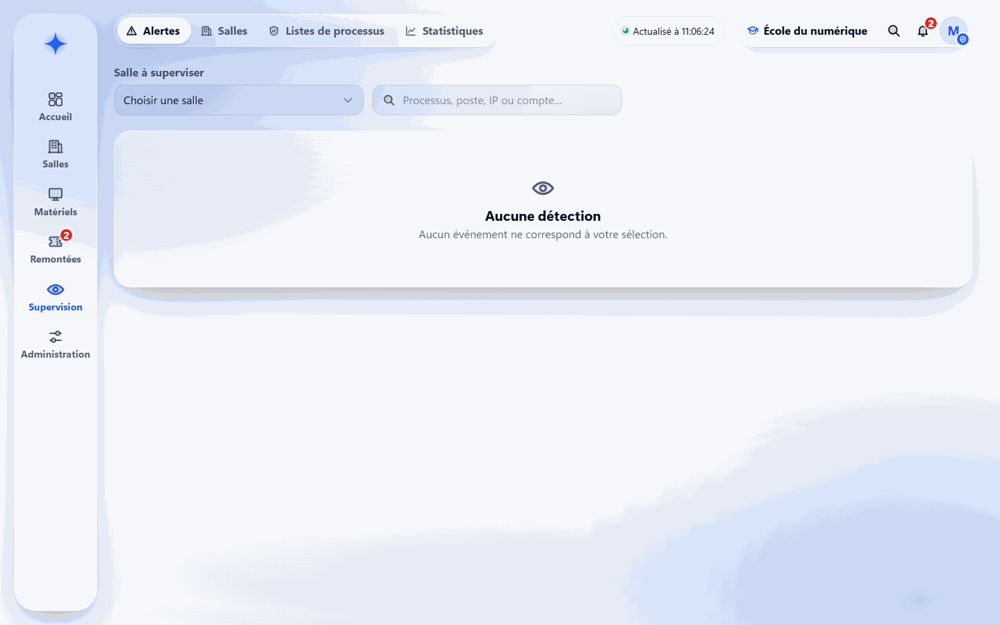
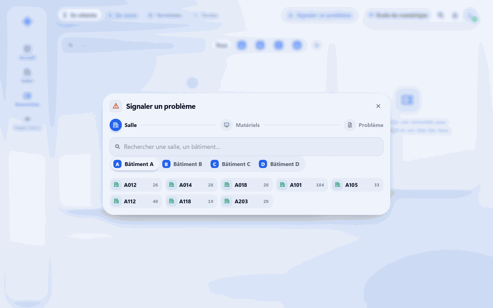
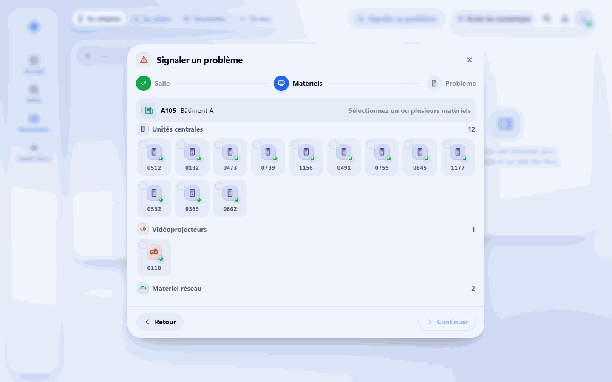
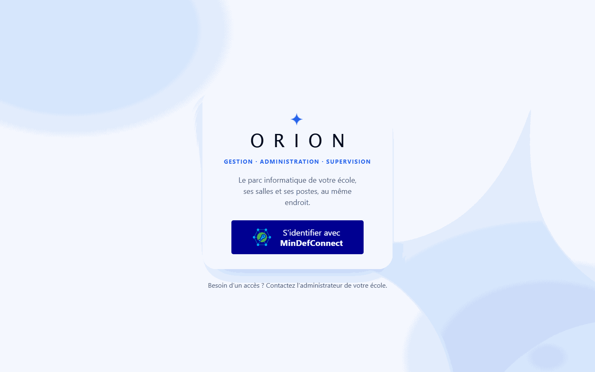
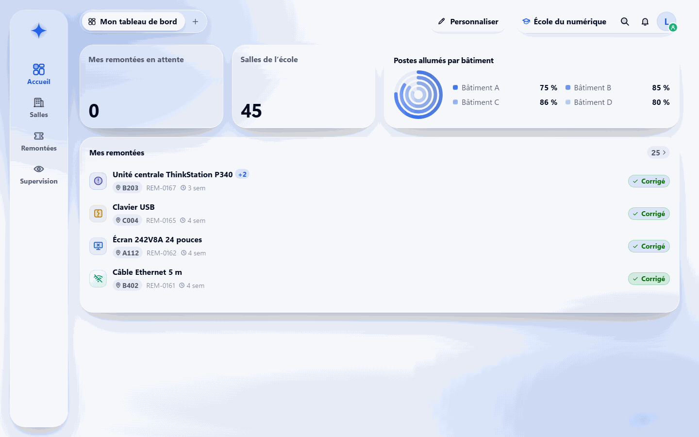
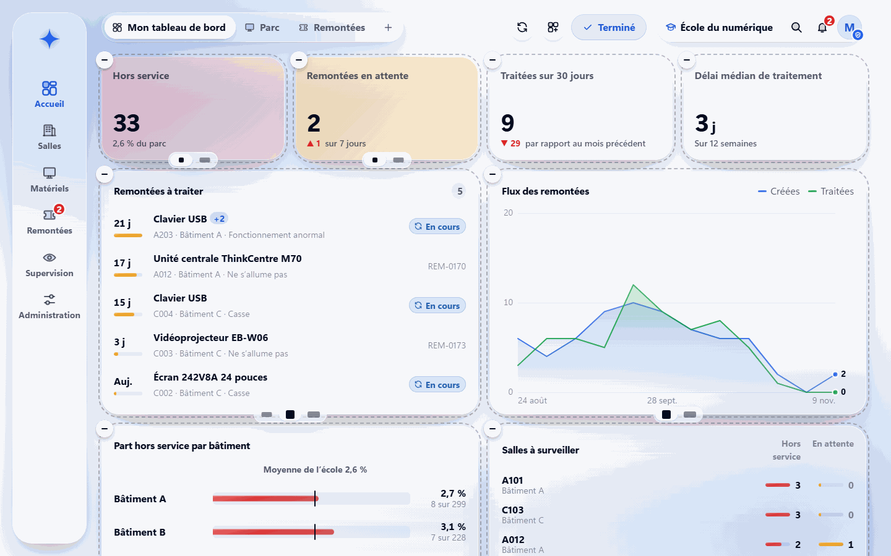
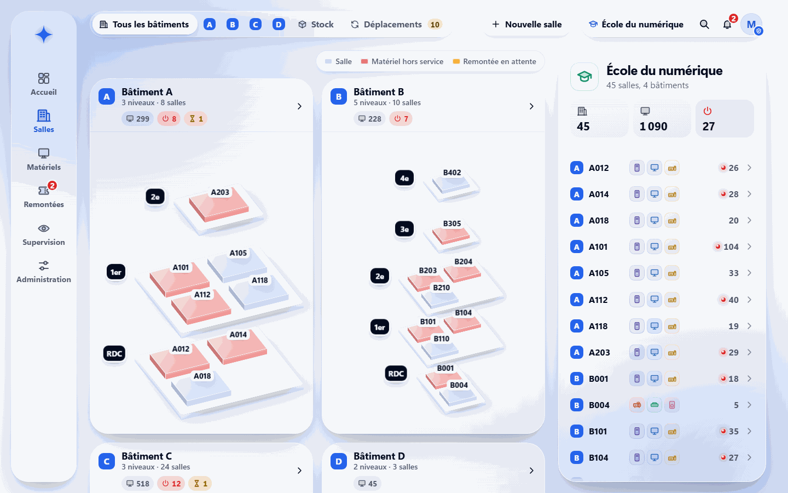
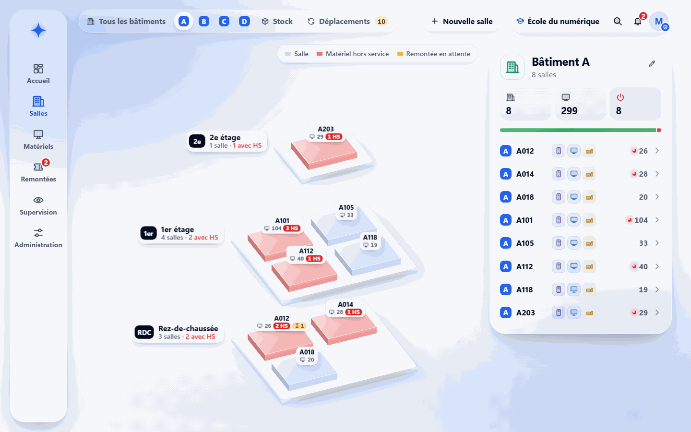

# Fiche descriptive — Formateur

<!-- version:debut : généré par versions.py, ne pas modifier à la main -->
| Version | Mise à jour | Destination | Dernière évolution | Historique |
| --- | --- | --- | --- | --- |
| 4.0 | 16/11/2026 | Production destinée à la remise | Adopter le format formel des cas d’utilisation (récit, critères, scénarios numérotés) ; Adopter le format formel des cas d’utilisation (récit, critères, scénarios numérotés) | [13 versions](../../../archive/README.md#13-fiche-descriptive-formateur) |
<!-- version:fin -->

- **Statut :** établie à partir des décisions en vigueur et de l’application ORION.
- **Profil :** formateur.
- **Rattachement :** une école.
- **Périmètre :** toutes les salles de son école, après sélection d’une salle ; aucune vue globale de supervision.
- **Finalité :** superviser les postes de la salle où il enseigne et signaler les problèmes rencontrés sur les matériels.

## Périmètre fonctionnel

| Domaine | Capacités |
| --- | --- |
| Accès | Connexion par MindefConnect, avec un compte ORION actif de son école ; recherche globale, préférences d’affichage et déconnexion |
| Tableaux de bord | « Mon tableau de bord » personnalisable (ses remontées, salles de l’école, postes allumés par bâtiment) et tableaux ajoutés, renommés ou supprimés par le compte |
| Salles | Vue éclatée des bâtiments, détail d’une salle et de ses matériels, sans modification ; recherche limitée aux salles et aux matériels affectés à une salle, menant à la salle |
| Supervision | **Alertes** et **Salles** : choisir une salle, consulter l’état de ses postes et leurs processus utilisateur, demander l’arrêt d’un processus, consulter les détections de la salle |
| Remontées | Créer une remontée sur des matériels d’une salle ; suivre ses propres remontées ; consulter, télécharger et imprimer leur état des lieux |
| Notifications | Prise en charge et fin de traitement de ses remontées |
| Exclusions | Inventaire et stock, modification du parc, RIGEL, traitement des remontées, listes de processus, statistiques, administration des postes et comptes ORION |

Les droits détaillés sont consolidés dans la [matrice des droits](11-MATRICE-DROITS.md).

## UC-FORM-01 — Superviser une salle et ses processus utilisateur

**En tant que** formateur, **je souhaite** consulter l’état des postes d’une salle et demander l’arrêt d’un processus utilisateur **afin de** connaître l’état des postes de la salle où j’enseigne et intervenir sur les processus utilisateur.

- **Déclencheur :** le formateur ouvre **Supervision › Salles**, ou suit le lien des postes allumés depuis le détail d’une salle.
- **Acteurs secondaires :** les postes de la salle, qui remontent leur état et exécutent l’arrêt demandé.

### Critères d’acceptation

- Le formateur dispose de l’état courant de la salle choisie.
- L’arrêt manuel porte uniquement sur un processus utilisateur présenté par ORION ; son état est affiché.
- Seul un processus en cours peut être arrêté, et un seul arrêt peut être demandé à la fois pour un même processus.
- Un processus de la whitelist reste visible sans historique ; un processus non référencé reste autorisé, visible et historisé.
- Les processus du système d’exploitation ne sont ni présentés ni proposés à l’arrêt.

### Règles de gestion

RG-19, RG-20, RG-25, RG-31 à RG-33, RG-41 à RG-49, RG-51 à RG-54, RG-57 à RG-59, RG-69, RG-81 et RG-88.

### Besoins non fonctionnels

- Les données de supervision sont actualisées automatiquement toutes les cinq secondes ; l’en-tête indique l’heure de la dernière actualisation.
- Un poste sans remontée depuis trente secondes est considéré comme déconnecté.

### Interface

- **Supervision › Salles** : sélecteur **Salle à superviser**, puis une carte par poste avec son état et ses processus.
- Recherche d’un poste, d’un processus (y compris par le nom de son application) ou d’un compte.
- Bouton d’arrêt d’un processus, remplacé par « Arrêt demandé » une fois l’arrêt demandé.
- Le formateur ne dispose que des onglets **Alertes** et **Salles** ; aucune vue globale de supervision.

[Diagramme d’activité – Superviser une salle et arrêter un processus](08-DIAGRAMMES-ACTIVITE-CAS-UTILISATION.md#11-superviser-une-salle-et-arrêter-un-processus)

### Préconditions

- Le formateur est connecté.
- La salle appartient à son école.
- Les postes remontent leur état à ORION.

### Scénario nominal

| Acteur | ORION |
| --- | --- |
| 1. Le formateur ouvre **Supervision › Salles** et choisit la salle dans **Salle à superviser**. | 2. ORION affiche une carte par poste avec son nom et son état : « Connecté » avec le compte Windows de la session, « Allumé » sans session, « Poste déconnecté » ou « Matériel hors service ». Pour chaque poste connecté, il liste les processus utilisateur en cours : nom, compte Windows et classement (« Whitelist », « Blacklist » ou « Non référencé »). |
| 3. Le formateur recherche au besoin un poste, un processus, y compris par le nom de son application, ou un compte. | 4. ORION présente les postes et les processus correspondants. |
| 5. Le formateur clique sur le bouton d’arrêt d’un processus. | 6. ORION confirme « Arrêt demandé au poste » et affiche « Arrêt demandé » à la place du bouton. |
| 7. Le poste exécute l’arrêt et renvoie son résultat. | 8. ORION retire le processus de la liste une fois arrêté. |

### Scénario alternatif 1 — aucune salle choisie

| Étape | Déroulement |
| --- | --- |
| 2a1.1 | Le formateur n’a pas encore choisi de salle. |
| 2a1.2 | ORION l’invite à « Choisir votre salle ». |
| Suite | Retour à l’étape 1. |

### Scénario alternatif 2 — poste déconnecté

| Étape | Déroulement |
| --- | --- |
| 2a2.1 | Un poste n’a rien remonté depuis trente secondes. |
| 2a2.2 | ORION le maintient affiché comme « Poste déconnecté », sans processus (« Aucun processus disponible »). |
| Suite | Retour à l’étape 3. |

### Scénario alternatif 3 — processus de la blacklist

| Étape | Déroulement |
| --- | --- |
| 2a3.1 | Un processus classé dans la blacklist est lancé sur un poste de la salle. |
| 2a3.2 | ORION en déclenche l’arrêt automatique, sans confirmation ni justification et sans prévenir l’utilisateur du poste. |
| Suite | Retour à l’étape 3. |

### Scénario alternatif 4 — unité centrale hors service

| Étape | Déroulement |
| --- | --- |
| 2a4.1 | L’unité centrale d’un poste est hors service. |
| 2a4.2 | ORION présente le poste comme « Matériel hors service » : il est éteint et ses processus sont arrêtés. |
| Suite | Retour à l’étape 3. |

### Scénario d’exception 1 — arrêt impossible

| Étape | Déroulement |
| --- | --- |
| 5e1.1 | Le processus n’est plus en cours, ou un arrêt est déjà demandé pour lui. |
| 5e1.2 | ORION ne propose pas de nouvel arrêt. |
| Suite | Retour à l’étape 3. |

### Questions ouvertes

- Solution d’administration à distance (dont l’agent Windows M42 envisagé, non réalisé), flux, comptes techniques et sécurisation des échanges.
- Présentation au formateur de l’échec d’un arrêt manuel.
- Données supplémentaires à remonter et fonctionnement sur des segments réseau isolés.
- Contraintes internes ou juridiques liées à la surveillance de l’activité.

## UC-FORM-02 — Consulter les détections de processus d’une salle

**En tant que** formateur, **je souhaite** consulter les détections de processus de la salle que je supervise **afin de** prendre connaissance des processus interdits et non référencés lancés dans la salle, et du résultat de l’arrêt automatique.

- **Déclencheur :** le formateur ouvre **Supervision › Alertes**.
- **Acteurs secondaires :** aucun.

### Critères d’acceptation

- Le formateur peut consulter les détections de la salle qu’il supervise.
- Chaque détection présente le processus et son classement, le poste et la salle, l’adresse IP, le compte Windows, la date de détection et le résultat.
- Le formateur ne reçoit pas de notification de processus interdit ; il consulte les détections de la salle choisie.
- Le traitement, l’acquittement ou la clôture d’une détection ne sont pas définis.

### Règles de gestion

RG-38, RG-52 à RG-56 et RG-69.

### Besoins non fonctionnels

- Les détections sont conservées trente jours.

### Interface

- **Supervision › Alertes** : liste des détections de la salle choisie, des plus récentes aux plus anciennes.
- Filtres par processus, poste, adresse IP ou compte.

### Préconditions

- Le formateur est connecté.
- Il a choisi une salle de son école.

### Scénario nominal

| Acteur | ORION |
| --- | --- |
| 1. Le formateur ouvre **Supervision › Alertes**. | 2. ORION liste les détections de la salle choisie, des plus récentes aux plus anciennes : processus et classement, poste et salle, adresse IP, compte Windows, date de détection et résultat (« Arrêt réussi », « Arrêt en échec » ou « Arrêt en cours » pour la blacklist, « Historisé » pour un processus non référencé). |
| 3. Le formateur filtre par processus, poste, adresse IP ou compte. | 4. ORION présente les détections correspondantes. |

### Scénario alternatif 1 — aucune salle choisie

| Étape | Déroulement |
| --- | --- |
| 2a1.1 | Le formateur n’a pas choisi de salle. |
| 2a1.2 | ORION rappelle que « les alertes concernent la salle que vous supervisez ». |
| Suite | Retour à l’étape 1. |

### Questions ouvertes

- Niveaux de gravité, statuts, regroupement et acquittement des détections.

## UC-FORM-03 — Créer une remontée et suivre son avancement

**En tant que** formateur, **je souhaite** déclarer un problème sur un ou plusieurs matériels d’une salle et suivre sa résolution **afin que** le problème soit traité par le gestionnaire ou un administrateur de l’école.

- **Déclencheur :** le formateur constate un problème, puis clique sur **Signaler un problème** dans **Remontées** ou dans le détail d’une salle.
- **Acteurs secondaires :** le gestionnaire de l’école, notifié de la remontée ; le gestionnaire ou un administrateur, qui la prend en charge puis la termine.

### Critères d’acceptation

- La remontée conserve un auteur unique et ses matériels.
- Le formateur suit uniquement ses propres remontées et reçoit leurs notifications de changement de statut.
- Une remontée concerne des matériels d’une seule école et n’a qu’un statut : « en attente », « en cours », « remplacé » ou « corrigé ». Une remontée terminée ne change plus de statut.
- Le formateur ne signale que des matériels affectés à une salle, jamais du stock ; la localisation présentée est celle de chaque matériel.
- Une fois transmise, la remontée n’est ni modifiée ni supprimée.
- Le formateur ne traite pas la remontée et ne consulte ni les remontées ni les états des lieux d’autres auteurs.

### Règles de gestion

RG-11 à RG-14, RG-21, RG-23, RG-34 à RG-38, RG-63, RG-64, RG-66, RG-69, RG-79, RG-80 et RG-89.

### Besoins non fonctionnels

- L’état des lieux est produit à chaque demande, avec les informations du moment ; il n’est pas conservé.
- Les notifications sont présentées dans ORION ; aucun courriel n’est envoyé.

### Interface

- **Signaler un problème** : parcours en trois étapes **Salle**, **Matériels** et **Problème**, puis **Transmettre la remontée**.
- **Remontées** : onglets **En attente**, **En cours**, **Terminées** et **Toutes**, limités aux remontées du formateur ; détail avec les matériels, leur localisation, le suivi daté et l’accès à l’**état des lieux** PDF.

[Diagramme d’activité – Créer une remontée](08-DIAGRAMMES-ACTIVITE-CAS-UTILISATION.md#8-créer-une-remontée)

[Diagramme d’activité – Consulter ou télécharger le PDF d’état des lieux](08-DIAGRAMMES-ACTIVITE-CAS-UTILISATION.md#10-consulter-ou-télécharger-le-pdf-détat-des-lieux)

### Préconditions

- Le formateur est connecté.
- Il peut sélectionner au moins un matériel de son école.

### Scénario nominal

| Acteur | ORION |
| --- | --- |
| 1. Le formateur clique sur **Signaler un problème** dans **Remontées**. | 2. ORION ouvre un parcours en trois étapes, à l’étape **Salle** ; le stock n’est pas proposé. |
| 3. Le formateur recherche une salle, ou choisit un bâtiment puis une salle. | 4. ORION présente, à l’étape **Matériels**, les matériels de la salle regroupés par type, avec leur état. |
| 5. Le formateur sélectionne un ou plusieurs matériels, puis clique sur **Continuer**. | 6. ORION présente l’étape **Problème**. |
| 7. Le formateur choisit le type de problème, obligatoire (« Ne s’allume pas », « Pas d’image », « Connexion », « Casse », « Fonctionnement anormal » ou « Autre »), saisit la description, obligatoire, puis clique sur **Transmettre la remontée**. | 8. ORION attribue le numéro, enregistre le formateur comme auteur et la remontée « en attente », notifie le gestionnaire et confirme « REM-… transmise, état des lieux disponible ». |
| 9. Le formateur ouvre **Remontées**, retrouve ses remontées par onglet (**En attente**, **En cours**, **Terminées**, **Toutes**) et en ouvre une. | 10. ORION présente les matériels, leur localisation et le suivi daté. |
| 11. Le formateur ouvre l’**état des lieux**. | 12. ORION produit le PDF, que le formateur consulte, télécharge ou imprime. |
| 13. Le gestionnaire ou un administrateur prend en charge la remontée, puis en termine le traitement. | 14. ORION notifie le formateur dans ORION à la prise en charge, puis à la fin du traitement. |

### Scénario alternatif 1 — signalement depuis une salle

| Étape | Déroulement |
| --- | --- |
| 1a1.1 | Le formateur clique sur **Signaler un problème** dans le détail d’une salle. |
| 1a1.2 | ORION ouvre le parcours en reprenant la salle et les matériels sélectionnés. |
| Suite | Retour à l’étape 5. |

### Scénario alternatif 2 — type de problème « Autre »

| Étape | Déroulement |
| --- | --- |
| 7a2.1 | Le formateur choisit le type « Autre ». |
| 7a2.2 | ORION lui demande d’en préciser le libellé. |
| Suite | Retour à l’étape 7. |

### Scénario d’exception 1 — type ou description manquant

| Étape | Déroulement |
| --- | --- |
| 7e1.1 | Le type de problème ou la description n’est pas renseigné. |
| 7e1.2 | ORION ne permet pas de transmettre la remontée. |
| Suite | Retour à l’étape 7. |

### Questions ouvertes

- Priorités, pièces jointes et complément après création.
- Signature de l’état des lieux.

## UC-FORM-04 — Consulter les salles et son tableau de bord

**En tant que** formateur, **je souhaite** consulter mon tableau de bord, les salles de l’école et leur matériel **afin de** me repérer dans l’école, connaître le matériel d’une salle et suivre mon activité.

- **Déclencheur :** le formateur ouvre **Accueil** ou **Salles**, ou lance la recherche de la barre supérieure.
- **Acteurs secondaires :** aucun.

### Critères d’acceptation

- Le formateur retrouve une salle et son matériel sans pouvoir les modifier.
- Le formateur ne voit ni l’inventaire ni le stock ; il ne crée, ne modifie, n’affecte ni ne supprime aucun matériel ou salle.

### Règles de gestion

RG-37, RG-59, RG-66, RG-69, RG-78 et RG-84.

### Besoins non fonctionnels

- Les préférences d’affichage (ambiance, mode, couleur d’accent, verre) sont conservées pour les connexions suivantes.

### Interface

- **Connexion** : le formateur s’identifie par MindefConnect ; seul un compte ORION actif donne accès à l’application.
- **Accueil** : « Mon tableau de bord » (ses remontées et leur statut, salles de l’école, postes allumés par bâtiment), **Personnaliser** et **+** du sous-menu ; aucune vue globale de supervision.
- **Salles** : vue éclatée des bâtiments en niveaux superposés, où un clic sur une salle ouvre son détail ; bâtiment avec ses niveaux, ses salles et leurs compteurs, dont la liste permet d’ouvrir une salle ; détail d’une salle en consultation avec un accès à la supervision et à **Signaler un problème**.
- Barre supérieure : recherche globale, cloche des notifications et menu du compte.

[Diagramme d’activité – Se connecter par MindefConnect](08-DIAGRAMMES-ACTIVITE-CAS-UTILISATION.md#1-se-connecter-par-mindefconnect)

[Diagramme d’activité – Personnaliser ses tableaux de bord](08-DIAGRAMMES-ACTIVITE-CAS-UTILISATION.md#19-personnaliser-ses-tableaux-de-bord)

### Préconditions

- Le formateur est connecté.

### Scénario nominal

| Acteur | ORION |
| --- | --- |
| 1. Le formateur ouvre **Accueil**. | 2. ORION présente son tableau de bord : ses remontées et leur statut, les salles de l’école, les postes allumés par bâtiment. |
| 3. Le formateur ouvre **Salles**. | 4. ORION présente la vue éclatée des bâtiments ; une balise signale une salle avec du matériel hors service ou une remontée en attente. |
| 5. Le formateur ouvre un bâtiment, puis une salle. | 6. ORION affiche les matériels de la salle par type et ses postes allumés, avec un accès à la supervision de la salle et à **Signaler un problème**. |
| 7. Le formateur lance la recherche de la barre supérieure. | 8. ORION propose les salles, les matériels affectés à une salle et ses remontées ; un matériel mène à sa salle. |

### Scénario alternatif 1 — personnaliser le tableau de bord

| Étape | Déroulement |
| --- | --- |
| 2a1.1 | Le formateur clique sur **Personnaliser**, puis déplace, redimensionne, retire ou ajoute des cartes depuis un catalogue, et clique sur **Terminé**. |
| 2a1.2 | ORION enregistre la disposition. |
| Suite | Retour à l’étape 2. |

### Scénario alternatif 2 — créer un autre tableau de bord

| Étape | Déroulement |
| --- | --- |
| 2a2.1 | Le formateur clique sur le **+** du sous-menu de l’accueil. |
| 2a2.2 | ORION crée un autre tableau, que le formateur peut ensuite renommer ou supprimer. |
| Suite | Retour à l’étape 2. |

### Scénario alternatif 3 — consulter les notifications

| Étape | Déroulement |
| --- | --- |
| 2a3.1 | Le formateur clique sur la cloche de la barre supérieure, qui indique le nombre de ses notifications. |
| 2a3.2 | ORION en ouvre le résumé ; la page **Notifications** les détaille. |
| Suite | Retour à l’étape 2. |

### Scénario alternatif 4 — régler ses préférences ou se déconnecter

| Étape | Déroulement |
| --- | --- |
| 2a4.1 | Le formateur ouvre le menu du compte, qui rappelle son nom, son profil et son école. |
| 2a4.2 | ORION lui permet de régler l’ambiance (Orion ou Minarm), le mode clair ou sombre, la couleur d’accent de l’ambiance Orion et le verre (liquide ou opaque), puis enregistre ces préférences ; il propose **Se déconnecter**. |
| Suite | Retour à l’étape 2 ; fin du cas d’utilisation en cas de déconnexion. |

### Questions ouvertes

- Indicateurs attendus par les formateurs.

## Contraintes transversales

- Application web utilisée avec les versions de Firefox installées sur les postes de l’équipe.
- Réseau interne NP disposant d’un accès à Internet.
- Authentification via MindefConnect ; modalités d’intégration à préciser (cadrage § 18).
- Un seul profil par utilisateur.

## Sources

[Consignes du projet](../../01-CONTEXTE/02-CONSIGNES.md), [cadrage §§ 3 et 10 à 19](../../01-CONTEXTE/03-CADRAGE.md), [glossaire](../../01-CONTEXTE/01-GLOSSAIRE.md), [règles de gestion](01-REGLES-DE-GESTION.md), [DCU — Gestion du parc](03-DCU-GESTION-PARC.md), [DCU — Supervision des postes](05-DCU-SUPERVISION-POSTES.md), [DCU — Remontées utilisateur](06-DCU-REMONTEES-UTILISATEUR.md), [matrice des droits](11-MATRICE-DROITS.md), [diagrammes d’états](../03-ANALYSE/01-DIAGRAMMES-ETATS.md) et application ORION.
