# Fiche descriptive — Gestionnaire

<!-- version:debut : généré par versions.py, ne pas modifier à la main -->
| Version | Mise à jour | Destination | Dernière évolution | Historique |
| --- | --- | --- | --- | --- |
| 5.0 | 16/11/2026 | Production destinée à la remise | Droits partagés avec les administrateurs | [13 versions](../../../archive/README.md#13-fiche-descriptive-gestionnaire) |
<!-- version:fin -->

- **Statut :** établie à partir des décisions en vigueur et de l’application ORION.
- **Profil :** gestionnaire.
- **Rattachement :** une école.
- **Périmètre :** toutes les données du parc de son école, sans restriction à un bâtiment.
- **Finalité :** tenir l’inventaire du parc, réaliser l’installation des salles et le recensement avec RIGEL, et traiter les remontées.

## Périmètre fonctionnel

| Domaine | Capacités |
| --- | --- |
| Accès | Connexion par MindefConnect, avec un compte ORION actif de son école ; recherche globale, préférences d’affichage et déconnexion |
| Tableaux de bord | « Mon tableau de bord » personnalisable, tableaux spécialisés « Parc » et « Remontées », tableaux ajoutés, renommés ou supprimés par le compte |
| Salles et stock | Vue éclatée des bâtiments, détail d’une salle, stock ; affecter un ou plusieurs matériels à une salle ou au stock (glisser-déposer, sélection ou « Équiper la salle ») ; déclarer un matériel hors service ou en service |
| Matériels | Inventaire filtrable, fiche, création et modification d’un matériel, date de fin de garantie, import JSON |
| Installation des salles | Prévoir les déplacements dans ORION ; les réaliser et les confirmer, sur place avec RIGEL ou dans « Déplacements » ; suivre l’avancement dans le backlog des installations |
| Recensement | Lancer un recensement depuis ORION, y lier son téléphone professionnel, imprimer les étiquettes, scanner les matériels, traiter dans ORION les anciens constats, clore le recensement |
| RIGEL | Application mobile : appairage, exploration des salles, inventaire d’un lieu, scan des codes ou lecture du numéro de série, saisie manuelle, travail hors connexion, synchronisation, dissociation du téléphone |
| Remontées | Consulter toutes les remontées de son école ; les prendre en charge puis les terminer en « remplacé » ou « corrigé » ; relocaliser ou remplacer un matériel hors service ; état des lieux PDF |
| Notifications | Nouvelles remontées, matériels à déplacer, garanties échues ou arrivant à échéance |
| Exclusions | Suppression d’un matériel, gestion des salles et des étages, création de remontée, supervision, administration des postes, listes de processus et comptes ORION |

Les droits détaillés sont consolidés dans la [matrice des droits](12-MATRICE-DROITS.md).

## UC-GEST-01 — Gérer le parc matériel

- **Objectif :** tenir un inventaire fiable et connaître la localisation de chaque matériel de l’école.
- **Déclencheur :** un matériel doit être enregistré, retrouvé, corrigé ou affecté.
- **Préconditions :** le gestionnaire est connecté ; les salles de destination appartiennent à son école.

### Scénario nominal

1. Le gestionnaire ouvre **Matériels › Inventaire**. ORION présente les matériels de son école, avec leur identifiant ORION, leur localisation, leur état et leur garantie.
2. Il recherche par modèle, identifiant ORION ou numéro de série, filtre par type, état, salle ou stock et garantie (« Hors garantie », « À échéance », « En cours », « Non renseignée »), trie par identifiant, matériel ou date de réception et parcourt les pages.
3. Pour enregistrer un matériel, il clique sur **Ajouter un matériel**, dans l’inventaire ou dans le stock, choisit le type et saisit le modèle et la date de réception (obligatoires), puis, s’il les connaît, la marque, le numéro de série, l’adresse MAC, l’affectation (salle ou stock), l’indication « hors service » (non par défaut) et la date de fin de garantie.
4. Il enregistre. ORION attribue l’identifiant ORION et confirme « MAT-… enregistré ».
5. Pour corriger un matériel, il ouvre sa fiche depuis l’inventaire, une salle, le stock, une remontée ou la recherche, puis clique sur **Modifier** ; l’identifiant ORION n’est pas modifiable. ORION confirme « MAT-… modifié ».
6. Pour affecter, il sélectionne un ou plusieurs matériels dans l’inventaire (case par ligne ou par page) et clique sur **Affecter**, choisit la destination et enregistre l’affectation ; ou, dans **Salles**, il glisse un matériel ou une sélection sur une salle ou sur le stock. **Équiper la salle** prend dans le stock en service le nombre de postes complets (unité centrale, écran et périphériques) et les matériels secondaires demandés.
7. ORION enregistre aussitôt l’affectation et l’annonce (« … affecté à C202, à installer » ou « … remis en stock, à ranger ») ; le matériel est « en cours de déplacement » jusqu’à la confirmation sur place (UC-GEST-04).
8. Dans le détail d’une salle ou du stock, il bascule un matériel entre **En service** et **Hors service** ; ORION confirme le nouvel état.

### Variantes et limites

- Un matériel en stock n’a pas de salle ; il reste rattaché à son école. Une affectation groupée porte sur des matériels d’une même école.
- Un matériel hors service ne peut aller qu’au stock : ORION refuse toute autre destination (« Un matériel hors service ne peut aller qu’au stock »).
- Un fichier de matériels s’importe en une fois (UC-GEST-02).
- La suppression n’est pas proposée au gestionnaire : dans le détail d’une salle ou du stock, la corbeille reste désactivée, avec le motif « Suppression réservée aux administrateurs ».
- La garantie est facultative ; un matériel est signalé « À échéance » six mois avant la date de fin, puis « Hors garantie » à cette date.
- Aucun historique des mouvements n’est exigé ; les déplacements en cours restent tracés jusqu’à leur confirmation.

### Résultats attendus

- Chaque matériel possède un identifiant ORION et ses données obligatoires.
- Il est affecté au plus à une salle de son école ou reste en stock.
- Une opération d’affectation peut porter sur plusieurs matériels.

### Questions ouvertes

- Exports de l’inventaire.
- Contrôle des doublons de numéro de série lors d’une saisie manuelle.

### Règles applicables

RG-03 à RG-10, RG-16 à RG-18, RG-25 à RG-27, RG-69, RG-72, RG-86, RG-87 et RG-92.

## UC-GEST-02 — Importer des matériels en JSON

- **Objectif :** enregistrer en une fois un inventaire existant.
- **Déclencheur :** le gestionnaire dispose d’un fichier JSON de matériels.
- **Préconditions :** le gestionnaire est connecté ; le fichier contient un tableau de matériels.

### Scénario nominal

1. Il ouvre **Matériels › Import**, qui présente le format attendu et un exemple : `modele` et `dateReception` obligatoires ; `type`, `marque`, `serie`, `mac`, `hs`, `salleId` et `garantieFin` facultatifs. L’école est la sienne ; sans salle, le matériel entre en stock.
2. Il choisit un fichier (2 000 matériels et 2 Mo au plus) ou colle le JSON.
3. ORION analyse aussitôt le contenu et rapproche ses numéros de série de tout le parc. L’aperçu présente chaque matériel (modèle, type, numéro de série, réception, destination) et la suite qui lui sera donnée : ajouté, déjà présent dans l’école, répété dans le fichier, ou connu dans une autre école.
4. Pour un matériel connu dans une autre école, il active ou non son transfert.
5. Il clique sur **Importer n matériels**. ORION ajoute les nouveaux matériels, avec leur identifiant ORION, et les transferts validés, qui gardent le leur, sans validation métier préalable. Chaque matériel est enregistré là où le fichier le déclare, sans déplacement à confirmer.
6. ORION confirme le bilan (« … ajoutés, … transférés, … non traités ») et garde la liste affichée avec le résultat de chaque ligne.

### Variantes et limites

- Un matériel déjà présent dans l’école, ou répété dans le fichier, n’est pas traité.
- Un matériel cité par une remontée en cours dans son école ne peut pas être transféré ; un matériel hors service ne peut l’être que vers le stock.
- Un fichier illisible, vide, trop volumineux ou contenant un matériel incomplet ou invalide est refusé en entier, avec le motif (par exemple « Matériel 3 : … »).

### Résultats attendus

- Les nouveaux matériels et les transferts validés figurent dans l’inventaire de l’école.

### Règles applicables

RG-03 à RG-05, RG-28, RG-29, RG-69, RG-72 et RG-87.

## UC-GEST-03 — Consulter et traiter les remontées

- **Objectif :** traiter les problèmes déclarés sur les matériels et en informer leurs auteurs.
- **Déclencheur :** une nouvelle remontée est créée ou une remontée doit être traitée.
- **Préconditions :** le gestionnaire est connecté ; la remontée appartient à son école.

### Scénario nominal

1. À la création d’une remontée, ORION notifie le gestionnaire (« nouvelle remontée »).
2. Il ouvre **Remontées**. L’onglet **Remontées** présente son backlog en trois colonnes, **En attente**, **En cours** et **Terminées** (30 derniers jours), filtrable par bâtiment et par recherche (matériel, identifiant, description, auteur) ; l’onglet **Toutes** liste toutes les remontées de l’école.
3. Il ouvre une carte. ORION affiche le problème, l’auteur, la date, la description, les matériels concernés avec leur localisation et le suivi daté ; chaque matériel ouvre sa fiche.
4. Il clique sur **Prendre en charge**. La remontée passe « en cours » ; ORION confirme (« REM-… : en cours ») et notifie l’auteur.
5. Pendant le traitement, il peut déclarer chaque matériel concerné en service ou hors service. Pour un matériel hors service d’une salle, il peut le **relocaliser dans le stock** et le **remplacer** par un matériel en service du stock du même type ; **Lancer le déplacement** crée les déplacements correspondants, à confirmer sur place (UC-GEST-04).
6. Il termine la remontée par **Remplacé** ou **Corrigé**. ORION enregistre le statut, la date et le gestionnaire dans le suivi, et notifie l’auteur.
7. Il ouvre l’**état des lieux** pour le consulter, le télécharger ou l’imprimer en PDF.

### Variantes et limites

- Une remontée peut concerner plusieurs matériels ; elle n’a qu’un statut : « en attente », « en cours », « remplacé » ou « corrigé ».
- La prise en charge est obligatoire avant « remplacé » ou « corrigé » ; une remontée terminée ne change plus de statut. Son contenu n’est ni modifié ni supprimé.
- Le gestionnaire traite les remontées, comme l’administrateur et le super administrateur ; il n’en crée pas.
- L’état des lieux est produit par ORION à chaque demande, avec les informations du moment, dont le statut et le suivi ; il n’est pas conservé.
- Aucun courriel n’est envoyé.

### Résultats attendus

- Le statut s’applique à toute la remontée ; chaque changement est conservé avec sa date et son auteur.
- L’auteur, quel que soit son profil, est informé dans ORION de chaque changement de statut.

### Questions ouvertes

- Répartition des remontées entre plusieurs gestionnaires d’une même école, qui reçoivent chacun la notification.
- Qualification, affectation à un intervenant, priorités et délais de traitement.
- Doublons et pièces jointes.
- Règles de calcul des indicateurs du tableau de bord des remontées.

### Règles applicables

RG-11 à RG-14, RG-23 à RG-25, RG-34 à RG-38, RG-64, RG-66, RG-67, RG-69, RG-79, RG-80, RG-87 et RG-89.

## UC-GEST-04 — Installer une salle avec RIGEL

- **Objectif :** réaliser sur place les déplacements prévus dans ORION et confirmer l’installation de chaque matériel.
- **Déclencheur :** des matériels ont été affectés à une salle ou en sont retirés et sont « en cours de déplacement ».
- **Préconditions :** le gestionnaire dispose de son téléphone professionnel ; la salle a au moins un déplacement en cours.

### Scénario nominal

1. Un administrateur, un super administrateur ou le gestionnaire affecte des matériels à une salle (UC-GEST-01). ORION les marque « en cours de déplacement » et notifie le gestionnaire.
2. Le gestionnaire ouvre **Salles › Déplacements** : une carte par trajet vers une salle et une seule carte des matériels à ramener au stock ; chaque matériel porte un point orange tant que son déplacement n’est pas confirmé.
3. Sur la carte du trajet, **Installer avec un téléphone** lance l’installation de la salle, ou reprend celle en cours, et affiche le QR code d’appairage ainsi que ceux de la salle et du stock. Il le scanne : son téléphone est lié à l’installation et ne présente que la salle et le stock (UC-GEST-06).
4. Sur place, il ouvre la salle dans RIGEL en scannant son QR code, ce qui revient à déclarer qu’il s’y trouve, puis **Réaliser l’installation** et scanne chaque matériel.
5. Pour un matériel attendu, **Confirmer l’installation** : le point passe au vert dans ORION.
6. Pour un matériel affecté ailleurs, RIGEL propose **Accepter ici**, **Ramener dans <salle d’affectation>** ou **Mettre au stock** ; au stock, **Ranger au stock** ou **Ramener dans <salle d’affectation>**. Ramener ou mettre au stock lance un déplacement, à confirmer à l’arrivée.
7. Pour un code inconnu, RIGEL avertit qu’il ne provient probablement pas du stock ; après **Installer ici** et la saisie de ses informations, ORION l’ajoute au parc dans la salle.
8. Quand plus aucun matériel n’est à déplacer vers la salle ou depuis elle, l’installation se termine d’elle-même, au nom du gestionnaire dont la confirmation l’a achevée.

### Variantes et limites

- Sans téléphone, le gestionnaire confirme un matériel en cliquant sur son point orange, et tous les matériels de la carte du stock par **Terminer le restockage**, après confirmation.
- **Remontées › Installations** présente le backlog des installations : salles en attente (aucun déplacement confirmé), en cours et terminées depuis moins de 30 jours ; une carte ouvre les déplacements de la salle.
- Un matériel hors service n’est jamais accepté dans une salle ; il ne peut aller qu’au stock.
- Une installation et un recensement peuvent être en cours en même temps dans une salle : son détail propose alors **Installation en cours** et **Recensement en cours**.
- Hors connexion, RIGEL garde les scans et les transmet chiffrés au retour du réseau ; un scan plus ancien que la dernière information connue sur le matériel est refusé.
- L’administrateur réalise l’installation comme le gestionnaire ; le super administrateur confirme les installations dans ORION, sans RIGEL ; le formateur n’a pas accès à RIGEL.

### Résultats attendus

- Chaque matériel déplacé est confirmé « installé » dans sa salle, ou « rangé » au stock.
- La localisation enregistrée dans ORION correspond à la réalité constatée sur place.

### Questions ouvertes

- Révocation d’un téléphone appairé perdu ou remplacé.

### Règles applicables

RG-26, RG-27, RG-87, RG-92, RG-94, RG-95 et RG-96.

## UC-GEST-05 — Recenser le parc avec RIGEL et traiter les anciens constats

- **Objectif :** vérifier que chaque matériel se trouve dans son lieu d’affectation et aligner ORION sur la réalité.
- **Déclencheur :** le gestionnaire décide de recenser toute son école ou certaines de ses salles.
- **Préconditions :** le gestionnaire est connecté à ORION et dispose de son téléphone professionnel.

### Scénario nominal

1. **Matériels › Recensement** présente les recensements de l’école avec leur périmètre, leur échéance, leur avancement et le nombre de constats à traiter. Il choisit **Nouveau recensement**, garde ou modifie le nom proposé, choisit **Toute l’école** ou **Salles choisies** (par salle ou par bâtiment), puis **Lancer le recensement**.
2. Dans le bilan du recensement, **Appairer un téléphone** affiche le QR code d’appairage, valable jusqu’à l’échéance, et **Copier le lien** ; il le scanne et son téléphone est lié au recensement (UC-GEST-06). **Étiquettes** affiche et imprime les QR codes des salles du recensement et du stock, à coller à leur entrée.
3. Dans chaque salle, ou au stock, il scanne le QR code du lieu, puis **Faire le recensement** et scanne les matériels. Pour un matériel du lieu, **Confirmer la présence** ; le recensement ne confirme pas d’installation.
4. Un matériel affecté ailleurs et un code inconnu sont traités comme pendant une installation (UC-GEST-04, étapes 6 et 7).
5. ORION reçoit chaque scan comme un constat daté par le serveur et présente le bilan : matériels vus sur matériels attendus, relocalisés et ajoutés au parc, constats à traiter, avancement par salle et derniers constats.
6. Il traite les anciens constats : pour un matériel vu dans un autre lieu, **Remettre au stock** ou **Ramener dans <salle d’affectation>** (déplacement à confirmer), ou **Réaffecter ici** (immédiat ; **Ranger au stock** s’il a été vu au stock) ; pour un ancien code inconnu, **Ajouter au parc** ouvre la fiche du matériel préremplie, ou **Écarter** ; pour un constat refusé, **Traité**.
7. Il clôt le recensement par **Clôturer**, après confirmation : les téléphones appairés ne peuvent plus envoyer de constats.

### Variantes et limites

- Le gestionnaire ou l’administrateur de l’école lance et réalise un recensement ; le super administrateur le suit en lecture seule ; le formateur n’y a pas accès.
- Un recensement dure au plus 14 jours ; il peut être clos plus tôt et, une fois clos, n’est ni rouvert ni supprimé.
- Un même code inconnu scanné plusieurs fois forme une seule ligne (« Vu n fois »), traitée en une fois ; si son numéro de série est déjà au parc, **Ajouter au parc** propose seulement de marquer le constat traité, sans doublon.
- Un matériel hors service ne peut être que remis au stock.
- RIGEL fonctionne hors connexion ; un scan plus ancien que la dernière information connue sur le matériel est refusé.
- Le traitement d’un constat est daté, attribué à son auteur et définitif ; les constats ne sont jamais supprimés.

### Résultats attendus

- Chaque matériel recensé est confirmé dans son lieu, relocalisé ou fait l’objet d’un constat traité.
- ORION conserve l’ensemble des constats et de leurs traitements.

### Questions ouvertes

- Révocation d’un téléphone appairé perdu ou remplacé.

### Règles applicables

RG-72, RG-87, RG-93, RG-94, RG-95 et RG-96.

## UC-GEST-06 — Utiliser RIGEL sur le téléphone

- **Objectif :** réaliser sur place une installation ou un recensement, même sans réseau.
- **Déclencheur :** le gestionnaire ouvre RIGEL sur son téléphone professionnel.
- **Préconditions :** une installation ou un recensement est en cours ; ORION affiche son QR code d’appairage.

### Scénario nominal

1. Téléphone non lié, RIGEL affiche **Associer ce téléphone** : le gestionnaire scanne le QR code d’appairage affiché dans ORION, ou saisit le lien d’appairage. Aucune connexion n’est demandée sur le téléphone : le QR code donne accès à cette seule opération, jusqu’à son échéance.
2. L’accueil présente l’opération (installation ou recensement, école, nom, échéance), l’état de la synchronisation et trois accès : **Scanner** (salle ou matériel), **Explorer** (salles et stock) et **Saisie manuelle**.
3. **Explorer** présente le stock et les salles de l’opération par bâtiment, avec les matériels vus sur les matériels attendus ; une salle ouvre son détail.
4. Le détail d’une salle ou du stock propose **Faire le recensement** (ou **Réaliser l’installation**), qui ouvre le scanner dans ce lieu, et **Voir l’inventaire** : matériels déclarés, filtrables, chacun « Vu », « Non vu », « En cours d’installation » ou vu dans un autre lieu, puis les matériels vus ici mais affectés ailleurs.
5. Le scanner lit en continu les QR codes, Data Matrix et codes-barres : une étiquette de salle ou du stock ouvre ce lieu, un matériel ouvre sa fiche, un code inconnu ouvre son signalement. **Numéro de série** passe en lecture du texte : **Lire le numéro**, puis choix parmi les matériels correspondants, ou correction du numéro et **Rechercher**. La saisie manuelle accepte un identifiant ORION, un numéro de série ou un code.
6. La fiche d’un matériel présente son type, son identifiant ORION, sa marque, son numéro de série, son affectation et son état, puis les seules actions utiles dans le lieu ouvert (UC-GEST-04, étapes 5 à 7 ; UC-GEST-05, étape 3). Ouverte hors d’un lieu, elle demande le **Lieu constaté**, puis **Constater ici**.
7. Pour un code inconnu, après **Installer ici**, il choisit le lieu s’il n’est pas déjà dans un lieu, le type et le modèle (obligatoire), complète la marque et le numéro de série, préremplis lorsqu’ils figurent sur l’étiquette lue, puis **Ajouter au parc**.
8. Chaque action s’affiche aussitôt sur le téléphone. **Synchronisation** présente les constats à intégrer par ORION (« En attente », « Transmis »), les constats intégrés avec leur résultat (« Présent », « Installation confirmée », « Relocalisé », « Rangé au stock », « Retour lancé », « Mise au stock lancée », « Ajouté au parc » ou « Refusé » avec son motif), et **Synchroniser** à la demande.

### Variantes et limites

- La synchronisation est aussi automatique : à l’ouverture, au retour du réseau et régulièrement ; hors connexion, les constats attendent sur le téléphone, chiffrés à l’envoi.
- Un nouveau QR code d’appairage, lu pendant une autre opération, demande confirmation : **Remplacer** efface les données du téléphone, dont les constats non intégrés, signalés ; **Garder l’appairage actuel** l’ignore.
- Opération close ou expirée : RIGEL indique « Accès retiré » et propose de dissocier le téléphone.
- **Dissocier ce téléphone**, après confirmation, efface du téléphone les données de l’opération et les constats non intégrés.
- Accès à la caméra refusé : RIGEL l’indique et propose **Réessayer** ; la saisie manuelle reste disponible.
- La lecture du numéro de série ne valide jamais seule : le gestionnaire choisit le matériel ou corrige le texte.

### Résultats attendus

- Chaque scan devient un constat transmis à ORION, qui l’intègre au nom du gestionnaire, même s’il a été fait hors connexion.

### Questions ouvertes

- Révocation d’un téléphone appairé perdu ou remplacé.

### Règles applicables

RG-87, RG-93, RG-94, RG-95 et RG-96.

## UC-GEST-07 — Suivre son activité : tableaux de bord et notifications

- **Objectif :** repérer ce qui demande une action : remontées, déplacements, garanties.
- **Déclencheur :** connexion à ORION ou consultation de l’accueil.
- **Préconditions :** le gestionnaire est connecté.

### Scénario nominal

1. La cloche de la barre supérieure indique le nombre de ses notifications et ouvre leur résumé par sujet ; la page **Notifications** les détaille.
2. Les notifications sont regroupées : nouvelles remontées de la semaine, matériels à déplacer, matériels hors garantie, matériels arrivant à échéance dans les six mois. **Voir toutes les notifications** ouvre la page **Notifications** ; chaque élément mène à l’écran concerné.
3. **Accueil › Mon tableau de bord** présente notamment le stock, les matériels hors service, les remontées en attente, les matériels à déplacer, l’installation des salles et les garanties du parc.
4. **Personnaliser** permet de déplacer, redimensionner ou retirer une carte, d’en ajouter depuis un catalogue par catégorie et de revenir à la disposition par défaut ; **Terminé** enregistre la disposition. Le **+** du sous-menu de l’accueil crée un autre tableau, que le gestionnaire peut ensuite renommer ou supprimer.
5. Les tableaux **Parc** et **Remontées** présentent respectivement l’état du parc et des stocks, la part hors service par bâtiment et les salles à surveiller, puis la file des remontées.
6. La recherche de la barre supérieure trouve une salle, un matériel (y compris du stock) ou une remontée par son nom, son modèle, son identifiant ORION, son numéro de série, son numéro ou sa description, et ouvre l’écran concerné.
7. Le menu du compte rappelle son nom, son profil et son école ; il règle l’ambiance (Orion ou Minarm), le mode clair ou sombre, la couleur d’accent de l’ambiance Orion et le verre (liquide ou opaque), conservés pour ses connexions suivantes, et propose **Se déconnecter**.

### Variantes et limites

- Le gestionnaire reçoit les alertes de garantie, comme l’administrateur et le super administrateur.
- Aucune notification n’est envoyée par courriel.

### Résultats attendus

- Le gestionnaire est informé dans ORION de chaque nouvelle remontée, des matériels à déplacer et des garanties à surveiller.

### Questions ouvertes

- Indicateurs attendus et règles de calcul des tableaux de bord.

### Règles applicables

RG-24, RG-36 à RG-38, RG-67, RG-84 et RG-86.

## Écrans de l’application

### Tableau de bord du gestionnaire

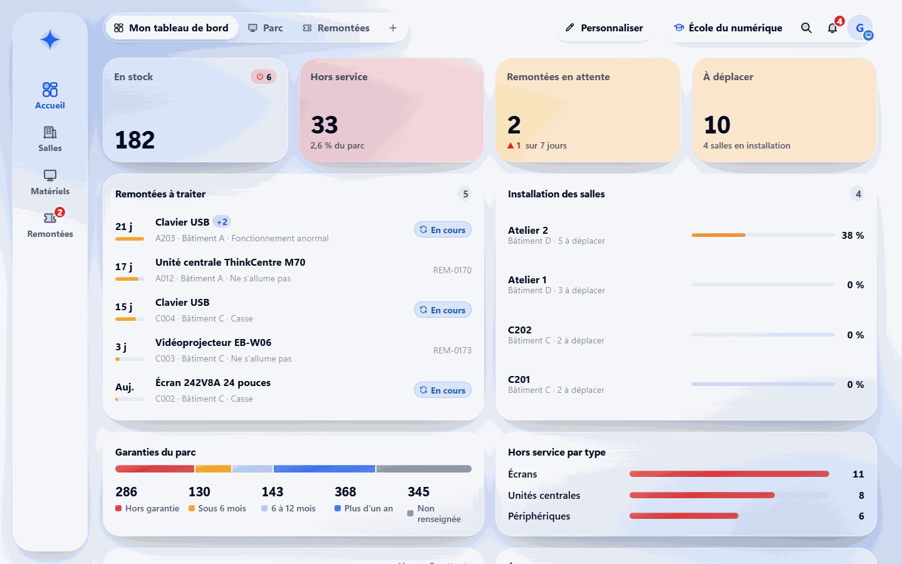

Le gestionnaire voit d’un coup d’œil le stock, les matériels hors service, les remontées à traiter et l’avancement de l’installation des salles ; chaque carte mène à l’écran concerné.

### Détail d’une salle

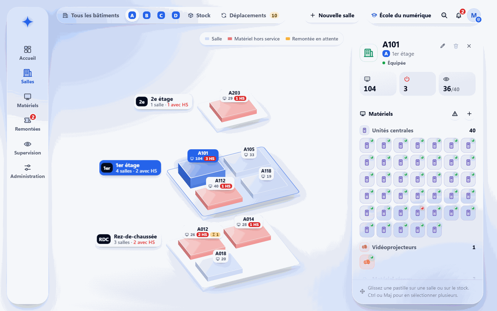

Les matériels de la salle sont regroupés par type ; le gestionnaire les sélectionne et les glisse vers une autre salle ou vers le stock, ou bascule un matériel hors service.

### Stock

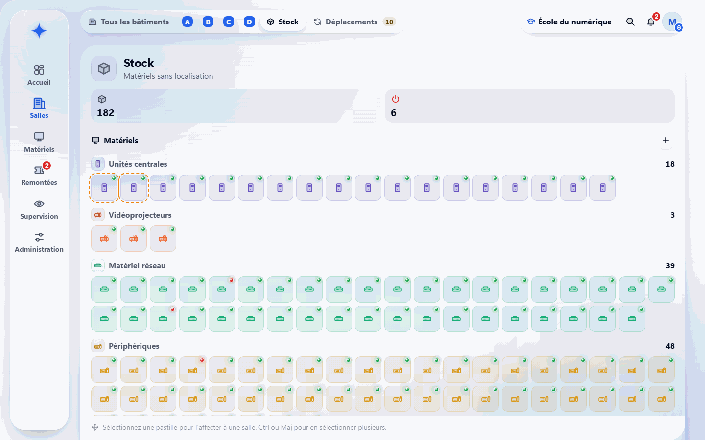

Le stock regroupe les matériels sans salle ; le gestionnaire les affecte à une salle depuis leur fiche ou par « Équiper la salle ».

### Déplacements

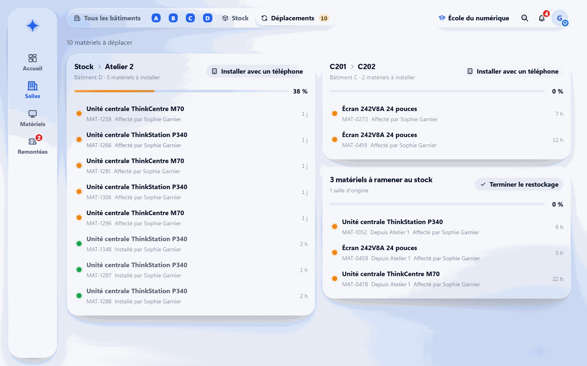

Chaque trajet vers une salle présente ses matériels à installer et son avancement ; une seule carte réunit les matériels à ramener au stock, avec **Terminer le restockage**. Le point d’un matériel passe de l’orange au vert lorsque le gestionnaire confirme son installation, dans ORION ou avec RIGEL.

### Inventaire

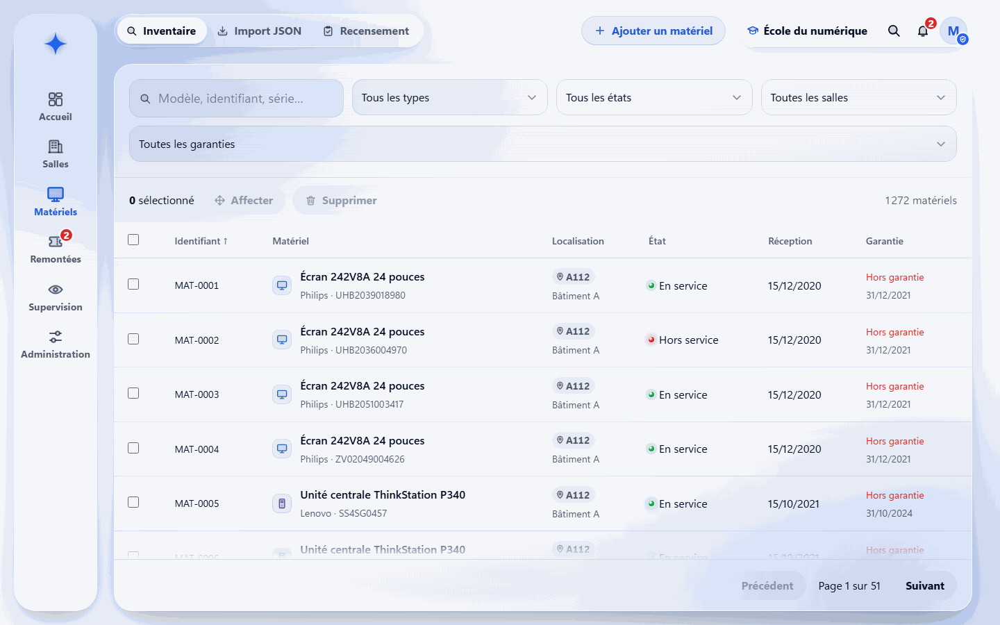

Le gestionnaire recherche, filtre et trie les matériels, en sélectionne plusieurs et les affecte en une fois ; la suppression ne lui est pas proposée.

### Ajout d’un matériel

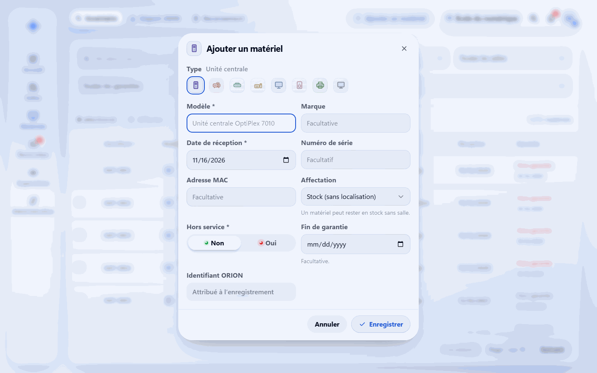

Le formulaire demande le modèle et la date de réception ; l’identifiant ORION est attribué à l’enregistrement.

### Import JSON

Le fichier est analysé dès qu’il est choisi ; l’aperçu signale les doublons et les matériels d’une autre école avant l’import.

### Bilan d’un recensement

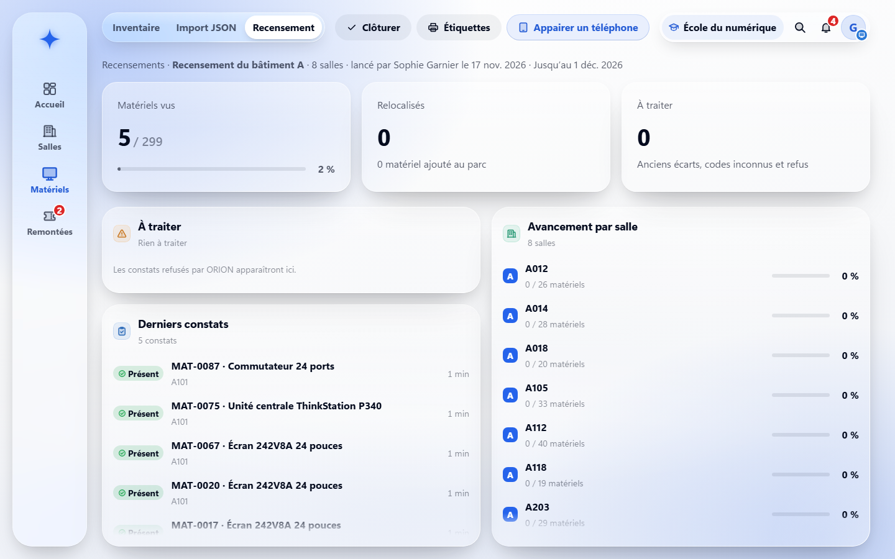

Le bilan suit les matériels vus, les relocalisations et les constats à traiter, salle par salle ; le gestionnaire y appaire son téléphone, imprime les étiquettes et clôt le recensement.

### RIGEL : appairage et accueil

| Appairage | Accueil |
| --- | --- |
|  |  |

Le téléphone se lie à l’opération en scannant le QR code affiché dans ORION ; l’accueil présente l’opération, l’état de la synchronisation, **Scanner** et **Explorer**.

### RIGEL : salles et inventaire d’un lieu

| Explorer | Salle | Inventaire |
| --- | --- | --- |
| 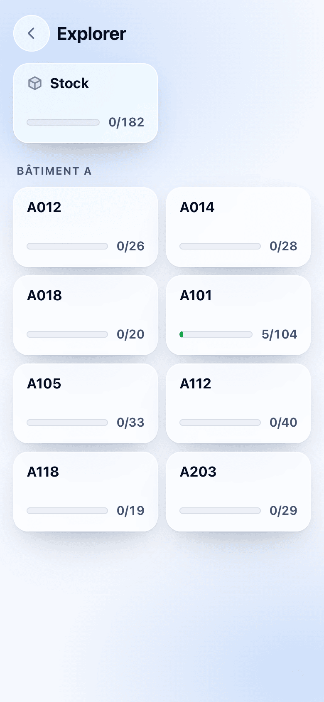 |  | 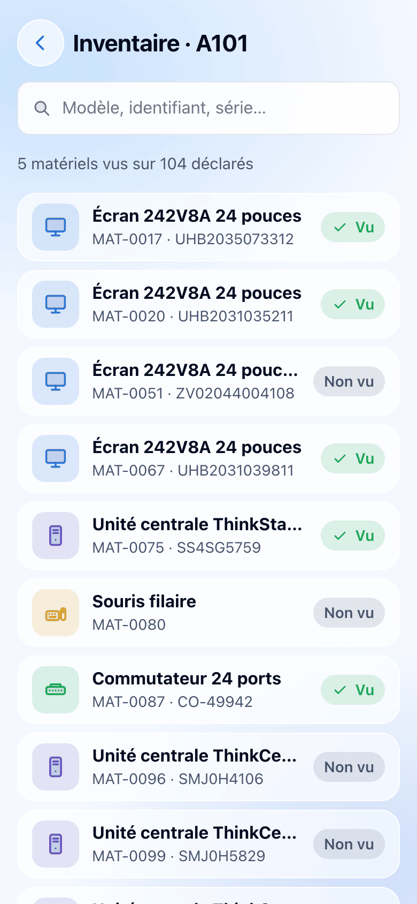 |

Chaque lieu affiche les matériels vus sur les matériels attendus ; ouvrir une salle, c’est déclarer s’y trouver, puis la recenser ou l’installer.

### RIGEL : scanner et fiche d’un matériel

| Scanner | Matériel affecté ailleurs |
| --- | --- |
| 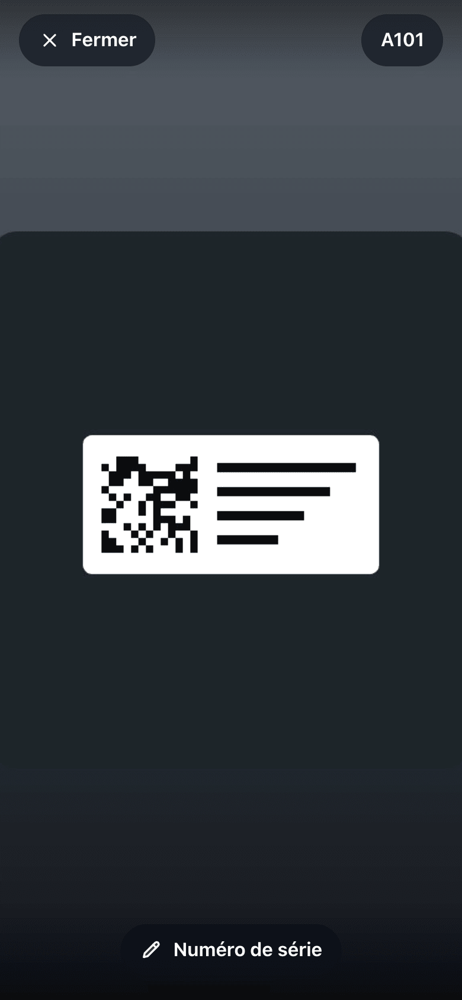 | 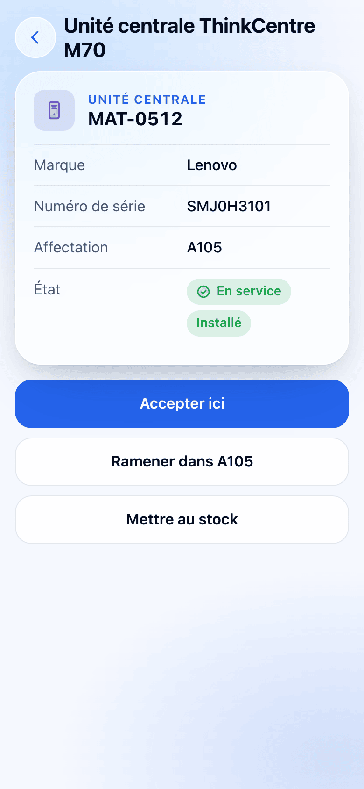 |

Le scanner lit les codes en continu ou le numéro de série ; un matériel affecté ailleurs est accepté ici, ramené dans sa salle ou mis au stock.

### RIGEL : code inconnu

| Avertissement | Saisie |
| --- | --- |
|  | 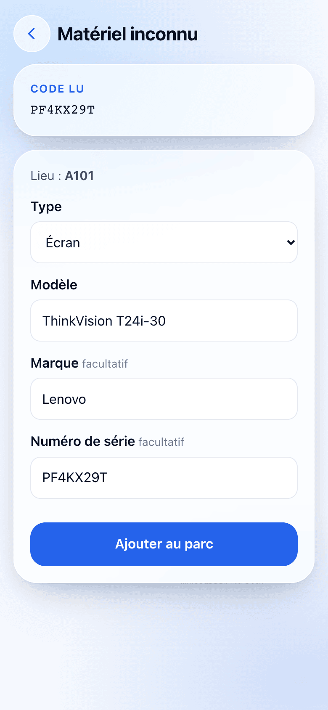 |

Un code inconnu n’est ajouté au parc qu’après confirmation et saisie de son type et de son modèle.

### RIGEL : synchronisation

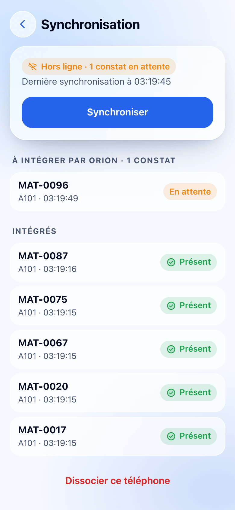

Les constats faits hors connexion attendent sur le téléphone ; chaque constat intégré par ORION revient avec son résultat.

### Backlog des remontées

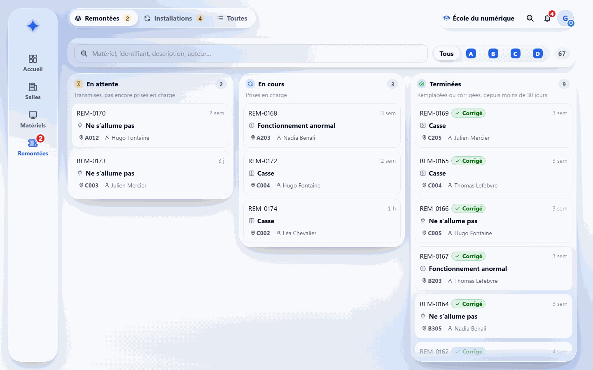

Les remontées sont rangées en colonnes « En attente », « En cours » et « Terminées » ; une carte ouvre le détail où se trouvent les actions.

### Détail d’une remontée

Le gestionnaire consulte le problème, les matériels et le suivi, puis prend en charge la remontée d’un clic avant de la terminer.

### Notifications

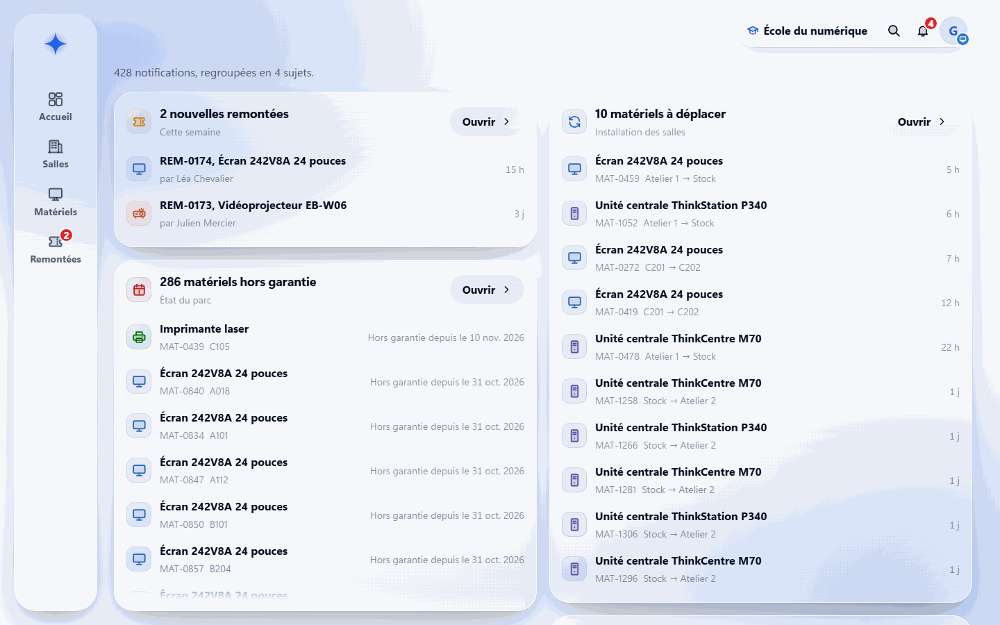

Les notifications sont regroupées par sujet : nouvelles remontées, matériels à déplacer, garanties échues ou proches de l’échéance.

## Besoins en interface

- Tableau de bord personnel composable, tableaux ajoutés par le compte et tableaux spécialisés du parc (état du parc et des stocks, part hors service par bâtiment, salles à surveiller) et des remontées.
- Recherche globale, préférences d’affichage et déconnexion depuis la barre supérieure.
- Vue éclatée des bâtiments, détail d’une salle et stock, avec glisser-déposer et sélection multiple.
- Écran des déplacements et backlog des installations, avec l’avancement par salle.
- Inventaire avec recherche, filtres, tri, pagination et sélection multiple.
- Formulaire de création et de modification conforme aux données confirmées.
- Import JSON avec format attendu, aperçu, choix des transferts et résultat ligne par ligne.
- Backlog et liste des remontées, détail avec prise en charge, traitement et accès au PDF.
- Écran du recensement dans ORION : liste, lancement, appairage du téléphone, étiquettes, bilan, constats à traiter et clôture.
- Module mobile RIGEL : appairage, accueil, exploration des salles, inventaire d’un lieu, scanner (codes et numéro de série), saisie manuelle, fiche d’un matériel, code inconnu, synchronisation et dissociation, utilisables hors connexion.
- Notifications dans ORION (compteur, résumé et page Notifications) ; aucune action de suppression, de supervision, d’administration des postes ou de gestion des comptes.

## Contraintes transversales

- Application web utilisée avec les versions de Firefox installées sur les postes de l’équipe.
- Réseau interne NP disposant d’un accès à Internet.
- Authentification via MindefConnect ; modalités d’intégration à préciser (cadrage § 18).
- Un seul profil par utilisateur.
- RIGEL s’utilise sur le téléphone professionnel du gestionnaire, appairé à ORION ; ses échanges avec ORION sont chiffrés.

## Sources

[Consignes du projet](../../01-CONTEXTE/01-CONSIGNES.md), [cadrage §§ 3 à 7, 13 à 18 et 23](../../01-CONTEXTE/02-CADRAGE.md), [glossaire](../../01-CONTEXTE/00-GLOSSAIRE.md), [règles de gestion](04-REGLES-DE-GESTION.md), [DCU — Gestion du parc](08-DCU-GESTION-PARC.md), [DCU — Remontées utilisateur](11-DCU-REMONTEES-UTILISATEUR.md), [matrice des droits](12-MATRICE-DROITS.md), [diagrammes d’états](../03-ANALYSE/17-DIAGRAMMES-ETATS.md) et application ORION.
