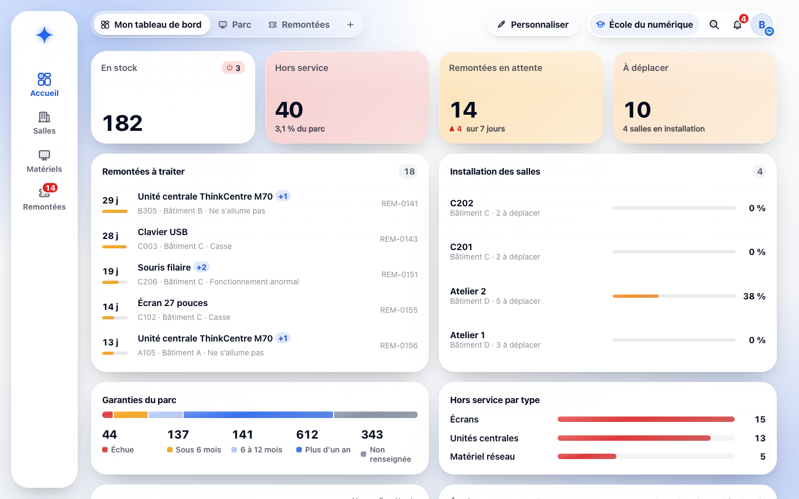
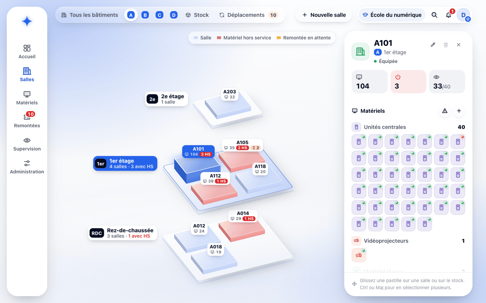
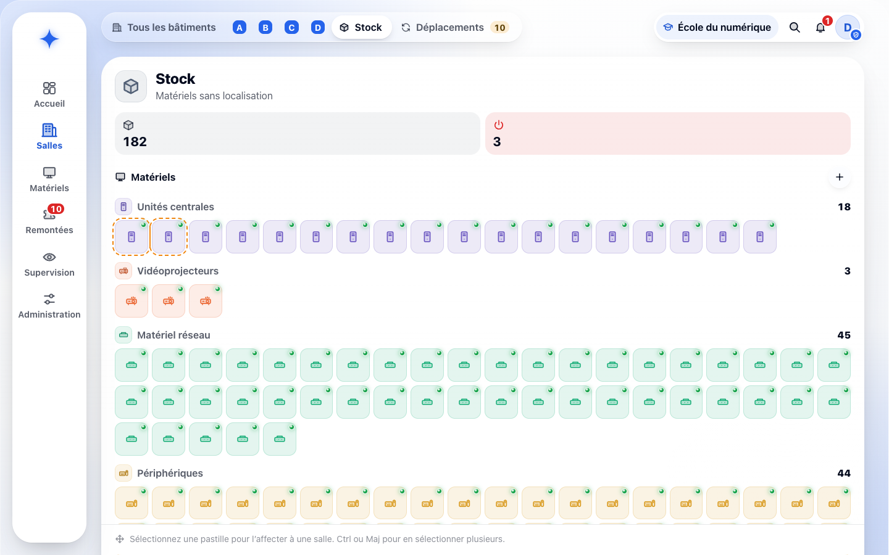
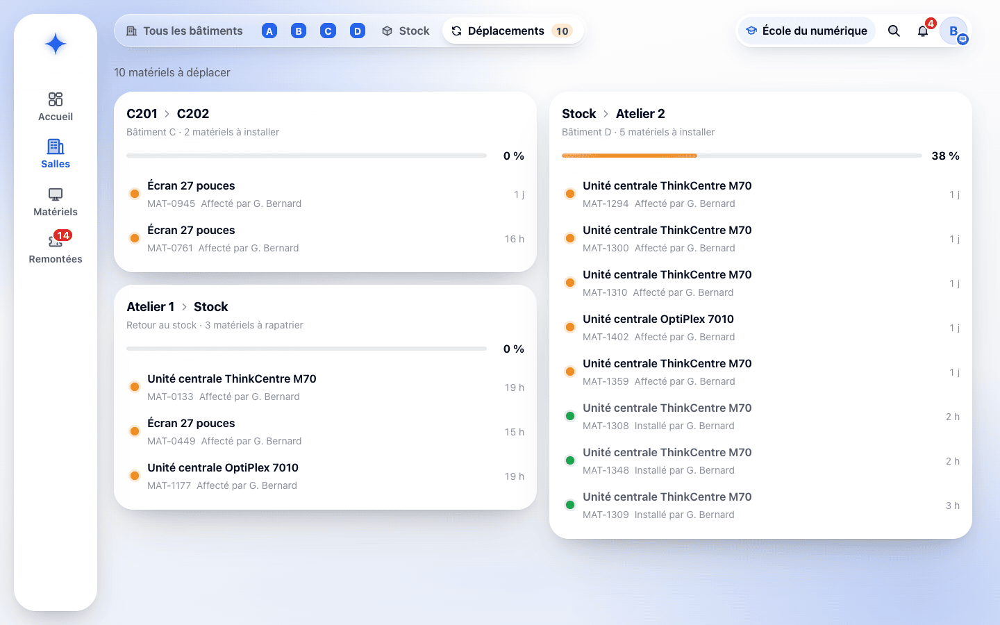
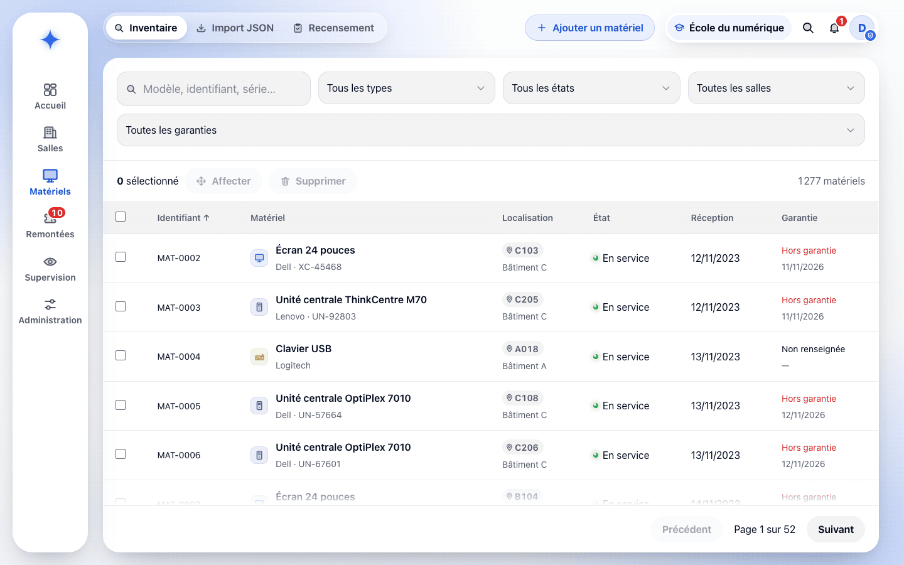
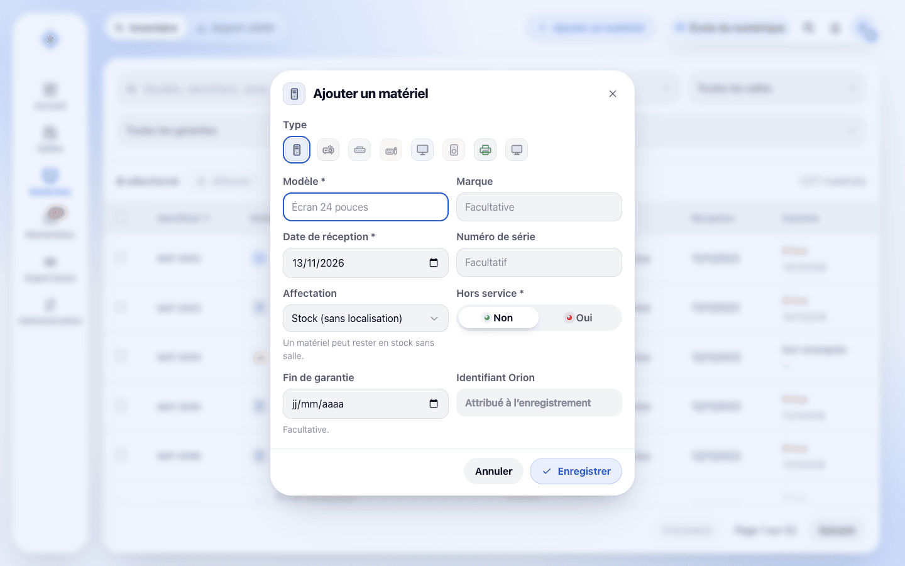
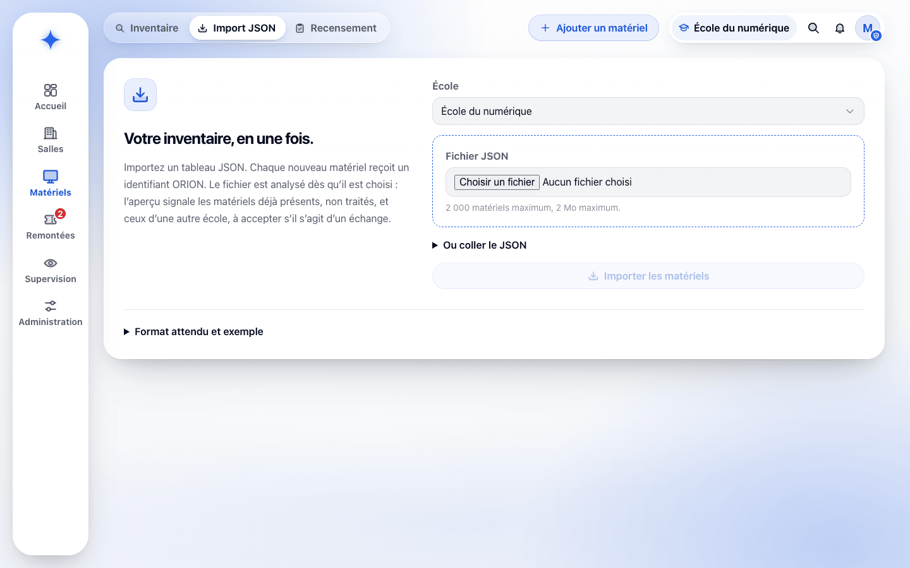
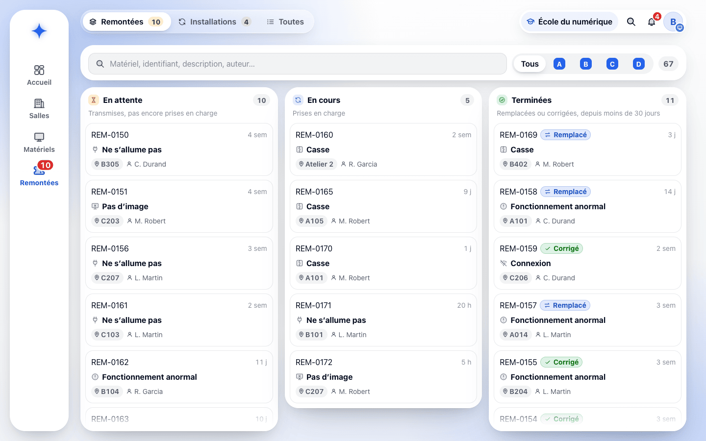
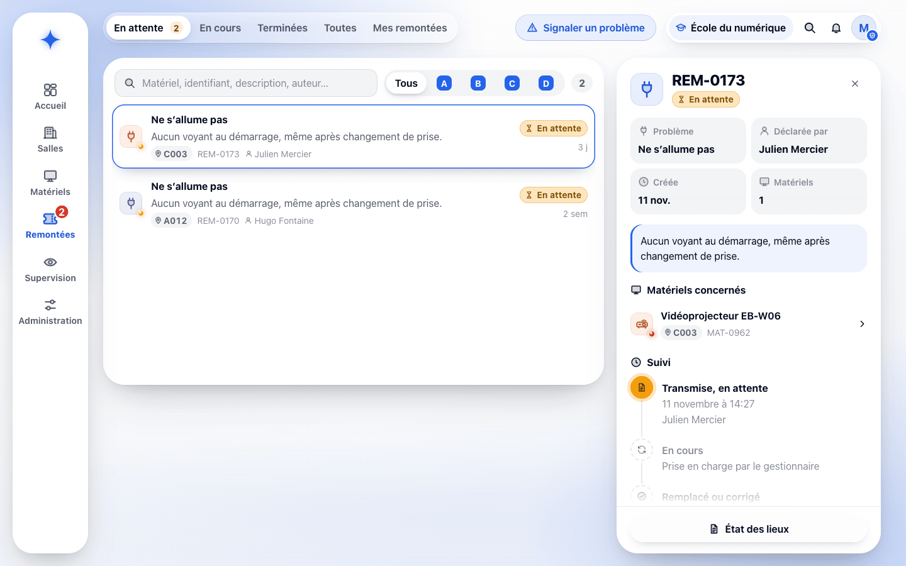
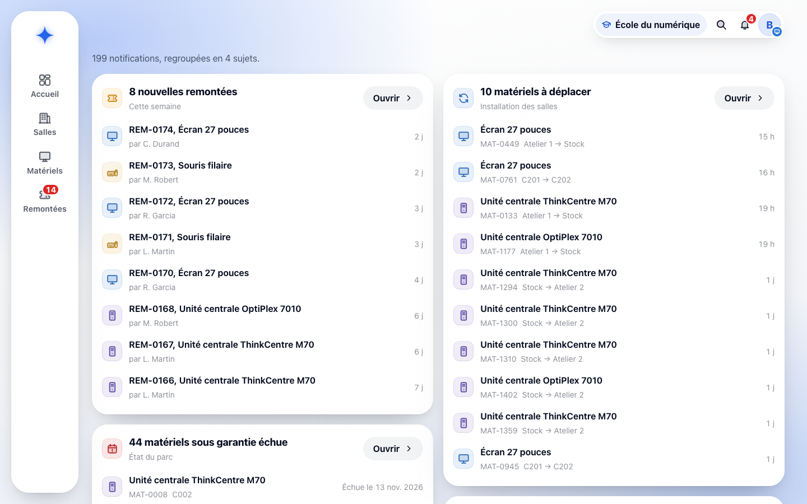

# Fiche descriptive — Gestionnaire

<!-- version:debut : généré par versions.py, ne pas modifier à la main -->
| Version | Mise à jour | Destination | Dernière évolution | Historique |
| --- | --- | --- | --- | --- |
| 4.1 | 14/11/2026 | Production destinée à la remise | Installation confirmée par le gestionnaire seul (clic ou RIGEL) ; super administrateur : autres super administrateurs et école d’un administrateur ; un administrateur par école ; Recensement lancé depuis ORION par le gestionnaire, téléphone lié à l’opération | [10 versions](../../../archive/README.md#13-fiche-descriptive-gestionnaire) |
<!-- version:fin -->

- **Statut :** établie à partir des décisions en vigueur et de l’application ORION.
- **Profil :** gestionnaire.
- **Rattachement :** une école.
- **Périmètre :** toutes les données du parc de son école, sans restriction à un bâtiment.
- **Finalité :** tenir l’inventaire du parc, réaliser l’installation des salles et le recensement avec RIGEL, et traiter les remontées.

## Périmètre fonctionnel

| Domaine | Capacités |
| --- | --- |
| Accès | Connexion par MindefConnect, avec un compte ORION actif de son école |
| Tableaux de bord | « Mon tableau de bord » personnalisable, tableaux spécialisés « Parc » et « Remontées », tableaux ajoutés par le compte |
| Salles et stock | Vue éclatée des bâtiments, détail d’une salle, stock ; affecter un ou plusieurs matériels à une salle ou au stock (glisser-déposer, sélection ou « Équiper la salle ») ; déclarer un matériel hors service ou en service |
| Matériels | Inventaire filtrable, création et modification d’un matériel, date de fin de garantie, import JSON |
| Installation des salles | Prévoir les déplacements dans ORION ; les réaliser sur place avec RIGEL ; suivre l’avancement dans « Déplacements » et dans le backlog des installations |
| Recensement | Appairer son téléphone professionnel, lancer un recensement depuis ORION et y lier son téléphone, scanner les matériels, traiter dans ORION les écarts et les codes inconnus |
| Remontées | Consulter toutes les remontées de son école ; les prendre en charge puis les terminer en « remplacé » ou « corrigé » ; état des lieux PDF |
| Notifications | Nouvelles remontées, matériels à déplacer, garanties échues ou arrivant à échéance |
| Exclusions | Suppression d’un matériel, gestion des salles et des étages, création de remontée, supervision, administration des postes, listes de processus et comptes ORION |

Les droits détaillés sont consolidés dans la [matrice des droits](12-MATRICE-DROITS.md).

## UC-GEST-01 — Gérer le parc matériel

- **Objectif :** tenir un inventaire fiable et connaître la localisation de chaque matériel de l’école.
- **Déclencheur :** un matériel doit être enregistré, retrouvé, corrigé ou affecté.
- **Préconditions :** le gestionnaire est connecté ; les salles de destination appartiennent à son école.

### Scénario nominal

1. Le gestionnaire ouvre **Matériels › Inventaire**. ORION présente les matériels de son école, avec leur identifiant ORION, leur localisation, leur état et leur garantie.
2. Il recherche par modèle, identifiant ORION ou numéro de série, filtre par type, état, salle ou stock et garantie (« Hors garantie », « À échéance », « En cours », « Non renseignée »), trie par identifiant, matériel ou date de réception et parcourt les pages.
3. Pour enregistrer un matériel, il clique sur **Ajouter un matériel** et saisit le modèle et la date de réception (obligatoires), puis, s’il les connaît, la marque, le numéro de série, l’affectation (salle ou stock), l’indication « hors service » (non par défaut) et la date de fin de garantie.
4. Il enregistre. ORION attribue l’identifiant ORION et confirme « MAT-… enregistré ».
5. Pour affecter, il sélectionne un ou plusieurs matériels dans l’inventaire et clique sur **Affecter**, ou, dans **Salles**, glisse un matériel ou une sélection sur une salle ou sur le stock. **Équiper la salle** prend dans le stock en service le nombre de postes complets (unité centrale, écran et périphériques) et les matériels secondaires demandés.
6. ORION enregistre aussitôt l’affectation et l’annonce (« … affecté à C202, à installer » ou « … remis en stock, à ranger ») ; le matériel est « en cours de déplacement » jusqu’à la confirmation sur place (UC-GEST-03).
7. Dans le détail d’une salle ou du stock, il bascule un matériel entre **En service** et **Hors service** ; ORION confirme le nouvel état.

### Variantes et limites

- Un matériel en stock n’a pas de salle ; il reste rattaché à son école. Une affectation groupée porte sur des matériels d’une même école.
- Un matériel hors service ne peut aller qu’au stock : ORION refuse toute autre destination (« Un matériel hors service ne peut aller qu’au stock »).
- **Import JSON :** le gestionnaire choisit un fichier (2 000 matériels et 2 Mo au plus) ou colle le JSON. ORION l’analyse aussitôt et présente un aperçu : un matériel déjà présent dans l’école, ou répété dans le fichier, n’est pas traité ; un matériel connu dans une autre école n’est transféré que si le gestionnaire active son transfert. **Importer** ajoute les nouveaux matériels et les transferts validés sans validation métier préalable, puis affiche le résultat de chaque ligne (ajouté, transféré, non traité). Un fichier illisible, vide ou contenant un matériel incomplet est refusé en entier.
- Le bouton **Supprimer** reste désactivé, avec le motif « Suppression réservée aux administrateurs ».
- La garantie est facultative ; un matériel est signalé « À échéance » six mois avant la date de fin, puis « Hors garantie » à cette date.
- Aucun historique des mouvements n’est exigé ; les déplacements en cours restent tracés jusqu’à leur confirmation.

### Résultats attendus

- Chaque matériel possède un identifiant ORION et ses données obligatoires.
- Il est affecté au plus à une salle de son école ou reste en stock.
- Une opération d’affectation peut porter sur plusieurs matériels.

### Questions ouvertes

- Exports de l’inventaire.
- Contrôle des doublons de numéro de série lors d’une saisie manuelle.

### Règles applicables

RG-03 à RG-10, RG-16 à RG-18, RG-25 à RG-29, RG-69, RG-72, RG-86, RG-87 et RG-92.

## UC-GEST-02 — Consulter et traiter les remontées

- **Objectif :** traiter les problèmes déclarés sur les matériels et en informer leurs auteurs.
- **Déclencheur :** une nouvelle remontée est créée ou une remontée doit être traitée.
- **Préconditions :** le gestionnaire est connecté ; la remontée appartient à son école.

### Scénario nominal

1. À la création d’une remontée, ORION notifie le gestionnaire (« nouvelle remontée »).
2. Il ouvre **Remontées**. L’onglet **Remontées** présente son backlog en trois colonnes, **En attente**, **En cours** et **Terminées** (30 derniers jours), filtrable par bâtiment et par recherche (matériel, identifiant, description, auteur) ; l’onglet **Toutes** liste toutes les remontées de l’école.
3. Il ouvre une carte. ORION affiche le problème, l’auteur, la date, la description, les matériels concernés avec leur localisation et le suivi daté.
4. Il clique sur **Prendre en charge**. La remontée passe « en cours » ; ORION confirme (« REM-… : en cours ») et notifie l’auteur.
5. Pendant le traitement, il peut déclarer chaque matériel concerné en service ou hors service. Pour un matériel hors service d’une salle, il peut le **relocaliser dans le stock** et le **remplacer** par un matériel en service du stock du même type ; ORION lance les déplacements correspondants, à confirmer sur place (UC-GEST-03).
6. Il termine la remontée par **Remplacé** ou **Corrigé**. ORION enregistre le statut, la date et le gestionnaire dans le suivi, et notifie l’auteur.
7. Il ouvre l’**état des lieux** pour le consulter, le télécharger ou l’imprimer en PDF.

### Variantes et limites

- Une remontée peut concerner plusieurs matériels ; elle n’a qu’un statut : « en attente », « en cours », « remplacé » ou « corrigé ».
- La prise en charge est obligatoire avant « remplacé » ou « corrigé » ; une remontée terminée ne change plus de statut. Son contenu n’est ni modifié ni supprimé.
- Le gestionnaire est seul à traiter les remontées ; il n’en crée pas.
- L’état des lieux est produit par ORION à chaque demande, avec les informations du moment, dont le statut et le suivi ; il n’est pas conservé.
- Aucun courriel n’est envoyé.

### Résultats attendus

- Le statut s’applique à toute la remontée ; chaque changement est conservé avec sa date et son auteur.
- L’auteur, quel que soit son profil, est informé dans ORION de chaque changement de statut.

### Questions ouvertes

- Répartition des remontées entre plusieurs gestionnaires d’une même école, qui reçoivent chacun la notification.
- Qualification, affectation à un intervenant, priorités et délais de traitement.
- Doublons et pièces jointes.
- Règles de calcul des indicateurs du tableau de bord des remontées.

### Règles applicables

RG-11 à RG-14, RG-23 à RG-25, RG-34 à RG-38, RG-64, RG-66, RG-67, RG-69, RG-79, RG-80, RG-87 et RG-89.

## UC-GEST-03 — Installer une salle avec RIGEL

- **Objectif :** réaliser sur place les déplacements prévus dans ORION et confirmer l’installation de chaque matériel.
- **Déclencheur :** des matériels ont été affectés à une salle ou renvoyés au stock et sont « en cours de déplacement ».
- **Préconditions :** le gestionnaire est sur place avec son téléphone professionnel appairé à ORION (UC-GEST-04) ; la salle porte son QR code, affiché dans ORION ou apposé sur la porte.

### Scénario nominal

1. Un gestionnaire ou un administrateur affecte des matériels à une salle (UC-GEST-01). ORION les marque « en cours de déplacement » et notifie le gestionnaire (« matériels à déplacer »).
2. Le gestionnaire ouvre **Salles › Déplacements**. ORION présente une carte par trajet (du stock vers une salle, d’une salle à une autre, d’une salle vers le stock) avec son avancement ; chaque matériel porte un point orange tant que son déplacement n’est pas confirmé.
3. Sur place, il ouvre la salle dans RIGEL en scannant son QR code.
4. Il scanne chaque matériel : Data Matrix, QR code, code-barres ou numéro de série lu par reconnaissance de caractères.
5. Pour un matériel attendu dans la salle, RIGEL confirme l’installation. Dans ORION, le point passe au vert et l’avancement du trajet progresse.
6. Pour un matériel affecté au stock ou à une autre salle, RIGEL propose de le relocaliser dans la salle ; s’il accepte, l’affectation et l’installation sont confirmées ensemble.
7. Lorsque tous les matériels d’une salle sont confirmés, la salle passe dans la colonne **Terminées** du backlog **Installations** de **Remontées**.

### Variantes et limites

- Sans RIGEL, le gestionnaire confirme l’installation d’un matériel dans ORION en cliquant sur son point de déplacement ; lui seul le peut, l’administrateur et le super administrateur ne font que suivre l’avancement.
- Un matériel hors service ne peut être relocalisé qu’au stock.
- Hors connexion, RIGEL garde les scans et les transmet chiffrés au retour du réseau ; un scan plus ancien que la dernière information connue sur le matériel est refusé.
- L’administrateur et le super administrateur prévoient les déplacements mais ne réalisent pas l’installation ; le formateur n’a pas accès à RIGEL.
- Le backlog **Installations** classe les salles en **En attente** (aucun déplacement confirmé), **En cours** et **Terminées** (salles équipées depuis moins de 30 jours) ; une carte ouvre les déplacements de la salle.

### Résultats attendus

- Chaque matériel déplacé est confirmé « installé » dans sa salle, ou « rangé » au stock.
- La localisation enregistrée dans ORION correspond à la réalité constatée sur place.

### Questions ouvertes

- Révocation d’un téléphone appairé perdu ou remplacé.

### Règles applicables

RG-26, RG-27, RG-87, RG-92 et RG-94.

## UC-GEST-04 — Recenser le parc avec RIGEL et traiter les écarts

- **Objectif :** vérifier que chaque matériel se trouve dans sa salle d’affectation et aligner ORION sur la réalité.
- **Déclencheur :** le gestionnaire décide de recenser toute son école ou certaines de ses salles.
- **Préconditions :** le gestionnaire est connecté à ORION et dispose de son téléphone professionnel.

### Scénario nominal

1. Dans ORION (**Matériels › Recensement**), le gestionnaire lance un recensement sur toute son école ou sur des salles choisies.
2. ORION affiche le QR code d’appairage du recensement ; il le scanne avec son téléphone professionnel, qui est lié à l’opération. RIGEL reçoit les salles et les matériels du recensement, et seulement ceux-là.
3. Si nécessaire, il imprime depuis ORION les étiquettes QR des salles et du stock.
4. Dans chaque salle, il scanne le QR code de la salle puis les matériels. RIGEL confirme la présence d’un matériel attendu, ou signale un écart sans déplacer le matériel ; un code inconnu est transmis avec les informations saisies sur le téléphone (type, modèle, numéro de série).
5. ORION reçoit chaque scan comme un constat daté par le serveur et présente le bilan : matériels vus sur matériels attendus, installations confirmées, constats à traiter.
6. Pour chaque écart, le gestionnaire choisit dans ORION de remettre le matériel au stock, de le ramener dans sa salle d’affectation ou de le réaffecter à la salle où il a été constaté.
7. Pour un code inconnu, il ajoute le matériel au parc à partir des informations reçues, ou écarte le constat.
8. Il clôt le recensement lorsqu’il est terminé.

### Variantes et limites

- Seul le gestionnaire lance et réalise un recensement ; aucun matériel n’est déplacé pendant le recensement.
- Un recensement dure au plus 14 jours ; il peut être clos plus tôt et, une fois clos, n’est ni rouvert ni supprimé.
- RIGEL fonctionne hors connexion ; un scan plus ancien que la dernière information connue sur le matériel est refusé.
- Le traitement d’un écart ou d’un code inconnu est daté, attribué à son auteur et définitif ; les constats ne sont jamais supprimés.

### Résultats attendus

- Chaque matériel recensé est confirmé dans sa salle ou fait l’objet d’un écart traité.
- ORION conserve l’ensemble des constats et de leurs traitements.

### Questions ouvertes

- Révocation d’un téléphone appairé perdu ou remplacé.

### Règles applicables

RG-72, RG-87, RG-93, RG-94 et RG-95.

## UC-GEST-05 — Suivre son activité : tableaux de bord et notifications

- **Objectif :** repérer ce qui demande une action : remontées, déplacements, garanties.
- **Déclencheur :** connexion à ORION ou consultation de l’accueil.
- **Préconditions :** le gestionnaire est connecté.

### Scénario nominal

1. À la connexion, ORION présente les notifications du gestionnaire dans une fenêtre contextuelle ; la cloche de la barre supérieure en indique le nombre et ouvre à tout moment leur résumé par sujet.
2. Les notifications sont regroupées : nouvelles remontées de la semaine, matériels à déplacer, matériels hors garantie, matériels arrivant à échéance dans les six mois. **Voir toutes les notifications** ouvre leur détail ; chaque élément mène à l’écran concerné.
3. **Accueil › Mon tableau de bord** présente notamment le stock, les matériels hors service, les remontées en attente, les matériels à déplacer, l’installation des salles et les garanties du parc.
4. **Personnaliser** permet de déplacer, redimensionner ou retirer une carte et d’en ajouter depuis un catalogue ; le gestionnaire peut aussi créer d’autres tableaux, ajoutés au sous-menu de l’accueil.
5. Les tableaux **Parc** et **Remontées** présentent respectivement l’état du parc (dont l’état des stocks) et la file des remontées.

### Variantes et limites

- Le gestionnaire est seul à recevoir les alertes de garantie.
- Aucune notification n’est envoyée par courriel.

### Résultats attendus

- Le gestionnaire est informé dans ORION de chaque nouvelle remontée, des matériels à déplacer et des garanties à surveiller.

### Questions ouvertes

- Indicateurs attendus et règles de calcul des tableaux de bord.

### Règles applicables

RG-24, RG-36 à RG-38, RG-67, RG-84 et RG-86.

## Écrans de l’application

### Tableau de bord du gestionnaire

Le gestionnaire voit d’un coup d’œil le stock, les matériels hors service, les remontées à traiter et l’avancement de l’installation des salles ; chaque carte mène à l’écran concerné.

### Détail d’une salle

Les matériels de la salle sont regroupés par type ; le gestionnaire les sélectionne et les glisse vers une autre salle ou vers le stock, ou bascule un matériel hors service.

### Stock

Le stock regroupe les matériels sans salle ; le gestionnaire les affecte à une salle depuis leur fiche ou par « Équiper la salle ».

### Déplacements

Chaque trajet présente ses matériels à installer et son avancement ; le point d’un matériel passe de l’orange au vert lorsque son installation est confirmée sur place avec RIGEL.

### Inventaire

Le gestionnaire recherche, filtre et trie les matériels, en sélectionne plusieurs et les affecte en une fois ; la suppression lui est refusée.

### Ajout d’un matériel

Le formulaire demande le modèle et la date de réception ; l’identifiant ORION est attribué à l’enregistrement.

### Import JSON

Le fichier est analysé dès qu’il est choisi ; l’aperçu signale les doublons et les matériels d’une autre école avant l’import.

### Backlog des remontées

Les remontées sont rangées en colonnes « En attente », « En cours » et « Terminées » ; une carte ouvre le détail où se trouvent les actions.

### Détail d’une remontée

Le gestionnaire consulte le problème, les matériels et le suivi, puis prend en charge la remontée d’un clic avant de la terminer.

### Notifications

Les notifications sont regroupées par sujet : nouvelles remontées, matériels à déplacer, garanties échues ou proches de l’échéance.

## Besoins en interface

- Tableau de bord personnel composable et tableaux spécialisés du parc (état des stocks, filtrable par salle) et des remontées.
- Vue éclatée des bâtiments, détail d’une salle et stock, avec glisser-déposer et sélection multiple.
- Écran des déplacements et backlog des installations, avec l’avancement par salle.
- Inventaire avec recherche, filtres, tri, pagination et sélection multiple.
- Formulaire de création et de modification conforme aux données confirmées.
- Import JSON avec aperçu et résultat ligne par ligne.
- Backlog et liste des remontées, détail avec prise en charge, traitement et accès au PDF.
- Écran du recensement dans ORION : appairage du téléphone, étiquettes, bilan, écarts et codes inconnus à traiter.
- Module mobile RIGEL : ouverture d’une salle par son QR code, scan des matériels, travail hors connexion.
- Notifications dans ORION ; aucune action de suppression, de supervision, d’administration des postes ou de gestion des comptes.

## Contraintes transversales

- Application web utilisée avec les versions de Firefox installées sur les postes de l’équipe.
- Réseau interne NP disposant d’un accès à Internet.
- Authentification via MindefConnect ; modalités d’intégration à préciser (cadrage § 18).
- Un seul profil par utilisateur.
- RIGEL s’utilise sur le téléphone professionnel du gestionnaire, appairé à ORION.

## Sources

[Consignes du projet](../../01-CONTEXTE/01-CONSIGNES.md), [cadrage §§ 3 à 7, 13 à 18 et 23](../../01-CONTEXTE/02-CADRAGE.md), [glossaire](../../01-CONTEXTE/00-GLOSSAIRE.md), [règles de gestion](04-REGLES-DE-GESTION.md), [DCU — Gestion du parc](08-DCU-GESTION-PARC.md), [DCU — Remontées utilisateur](11-DCU-REMONTEES-UTILISATEUR.md), [matrice des droits](12-MATRICE-DROITS.md), [diagrammes d’états](../03-ANALYSE/17-DIAGRAMMES-ETATS.md) et application ORION.
