# Fiche descriptive — Administrateur

<!-- version:debut : généré par versions.py, ne pas modifier à la main -->
| Version | Mise à jour | Destination | Dernière évolution | Historique |
| --- | --- | --- | --- | --- |
| 6.3 | 17/11/2026 | Production destinée à la remise | Présenter l’administrateur comme acteur du traitement des remontées | [21 versions](../../../archive/README.md#14-fiche-descriptive-administrateur) |
<!-- version:fin -->

- **Statut :** établie à partir des décisions en vigueur et de l’application ORION.
- **Profil :** administrateur.
- **Rattachement :** une école.
- **Périmètre :** toutes les données et fonctionnalités de son école, dont tous les droits du gestionnaire : traitement des remontées, confirmation des installations, RIGEL et alerte de garantie.
- **Finalité :** administrer le parc, les salles, les postes, la supervision et les comptes de son école, installer les salles, recenser le parc et traiter les remontées.

## Périmètre fonctionnel

| Domaine | Capacités |
| --- | --- |
| Accès | Connexion par MindefConnect, avec un compte ORION actif de son école ; recherche globale, préférences d’affichage et déconnexion |
| Tableaux de bord | « Mon tableau de bord » personnalisable, tableaux spécialisés « Parc » et « Remontées », tableaux ajoutés, renommés ou supprimés par le compte |
| Parc matériel | Toutes les actions du gestionnaire sur les matériels, y compris l’import JSON, et la suppression d’un ou plusieurs matériels du stock |
| Salles et bâtiments | Créer, modifier et supprimer une salle ; renommer un bâtiment ; prévoir les déplacements d’une installation et les confirmer, dans ORION ou avec RIGEL |
| Recensement | Lancer, réaliser avec RIGEL et clore les recensements de son école ; appairer son téléphone, imprimer les étiquettes et traiter les anciens constats, comme le gestionnaire |
| Administration des postes | Consulter les postes, leur état et leurs applications ; installer ou désinstaller une application sur un poste ou une salle ; demander la réinitialisation d’un ou plusieurs postes ; suivre les interventions |
| Supervision | Alertes de toutes les salles, supervision d’une salle et arrêt d’un processus, listes de processus (whitelist, blacklist) de son école, statistiques d’utilisation |
| Remontées | Créer une remontée et suivre les siennes ; consulter toutes les remontées de son école et leurs états des lieux ; les prendre en charge et les terminer |
| Comptes ORION | Créer, modifier, désactiver et réactiver les comptes de son école, sans pouvoir les rattacher à une autre école ni changer la sienne ; consulter leur dernière connexion et leur date de désactivation |
| Notifications | Évolution de ses propres remontées, fin des interventions qu’il a demandées, lancement d’un processus interdit, matériels à déplacer, garanties échues ou proches de l’échéance |
| Exclusions | Règles globales, écoles et comptes super administrateur |

Les droits détaillés sont consolidés dans la [matrice des droits](11-MATRICE-DROITS.md).

## UC-ADMIN-01 — Administrer le parc matériel

**En tant qu’**administrateur, **je souhaite** créer, retrouver, modifier, affecter, importer et supprimer les matériels du parc de mon école **afin de** tenir l’inventaire de l’école, y compris lorsque la suppression d’un matériel est nécessaire.

- **Déclencheur :** un matériel doit être créé, retrouvé, modifié, affecté, importé ou supprimé.
- **Acteurs secondaires :** aucun.

### Critères d’acceptation

- Le matériel possède un identifiant ORION, attribué par ORION à l’enregistrement, et ses données obligatoires : type, modèle et date de réception.
- Le matériel est affecté au plus à une salle de son école ou reste en stock.
- Une affectation est enregistrée aussitôt et marque les matériels « en cours de déplacement ».
- Seul un matériel du stock, cité par aucune remontée, peut être supprimé, après confirmation.
- L’administrateur renseigne la date de fin de garantie, consulte l’état des garanties et reçoit l’alerte de garantie, comme le gestionnaire.

### Règles de gestion

RG-03 à RG-10, RG-15, RG-25 à RG-29, RG-69, RG-72, RG-73, RG-86, RG-87 et RG-91.

### Besoins non fonctionnels

- Les motifs de blocage et les demandes de confirmation sont affichés à l’écran.

### Interface

- Tous les écrans du parc, communs avec le gestionnaire ([UC-GEST-01](12-FICHE-DESCRIPTIVE-GESTIONNAIRE.md#uc-gest-01--gérer-le-parc-matériel)) : **Matériels › Inventaire**, salles, stock et fiche du matériel.
- Boutons **Ajouter un matériel**, **Modifier** et **Supprimer**, et corbeille de la fiche du matériel ; la suppression est réservée aux administrateurs, avec son motif affiché lorsqu’elle est impossible.
- Affectation par sélection ou par glisser-déposer ; import JSON dans **Matériels › Import**.

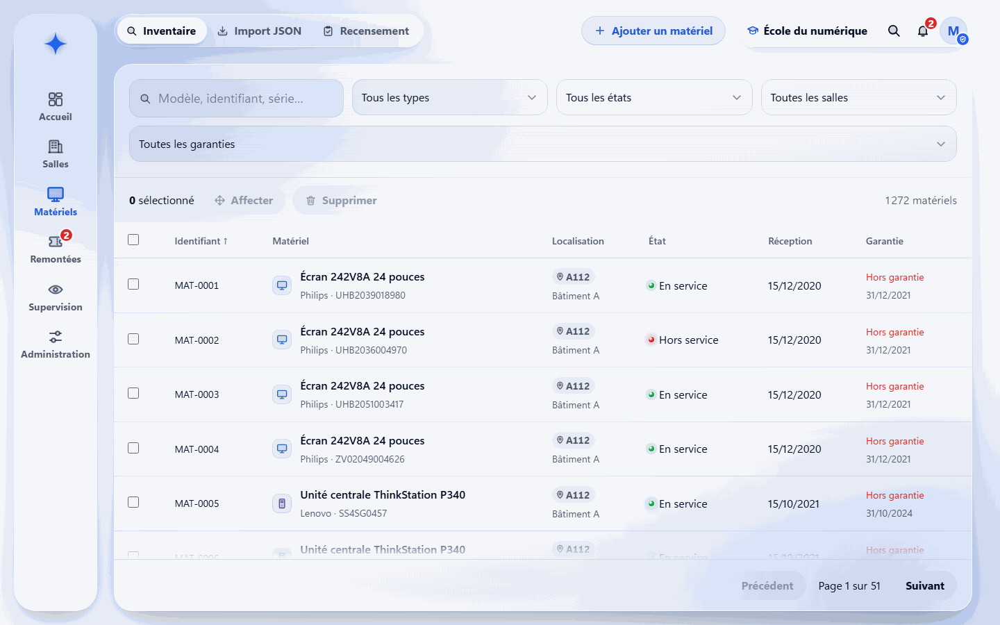

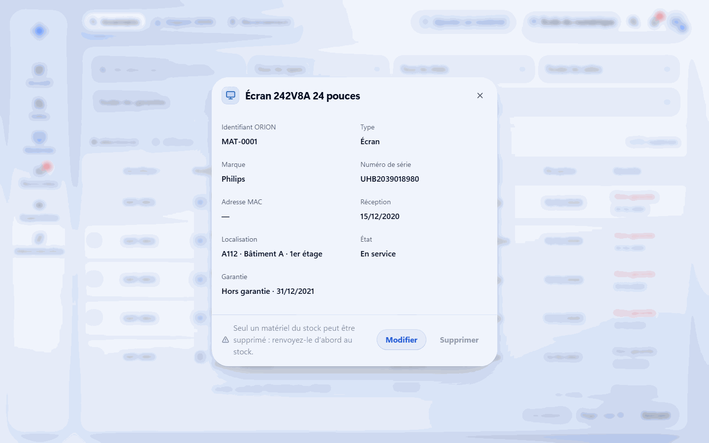

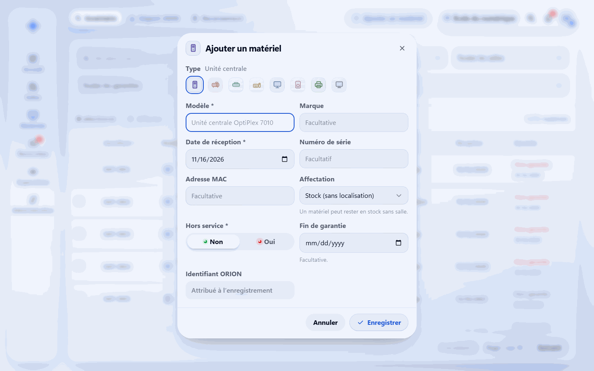

[Diagramme d’activité – Enregistrer ou modifier un matériel](08-DIAGRAMMES-ACTIVITE-CAS-UTILISATION.md#2-enregistrer-ou-modifier-un-matériel)

[Diagramme d’activité – Importer de nouveaux matériels en JSON](08-DIAGRAMMES-ACTIVITE-CAS-UTILISATION.md#3-importer-de-nouveaux-matériels-en-json)

[Diagramme d’activité – Affecter un ou plusieurs matériels à une salle ou au stock](08-DIAGRAMMES-ACTIVITE-CAS-UTILISATION.md#4-affecter-un-ou-plusieurs-matériels-à-une-salle-ou-au-stock)

[Diagramme d’activité – Supprimer un ou plusieurs matériels](08-DIAGRAMMES-ACTIVITE-CAS-UTILISATION.md#5-supprimer-un-ou-plusieurs-matériels)

### Préconditions

- L’administrateur est connecté.
- Les données concernées appartiennent à son école.

### Scénario nominal

| Acteur | ORION |
| --- | --- |
| 1. L’administrateur ouvre **Matériels › Inventaire** ou une salle, et recherche un matériel par modèle, identifiant ORION ou numéro de série. | 2. ORION présente les matériels correspondants. |
| 3. L’administrateur crée un matériel par **Ajouter un matériel**, dans l’inventaire ou dans le stock, ou le modifie depuis sa fiche (**Modifier**), comme le gestionnaire : il saisit le type, le modèle et la date de réception, obligatoires, et au besoin la marque, le numéro de série, l’adresse MAC, l’affectation, l’état et la fin de garantie, puis enregistre. | 4. ORION enregistre le matériel et lui attribue l’identifiant ORION. |
| 5. L’administrateur affecte un ou plusieurs matériels à une salle ou au stock, par sélection ou par glisser-déposer. | 6. ORION enregistre aussitôt l’affectation et marque les matériels « en cours de déplacement ». |
| 7. L’administrateur sélectionne des matériels du stock dans l’inventaire et clique sur **Supprimer**, ou utilise la corbeille de la fiche du matériel. | 8. ORION demande confirmation : « Supprimer définitivement … de l’inventaire ? ». |
| 9. L’administrateur confirme la suppression. | 10. ORION supprime les matériels de l’inventaire et confirme la suppression. |

### Scénario alternatif 1 — importer des matériels en JSON

| Étape | Déroulement |
| --- | --- |
| 3a1.1 | L’administrateur ouvre **Matériels › Import** et suit le parcours du gestionnaire ([UC-GEST-02](12-FICHE-DESCRIPTIVE-GESTIONNAIRE.md#uc-gest-02--importer-des-matériels-en-json)) : format attendu, puis aperçu. |
| 3a1.2 | ORION présente l’aperçu ; les matériels déjà présents ou répétés ne sont pas traités. |
| 3a1.3 | L’administrateur valide l’import, dont le transfert éventuel d’un matériel d’une autre école, qu’il valide en tant qu’importeur. |
| 3a1.4 | ORION importe les matériels et présente le bilan ligne par ligne. |
| Suite | Retour à l’étape 5. |

### Scénario d’exception 1 — matériel hors service affecté à une salle

| Étape | Déroulement |
| --- | --- |
| 5e1.1 | L’administrateur affecte à une salle un matériel hors service. |
| 5e1.2 | ORION refuse l’affectation : un matériel hors service ne peut aller qu’au stock. |
| Suite | Retour à l’étape 5. |

### Scénario d’exception 2 — suppression impossible

| Étape | Déroulement |
| --- | --- |
| 7e2.1 | Le matériel n’est pas au stock ou est cité par une remontée. |
| 7e2.2 | ORION laisse la corbeille désactivée et affiche son motif : « Seul un matériel du stock peut être supprimé : renvoyez-le d’abord au stock. » ou « Un matériel cité par une remontée est conservé. ». |
| Suite | Retour à l’étape 7. |

### Scénario d’exception 3 — fichier JSON invalide

| Étape | Déroulement |
| --- | --- |
| 3e3.1 | Le fichier JSON importé est illisible, vide, trop volumineux ou contient un matériel incomplet ou invalide. |
| 3e3.2 | ORION refuse le fichier en entier et affiche le motif (par exemple « Matériel 3 : … »), comme pour le gestionnaire (UC-GEST-02). |
| Suite | Fin du cas d’utilisation. |

### Questions ouvertes

- Contrôle des doublons de numéro de série lors d’une saisie manuelle.

## UC-ADMIN-02 — Administrer les applications d’un poste ou d’une salle

**En tant qu’**administrateur, **je souhaite** consulter les applications installées et faire installer ou désinstaller une application sur un poste ou une salle **afin d’**administrer les applications des postes de mon école.

- **Déclencheur :** l’administrateur ouvre un poste ou le catalogue des applications.
- **Acteurs secondaires :** postes, qui remontent leurs applications, exécutent l’intervention et renvoient leur résultat.

### Critères d’acceptation

- Chaque poste est présenté avec son emplacement, son unité centrale, son état et son nombre d’applications.
- La demande résume les postes visés, ceux qui démarreront aussitôt (allumés) et ceux qui attendront leur retour (déconnectés).
- Une intervention porte sur un à cinq cents postes d’une seule salle de son école ; elle ne peut pas être supprimée.
- Chaque poste exécute l’intervention et renvoie son résultat.

### Règles de gestion

RG-15, RG-25, RG-65, RG-69, RG-77 et RG-81.

### Besoins non fonctionnels

- Les applications installées ne sont alimentées que par les postes.
- Le catalogue des applications est commun à toutes les écoles.

### Interface

- **Administration › Postes** : filtre par salle, recherche d’un poste et bouton **Ouvrir** ; chaque poste présente son emplacement, son unité centrale, son état et ses applications.
- Détail d’un poste : applications installées, chacune avec **Désinstaller**, et bouton **Installer une application**.
- **Administration › Applications** : catalogue (nom, éditeur, version, nombre de postes équipés, filtrable par salle), boutons **Installer** et **Désinstaller**.
- Demande : choix **Salle entière** ou **Postes**, résumé des postes allumés et déconnectés ; suivi poste par poste dans **Administration › Interventions**.

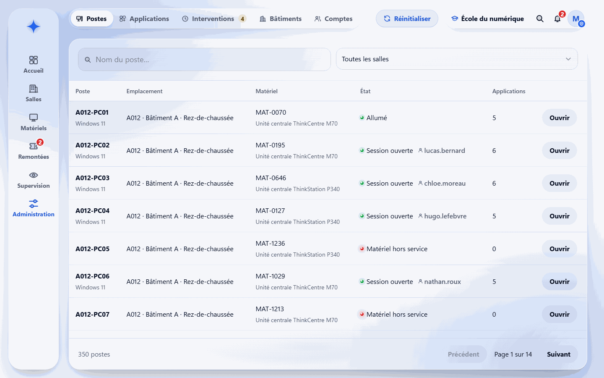

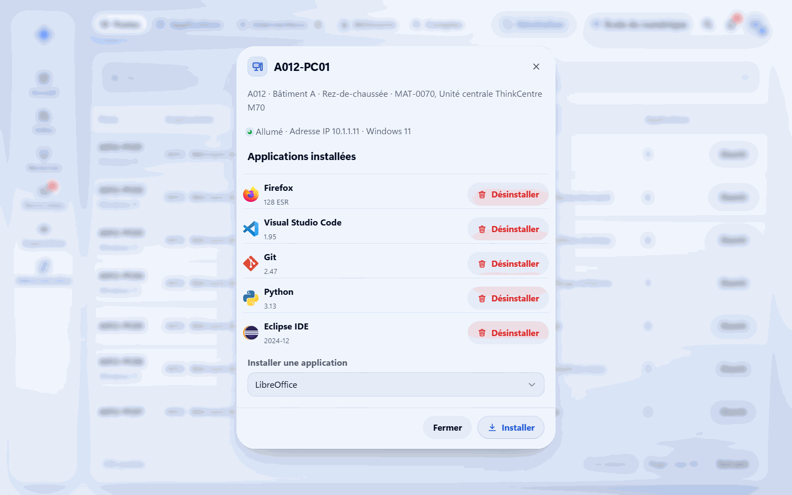

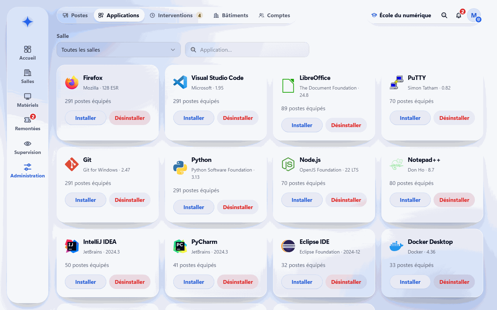

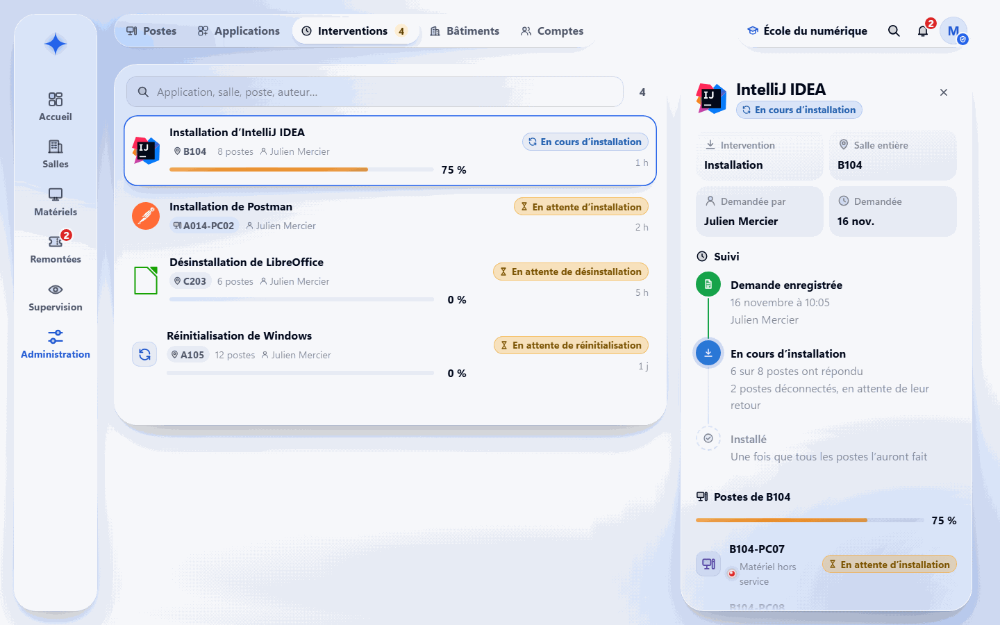

[Diagramme d’activité – Demander une intervention sur les postes](08-DIAGRAMMES-ACTIVITE-CAS-UTILISATION.md#14-demander-une-intervention-sur-les-postes)

### Préconditions

- L’administrateur est connecté.
- La cible appartient à son école.
- Les postes remontent leurs applications à ORION.

### Scénario nominal

| Acteur | ORION |
| --- | --- |
| 1. L’administrateur ouvre **Administration › Postes**, filtre par salle ou recherche un poste. | 2. ORION présente chaque poste avec son emplacement, son unité centrale, son état et son nombre d’applications. |
| 3. L’administrateur clique sur **Ouvrir**. | 4. ORION présente le poste : emplacement, état, adresse IP et applications installées, chacune avec **Désinstaller** ; **Installer une application** propose les autres applications du catalogue. |
| 5. L’administrateur ouvre **Administration › Applications**, consulte le catalogue et clique sur **Installer** ou **Désinstaller**. | 6. ORION ouvre la demande : cible **Salle entière** ou **Postes** choisis dans une salle. |
| 7. L’administrateur choisit la cible. | 8. ORION résume les postes visés, ceux qui démarreront aussitôt (allumés) et ceux qui attendront leur retour (déconnectés). |
| 9. L’administrateur valide. | 10. ORION enregistre l’intervention et confirme : « Installation de … demandée pour la salle … » ; chaque poste l’exécute et renvoie son résultat. |
| 11. L’administrateur suit l’intervention dans **Administration › Interventions** (UC-ADMIN-03). | 12. ORION présente l’avancement de l’intervention, poste par poste. |

### Scénario alternatif 1 — intervenir depuis le détail d’un poste

| Étape | Déroulement |
| --- | --- |
| 5a1.1 | Dans le détail du poste, l’administrateur clique sur **Désinstaller** en face d’une application installée, ou sur **Installer une application**. |
| 5a1.2 | ORION ouvre la demande correspondante. |
| Suite | Retour à l’étape 7. |

### Scénario alternatif 2 — postes déconnectés

| Étape | Déroulement |
| --- | --- |
| 9a2.1 | La demande vise des postes déconnectés. |
| 9a2.2 | ORION enregistre l’intervention ; ces postes l’exécutent à leur retour. |
| Suite | Retour à l’étape 11. |

### Questions ouvertes

- Solution d’administration à distance, protocole, compte technique et gestion des secrets ; l’agent M42 et les postes Linux relèvent de la V2.
- Origine, validation et version des paquets ; la gestion du catalogue des applications relève de la V2.
- Reprise d’une intervention en échec.

## UC-ADMIN-03 — Réinitialiser un poste ou une salle

**En tant qu’**administrateur, **je souhaite** réinitialiser un ou plusieurs postes, ou une salle entière, et en suivre l’exécution **afin de** faire réappliquer l’image système de référence sur les postes de mon école.

- **Déclencheur :** l’administrateur clique sur **Réinitialiser** dans **Administration › Postes**.
- **Acteurs secondaires :** postes, qui réappliquent l’image de référence et renvoient leur résultat ; mécanisme de déploiement.

### Critères d’acceptation

- La demande est enregistrée avec l’image de référence et confirmée : « Réinitialisation … demandée pour … ».
- **Administration › Interventions** présente une ligne par demande avec son avancement ; le détail suit chaque poste : en attente, en cours, réinitialisé ou en échec.
- Lorsque tous les postes ont répondu, l’intervention est terminée si tous ont réussi, en échec sinon ; ORION notifie l’administrateur qui l’a demandée.
- L’annulation et l’interruption d’une réinitialisation ne sont pas proposées.

### Règles de gestion

RG-15, RG-22, RG-25, RG-30, RG-39, RG-69 et RG-81.

### Besoins non fonctionnels

- ORION ne développe pas son propre moteur d’image ; il s’appuie sur un mécanisme de déploiement disponible et autorisé.

### Interface

- Bouton **Réinitialiser** dans **Administration › Postes** ; demande avec choix **Salle entière** ou **Postes**, salle, postes concernés et résumé des postes allumés et déconnectés.
- **Administration › Interventions** : une ligne par demande avec son avancement, filtres par application, salle, poste ou auteur, et détail poste par poste ; les installations, désinstallations et réinitialisations y sont suivies jusqu’à leur fin ou leur échec.

[Diagramme d’activité – Demander une intervention sur les postes](08-DIAGRAMMES-ACTIVITE-CAS-UTILISATION.md#14-demander-une-intervention-sur-les-postes)

### Préconditions

- L’administrateur est connecté.
- Les postes appartiennent à son école.
- Un mécanisme de déploiement est disponible et autorisé.

### Scénario nominal

| Acteur | ORION |
| --- | --- |
| 1. L’administrateur clique sur **Réinitialiser** dans **Administration › Postes**. | 2. ORION ouvre la demande de réinitialisation, avec la salle filtrée le cas échéant. |
| 3. L’administrateur choisit **Salle entière** ou **Postes**, la salle, puis les postes concernés. | 4. ORION résume les postes visés, allumés ou déconnectés. |
| 5. L’administrateur valide par **Réinitialiser**. | 6. ORION enregistre la demande avec l’image de référence et confirme : « Réinitialisation … demandée pour … » ; chaque poste réapplique l’image et renvoie son résultat. |
| 7. L’administrateur ouvre **Administration › Interventions** et filtre au besoin par application, salle, poste ou auteur. | 8. ORION présente une ligne par demande avec son avancement ; le détail suit chaque poste : en attente, en cours, réinitialisé ou en échec. Lorsque tous les postes ont répondu, ORION termine l’intervention et notifie l’administrateur qui l’a demandée. |

### Scénario alternatif 1 — postes déconnectés

| Étape | Déroulement |
| --- | --- |
| 5a1.1 | La demande vise des postes déconnectés. |
| 5a1.2 | ORION enregistre la demande ; ces postes restent en attente et exécutent l’intervention à leur retour. |
| Suite | Retour à l’étape 7. |

### Scénario d’exception 1 — échec de la réinitialisation d’un poste

| Étape | Déroulement |
| --- | --- |
| 6e1.1 | Un poste renvoie un échec de réinitialisation. |
| 6e1.2 | Lorsque tous les postes ont répondu, ORION termine l’intervention en échec et notifie l’administrateur qui l’a demandée. |
| Suite | Fin du cas d’utilisation. |

### Questions ouvertes

- Outil de déploiement existant et interface d’automatisation.
- Images de référence, choix de l’image et données locales à préserver.
- Planification, reprise et capacité simultanée.

## UC-ADMIN-04 — Superviser les postes et gérer les règles de processus

**En tant qu’**administrateur, **je souhaite** superviser les postes, arrêter un processus utilisateur et définir les règles de whitelist et de blacklist de mon école **afin de** superviser les postes de l’école, intervenir sur les processus utilisateur et définir les règles de classement.

- **Déclencheur :** l’administrateur ouvre **Supervision**.
- **Acteurs secondaires :** postes, qui remontent leur état et leurs processus et exécutent les arrêts.

### Critères d’acceptation

- **Alertes** liste les détections de toutes les salles de l’école, des plus récentes aux plus anciennes.
- L’arrêt d’un processus est confirmé : « Arrêt demandé au poste ».
- L’enregistrement d’une règle est confirmé : « Règle enregistrée » ; la suppression d’une règle est confirmée et laisse actives les autres règles.
- ORION applique les règles cumulées et arrête automatiquement un processus de la blacklist ; la détection est historisée et l’administrateur reçoit une notification pour chaque processus interdit lancé.
- La blacklist est prioritaire et une interdiction héritée ne peut pas être annulée à un niveau inférieur.
- Les règles globales sont présentées sans modification ; seul le super administrateur les gère.

### Règles de gestion

RG-15, RG-31 à RG-58, RG-68, RG-69 et RG-88.

### Besoins non fonctionnels

- L’état des postes et leurs processus utilisateur sont actualisés toutes les cinq secondes.
- Après trente secondes sans remontée, un poste est « Poste déconnecté » et reste visible sans processus.
- Les processus du système d’exploitation ne sont pas proposés à l’arrêt ; un seul arrêt peut être en attente pour un même processus.

### Interface

- **Alertes** : détections avec le processus et son classement, le poste et la salle, l’adresse IP, le compte Windows, la date et le résultat de l’arrêt automatique ; choix d’une salle et recherche par processus, poste, adresse IP ou compte.
- **Salles** : état de chaque poste (« Connecté », « Allumé », « Poste déconnecté », « Matériel hors service ») et ses processus utilisateur, avec le bouton d’arrêt d’un processus.
- **Listes de processus** : règles (processus, classement, portée) par ordre alphabétique, 25 par page, recherche et filtre par classement ; **Ajouter une règle**, crayon de modification et corbeille avec confirmation.
- **Statistiques** : postes allumés, processus utilisateur actifs, détections conservées et processus les plus détectés, qui résument l’utilisation du parc.

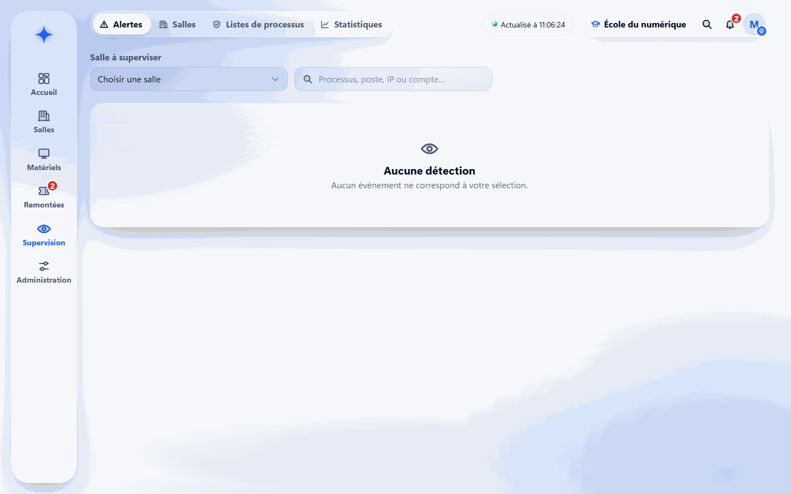

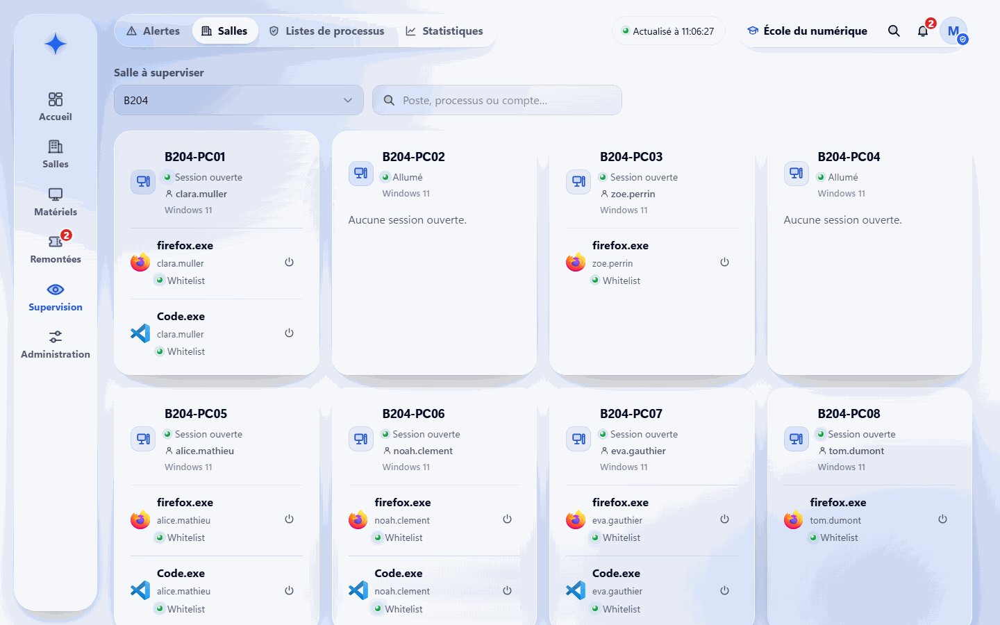

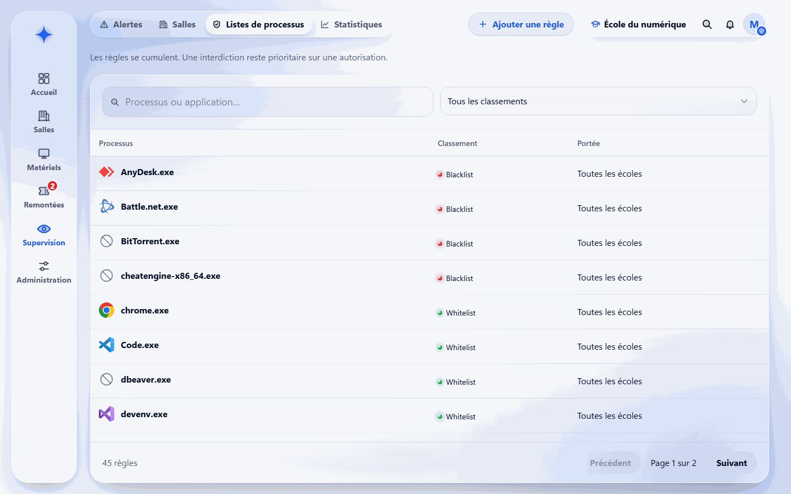

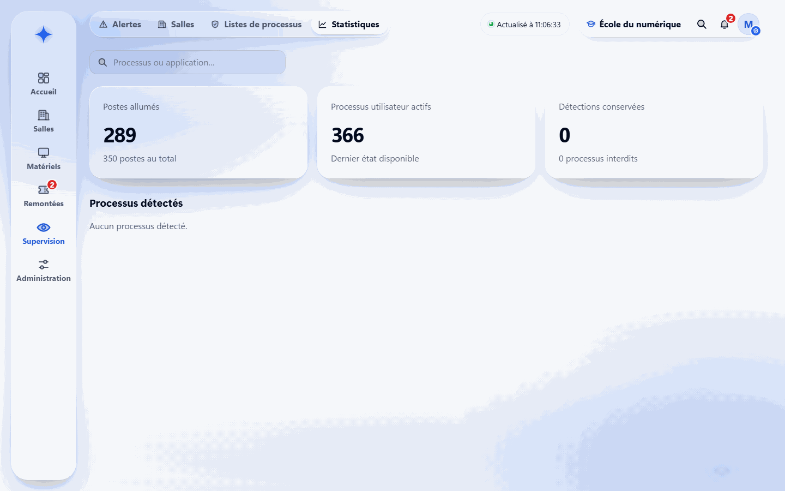

[Diagramme d’activité – Superviser une salle et arrêter un processus](08-DIAGRAMMES-ACTIVITE-CAS-UTILISATION.md#11-superviser-une-salle-et-arrêter-un-processus)

[Diagramme d’activité – Classer les processus et appliquer les règles](08-DIAGRAMMES-ACTIVITE-CAS-UTILISATION.md#12-classer-les-processus-et-appliquer-les-règles)

[Diagramme d’activité – Gérer la whitelist et la blacklist](08-DIAGRAMMES-ACTIVITE-CAS-UTILISATION.md#13-gérer-la-whitelist-et-la-blacklist)

### Préconditions

- L’administrateur est connecté.
- Les postes sont connus dans ORION et remontent leur état.

### Scénario nominal

| Acteur | ORION |
| --- | --- |
| 1. L’administrateur ouvre **Supervision › Alertes** ; il choisit au besoin une salle et applique une recherche par processus, poste, adresse IP ou compte. | 2. ORION liste les détections de toutes les salles de l’école, des plus récentes aux plus anciennes : processus et classement, poste et salle, adresse IP, compte Windows, date et résultat de l’arrêt automatique. |
| 3. L’administrateur ouvre **Salles** et choisit une salle. | 4. ORION présente l’état de chaque poste (« Connecté », « Allumé », « Poste déconnecté », « Matériel hors service ») et ses processus utilisateur, actualisés toutes les cinq secondes. |
| 5. L’administrateur clique sur le bouton d’arrêt d’un processus. | 6. ORION demande l’arrêt au poste et confirme : « Arrêt demandé au poste ». |
| 7. L’administrateur ouvre **Listes de processus**. | 8. ORION présente les règles applicables (processus, classement, portée) par ordre alphabétique, 25 par page, avec une recherche et un filtre par classement. |
| 9. L’administrateur clique sur **Ajouter une règle** et saisit le nom du processus, le classement « Autorisé (whitelist) » ou « Interdit (blacklist) » et la portée école, bâtiment ou salle. | 10. ORION enregistre la règle et confirme : « Règle enregistrée » ; il applique les règles cumulées, arrête automatiquement un processus de la blacklist, historise la détection et notifie l’administrateur de chaque processus interdit lancé. |
| 11. L’administrateur ouvre **Statistiques**. | 12. ORION présente les postes allumés, les processus utilisateur actifs, les détections conservées et les processus les plus détectés. |

### Scénario alternatif 1 — modifier ou supprimer une règle de son école

| Étape | Déroulement |
| --- | --- |
| 9a1.1 | L’administrateur clique sur le crayon d’une règle pour la modifier, ou sur sa corbeille pour la supprimer. |
| 9a1.2 | ORION ouvre le formulaire de modification, ou demande confirmation de la suppression. |
| 9a1.3 | L’administrateur enregistre la modification ou confirme la suppression. |
| 9a1.4 | ORION applique le changement ; la suppression laisse actives les autres règles. |
| Suite | Retour à l’étape 11. |

### Scénario alternatif 2 — consulter les règles globales

| Étape | Déroulement |
| --- | --- |
| 8a2.1 | L’administrateur consulte une règle globale dans **Listes de processus**. |
| 8a2.2 | ORION la présente sans modification possible ; seul le super administrateur gère les règles globales. |
| Suite | Retour à l’étape 9. |

### Scénario d’exception 1 — poste déconnecté

| Étape | Déroulement |
| --- | --- |
| 4e1.1 | Un poste n’a pas remonté son état depuis trente secondes. |
| 4e1.2 | ORION présente le poste « Poste déconnecté », visible sans processus. |
| Suite | Retour à l’étape 5. |

### Scénario d’exception 2 — arrêt de processus impossible

| Étape | Déroulement |
| --- | --- |
| 5e2.1 | Le processus est un processus du système d’exploitation, ou un arrêt est déjà en attente pour ce processus. |
| 5e2.2 | ORION ne présente pas les processus du système d’exploitation ; pour un processus dont l’arrêt est déjà demandé, il ne propose pas de nouvel arrêt : un seul arrêt peut être en attente pour un même processus. |
| Suite | Retour à l’étape 7. |

### Scénario d’exception 3 — interdiction héritée

| Étape | Déroulement |
| --- | --- |
| 9e3.1 | L’administrateur tente d’autoriser, à un niveau inférieur, un processus interdit à un niveau supérieur. |
| 9e3.2 | ORION maintient l’interdiction : la blacklist est prioritaire. |
| Suite | Retour à l’étape 9. |

### Questions ouvertes

- Solution d’administration à distance (dont l’agent Windows M42 envisagé, non réalisé), flux et sécurisation.
- Indicateurs, périodes, filtres et exports statistiques.
- Statuts, traitement et acquittement des détections.

## UC-ADMIN-05 — Créer, consulter et suivre les remontées

**En tant qu’**administrateur, **je souhaite** déclarer un problème, consulter les remontées de l’école, les traiter et suivre leur avancement **afin de** signaler un problème et faire aboutir son traitement.

- **Déclencheur :** l’administrateur clique sur **Signaler un problème** ou ouvre **Remontées**.
- **Acteurs secondaires :** gestionnaire, notifié des nouvelles remontées, qui les traite comme l’administrateur ; auteur de la remontée, notifié de chaque changement de statut.

### Critères d’acceptation

- La remontée est enregistrée « en attente », le gestionnaire est notifié et ORION confirme : « REM-… transmise, état des lieux disponible ».
- L’administrateur consulte toutes les remontées et tous les états des lieux de son école.
- Il n’est notifié que de l’évolution des remontées qu’il a créées, à leur prise en charge puis à la fin de leur traitement ; la notification d’une nouvelle remontée est adressée au gestionnaire.
- L’état des lieux présente le statut et le suivi de la remontée.

### Règles de gestion

RG-11 à RG-15, RG-21, RG-23 à RG-25, RG-34 à RG-39, RG-63, RG-64, RG-66, RG-69, RG-79, RG-80 et RG-89.

### Besoins non fonctionnels

- L’état des lieux est un document A4 produit en PDF à chaque demande, qui n’est pas conservé.
- Les notifications sont présentées dans ORION.

### Interface

- Création d’une remontée en trois étapes par **Signaler un problème**, par les écrans du formateur ([UC-FORM-03](13-FICHE-DESCRIPTIVE-FORMATEUR.md#uc-form-03--créer-une-remontée-et-suivre-son-avancement)).
- **Remontées** : onglets **En attente**, **En cours**, **Terminées**, **Toutes** et **Mes remontées**, filtre par bâtiment et recherche ; une ligne ouvre le détail, où l’administrateur prend en charge puis termine la remontée.
- Bouton **État des lieux** : consulter, télécharger ou imprimer le PDF.

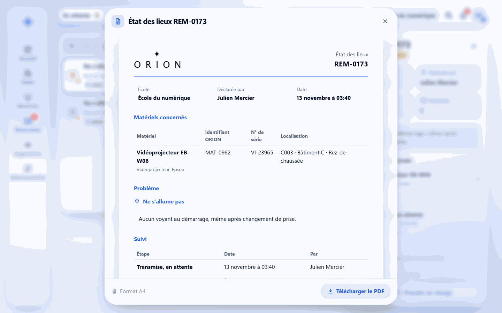

[Diagramme d’activité – Créer une remontée](08-DIAGRAMMES-ACTIVITE-CAS-UTILISATION.md#8-créer-une-remontée)

[Diagramme d’activité – Traiter une remontée](08-DIAGRAMMES-ACTIVITE-CAS-UTILISATION.md#9-traiter-une-remontée)

[Diagramme d’activité – Consulter ou télécharger le PDF d’état des lieux](08-DIAGRAMMES-ACTIVITE-CAS-UTILISATION.md#10-consulter-ou-télécharger-le-pdf-détat-des-lieux)

### Préconditions

- L’administrateur est connecté.
- Les matériels concernés appartiennent à son école.

### Scénario nominal

| Acteur | ORION |
| --- | --- |
| 1. L’administrateur clique sur **Signaler un problème** et suit le même parcours en trois étapes que le formateur : salle ou stock, matériels, type de problème (obligatoire) et description. | 2. ORION enregistre la remontée « en attente », notifie le gestionnaire et confirme : « REM-… transmise, état des lieux disponible ». |
| 3. L’administrateur ouvre **Remontées**, choisit un onglet (**En attente**, **En cours**, **Terminées**, **Toutes**, **Mes remontées**) et filtre au besoin par bâtiment ou par recherche. | 4. ORION présente les remontées de l’école correspondantes. |
| 5. L’administrateur ouvre le détail d’une remontée. | 6. ORION présente le problème, l’auteur, les matériels, le suivi et le bouton **État des lieux**. |
| 7. L’administrateur clique sur **État des lieux**. | 8. ORION produit le PDF, à consulter, télécharger ou imprimer. |
| 9. L’administrateur suit ses propres remontées dans **Mes remontées**. | 10. À la prise en charge puis à la fin du traitement de ses propres remontées, ORION lui adresse une notification. |

### Scénario alternatif 1 — traiter une remontée de l’école

| Étape | Déroulement |
| --- | --- |
| 6a1.1 | L’administrateur prend en charge puis termine la remontée par le parcours du gestionnaire ([UC-GEST-03](12-FICHE-DESCRIPTIVE-GESTIONNAIRE.md#uc-gest-03--consulter-et-traiter-les-remontées)). |
| 6a1.2 | ORION enregistre chaque changement de statut et notifie l’auteur de la remontée. |
| Suite | Retour à l’étape 7. |

### Scénario alternatif 2 — remontée créée par un autre utilisateur

| Étape | Déroulement |
| --- | --- |
| 4a2.1 | L’administrateur consulte une remontée, ou son état des lieux, créée par un autre utilisateur de son école. |
| 4a2.2 | ORION la présente ; il ne notifie pas l’administrateur de son évolution. |
| Suite | Retour à l’étape 5. |

### Questions ouvertes

- Qualification, affectation et délais.
- Signature de l’état des lieux.

## UC-ADMIN-06 — Gérer les comptes ORION de l’école

**En tant qu’**administrateur, **je souhaite** créer, modifier, désactiver et réactiver les comptes ORION de mon école **afin de** créer et tenir à jour les comptes rattachés à l’école.

- **Déclencheur :** un compte doit être créé, modifié, désactivé ou réactivé.
- **Acteurs secondaires :** MindefConnect, qui authentifie l’utilisateur et rapproche son identité du compte.

### Critères d’acceptation

- L’enregistrement d’un compte est confirmé : « Compte enregistré ».
- L’utilisateur accède à ORION après son authentification par MindefConnect, qui rapproche son identité du compte.
- Un compte désactivé ne donne plus accès à ORION ; le changement est appliqué aussitôt, après confirmation.
- Un compte n’est jamais supprimé ; il est désactivé.
- Les comptes gérés par l’administrateur restent rattachés à son école ; il n’attribue pas le profil super administrateur.

### Règles de gestion

RG-01, RG-15, RG-60, RG-62, RG-69 à RG-71, RG-82 et RG-85.

### Besoins non fonctionnels

- L’adresse électronique d’un compte est unique dans ORION.
- Le journal applicatif trace les connexions et chaque enregistrement des utilisateurs.

### Interface

- **Administration › Comptes** : liste des comptes de l’école avec nom et adresse électronique, profil, école, état (« Actif », ou « Désactivé » avec sa date de désactivation) et date de dernière connexion (« Jamais » à défaut).
- **Créer un compte** : formulaire (nom, adresse électronique, profil) ; le crayon d’un compte ouvre le même formulaire ; boutons **Désactiver** et **Réactiver** avec confirmation.

[Diagramme d’activité – Créer ou modifier un compte ORION](08-DIAGRAMMES-ACTIVITE-CAS-UTILISATION.md#16-créer-ou-modifier-un-compte-orion)

[Diagramme d’activité – Désactiver ou réactiver un compte ORION](08-DIAGRAMMES-ACTIVITE-CAS-UTILISATION.md#17-désactiver-ou-réactiver-un-compte-orion)

### Préconditions

- L’administrateur est connecté.
- Le compte appartient à son école.

### Scénario nominal

| Acteur | ORION |
| --- | --- |
| 1. L’administrateur ouvre **Administration › Comptes**. | 2. ORION liste les comptes de l’école : nom et adresse électronique, profil, école, état et date de dernière connexion. |
| 3. L’administrateur clique sur **Créer un compte**. | 4. ORION ouvre le formulaire ; le compte est rattaché à l’école de l’administrateur. |
| 5. L’administrateur saisit le nom, l’adresse électronique et le profil (administrateur, gestionnaire ou formateur), puis enregistre. | 6. ORION enregistre le compte et confirme : « Compte enregistré ». L’utilisateur accède ensuite à ORION après son authentification par MindefConnect. |
| 7. L’administrateur clique sur **Désactiver** ou **Réactiver** un compte et confirme. | 8. ORION applique aussitôt le changement : un compte désactivé ne donne plus accès à ORION. |

### Scénario alternatif 1 — modifier un compte

| Étape | Déroulement |
| --- | --- |
| 3a1.1 | L’administrateur clique sur le crayon d’un compte. |
| 3a1.2 | ORION ouvre le même formulaire que pour la création. |
| Suite | Retour à l’étape 5. |

### Scénario d’exception 1 — adresse électronique déjà utilisée

| Étape | Déroulement |
| --- | --- |
| 5e1.1 | L’adresse électronique saisie est déjà utilisée par un autre compte. |
| 5e1.2 | ORION refuse l’enregistrement : « Cette adresse est déjà utilisée par un autre compte. ». |
| Suite | Retour à l’étape 5. |

### Scénario d’exception 2 — action sur son propre compte

| Étape | Déroulement |
| --- | --- |
| 5e2.1 | L’administrateur tente de modifier son propre profil ou de désactiver son propre compte. |
| 5e2.2 | ORION refuse l’opération. |
| Suite | Fin du cas d’utilisation. |

### Questions ouvertes

- Modalités d’intégration à MindefConnect (DSE, point ouvert PO-02).
- Revue des droits et désactivation des comptes quittant l’organisation.
- Consultation dans ORION et durée de conservation du journal applicatif, qui trace les connexions et chaque enregistrement des utilisateurs.

## UC-ADMIN-07 — Gérer les salles et les étages

**En tant qu’**administrateur, **je souhaite** créer, modifier et supprimer une salle et renommer un bâtiment **afin de** tenir à jour les salles et les bâtiments de l’école.

- **Déclencheur :** une salle doit être créée, modifiée ou supprimée, ou un bâtiment renommé.
- **Acteurs secondaires :** aucun.

### Critères d’acceptation

- La création d’une salle est confirmée : « Salle … créée ».
- À la suppression d’une salle, ses matériels passent en stock ; la suppression est confirmée : « … supprimée ».
- Le renommage d’un bâtiment change son nom pour toutes ses salles.
- Un étage peut exister sans salle ; son numéro est compris entre -5 et 30.
- Le rattachement d’une salle à une école ne peut pas être modifié.

### Règles de gestion

RG-02, RG-15, RG-61, RG-69, RG-74 et RG-75.

### Besoins non fonctionnels

- La suppression d’une salle est confirmée au préalable, en indiquant que ses matériels passeront en stock.

### Interface

- **Salles** : vue des bâtiments, bouton **Nouvelle salle** depuis un bâtiment ou un étage, crayon du détail d’une salle, corbeille avec confirmation, crayon de la vue d’un bâtiment.
- **Administration › Bâtiments** : bâtiments avec leurs étages, leurs salles et leurs matériels, bouton **Renommer**.

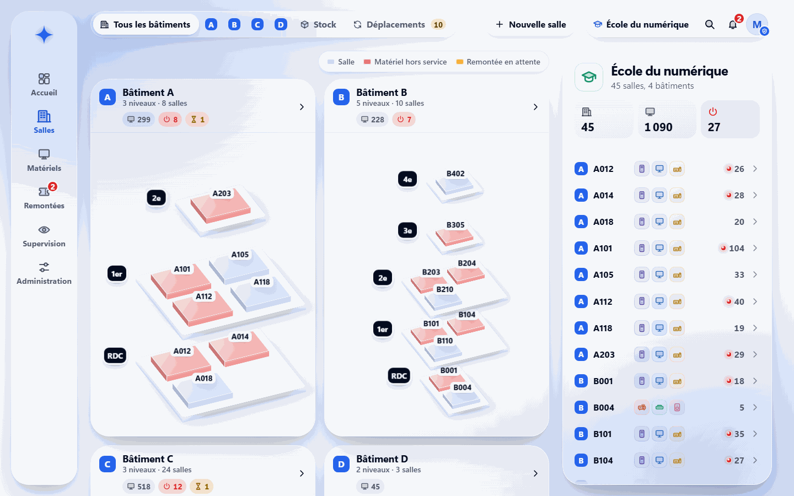

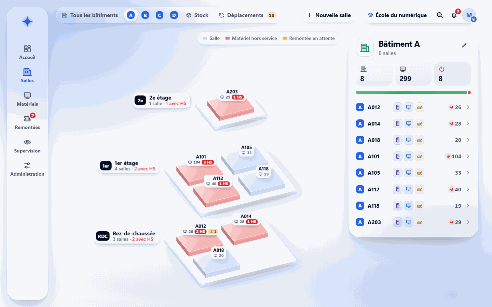

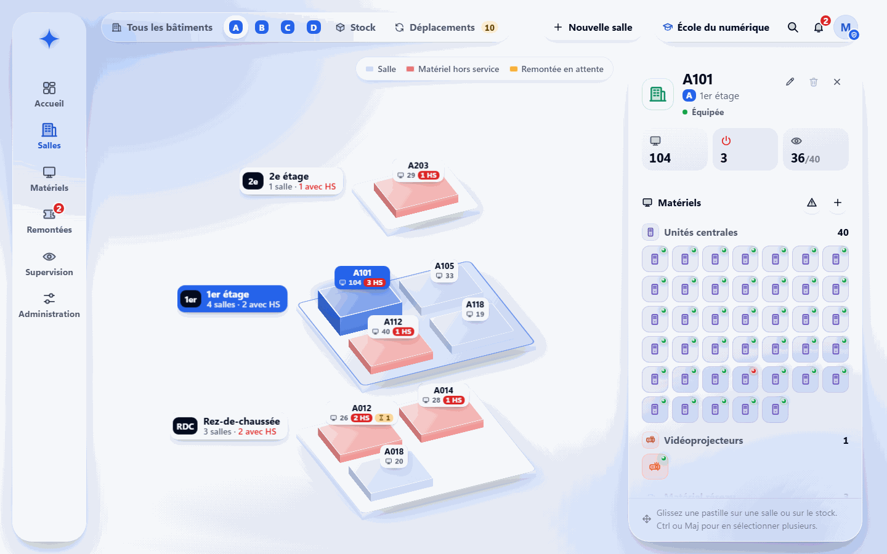

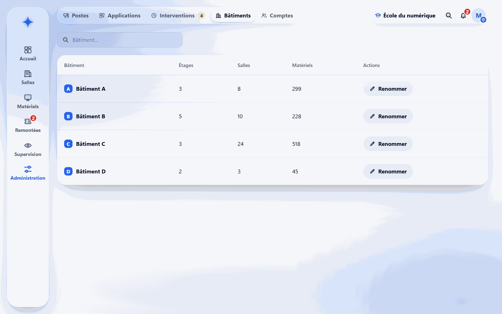

[Diagramme d’activité – Gérer les salles et les étages](08-DIAGRAMMES-ACTIVITE-CAS-UTILISATION.md#15-gérer-les-salles-et-les-étages)

### Préconditions

- L’administrateur est connecté.
- La salle ou le bâtiment appartient à son école.

### Scénario nominal

| Acteur | ORION |
| --- | --- |
| 1. Dans **Salles**, l’administrateur ouvre un bâtiment ou un étage et clique sur **Nouvelle salle**. | 2. ORION ouvre le formulaire de création de la salle. |
| 3. L’administrateur saisit le nom, choisit un bâtiment existant ou nouveau et l’étage. | 4. ORION enregistre la salle et confirme : « Salle … créée ». |
| 5. L’administrateur ouvre le détail d’une salle et clique sur le crayon pour la modifier. | 6. ORION enregistre les modifications de la salle. |
| 7. L’administrateur clique sur la corbeille d’une salle. | 8. ORION demande confirmation, en indiquant que ses matériels passeront en stock. |
| 9. L’administrateur confirme la suppression. | 10. ORION supprime la salle, place ses matériels en stock et confirme : « … supprimée ». |
| 11. L’administrateur ouvre **Administration › Bâtiments** et clique sur **Renommer** pour un bâtiment. | 12. ORION change le nom du bâtiment pour toutes ses salles. |

### Scénario alternatif 1 — renommer un bâtiment depuis Salles

| Étape | Déroulement |
| --- | --- |
| 11a1.1 | L’administrateur ouvre la vue d’un bâtiment dans **Salles** et clique sur son crayon. |
| 11a1.2 | ORION change le nom du bâtiment pour toutes ses salles. |
| Suite | Fin du cas d’utilisation. |

### Scénario d’exception 1 — salle accueillant des postes supervisés

| Étape | Déroulement |
| --- | --- |
| 7e1.1 | La salle accueille des postes supervisés. |
| 7e1.2 | ORION laisse la corbeille désactivée : la salle ne peut pas être supprimée. |
| Suite | Fin du cas d’utilisation. |

## UC-ADMIN-08 — Prévoir et réaliser l’installation d’une salle

**En tant qu’**administrateur, **je souhaite** prévoir les déplacements de matériels vers une salle ou depuis elle, puis confirmer leur installation **afin d’**équiper, compléter ou vider une salle de mon école.

- **Déclencheur :** une salle doit être équipée, complétée ou vidée.
- **Acteurs secondaires :** gestionnaire, notifié des matériels à déplacer comme l’administrateur, qui peut aussi confirmer leur installation.

### Critères d’acceptation

- Les affectations sont enregistrées et les matériels passent « en cours de déplacement ».
- Les déplacements prévus sont visibles par le gestionnaire.
- Chaque installation confirmée enregistre son auteur et sa date ; le matériel passe alors au vert dans **Salles › Déplacements**.
- L’administrateur lance et réalise les recensements de son école comme le gestionnaire.

### Règles de gestion

RG-15, RG-26, RG-27, RG-87 et RG-92 à RG-96.

### Besoins non fonctionnels

- La confirmation peut être faite dans ORION ou sur place avec RIGEL, sur le téléphone de l’administrateur.

### Interface

- Détail d’une salle : bouton **Équiper la salle** (nombre de postes complets, matériels secondaires pris dans le stock en service) et glisser-déposer de matériels vers la salle ou vers le stock.
- **Salles › Déplacements** : suivi de l’avancement, points de déplacement, **Terminer le restockage** et **Installer avec un téléphone**.
- **Matériels › Recensement** : lancement et suivi des recensements de l’école, avec RIGEL.

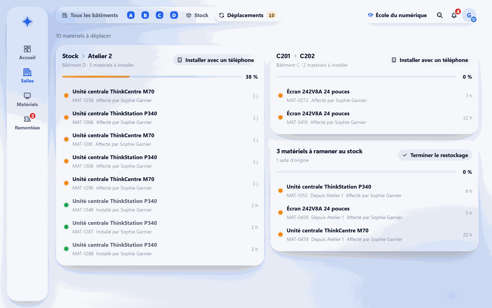

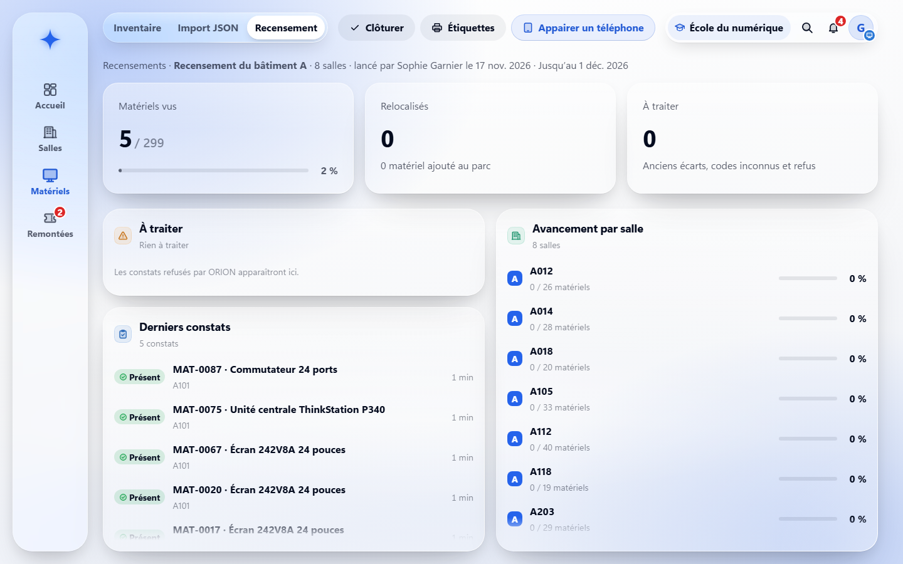

[Diagramme d’activité – Installer une salle](08-DIAGRAMMES-ACTIVITE-CAS-UTILISATION.md#6-installer-une-salle)

[Diagramme d’activité – Recenser le parc](08-DIAGRAMMES-ACTIVITE-CAS-UTILISATION.md#7-recenser-le-parc)

### Préconditions

- L’administrateur est connecté.
- La salle et les matériels appartiennent à son école.

### Scénario nominal

| Acteur | ORION |
| --- | --- |
| 1. Dans le détail d’une salle, l’administrateur clique sur **Équiper la salle**. | 2. ORION propose de choisir le nombre de postes complets et les matériels secondaires, pris dans le stock en service. |
| 3. L’administrateur choisit le nombre de postes complets et les matériels secondaires, ou glisse des matériels vers la salle ou vers le stock. | 4. ORION enregistre les affectations ; les matériels passent « en cours de déplacement » ; le gestionnaire et l’administrateur sont notifiés des matériels à déplacer. |
| 5. L’administrateur ouvre **Salles › Déplacements**. | 6. ORION présente l’avancement des déplacements de la salle. |
| 7. L’administrateur confirme l’installation d’un matériel par son point de déplacement, ou **Terminer le restockage**, comme le gestionnaire ([UC-GEST-04](12-FICHE-DESCRIPTIVE-GESTIONNAIRE.md#uc-gest-04--installer-une-salle-avec-rigel)). | 8. ORION enregistre la confirmation, son auteur et sa date ; le matériel passe au vert. |

### Scénario alternatif 1 — installer avec un téléphone

| Étape | Déroulement |
| --- | --- |
| 7a1.1 | L’administrateur clique sur **Installer avec un téléphone** et confirme sur place l’installation avec RIGEL ([UC-GEST-06](12-FICHE-DESCRIPTIVE-GESTIONNAIRE.md#uc-gest-06--utiliser-rigel-sur-le-téléphone)). |
| 7a1.2 | ORION intègre les confirmations, avec leur auteur et leur date ; chaque matériel confirmé passe au vert. |
| Suite | Retour à l’étape 5. |

### Scénario alternatif 2 — installation confirmée par le gestionnaire

| Étape | Déroulement |
| --- | --- |
| 7a2.1 | Le gestionnaire confirme l’installation d’un matériel, dans ORION ou sur place avec RIGEL. |
| 7a2.2 | ORION enregistre la confirmation ; le matériel passe au vert. |
| Suite | Retour à l’étape 5. |

### Scénario alternatif 3 — recenser le parc

| Étape | Déroulement |
| --- | --- |
| 1a3.1 | L’administrateur lance et réalise un recensement de son école dans **Matériels › Recensement**, comme le gestionnaire ([UC-GEST-05](12-FICHE-DESCRIPTIVE-GESTIONNAIRE.md#uc-gest-05--recenser-le-parc-avec-rigel-et-traiter-les-anciens-constats)), avec RIGEL sur son téléphone ([UC-GEST-06](12-FICHE-DESCRIPTIVE-GESTIONNAIRE.md#uc-gest-06--utiliser-rigel-sur-le-téléphone)). |
| 1a3.2 | ORION intègre les constats du recensement. |
| Suite | Fin du cas d’utilisation. |

### Scénario d’exception 1 — matériel hors service affecté à une salle

| Étape | Déroulement |
| --- | --- |
| 3e1.1 | L’administrateur affecte à une salle un matériel hors service. |
| 3e1.2 | ORION refuse l’affectation : un matériel hors service ne peut être affecté qu’au stock. |
| Suite | Retour à l’étape 3. |

## UC-ADMIN-09 — Suivre son activité : tableaux de bord et notifications

**En tant qu’**administrateur, **je souhaite** consulter mes notifications et mes tableaux de bord **afin de** repérer les remontées, les interventions et les alertes qui me concernent.

- **Déclencheur :** connexion à ORION ou consultation de l’accueil.
- **Acteurs secondaires :** aucun.

### Critères d’acceptation

- Les notifications sont regroupées : remontées qu’il a créées prises en charge ou terminées, interventions qu’il a demandées terminées (réussies ou en échec), processus interdits lancés et arrêtés automatiquement, matériels à déplacer, garanties échues ou arrivant à échéance.
- Il n’est pas notifié des remontées créées par d’autres.
- Chaque carte du tableau de bord mène à l’écran concerné.
- Les réglages d’affichage sont conservés pour ses connexions suivantes.

### Règles de gestion

RG-24, RG-36 à RG-39, RG-55, RG-66, RG-84 et RG-86.

### Besoins non fonctionnels

- Aucune notification n’est envoyée par courriel.

### Interface

- Cloche de la barre supérieure, avec le nombre de notifications et leur résumé ; page **Notifications**.
- **Accueil** : tableau de bord personnalisable (matériels hors service, remontées en attente, flux des remontées, part hors service par bâtiment, salles à surveiller), tableaux **Parc** et **Remontées**, bouton **Personnaliser** et **+** du sous-menu de l’accueil.
- Recherche de la barre supérieure ; menu du compte (nom, profil, école, ambiance, mode, couleur d’accent, verre) et **Se déconnecter**.

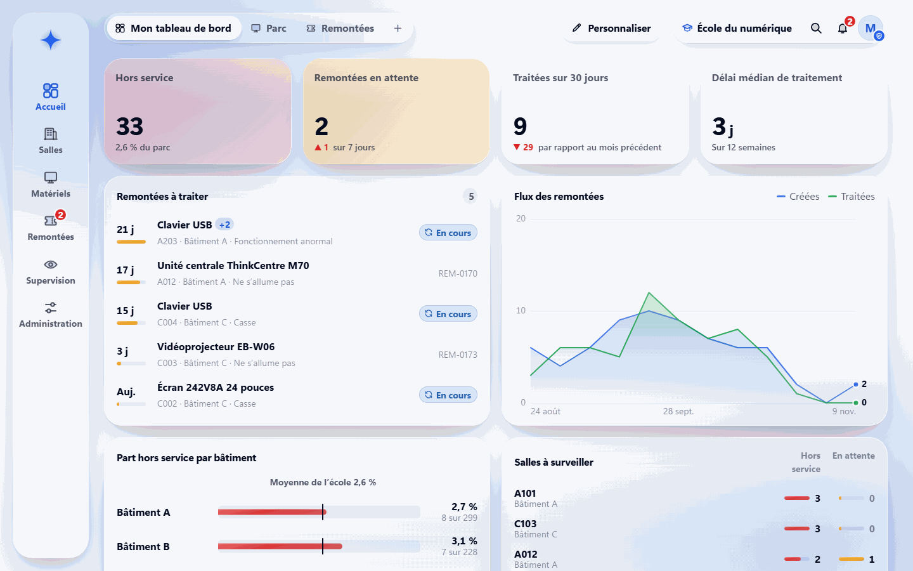

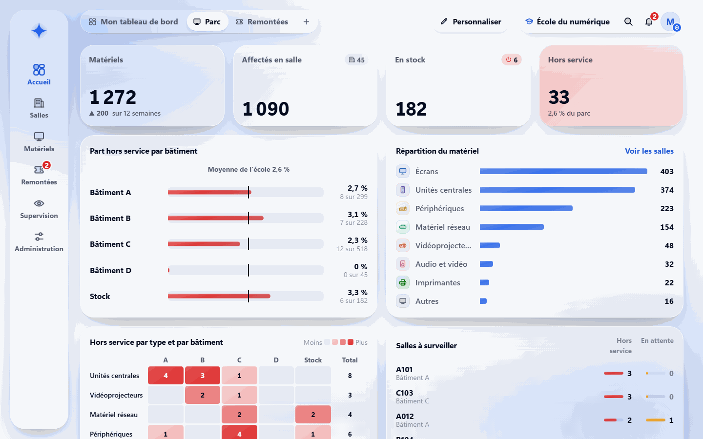

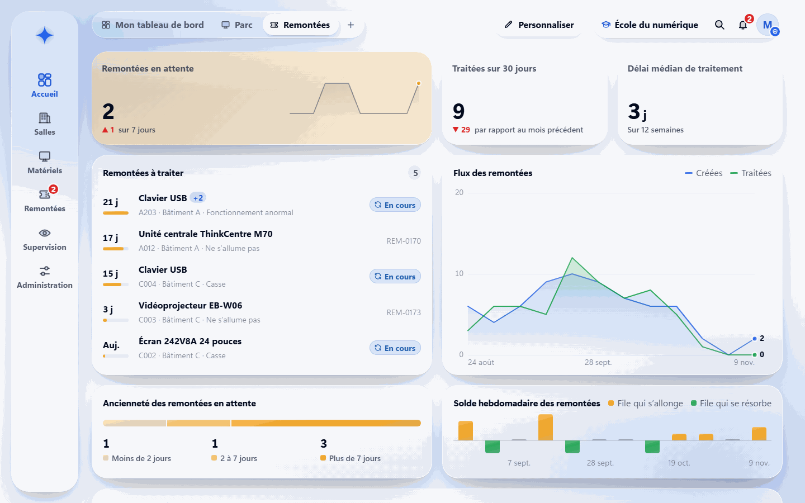

[Diagramme d’activité – Personnaliser ses tableaux de bord](08-DIAGRAMMES-ACTIVITE-CAS-UTILISATION.md#19-personnaliser-ses-tableaux-de-bord)

### Préconditions

- L’administrateur est connecté.

### Scénario nominal

| Acteur | ORION |
| --- | --- |
| 1. L’administrateur clique sur la cloche de la barre supérieure. | 2. ORION indique le nombre de ses notifications et ouvre leur résumé. |
| 3. L’administrateur ouvre la page **Notifications**. | 4. ORION détaille les notifications, regroupées par nature. |
| 5. L’administrateur ouvre **Accueil**. | 6. ORION présente son tableau de bord (matériels hors service, remontées en attente, flux des remontées, part hors service par bâtiment, salles à surveiller), ainsi que les tableaux **Parc** et **Remontées**. |
| 7. L’administrateur clique sur **Personnaliser** : il déplace, redimensionne, retire ou ajoute des cartes, ou rétablit la disposition par défaut. | 8. ORION applique la disposition choisie. |
| 9. L’administrateur utilise la recherche de la barre supérieure. | 10. ORION trouve une salle, un matériel ou une remontée et ouvre l’écran concerné. |
| 11. L’administrateur ouvre le menu du compte et règle l’ambiance (Orion ou Minarm), le mode clair ou sombre, la couleur d’accent de l’ambiance Orion et le verre (liquide ou opaque). | 12. ORION rappelle son nom, son profil et son école, et conserve les réglages pour ses connexions suivantes. |

### Scénario alternatif 1 — créer un autre tableau de bord

| Étape | Déroulement |
| --- | --- |
| 6a1.1 | L’administrateur clique sur le **+** du sous-menu de l’accueil. |
| 6a1.2 | ORION crée un autre tableau. |
| 6a1.3 | L’administrateur renomme ou supprime ce tableau. |
| 6a1.4 | ORION applique le renommage ou la suppression. |
| Suite | Retour à l’étape 7. |

### Scénario alternatif 2 — se déconnecter

| Étape | Déroulement |
| --- | --- |
| 11a2.1 | L’administrateur clique sur **Se déconnecter** dans le menu du compte. |
| 11a2.2 | ORION met fin à sa session. |
| Suite | Fin du cas d’utilisation. |

### Questions ouvertes

- Indicateurs attendus et règles de calcul des tableaux de bord.

## Contraintes transversales

- Application web utilisée avec les versions de Firefox installées sur les postes des écoles.
- Réseau interne NP disposant d’un accès à Internet.
- Authentification via MindefConnect ; modalités d’intégration à préciser (DSE, point ouvert PO-02).
- Un seul profil par utilisateur.
- Notifications dans ORION ; aucun écran ne laisse penser que l’administrateur a un périmètre sur plusieurs écoles.

## Sources

[Consignes du projet](../../01-CONTEXTE/02-CONSIGNES.md), [cadrage consolidé](../../01-CONTEXTE/03-CADRAGE.md), [glossaire](../../01-CONTEXTE/01-GLOSSAIRE.md), [règles de gestion](01-REGLES-DE-GESTION.md), [DCU — Gestion du parc](03-DCU-GESTION-PARC.md), [DCU — Administration des postes](04-DCU-ADMINISTRATION-POSTES.md), [DCU — Supervision des postes](05-DCU-SUPERVISION-POSTES.md), [DCU — Remontées utilisateur](06-DCU-REMONTEES-UTILISATEUR.md), [matrice des droits](11-MATRICE-DROITS.md), [diagrammes d’états](../03-ANALYSE/01-DIAGRAMMES-ETATS.md) et application ORION.
