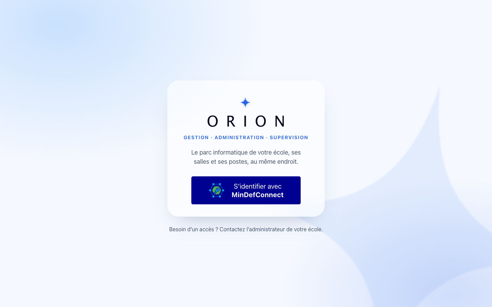
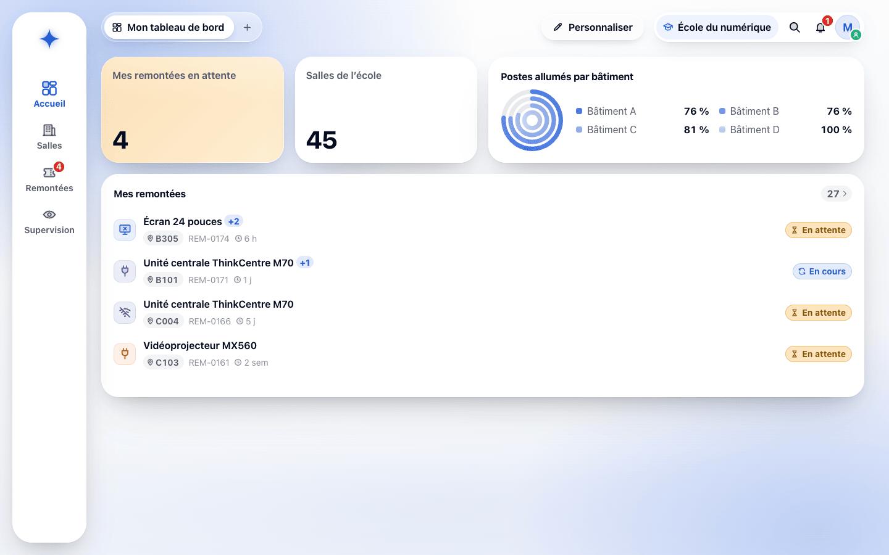
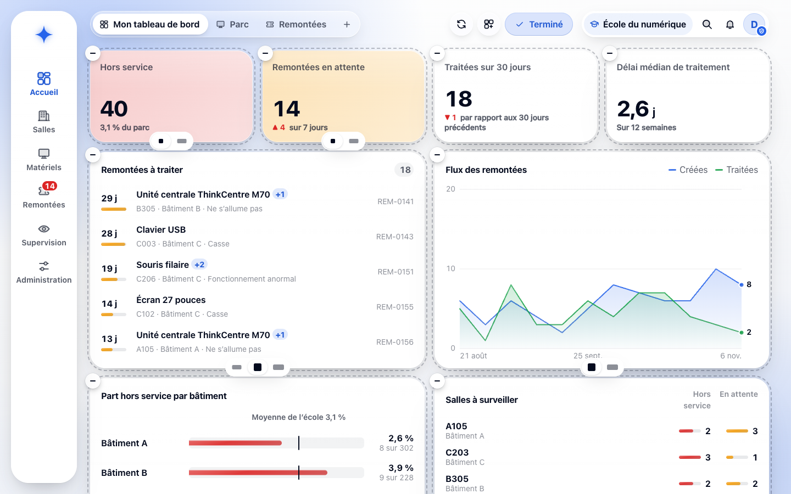
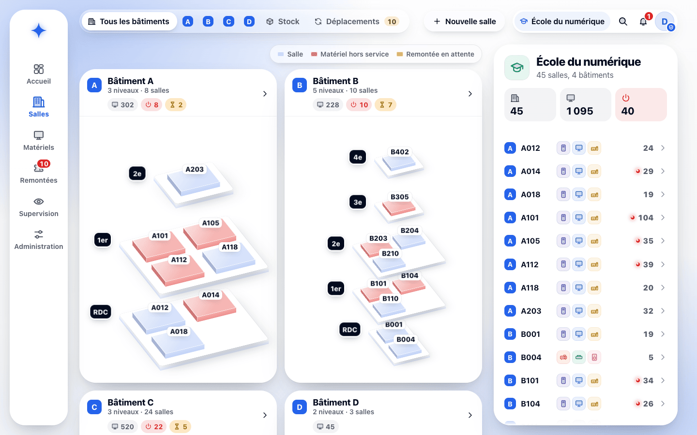
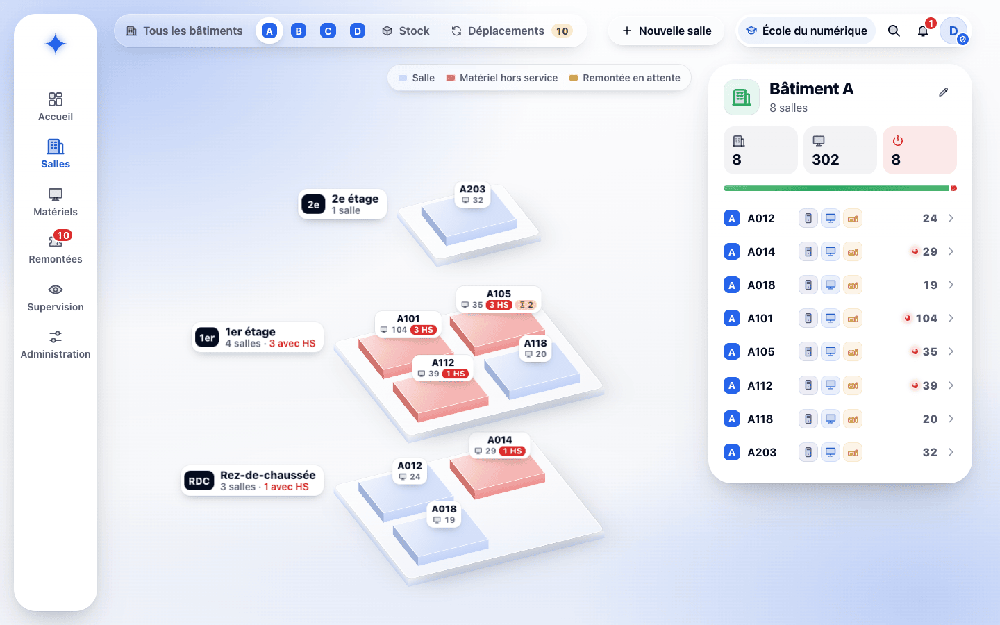
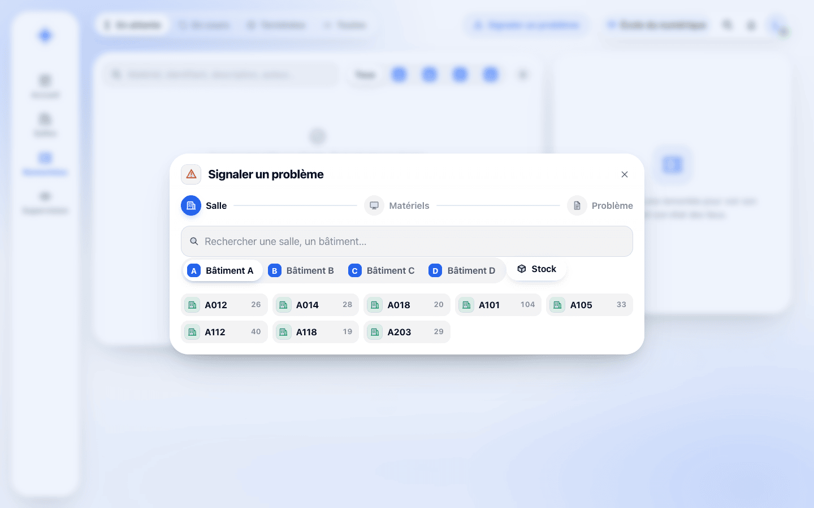
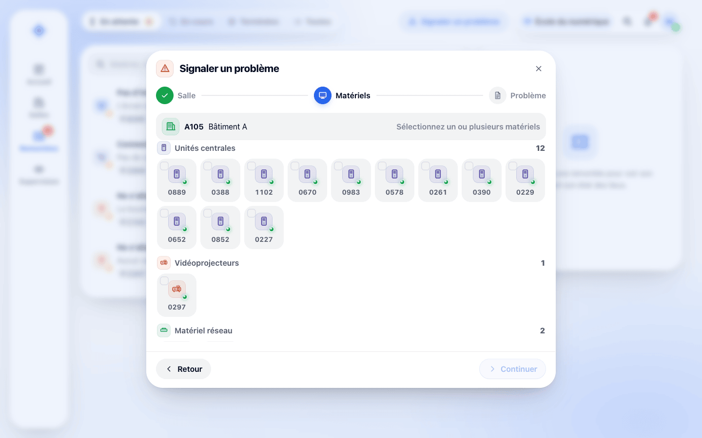
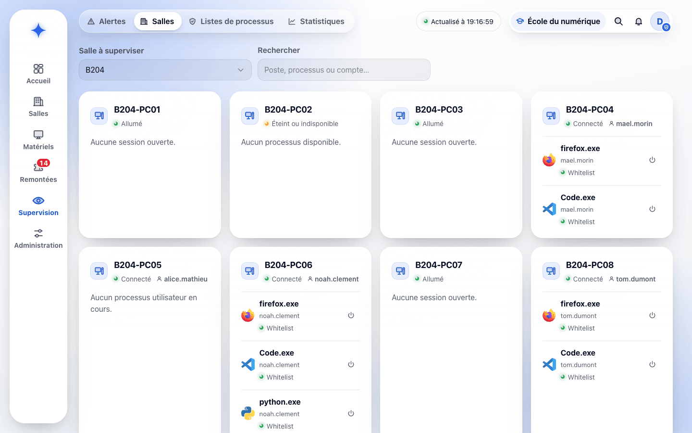
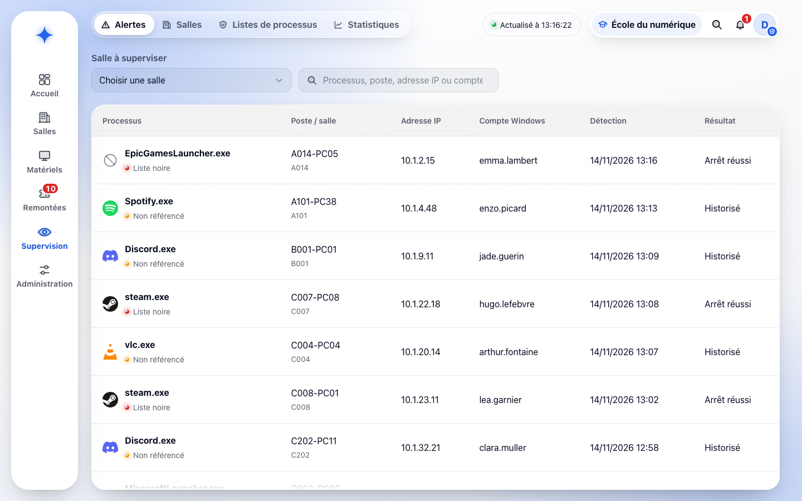

# Fiche descriptive — Formateur

<!-- version:debut : généré par versions.py, ne pas modifier à la main -->
| Version | Mise à jour | Destination | Dernière évolution | Historique |
| --- | --- | --- | --- | --- |
| 3.1 | 14/11/2026 | Production destinée à la remise | Formateur : remontées sur les matériels d’une salle seulement | [9 versions](../../../archive/README.md#14-fiche-descriptive-formateur) |
<!-- version:fin -->

- **Statut :** établie à partir des décisions en vigueur et de l’application ORION.
- **Profil :** formateur.
- **Rattachement :** une école.
- **Périmètre :** toutes les salles de son école, après sélection d’une salle ; aucune vue globale de supervision.
- **Finalité :** superviser les postes de la salle où il enseigne et signaler les problèmes rencontrés sur les matériels.

## Périmètre fonctionnel

| Domaine | Capacités |
| --- | --- |
| Accès | Connexion par MindefConnect, avec un compte ORION actif de son école |
| Tableau de bord | « Mon tableau de bord » personnalisable (ses remontées, salles de l’école, postes allumés par bâtiment) |
| Salles | Vue éclatée des bâtiments, détail d’une salle et de ses matériels, sans modification ; recherche limitée aux salles et aux matériels affectés à une salle, menant à la salle |
| Supervision | **Alertes** et **Salles** : choisir une salle, consulter l’état de ses postes et leurs processus utilisateur, demander l’arrêt d’un processus, consulter les détections de la salle |
| Remontées | Créer une remontée sur des matériels d’une salle ; suivre ses propres remontées ; consulter, télécharger et imprimer leur état des lieux |
| Notifications | Prise en charge et fin de traitement de ses remontées |
| Exclusions | Inventaire et stock, modification du parc, RIGEL, traitement des remontées, listes de processus, statistiques, administration des postes et comptes ORION |

Les droits détaillés sont consolidés dans la [matrice des droits](12-MATRICE-DROITS.md).

## UC-FORM-01 — Superviser une salle et ses processus utilisateur

- **Objectif :** connaître l’état des postes d’une salle et intervenir sur les processus utilisateur.
- **Déclencheur :** le formateur ouvre **Supervision › Salles**, ou suit le lien des postes allumés depuis le détail d’une salle.
- **Préconditions :** le formateur est connecté ; la salle appartient à son école ; les postes remontent leur état à ORION.

### Scénario nominal

1. Le formateur choisit la salle dans **Salle à superviser** ; sans choix, ORION l’invite à « Choisir votre salle ».
2. ORION affiche une carte par poste avec son nom et son état : « Connecté » avec le compte Windows de la session, « Allumé » sans session, « Poste déconnecté » ou « Matériel hors service ».
3. Pour chaque poste connecté, ORION liste les processus utilisateur en cours : nom, compte Windows et classement (« Liste blanche », « Liste noire » ou « Non référencé »).
4. Les données sont actualisées automatiquement toutes les cinq secondes ; l’en-tête indique l’heure de la dernière actualisation.
5. Le formateur peut rechercher un poste, un processus (y compris par le nom de son application) ou un compte.
6. Il clique sur le bouton d’arrêt d’un processus. ORION confirme « Arrêt demandé au poste » et affiche « Arrêt demandé » à la place du bouton.
7. Le poste exécute l’arrêt et renvoie son résultat ; le processus disparaît de la liste une fois arrêté.

### Variantes et limites

- Un poste sans remontée depuis trente secondes est « Poste déconnecté » : il reste affiché, sans processus (« Aucun processus disponible »).
- Les processus du système d’exploitation ne sont ni présentés ni proposés à l’arrêt.
- Un processus de la liste blanche reste visible sans historique ; un processus non référencé reste autorisé, visible et historisé.
- Un processus de la liste noire est arrêté automatiquement, sans confirmation ni justification et sans prévenir l’utilisateur du poste.
- Seul un processus en cours peut être arrêté, et un seul arrêt peut être demandé à la fois pour un même processus.
- Un poste dont l’unité centrale est hors service est éteint et ses processus sont arrêtés.

### Résultats attendus

- Le formateur dispose de l’état courant de la salle choisie.
- L’arrêt manuel porte uniquement sur un processus utilisateur présenté par ORION ; son état est affiché.

### Questions ouvertes

- Solution d’administration à distance (dont l’agent Windows M42 envisagé, non réalisé), flux, comptes techniques et sécurisation des échanges.
- Présentation au formateur de l’échec d’un arrêt manuel.
- Données supplémentaires à remonter et fonctionnement sur des segments réseau isolés.
- Contraintes internes ou juridiques liées à la surveillance de l’activité.

### Règles applicables

RG-19, RG-20, RG-25, RG-31 à RG-33, RG-41 à RG-49, RG-51 à RG-54, RG-57 à RG-59, RG-69, RG-81 et RG-88.

## UC-FORM-02 — Consulter les détections de processus d’une salle

- **Objectif :** prendre connaissance des processus interdits et non référencés lancés dans une salle, et du résultat de l’arrêt automatique.
- **Déclencheur :** le formateur ouvre **Supervision › Alertes**.
- **Préconditions :** le formateur a choisi une salle de son école.

### Scénario nominal

1. Sans salle choisie, ORION rappelle que « les alertes concernent la salle que vous supervisez ».
2. Une fois la salle choisie, ORION liste ses détections, des plus récentes aux plus anciennes : processus et classement, poste et salle, adresse IP, compte Windows, date de détection et résultat (« Arrêt réussi », « Arrêt en échec » ou « Arrêt en cours » pour la liste noire, « Historisé » pour un processus non référencé).
3. Il filtre par processus, poste, adresse IP ou compte.

### Variantes et limites

- Le formateur ne reçoit pas de notification de processus interdit ; il consulte les détections de la salle choisie.
- Les détections sont conservées trente jours.
- Le traitement, l’acquittement ou la clôture d’une détection ne sont pas définis.

### Résultats attendus

- Le formateur peut consulter les détections de la salle qu’il supervise.

### Questions ouvertes

- Niveaux de gravité, statuts, regroupement et acquittement des détections.

### Règles applicables

RG-38, RG-52 à RG-56 et RG-69.

## UC-FORM-03 — Créer une remontée et suivre son avancement

- **Objectif :** déclarer un problème sur un ou plusieurs matériels et suivre sa résolution.
- **Déclencheur :** le formateur constate un problème, puis clique sur **Signaler un problème** dans **Remontées** ou dans le détail d’une salle.
- **Préconditions :** le formateur est connecté et peut sélectionner au moins un matériel de son école.

### Scénario nominal

1. ORION ouvre un parcours en trois étapes. Depuis une salle, la salle et les matériels sélectionnés sont repris.
2. **Salle :** le formateur recherche une salle ou choisit un bâtiment, puis une salle ; le stock ne lui est pas proposé.
3. **Matériels :** ORION présente les matériels regroupés par type, avec leur état ; il en sélectionne un ou plusieurs, puis clique sur **Continuer**.
4. **Problème :** il choisit le type de problème, obligatoire (« Ne s’allume pas », « Pas d’image », « Connexion », « Casse », « Fonctionnement anormal » ou « Autre », dont il précise alors le libellé), puis saisit la description, obligatoire.
5. Il clique sur **Transmettre la remontée**. ORION attribue le numéro, enregistre le formateur comme auteur et la remontée « en attente », notifie le gestionnaire et confirme « REM-… transmise, état des lieux disponible ».
6. Dans **Remontées**, le formateur retrouve ses remontées par onglet (**En attente**, **En cours**, **Terminées**, **Toutes**) ; le détail présente les matériels, leur localisation et le suivi daté.
7. Il ouvre l’**état des lieux** pour le consulter, le télécharger ou l’imprimer en PDF.
8. À la prise en charge puis à la fin du traitement par le gestionnaire, il reçoit une notification dans ORION.

### Variantes et limites

- Une remontée concerne des matériels d’une seule école et n’a qu’un statut : « en attente », « en cours », « remplacé » ou « corrigé ». Une remontée terminée ne change plus de statut.
- Le formateur ne signale que des matériels affectés à une salle, jamais du stock ; la localisation présentée est celle de chaque matériel.
- La remontée ne peut pas être transmise sans type de problème ni description ; elle n’est ensuite ni modifiée ni supprimée.
- Le formateur ne traite pas la remontée et ne consulte ni les remontées ni les états des lieux d’autres auteurs.
- L’état des lieux est produit à chaque demande, avec les informations du moment ; il n’est pas conservé. Aucun courriel n’est envoyé.

### Résultats attendus

- La remontée conserve un auteur unique et ses matériels.
- Le formateur suit uniquement ses propres remontées et reçoit leurs notifications de changement de statut.

### Questions ouvertes

- Priorités, pièces jointes et complément après création.
- Signature de l’état des lieux.

### Règles applicables

RG-11 à RG-14, RG-21, RG-23, RG-34 à RG-38, RG-63, RG-64, RG-66, RG-69, RG-79, RG-80 et RG-89.

## UC-FORM-04 — Consulter les salles et son tableau de bord

- **Objectif :** se repérer dans l’école, connaître le matériel d’une salle et suivre son activité.
- **Déclencheur :** le formateur ouvre **Accueil** ou **Salles**, ou lance la recherche de la barre supérieure.
- **Préconditions :** le formateur est connecté.

### Scénario nominal

1. **Accueil** présente son tableau de bord : ses remontées et leur statut, les salles de l’école, les postes allumés par bâtiment. **Personnaliser** lui permet de déplacer, redimensionner, retirer ou ajouter des cartes.
2. **Salles** présente la vue éclatée des bâtiments ; une balise signale une salle avec du matériel hors service ou une remontée en attente.
3. Il ouvre un bâtiment, puis une salle : ORION affiche ses matériels par type et ses postes allumés, avec un accès à la supervision de la salle et à **Signaler un problème**.
4. La recherche de la barre supérieure lui propose les salles, les matériels affectés à une salle et ses remontées ; un matériel mène à sa salle.
5. À la connexion, ses notifications s’affichent dans une fenêtre contextuelle ; la cloche de la barre supérieure en indique le nombre.

### Variantes et limites

- Le formateur ne voit ni l’inventaire ni le stock ; il ne crée, ne modifie, n’affecte ni ne supprime aucun matériel ou salle.

### Résultats attendus

- Le formateur retrouve une salle et son matériel sans pouvoir les modifier.

### Questions ouvertes

- Indicateurs attendus par les formateurs.

### Règles applicables

RG-37, RG-59, RG-66, RG-69, RG-78 et RG-84.

## Écrans de l’application

### Connexion

Le formateur s’identifie par MindefConnect ; seul un compte ORION actif donne accès à l’application.

### Tableau de bord du formateur

Le formateur suit ses remontées et leur statut, et retrouve les salles de son école et les postes allumés par bâtiment.

### Personnalisation

En mode personnalisation, chaque carte se déplace, se redimensionne ou se retire ; un catalogue en ajoute d’autres.

### Vue éclatée de l’école

Les bâtiments apparaissent en niveaux superposés ; un clic sur une salle ouvre son détail.

### Bâtiment

Les niveaux et les salles d’un bâtiment sont présentés avec leurs compteurs ; la liste des salles permet d’en ouvrir une.

### Signaler un problème : salle

Première étape : le formateur choisit la salle où se trouvent les matériels concernés.

### Signaler un problème : matériels

Deuxième étape : il sélectionne un ou plusieurs matériels avant de choisir le type de problème et de le décrire.

### Supervision d’une salle

Après le choix de la salle, chaque poste présente son état et ses processus ; le bouton d’arrêt demande l’arrêt d’un processus. Le formateur ne dispose que des onglets « Alertes » et « Salles ».

### Alertes

Les détections de processus non référencés ou interdits sont listées avec le poste, l’adresse IP, le compte et le résultat de l’arrêt ; le formateur les consulte pour la salle choisie.

## Besoins en interface

- Tableau de bord personnel composable ; aucune vue globale de supervision.
- Vue éclatée et détail des salles en consultation, avec une action de signalement.
- Choix d’une salle, état des postes et de leurs processus, action d’arrêt avec son état.
- Liste des détections de la salle choisie.
- Parcours de remontée en trois étapes (salle, matériels, problème).
- Espace limité aux remontées du formateur, avec statut, suivi et accès au PDF.
- Notifications dans ORION.

## Contraintes transversales

- Application web utilisée avec les versions de Firefox installées sur les postes de l’équipe.
- Réseau interne NP disposant d’un accès à Internet.
- Authentification via MindefConnect ; modalités d’intégration à préciser (cadrage § 18).
- Un seul profil par utilisateur.

## Sources

[Consignes du projet](../../01-CONTEXTE/01-CONSIGNES.md), [cadrage §§ 3 et 10 à 19](../../01-CONTEXTE/02-CADRAGE.md), [glossaire](../../01-CONTEXTE/00-GLOSSAIRE.md), [règles de gestion](04-REGLES-DE-GESTION.md), [DCU — Gestion du parc](08-DCU-GESTION-PARC.md), [DCU — Supervision des postes](10-DCU-SUPERVISION-POSTES.md), [DCU — Remontées utilisateur](11-DCU-REMONTEES-UTILISATEUR.md), [matrice des droits](12-MATRICE-DROITS.md), [diagrammes d’états](../03-ANALYSE/17-DIAGRAMMES-ETATS.md) et application ORION.
