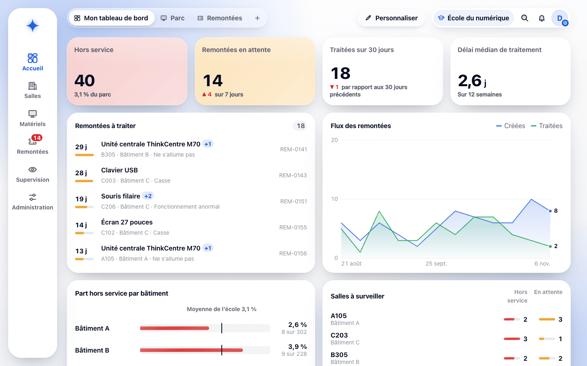
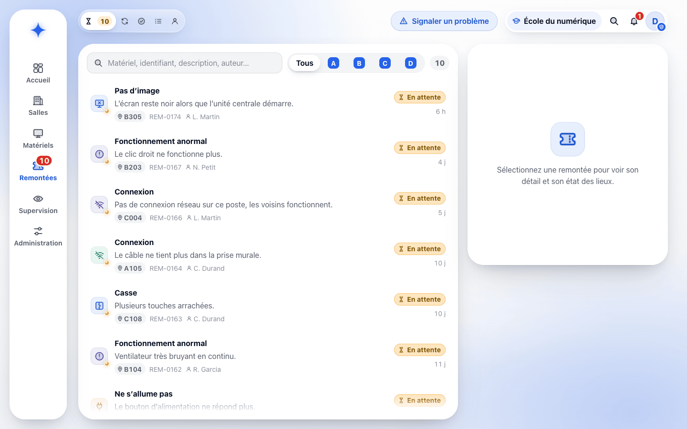
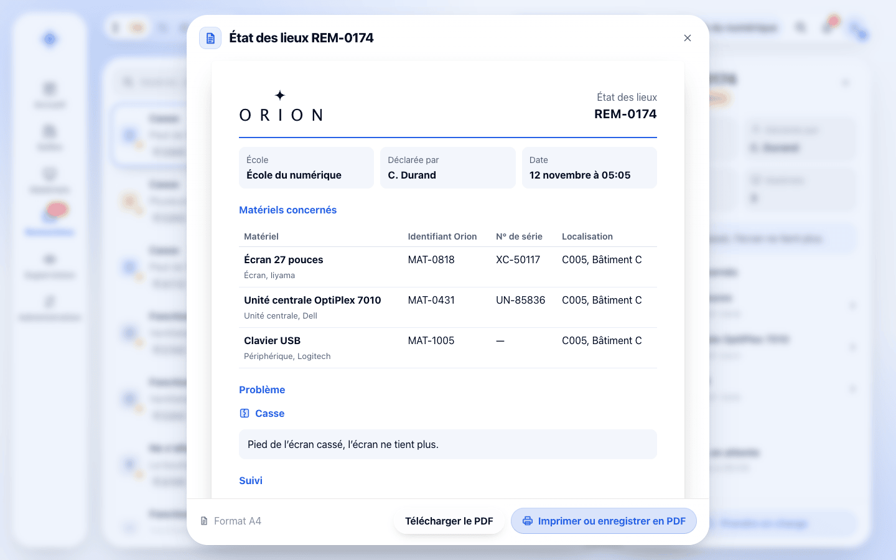
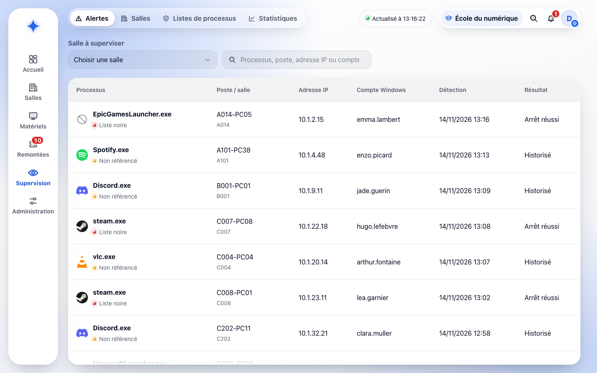
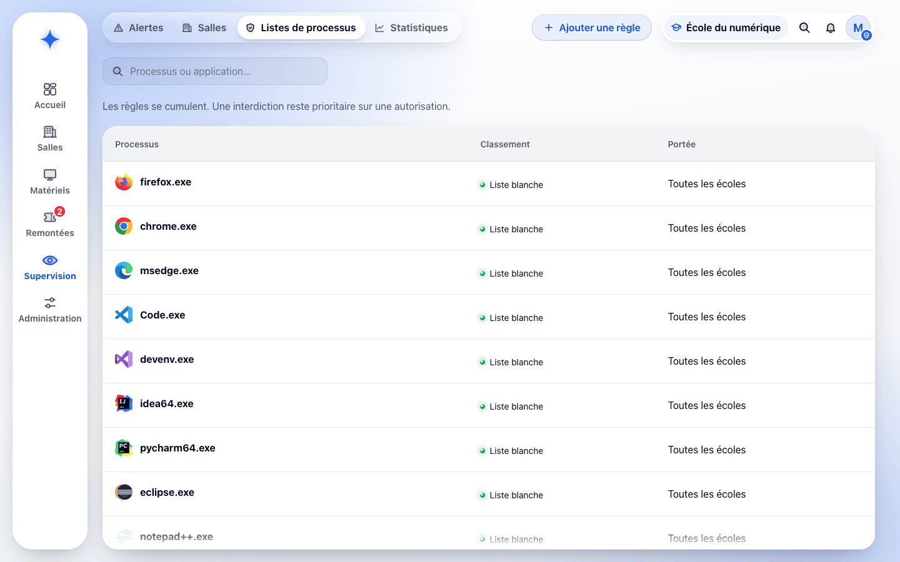
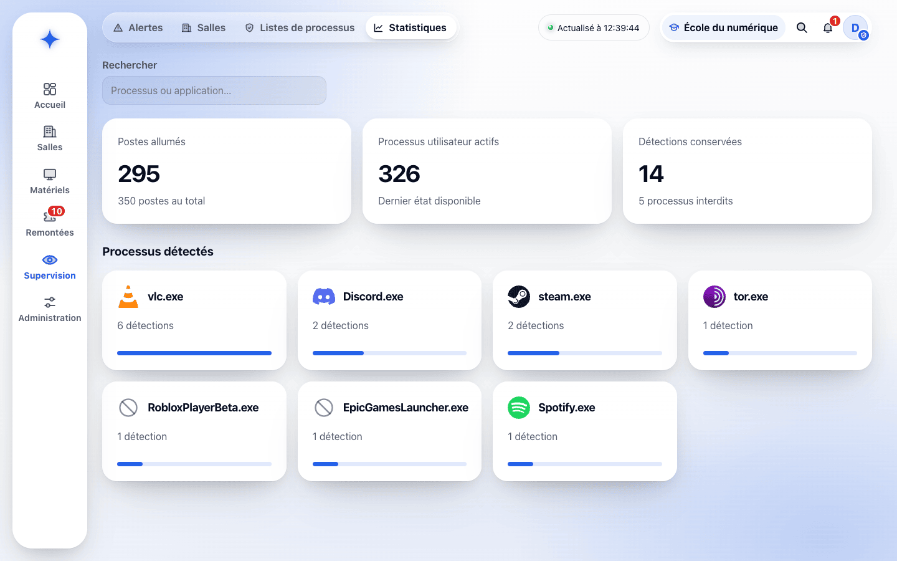
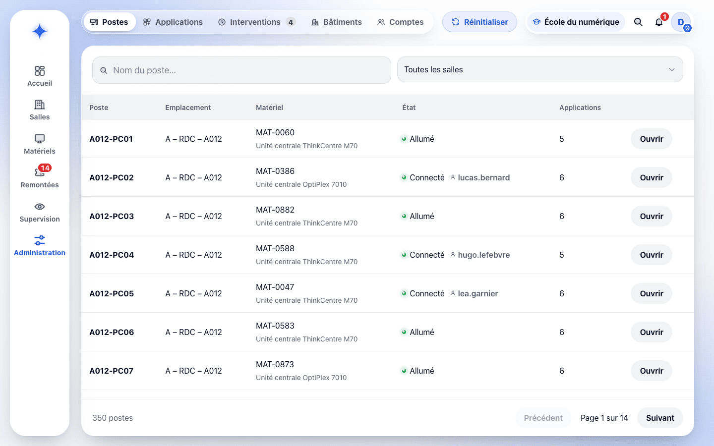
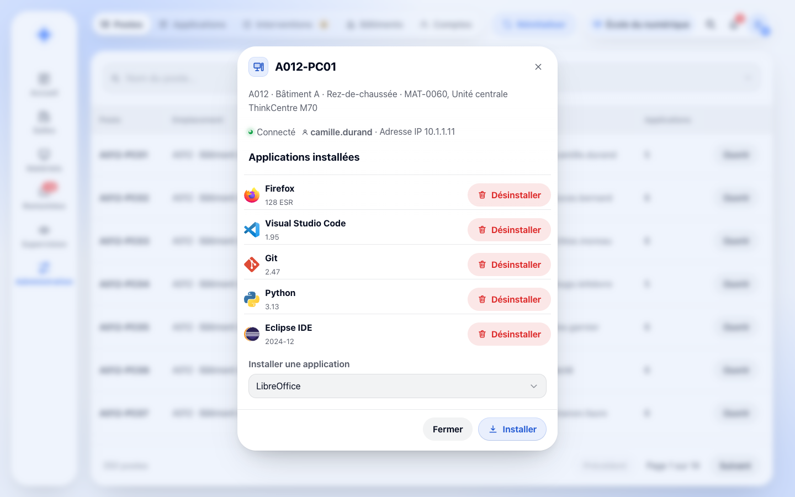
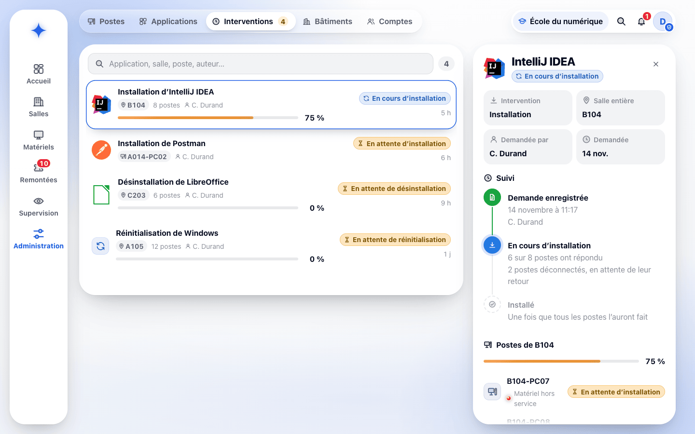
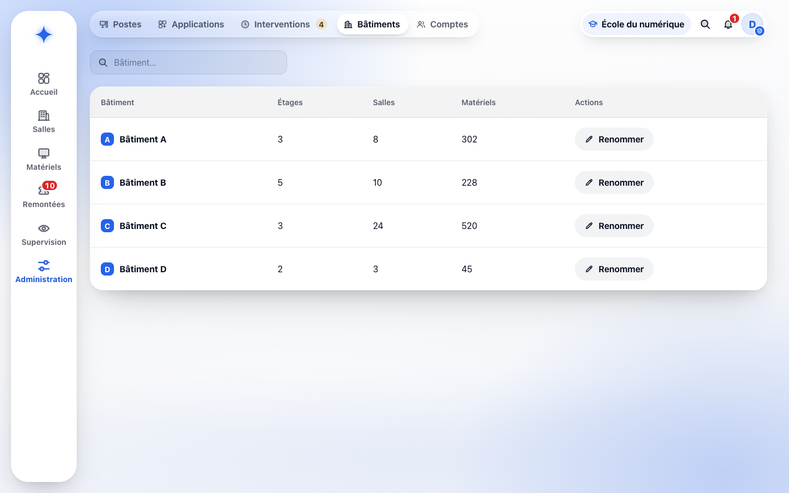

# Fiche descriptive — Administrateur

<!-- version:debut : généré par versions.py, ne pas modifier à la main -->
| Version | Mise à jour | Destination | Dernière évolution | Historique |
| --- | --- | --- | --- | --- |
| 4.0 | 14/11/2026 | Production destinée à la remise | Refaire d’après l’application : parcours écran par écran, RIGEL, noms actuels, captures de l’application | [10 versions](../../../archive/README.md#15-fiche-descriptive-administrateur) |
<!-- version:fin -->

- **Statut :** établie à partir des décisions en vigueur et de l’application ORION.
- **Profil :** administrateur.
- **Rattachement :** une école.
- **Périmètre :** toutes les données et fonctionnalités de son école, à l’exception du traitement des remontées et de l’usage de RIGEL, réservés au gestionnaire.
- **Finalité :** administrer le parc, les salles, les postes, la supervision et les comptes de son école, et suivre les remontées.

## Périmètre fonctionnel

| Domaine | Capacités |
| --- | --- |
| Accès | Connexion par MindefConnect, avec un compte ORION actif de son école |
| Tableaux de bord | « Mon tableau de bord » personnalisable, tableaux spécialisés « Parc » et « Remontées », tableaux ajoutés par le compte |
| Parc matériel | Toutes les actions du gestionnaire sur les matériels, y compris l’import JSON, et la suppression d’un ou plusieurs matériels du stock |
| Salles et bâtiments | Créer, modifier et supprimer une salle ; renommer un bâtiment ; prévoir les déplacements d’une installation |
| Administration des postes | Consulter les postes, leur état et leurs applications ; installer ou désinstaller une application sur un poste ou une salle ; demander la réinitialisation d’un ou plusieurs postes ; suivre les interventions |
| Supervision | Alertes de toutes les salles, supervision d’une salle et arrêt d’un processus, listes de processus (liste blanche, liste noire) de son école, statistiques d’utilisation |
| Remontées | Créer une remontée et suivre les siennes ; consulter toutes les remontées de son école et leurs états des lieux ; le traitement est réservé au gestionnaire |
| Comptes ORION | Créer, modifier, désactiver et réactiver les comptes de son école ; consulter leur dernière connexion et leur date de désactivation |
| Notifications | Évolution de ses propres remontées, fin des interventions qu’il a demandées, lancement d’un processus interdit |
| Exclusions | Traitement des remontées, RIGEL (installation sur place et recensement), règles globales, écoles et comptes super administrateur |

Les droits détaillés sont consolidés dans la [matrice des droits](12-MATRICE-DROITS.md).

## UC-ADMIN-01 — Administrer le parc matériel

- **Objectif :** tenir l’inventaire de l’école, y compris lorsque la suppression d’un matériel est nécessaire.
- **Déclencheur :** un matériel doit être créé, retrouvé, modifié, affecté, importé ou supprimé.
- **Préconditions :** l’administrateur est connecté ; les données concernées appartiennent à son école.

### Scénario nominal

1. L’administrateur ouvre **Matériels › Inventaire** ou une salle, et recherche un matériel par modèle, identifiant ORION ou numéro de série.
2. Il crée ou modifie un matériel comme le gestionnaire (modèle et date de réception obligatoires) ; ORION attribue l’identifiant ORION à l’enregistrement.
3. Il affecte un ou plusieurs matériels à une salle ou au stock, par sélection ou par glisser-déposer ; ORION enregistre aussitôt l’affectation et marque les matériels « en cours de déplacement ».
4. Pour supprimer, il sélectionne des matériels du stock dans l’inventaire et clique sur **Supprimer**, ou utilise la corbeille de la fiche du matériel ; ORION demande confirmation (« Supprimer définitivement … de l’inventaire ? ») puis confirme la suppression.

### Variantes et limites

- Seul un matériel du stock, cité par aucune remontée, peut être supprimé : sinon, la corbeille reste désactivée avec son motif (« Seul un matériel du stock peut être supprimé : renvoyez-le d’abord au stock. » ou « Un matériel cité par une remontée est conservé. »).
- Un matériel hors service ne peut aller qu’au stock.
- L’import JSON fonctionne comme pour le gestionnaire : aperçu, matériels déjà présents non traités, transfert d’un matériel d’une autre école validé par l’importeur, refus d’un fichier invalide en entier.
- L’administrateur renseigne la date de fin de garantie et consulte l’état des garanties ; il ne reçoit pas l’alerte de garantie, réservée au gestionnaire.

### Résultats attendus

- Le matériel possède un identifiant ORION et ses données obligatoires ; il est affecté au plus à une salle de son école ou reste en stock.

### Questions ouvertes

- Contrôle des doublons de numéro de série lors d’une saisie manuelle.

### Règles applicables

RG-03 à RG-10, RG-15, RG-25 à RG-29, RG-69, RG-72, RG-73, RG-86, RG-87 et RG-91.

## UC-ADMIN-02 — Administrer les applications d'un poste ou d'une salle

- **Objectif :** consulter les applications installées et faire installer ou désinstaller une application.
- **Déclencheur :** l’administrateur ouvre un poste ou le catalogue des applications.
- **Préconditions :** la cible appartient à son école ; les postes remontent leurs applications à ORION.

### Scénario nominal

1. Dans **Administration › Postes**, l’administrateur filtre par salle ou recherche un poste. ORION présente chaque poste avec son emplacement, son unité centrale, son état et son nombre d’applications.
2. **Ouvrir** présente le poste : emplacement, état, adresse IP et applications installées, chacune avec **Désinstaller** ; **Installer une application** propose les autres applications du catalogue.
3. Dans **Administration › Applications**, il consulte le catalogue (nom, éditeur, version, nombre de postes équipés, filtrable par salle) et clique sur **Installer** ou **Désinstaller**.
4. ORION ouvre la demande : cible **Salle entière** ou **Postes** choisis dans une salle, puis résumé des postes visés, de ceux qui démarreront aussitôt (allumés) et de ceux qui attendront leur retour (déconnectés).
5. Il valide. ORION enregistre l’intervention et confirme (« Installation de … demandée pour la salle … ») ; chaque poste l’exécute et renvoie son résultat.
6. Il suit l’intervention dans **Administration › Interventions** (UC-ADMIN-03).

### Variantes et limites

- Une intervention porte sur un à cinq cents postes d’une seule salle de son école ; elle ne peut pas être supprimée.
- Les applications installées ne sont alimentées que par les postes.
- Le catalogue des applications est commun à toutes les écoles.

### Questions ouvertes

- Solution d’administration à distance (dont l’agent Windows M42 envisagé, non réalisé), protocole, compte technique et gestion des secrets.
- Origine, validation et version des paquets ; gestion du catalogue des applications.
- Reprise d’une intervention en échec.

### Règles applicables

RG-15, RG-25, RG-65, RG-69, RG-77 et RG-81.

## UC-ADMIN-03 — Réinitialiser un poste ou une salle

- **Objectif :** faire réappliquer l’image système de référence sur des postes et en suivre l’exécution.
- **Déclencheur :** l’administrateur clique sur **Réinitialiser** dans **Administration › Postes**.
- **Préconditions :** les postes appartiennent à son école ; un mécanisme de déploiement est disponible et autorisé.

### Scénario nominal

1. ORION ouvre la demande de réinitialisation, avec la salle filtrée le cas échéant.
2. L’administrateur choisit **Salle entière** ou **Postes**, la salle, puis les postes concernés ; ORION résume les postes visés, allumés ou déconnectés.
3. Il valide par **Réinitialiser**. ORION enregistre la demande avec l’image de référence et confirme « Réinitialisation … demandée pour … ».
4. **Administration › Interventions** présente une ligne par demande avec son avancement ; le détail suit chaque poste : en attente, en cours, réinitialisé ou en échec.
5. Lorsque tous les postes ont répondu, l’intervention est terminée si tous ont réussi, en échec sinon ; ORION notifie l’administrateur qui l’a demandée.

### Variantes et limites

- Un poste déconnecté exécute l’intervention à son retour.
- ORION ne développe pas son propre moteur d’image ; l’annulation et l’interruption ne sont pas proposées.

### Questions ouvertes

- Outil de déploiement existant et interface d’automatisation.
- Images de référence, choix de l’image et données locales à préserver.
- Planification, reprise et capacité simultanée.

### Règles applicables

RG-15, RG-22, RG-25, RG-30, RG-39, RG-69 et RG-81.

## UC-ADMIN-04 — Superviser les postes et gérer les règles de processus

- **Objectif :** superviser les postes de l’école, intervenir sur les processus utilisateur et définir les règles de classement.
- **Déclencheur :** l’administrateur ouvre **Supervision**.
- **Préconditions :** les postes sont connus dans ORION et remontent leur état.

### Scénario nominal

1. **Alertes** liste les détections de toutes les salles de l’école, des plus récentes aux plus anciennes : processus et classement, poste et salle, adresse IP, compte Windows, date et résultat de l’arrêt automatique ; une salle peut être choisie pour restreindre la liste.
2. **Salles** présente, pour la salle choisie, l’état de chaque poste (« Connecté », « Allumé », « Poste déconnecté », « Matériel hors service ») et ses processus utilisateur, actualisés toutes les cinq secondes ; le bouton d’arrêt demande l’arrêt d’un processus (« Arrêt demandé au poste »).
3. **Listes de processus** présente les règles applicables (processus, classement, portée) ; **Ajouter une règle** ouvre le formulaire : nom du processus, classement « Autorisé (liste blanche) » ou « Interdit (liste noire) », portée école, bâtiment ou salle. ORION confirme « Règle enregistrée ».
4. ORION applique les règles cumulées et arrête automatiquement un processus de la liste noire ; la détection est historisée.
5. L’administrateur reçoit une notification pour chaque processus interdit lancé.
6. **Statistiques** présente les postes allumés, les processus utilisateur actifs, les détections conservées et les processus les plus détectés.

### Variantes et limites

- Les règles globales sont présentées sans modification ; seul le super administrateur les gère. La suppression d’une règle est confirmée et laisse actives les autres règles.
- La liste noire est prioritaire et une interdiction héritée ne peut pas être annulée à un niveau inférieur.
- Les processus du système d’exploitation ne sont pas proposés à l’arrêt ; un seul arrêt peut être en attente pour un même processus.
- Après trente secondes sans remontée, un poste est « Poste déconnecté » et reste visible sans processus.

### Questions ouvertes

- Solution d’administration à distance (dont l’agent Windows M42 envisagé, non réalisé), flux et sécurisation.
- Indicateurs, périodes, filtres et exports statistiques.
- Statuts, traitement et acquittement des détections.

### Règles applicables

RG-15, RG-31 à RG-58, RG-68, RG-69 et RG-88.

## UC-ADMIN-05 — Créer, consulter et suivre les remontées

- **Objectif :** déclarer un problème, consulter les remontées de l’école et suivre le traitement réalisé par le gestionnaire.
- **Déclencheur :** l’administrateur clique sur **Signaler un problème** ou ouvre **Remontées**.
- **Préconditions :** l’administrateur est connecté ; les matériels concernés appartiennent à son école.

### Scénario nominal

1. L’administrateur crée une remontée par le même parcours en trois étapes que le formateur : salle ou stock, matériels, type de problème (obligatoire) et description.
2. ORION enregistre la remontée « en attente », notifie le gestionnaire et confirme « REM-… transmise, état des lieux disponible ».
3. **Remontées** présente les remontées de l’école par onglet (**En attente**, **En cours**, **Terminées**, **Toutes**, **Mes remontées**), filtrables par bâtiment et par recherche.
4. Le détail présente le problème, l’auteur, les matériels, le suivi et le bouton **État des lieux**, pour consulter, télécharger ou imprimer le PDF.
5. À la prise en charge puis à la fin du traitement de ses propres remontées, il reçoit une notification dans ORION.

### Variantes et limites

- L’administrateur ne prend pas en charge et ne termine pas les remontées.
- Il consulte toutes les remontées et tous les états des lieux de son école, mais n’est notifié que de l’évolution des remontées qu’il a créées.
- L’état des lieux présente le statut et le suivi ; il est produit à chaque demande et n’est pas conservé.

### Questions ouvertes

- Qualification, affectation et délais.
- Signature de l’état des lieux.

### Règles applicables

RG-11 à RG-15, RG-21, RG-23 à RG-25, RG-34 à RG-39, RG-63, RG-64, RG-66, RG-69, RG-79, RG-80 et RG-89.

## UC-ADMIN-06 — Gérer les comptes ORION de l'école

- **Objectif :** créer et tenir à jour les comptes rattachés à l’école.
- **Déclencheur :** un compte doit être créé, modifié, désactivé ou réactivé.
- **Préconditions :** l’administrateur est connecté ; le compte appartient à son école.

### Scénario nominal

1. **Administration › Comptes** liste les comptes de l’école : nom et adresse électronique, profil, école, état (« Actif », ou « Désactivé » avec sa date de désactivation) et date de dernière connexion (« Jamais » à défaut).
2. **Créer un compte** ouvre le formulaire : nom, adresse électronique unique dans ORION et profil (administrateur, gestionnaire ou formateur) ; le compte est rattaché à son école.
3. Il enregistre ; ORION confirme « Compte enregistré ». L’utilisateur accède à ORION après son authentification par MindefConnect, qui rapproche son identité du compte.
4. **Désactiver** ou **Réactiver** demande confirmation ; ORION applique aussitôt le changement : un compte désactivé ne donne plus accès à ORION.

### Variantes et limites

- Un compte n’est jamais supprimé ; il est désactivé.
- L’administrateur ne peut ni modifier son propre profil ni désactiver son propre compte ; les comptes qu’il gère restent rattachés à son école.
- Il n’attribue pas le profil super administrateur.
- Une adresse déjà utilisée est refusée (« Cette adresse est déjà utilisée par un autre compte. »).

### Questions ouvertes

- Modalités d’intégration à MindefConnect (cadrage § 18).
- Revue des droits et désactivation des comptes quittant l’organisation.
- Consultation et durée de conservation du journal des opérations sur les comptes.

### Règles applicables

RG-01, RG-15, RG-60, RG-62, RG-69 à RG-71, RG-82 et RG-85.

## UC-ADMIN-07 — Gérer les salles et les étages

- **Objectif :** tenir à jour les salles et les bâtiments de l’école.
- **Déclencheur :** une salle doit être créée, modifiée ou supprimée, ou un bâtiment renommé.
- **Préconditions :** l’administrateur est connecté ; la salle ou le bâtiment appartient à son école.

### Scénario nominal

1. Dans **Salles**, l’administrateur ouvre un bâtiment ou un étage et clique sur **Nouvelle salle** ; il saisit le nom, choisit un bâtiment existant ou nouveau et l’étage.
2. ORION enregistre la salle et confirme « Salle … créée ». Le crayon du détail d’une salle permet de la modifier.
3. La corbeille d’une salle demande confirmation, en indiquant que ses matériels passeront en stock ; ORION confirme « … supprimée ».
4. **Administration › Bâtiments** liste les bâtiments avec leurs étages, salles et matériels ; **Renommer** change le nom d’un bâtiment pour toutes ses salles.

### Variantes et limites

- Une salle qui accueille des postes supervisés ne peut pas être supprimée : sa corbeille reste désactivée.
- À la suppression d’une salle, ses matériels passent en stock.
- Un étage peut exister sans salle ; son numéro est compris entre -5 et 30.
- Le rattachement d’une salle à une école ne peut pas être modifié.

### Règles applicables

RG-02, RG-15, RG-61, RG-69, RG-74 et RG-75.

## UC-ADMIN-08 — Prévoir l’installation d’une salle

- **Objectif :** préparer les déplacements de matériels que le gestionnaire réalisera sur place.
- **Déclencheur :** une salle doit être équipée, complétée ou vidée.
- **Préconditions :** l’administrateur est connecté ; la salle et les matériels appartiennent à son école.

### Scénario nominal

1. Dans le détail d’une salle, l’administrateur clique sur **Équiper la salle** et choisit le nombre de postes complets et les matériels secondaires pris dans le stock en service, ou glisse des matériels vers la salle ou vers le stock.
2. ORION enregistre les affectations ; les matériels passent « en cours de déplacement » et le gestionnaire est notifié des matériels à déplacer.
3. L’administrateur suit l’avancement dans **Salles › Déplacements** ; chaque matériel passe au vert lorsque le gestionnaire confirme son installation sur place avec RIGEL.

### Variantes et limites

- L’administrateur prévoit les déplacements mais ne réalise pas l’installation et n’utilise pas RIGEL.
- Un matériel hors service ne peut être affecté qu’au stock.

### Résultats attendus

- Les déplacements prévus sont visibles par le gestionnaire, qui les réalise.

### Règles applicables

RG-26, RG-27, RG-87 et RG-92.

## UC-ADMIN-09 — Suivre son activité : tableaux de bord et notifications

- **Objectif :** repérer les remontées, les interventions et les alertes qui le concernent.
- **Déclencheur :** connexion à ORION ou consultation de l’accueil.
- **Préconditions :** l’administrateur est connecté.

### Scénario nominal

1. À la connexion, ORION présente ses notifications dans une fenêtre contextuelle ; la cloche de la barre supérieure en indique le nombre et ouvre à tout moment leur résumé.
2. Les notifications sont regroupées : remontées qu’il a créées prises en charge ou terminées, interventions qu’il a demandées terminées (réussies ou en échec), processus interdits lancés et arrêtés automatiquement.
3. **Accueil** présente son tableau de bord (matériels hors service, remontées en attente, flux des remontées, part hors service par bâtiment, salles à surveiller), personnalisable, ainsi que les tableaux **Parc** et **Remontées**.

### Variantes et limites

- Il n’est pas notifié des remontées créées par d’autres, ni des garanties.
- Aucune notification n’est envoyée par courriel.

### Questions ouvertes

- Indicateurs attendus et règles de calcul des tableaux de bord.

### Règles applicables

RG-24, RG-36 à RG-39, RG-55, RG-66 et RG-84.

## Écrans de l’application

### Tableau de bord de l’administrateur

L’administrateur suit les matériels hors service, les remontées en attente et les salles à surveiller ; chaque carte mène à l’écran concerné.

### Liste des remontées

Les remontées de l’école sont filtrées par onglet, bâtiment ou recherche ; une ligne ouvre le détail, sans action de traitement.

### État des lieux

Le document A4 de la remontée, produit à la demande, se télécharge ou s’imprime en PDF.

### Alertes

Les détections de toutes les salles sont listées avec le poste, l’adresse IP, le compte et le résultat de l’arrêt automatique.

### Listes de processus

Les règles de liste blanche et de liste noire sont présentées par portée ; l’administrateur ajoute, modifie ou supprime celles de son école.

### Statistiques

Les postes allumés, les processus actifs et les détections conservées résument l’utilisation du parc.

### Postes

Chaque poste présente son emplacement, son unité centrale, son état et ses applications ; « Réinitialiser » ouvre la demande sur une salle ou des postes.

### Applications d’un poste

Le détail d’un poste liste ses applications installées, à désinstaller, et propose l’installation d’une autre application.

### Interventions

Les installations, désinstallations et réinitialisations demandées sont suivies poste par poste jusqu’à leur fin ou leur échec.

### Bâtiments

Chaque bâtiment présente ses étages, ses salles et ses matériels ; « Renommer » change son nom pour toutes ses salles.

Les écrans du parc, communs avec le gestionnaire, sont présentés dans la [fiche Gestionnaire](13-FICHE-DESCRIPTIVE-GESTIONNAIRE.md#écrans-de-lapplication), et ceux de la création d’une remontée dans la [fiche Formateur](14-FICHE-DESCRIPTIVE-FORMATEUR.md#écrans-de-lapplication).

## Besoins en interface

- Tous les écrans du parc, avec suppression réservée aux administrateurs et motif affiché lorsqu’elle est impossible.
- Gestion des salles depuis la vue des bâtiments et renommage des bâtiments.
- Préparation des installations (« Équiper la salle », glisser-déposer) et suivi des déplacements.
- Sélection d’une salle entière ou de postes pour les interventions, avec résumé des postes allumés et déconnectés.
- Catalogue des applications, détail d’un poste et suivi des interventions poste par poste.
- Supervision des postes et processus, listes de processus, alertes et statistiques.
- Création, consultation et suivi des remontées avec accès aux PDF, sans action de traitement.
- Gestion des comptes limitée à l’école, avec dernière connexion et date de désactivation.
- Notifications dans ORION ; aucun écran ne laisse penser que l’administrateur a un périmètre sur plusieurs écoles.

## Contraintes transversales

- Application web utilisée avec les versions de Firefox installées sur les postes de l’équipe.
- Réseau interne NP disposant d’un accès à Internet.
- Authentification via MindefConnect ; modalités d’intégration à préciser (cadrage § 18).
- Un seul profil par utilisateur.

## Sources

[Consignes du projet](../../01-CONTEXTE/01-CONSIGNES.md), [cadrage consolidé](../../01-CONTEXTE/02-CADRAGE.md), [glossaire](../../01-CONTEXTE/00-GLOSSAIRE.md), [règles de gestion](04-REGLES-DE-GESTION.md), [DCU — Gestion du parc](08-DCU-GESTION-PARC.md), [DCU — Administration des postes](09-DCU-ADMINISTRATION-POSTES.md), [DCU — Supervision des postes](10-DCU-SUPERVISION-POSTES.md), [DCU — Remontées utilisateur](11-DCU-REMONTEES-UTILISATEUR.md), [matrice des droits](12-MATRICE-DROITS.md), [diagrammes d’états](../03-ANALYSE/17-DIAGRAMMES-ETATS.md) et application ORION.
