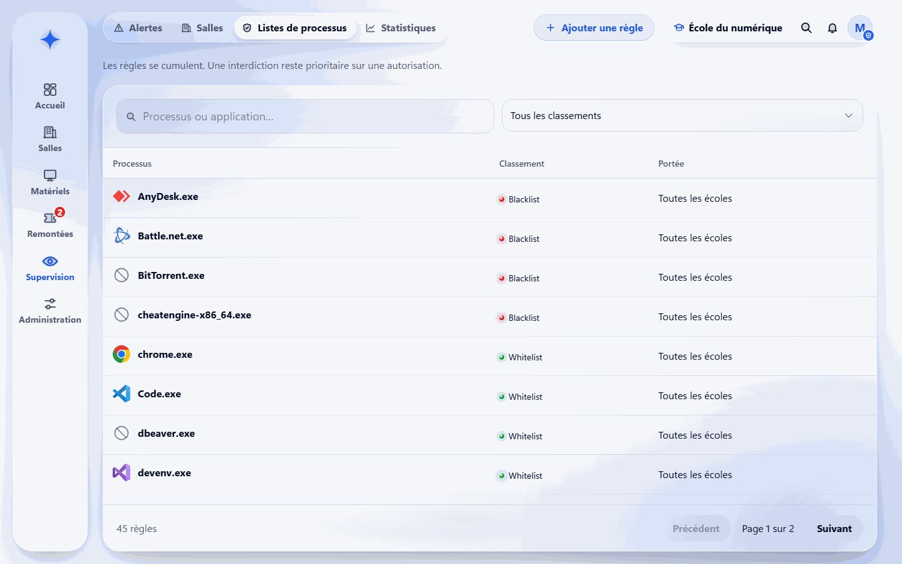
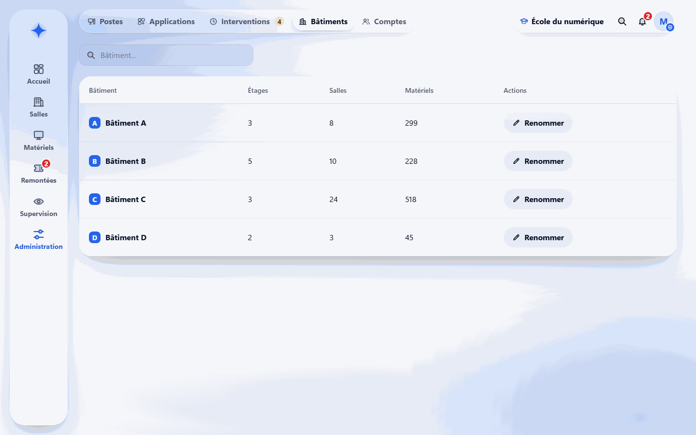

# Fiche descriptive — Super administrateur

<!-- version:debut : généré par versions.py, ne pas modifier à la main -->
| Version | Mise à jour | Destination | Dernière évolution | Historique |
| --- | --- | --- | --- | --- |
| 5.1 | 16/11/2026 | Production destinée à la remise | Adopter la numérotation locale du dossier ; Actualiser les liens après la renumérotation | [14 versions](../../../archive/README.md#15-fiche-descriptive-super-administrateur) |
<!-- version:fin -->

- **Statut :** établie à partir des décisions en vigueur et de l’application ORION.
- **Profil :** super administrateur.
- **Rattachement :** aucune école.
- **Périmètre :** toutes les écoles.
- **Finalité :** exercer à l’échelle de toutes les écoles les droits de l’administrateur, gérer les écoles, les règles globales de processus et les comptes super administrateur.

## Différence avec l'administrateur

Le super administrateur possède les mêmes capacités que l’administrateur, sur toutes les écoles. Il dispose en outre de capacités propres au périmètre global : choix de l’école affichée, gestion des écoles, gestion des règles globales de processus et attribution du profil super administrateur.

Comme l’administrateur, il dispose des droits du gestionnaire : il traite les remontées, confirme les installations dans ORION et reçoit les alertes de garantie. RIGEL, propre à une école, fait exception : sans école de rattachement, il n’appaire pas de téléphone, ne lance ni ne clôt de recensement et ne traite pas les anciens constats ; il suit les recensements en lecture seule.

Afin d’éviter de dupliquer les scénarios, les parcours détaillés sont décrits dans la [fiche Administrateur](14-FICHE-DESCRIPTIVE-ADMINISTRATEUR.md). Ils s’appliquent au super administrateur avec les adaptations de périmètre ci-dessous.

## Périmètre fonctionnel

| Domaine | Capacités globales |
| --- | --- |
| Accès | Connexion par MindefConnect, avec un compte ORION actif de profil super administrateur ; recherche globale, préférences d’affichage et déconnexion, comme l’administrateur |
| Écoles | Choisir l’école affichée ou toutes les écoles ; créer et renommer une école |
| Parc matériel | Toutes les actions sur les matériels de toutes les écoles, y compris la suppression et l’import JSON |
| Salles et bâtiments | Gestion des salles et renommage des bâtiments de toutes les écoles ; déplacements d’une installation prévus et confirmés dans ORION, sans RIGEL |
| Recensement | Suivi en lecture seule des recensements de toutes les écoles |
| Administration des postes | Applications, installation, désinstallation, réinitialisation et suivi des interventions sur les postes de toutes les écoles |
| Supervision | Alertes, supervision des salles, arrêt d’un processus et statistiques de toutes les écoles |
| Règles de processus | Règles globales, en plus des règles d’école, de bâtiment et de salle |
| Remontées | Création et suivi de ses remontées ; consultation, prise en charge et fin des remontées de toutes les écoles ; consultation de leurs états des lieux |
| Comptes ORION | Création, modification, désactivation et réactivation des comptes de toutes les écoles, y compris des comptes super administrateur ; changement de l’école d’un administrateur, rattaché à une seule école |
| Notifications | Comme l’administrateur : évolution de ses propres remontées, fin des interventions qu’il a demandées, lancement d’un processus interdit, garanties échues ou proches de l’échéance |

## Adaptation des parcours administrateur

### Écoles

Le super administrateur clique sur le nom de l’école dans la barre supérieure. ORION présente **École affichée** : chaque école avec son nombre de salles, et **Toutes les écoles**. Le choix est confirmé par une notification et conservé pour ses connexions suivantes ; tous les écrans se limitent alors à l’école choisie, ou couvrent toutes les écoles.

Dans **Administration › Comptes**, la rubrique **Écoles** présente une carte par école avec son nombre de salles ; **Modifier** renomme une école et **Ajouter une école** en crée une. La suppression d’une école n’est pas proposée.

### Parc matériel

Les opérations de [UC-ADMIN-01](14-FICHE-DESCRIPTIVE-ADMINISTRATEUR.md#uc-admin-01--administrer-le-parc-matériel) portent sur les matériels de toutes les écoles. Une affectation groupée porte sur des matériels d’une même école (« Sélectionnez des matériels de la même école. ») ; un import JSON est rattaché à l’école choisie dans le champ **École** du formulaire d’import, et le transfert y fait entrer un matériel venu d’une autre école.

### Salles et installation

Les parcours [UC-ADMIN-07](14-FICHE-DESCRIPTIVE-ADMINISTRATEUR.md#uc-admin-07--gérer-les-salles-et-les-étages) et [UC-ADMIN-08](14-FICHE-DESCRIPTIVE-ADMINISTRATEUR.md#uc-admin-08--prévoir-et-réaliser-linstallation-dune-salle) s’appliquent aux salles de toutes les écoles. Lorsque toutes les écoles sont affichées, **Administration › Bâtiments** ajoute la colonne **École**. Le super administrateur prévoit les déplacements et confirme les installations dans ORION (point de déplacement, **Terminer le restockage**) ; **Installer avec un téléphone** ne lui est pas proposé. Il suit les recensements, sans action.

### Administration des postes

Les opérations de [UC-ADMIN-02](14-FICHE-DESCRIPTIVE-ADMINISTRATEUR.md#uc-admin-02--administrer-les-applications-dun-poste-ou-dune-salle) et [UC-ADMIN-03](14-FICHE-DESCRIPTIVE-ADMINISTRATEUR.md#uc-admin-03--réinitialiser-un-poste-ou-une-salle) s’appliquent aux postes de toutes les écoles. Une intervention porte sur des postes d’une seule salle, donc d’une seule école. Le catalogue des applications est commun à toutes les écoles.

### Supervision et règles globales

Le parcours [UC-ADMIN-04](14-FICHE-DESCRIPTIVE-ADMINISTRATEUR.md#uc-admin-04--superviser-les-postes-et-gérer-les-règles-de-processus) couvre toutes les écoles. Dans **Listes de processus**, le formulaire d’une règle propose en plus la portée **Globale** ; une règle globale s’applique à toutes les écoles (« Toutes les écoles ») et seul le super administrateur peut l’ajouter, la modifier ou la supprimer.

### Remontées

Le parcours [UC-ADMIN-05](14-FICHE-DESCRIPTIVE-ADMINISTRATEUR.md#uc-admin-05--créer-consulter-et-suivre-les-remontées) permet de consulter les remontées et les états des lieux de toutes les écoles. Une remontée réunit des matériels d’une seule école. Le super administrateur crée des remontées et est notifié de l’évolution des siennes ; il prend en charge et termine les remontées de toutes les écoles.

### Comptes ORION

Le parcours [UC-ADMIN-06](14-FICHE-DESCRIPTIVE-ADMINISTRATEUR.md#uc-admin-06--gérer-les-comptes-orion-de-lécole) est étendu aux comptes de toutes les écoles, avec leur dernière connexion et leur date de désactivation ; la colonne **École** indique « Toutes les écoles » pour un super administrateur. Le formulaire propose en plus le profil super administrateur et le choix de l’école ; un compte super administrateur n’est rattaché à aucune école. Il ne peut ni modifier son propre profil ni désactiver son propre compte.

## Questions ouvertes propres au périmètre global

- Filtres et indicateurs attendus au niveau global.
- Comparaison des écoles et agrégation de leurs statistiques.
- Traçabilité des opérations globales sensibles.

## Écrans de l’application

### Connexion

Le super administrateur s’identifie par MindefConnect ; son compte ORION n’est rattaché à aucune école.

### Choix de l’école affichée

Depuis la barre supérieure, il passe d’une école à l’autre ou les affiche toutes ; les écrans suivent ce choix.

### Listes de processus

Il gère les règles de toutes les portées, dont les règles globales qui s’appliquent à toutes les écoles.

### Applications

Le catalogue, commun à toutes les écoles, indique le nombre de postes équipés ; « Installer » ou « Désinstaller » ouvre la demande sur une salle ou des postes.

### Bâtiments

Lorsque toutes les écoles sont affichées, chaque bâtiment est présenté avec son école ; « Renommer » change son nom pour toutes ses salles.

Les autres écrans sont présentés dans les fiches [Administrateur](14-FICHE-DESCRIPTIVE-ADMINISTRATEUR.md#écrans-de-lapplication) et [Gestionnaire](12-FICHE-DESCRIPTIVE-GESTIONNAIRE.md#écrans-de-lapplication).

## Besoins en interface

- Sélecteur de l’école affichée, avec le choix de toutes les écoles, conservé d’une connexion à l’autre.
- Identification visible de l’école sur les listes, fiches, salles, bâtiments, postes et comptes lorsque plusieurs écoles sont affichées.
- Refus explicite d’une opération groupée portant sur plusieurs écoles.
- Accès aux écrans de l’administrateur, étendus à toutes les écoles.
- Gestion des écoles et des règles globales.
- Gestion des comptes de toutes les écoles, sans rattacher le super administrateur à une école.

## Contraintes transversales

- Application web utilisée avec les versions de Firefox installées sur les postes de l’équipe.
- Réseau interne NP disposant d’un accès à Internet.
- Authentification via MindefConnect ; modalités d’intégration à préciser (cadrage § 18).
- Un seul profil par utilisateur.

## Règles applicables

RG-01, RG-15, RG-47, RG-50, RG-60, RG-62, RG-64, RG-69 à RG-72, RG-76, RG-82 et RG-84, complétées par toutes les règles applicables aux parcours de l’administrateur.

## Sources

[Cadrage §§ 2, 3 et 18](../../01-CONTEXTE/03-CADRAGE.md), [glossaire](../../01-CONTEXTE/01-GLOSSAIRE.md), [règles de gestion](01-REGLES-DE-GESTION.md), [fiche Administrateur](14-FICHE-DESCRIPTIVE-ADMINISTRATEUR.md), DCU [gestion du parc](03-DCU-GESTION-PARC.md), [administration des postes](04-DCU-ADMINISTRATION-POSTES.md), [supervision](05-DCU-SUPERVISION-POSTES.md) et [remontées utilisateur](06-DCU-REMONTEES-UTILISATEUR.md), [matrice des droits](11-MATRICE-DROITS.md) et application ORION.
