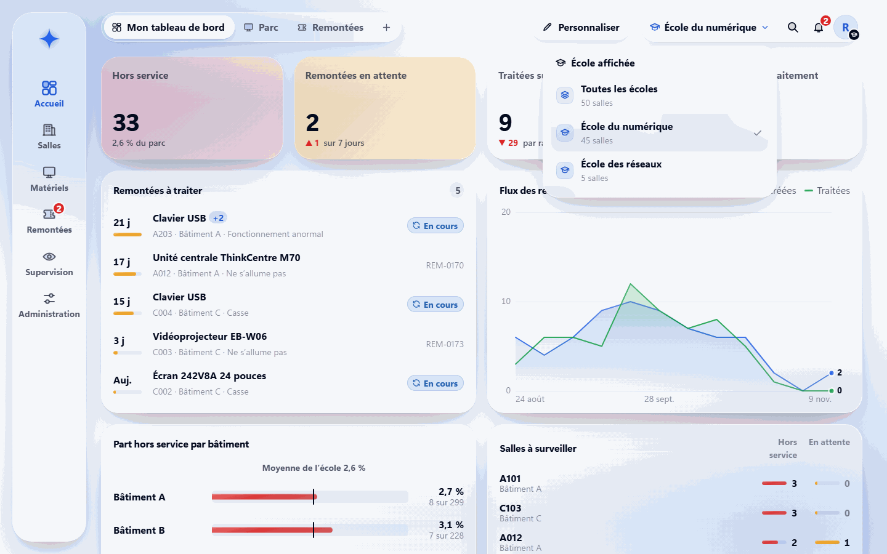
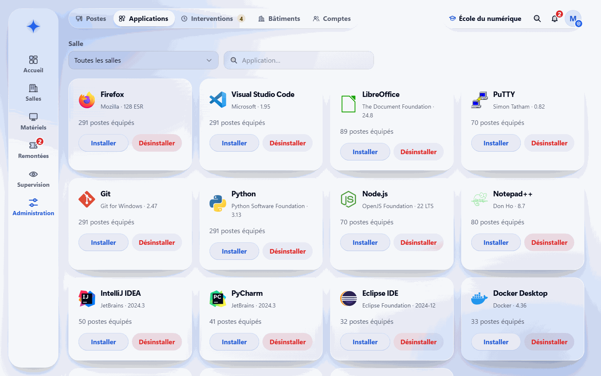

# Fiche descriptive — Super administrateur

<!-- version:debut : généré par versions.py, ne pas modifier à la main -->
| Version | Mise à jour | Destination | Dernière évolution | Historique |
| --- | --- | --- | --- | --- |
| 6.1 | 16/11/2026 | Production destinée à la remise | Notifier aussi les matériels à déplacer | [16 versions](../../../archive/README.md#15-fiche-descriptive-super-administrateur) |
<!-- version:fin -->

- **Statut :** établie à partir des décisions en vigueur et de l’application ORION.
- **Profil :** super administrateur.
- **Rattachement :** aucune école.
- **Périmètre :** toutes les écoles.
- **Finalité :** exercer à l’échelle de toutes les écoles les droits de l’administrateur, gérer les écoles, les règles globales de processus et les comptes super administrateur.

## Différence avec l’administrateur

Le super administrateur possède les mêmes capacités que l’administrateur, sur toutes les écoles. Il dispose en outre de capacités propres au périmètre global : choix de l’école affichée ([UC-SADMIN-01](#uc-sadmin-01--choisir-lécole-affichée)), gestion des écoles ([UC-SADMIN-02](#uc-sadmin-02--gérer-les-écoles)), gestion des règles globales de processus ([UC-SADMIN-03](#uc-sadmin-03--gérer-les-règles-globales-de-processus)) et attribution du profil super administrateur ([UC-SADMIN-04](#uc-sadmin-04--gérer-les-comptes-orion-de-toutes-les-écoles)).

Comme l’administrateur, il dispose des droits du gestionnaire : il traite les remontées, confirme les installations dans ORION et reçoit les alertes de garantie. RIGEL, propre à une école, fait exception : sans école de rattachement, il n’appaire pas de téléphone, ne lance ni ne clôt de recensement et ne traite pas les anciens constats ; il suit les recensements en lecture seule.

Afin d’éviter de dupliquer les scénarios, les parcours détaillés sont décrits dans la [fiche Administrateur](14-FICHE-DESCRIPTIVE-ADMINISTRATEUR.md). Ils s’appliquent au super administrateur avec les adaptations de périmètre décrites dans [UC-SADMIN-05](#uc-sadmin-05--exercer-les-parcours-de-ladministrateur-sur-toutes-les-écoles).

## Périmètre fonctionnel

| Domaine | Capacités globales |
| --- | --- |
| Accès | Connexion par MindefConnect, avec un compte ORION actif de profil super administrateur ; recherche globale, préférences d’affichage et déconnexion, comme l’administrateur |
| Écoles | Choisir l’école affichée ou toutes les écoles ; créer et renommer une école |
| Parc matériel | Toutes les actions sur les matériels de toutes les écoles, y compris la suppression et l’import JSON |
| Salles et bâtiments | Gestion des salles et renommage des bâtiments de toutes les écoles ; déplacements d’une installation prévus et confirmés dans ORION, sans RIGEL |
| Recensement | Suivi en lecture seule des recensements de toutes les écoles |
| Administration des postes | Applications, installation, désinstallation, réinitialisation et suivi des interventions sur les postes de toutes les écoles |
| Supervision | Alertes, supervision des salles, arrêt d’un processus et statistiques de toutes les écoles |
| Règles de processus | Règles globales, en plus des règles d’école, de bâtiment et de salle |
| Remontées | Création et suivi de ses remontées ; consultation, prise en charge et fin des remontées de toutes les écoles ; consultation de leurs états des lieux |
| Comptes ORION | Création, modification, désactivation et réactivation des comptes de toutes les écoles, y compris des comptes super administrateur ; changement de l’école d’un administrateur, rattaché à une seule école |
| Notifications | Comme l’administrateur : évolution de ses propres remontées, fin des interventions qu’il a demandées, lancement d’un processus interdit, matériels à déplacer, garanties échues ou proches de l’échéance |

Les droits de chaque profil sont détaillés dans la [matrice des droits](11-MATRICE-DROITS.md).

## UC-SADMIN-01 — Choisir l’école affichée

**En tant que** super administrateur, **je souhaite** choisir l’école affichée ou toutes les écoles **afin de** limiter tous les écrans à l’école qui m’intéresse ou de couvrir toutes les écoles.

- **Déclencheur :** le super administrateur souhaite passer d’une école à l’autre ou afficher toutes les écoles.
- **Acteurs secondaires :** aucun.

### Critères d’acceptation

- Tous les écrans se limitent à l’école choisie, ou couvrent toutes les écoles.
- Le choix est confirmé par une notification et conservé pour les connexions suivantes.
- Lorsque plusieurs écoles sont affichées, l’école est identifiée sur les listes, fiches, salles, bâtiments, postes et comptes.

### Règles de gestion

RG-60, RG-62, RG-69 et RG-84.

### Besoins non fonctionnels

- Application web utilisée avec les versions de Firefox installées sur les postes de l’équipe.
- Réseau interne NP disposant d’un accès à Internet.
- Authentification via MindefConnect ; modalités d’intégration à préciser (cadrage § 18).

### Interface

- **Connexion** : le super administrateur s’identifie par MindefConnect ; son compte ORION n’est rattaché à aucune école.
- Barre supérieure : nom de l’école, qui ouvre le sélecteur **École affichée** : chaque école avec son nombre de salles, et **Toutes les écoles** ; le choix est conservé d’une connexion à l’autre.
- **Administration › Bâtiments** : lorsque toutes les écoles sont affichées, la colonne **École** présente l’école de chaque bâtiment ; **Renommer** change le nom du bâtiment pour toutes ses salles.

[Diagramme d’activité – Se connecter par MindefConnect](08-DIAGRAMMES-ACTIVITE-CAS-UTILISATION.md#1-se-connecter-par-mindefconnect)

### Préconditions

- Le super administrateur est connecté par MindefConnect, avec un compte ORION actif de profil super administrateur.
- Son compte n’est rattaché à aucune école.

### Scénario nominal

| Acteur | ORION |
| --- | --- |
| 1. Le super administrateur clique sur le nom de l’école dans la barre supérieure. | 2. ORION présente **École affichée** : chaque école avec son nombre de salles, et **Toutes les écoles**. |
| 3. Le super administrateur choisit une école. | 4. ORION confirme le choix par une notification, le conserve pour ses connexions suivantes et limite tous les écrans à cette école. |

### Scénario alternatif 1 — afficher toutes les écoles

| Étape | Déroulement |
| --- | --- |
| 3a1.1 | Le super administrateur choisit **Toutes les écoles**. |
| 3a1.2 | ORION confirme le choix par une notification, le conserve et couvre toutes les écoles dans tous les écrans ; **Administration › Bâtiments** ajoute la colonne **École**. |
| Suite | Fin du cas d’utilisation. |

## UC-SADMIN-02 — Gérer les écoles

**En tant que** super administrateur, **je souhaite** créer et renommer les écoles **afin de** tenir à jour la liste des écoles gérées dans ORION.

- **Déclencheur :** une école doit être créée ou renommée.
- **Acteurs secondaires :** aucun.

### Critères d’acceptation

- Seul le super administrateur crée et renomme les écoles.
- Chaque école est présentée avec son nombre de salles.
- La suppression d’une école n’est pas proposée.

### Règles de gestion

RG-15, RG-60 et RG-76.

### Besoins non fonctionnels

- Application web utilisée avec les versions de Firefox installées sur les postes de l’équipe.
- Réseau interne NP disposant d’un accès à Internet.
- Authentification via MindefConnect ; modalités d’intégration à préciser (cadrage § 18).

### Interface

- **Administration › Comptes**, rubrique **Écoles** : une carte par école avec son nombre de salles.
- **Ajouter une école** crée une école ; **Modifier**, sur la carte d’une école, la renomme.

[Diagramme d’activité – Créer ou renommer une école](08-DIAGRAMMES-ACTIVITE-CAS-UTILISATION.md#18-créer-ou-renommer-une-école)

### Préconditions

- Le super administrateur est connecté.

### Scénario nominal

| Acteur | ORION |
| --- | --- |
| 1. Le super administrateur ouvre **Administration › Comptes**, rubrique **Écoles**. | 2. ORION présente une carte par école avec son nombre de salles. |
| 3. Le super administrateur clique sur **Ajouter une école**, saisit son nom et enregistre. | 4. ORION enregistre l’école. |

### Scénario alternatif 1 — renommer une école

| Étape | Déroulement |
| --- | --- |
| 3a1.1 | Le super administrateur clique sur **Modifier** sur la carte d’une école, saisit le nouveau nom et enregistre. |
| 3a1.2 | ORION enregistre le nouveau nom de l’école. |
| Suite | Fin du cas d’utilisation. |

### Scénario d’exception 1 — nom manquant

| Étape | Déroulement |
| --- | --- |
| 4e1.1 | Le nom de l’école n’est pas renseigné. |
| 4e1.2 | ORION signale le nom manquant et n’enregistre pas l’école. |
| Suite | Retour à l’étape 3. |

## UC-SADMIN-03 — Gérer les règles globales de processus

**En tant que** super administrateur, **je souhaite** ajouter, modifier et supprimer les règles de whitelist et de blacklist de toutes les portées, dont la portée globale, **afin d’**appliquer une même règle à toutes les écoles.

- **Déclencheur :** une règle de processus doit être ajoutée, modifiée ou supprimée.
- **Acteurs secondaires :** postes des écoles, dont les processus remontés sont classés selon les règles.

### Critères d’acceptation

- Une règle globale s’applique à toutes les écoles (« Toutes les écoles »).
- Seul le super administrateur ajoute, modifie ou supprime une règle globale.
- Chaque règle possède une seule portée : globale, école, bâtiment ou salle.

### Règles de gestion

RG-15, RG-47, RG-50 et RG-69.

### Besoins non fonctionnels

- Application web utilisée avec les versions de Firefox installées sur les postes de l’équipe.
- Réseau interne NP disposant d’un accès à Internet.
- Authentification via MindefConnect ; modalités d’intégration à préciser (cadrage § 18).

### Interface

- **Supervision › Listes de processus** : règles de toutes les portées, dont les règles globales qui s’appliquent à toutes les écoles.
- Formulaire d’une règle : la portée **Globale** est proposée en plus des portées école, bâtiment et salle.
- Crayon et corbeille d’une règle, avec confirmation de la suppression.

[Diagramme d’activité – Gérer la whitelist et la blacklist](08-DIAGRAMMES-ACTIVITE-CAS-UTILISATION.md#13-gérer-la-whitelist-et-la-blacklist)

### Préconditions

- Le super administrateur est connecté.

### Scénario nominal

| Acteur | ORION |
| --- | --- |
| 1. Le super administrateur ouvre **Supervision › Listes de processus**. | 2. ORION présente les règles de toutes les portées. |
| 3. Le super administrateur clique sur **Ajouter une règle**, saisit le processus, choisit son classement (whitelist ou blacklist) et la portée **Globale**, puis enregistre. | 4. ORION enregistre la règle pour toutes les écoles. |

### Scénario alternatif 1 — modifier ou supprimer une règle

| Étape | Déroulement |
| --- | --- |
| 3a1.1 | Le super administrateur clique sur le crayon ou la corbeille d’une règle. |
| 3a1.2 | ORION ouvre le formulaire de modification ou demande la confirmation de la suppression. |
| 3a1.3 | Le super administrateur enregistre ou confirme. |
| 3a1.4 | ORION applique le changement. |
| Suite | Fin du cas d’utilisation. |

### Scénario alternatif 2 — règle d’école, de bâtiment ou de salle

| Étape | Déroulement |
| --- | --- |
| 3a2.1 | Le super administrateur choisit la portée école, bâtiment ou salle d’une école. |
| 3a2.2 | ORION enregistre la règle pour cette portée, comme pour l’administrateur ([UC-ADMIN-04](14-FICHE-DESCRIPTIVE-ADMINISTRATEUR.md#uc-admin-04--superviser-les-postes-et-gérer-les-règles-de-processus)). |
| Suite | Fin du cas d’utilisation. |

## UC-SADMIN-04 — Gérer les comptes ORION de toutes les écoles

**En tant que** super administrateur, **je souhaite** créer, modifier, désactiver et réactiver les comptes ORION de toutes les écoles, y compris les comptes super administrateur, **afin d’**ouvrir et de tenir à jour les accès à ORION.

- **Déclencheur :** un compte doit être créé, modifié, désactivé ou réactivé.
- **Acteurs secondaires :** MindefConnect, qui authentifie l’utilisateur du compte.

### Critères d’acceptation

- Les comptes de toutes les écoles sont gérés, avec leur dernière connexion et leur date de désactivation.
- Un compte super administrateur n’est rattaché à aucune école ; la colonne **École** indique « Toutes les écoles ».
- Un administrateur reste rattaché à une seule école ; le super administrateur peut changer son école.
- Seul le super administrateur attribue le profil super administrateur.
- Le super administrateur ne peut ni modifier son propre profil ni désactiver son propre compte.
- Un compte n’est jamais supprimé ; son adresse électronique est unique.

### Règles de gestion

RG-01, RG-15, RG-60, RG-62, RG-70, RG-71 et RG-82.

### Besoins non fonctionnels

- Application web utilisée avec les versions de Firefox installées sur les postes de l’équipe.
- Réseau interne NP disposant d’un accès à Internet.
- Authentification via MindefConnect ; modalités d’intégration à préciser (cadrage § 18).
- Un seul profil par utilisateur.

### Interface

- **Administration › Comptes** : comptes de toutes les écoles, avec leur profil, leur école (colonne **École**), leur état, leur date de désactivation et leur dernière connexion.
- Formulaire de compte : le profil super administrateur et le choix de l’école sont proposés en plus ; un compte super administrateur n’est rattaché à aucune école.

[Diagramme d’activité – Créer ou modifier un compte ORION](08-DIAGRAMMES-ACTIVITE-CAS-UTILISATION.md#16-créer-ou-modifier-un-compte-orion)

[Diagramme d’activité – Désactiver ou réactiver un compte ORION](08-DIAGRAMMES-ACTIVITE-CAS-UTILISATION.md#17-désactiver-ou-réactiver-un-compte-orion)

### Préconditions

- Le super administrateur est connecté.

### Scénario nominal

| Acteur | ORION |
| --- | --- |
| 1. Le super administrateur ouvre **Administration › Comptes**. | 2. ORION liste les comptes de toutes les écoles avec leur profil, leur école, leur état, leur date de désactivation et leur dernière connexion. |
| 3. Le super administrateur clique sur **Créer un compte**, saisit le nom, l’adresse électronique, le profil et l’école, puis enregistre. | 4. ORION contrôle les données et enregistre le compte. |
| 5. Le super administrateur désactive ou réactive un compte. | 6. ORION enregistre le nouvel état et, pour une désactivation, sa date. |

### Scénario alternatif 1 — créer un compte super administrateur

| Étape | Déroulement |
| --- | --- |
| 3a1.1 | Le super administrateur choisit le profil super administrateur. |
| 3a1.2 | ORION n’associe le compte à aucune école ; la colonne **École** indique « Toutes les écoles ». |
| Suite | Retour à l’étape 4. |

### Scénario alternatif 2 — changer l’école d’un administrateur

| Étape | Déroulement |
| --- | --- |
| 3a2.1 | Le super administrateur modifie un compte administrateur et choisit une autre école. |
| 3a2.2 | ORION rattache l’administrateur à cette seule école. |
| Suite | Fin du cas d’utilisation. |

### Scénario d’exception 1 — adresse électronique déjà utilisée

| Étape | Déroulement |
| --- | --- |
| 4e1.1 | L’adresse électronique saisie est déjà utilisée par un autre compte. |
| 4e1.2 | ORION refuse l’enregistrement. |
| Suite | Retour à l’étape 3. |

### Scénario d’exception 2 — action sur son propre compte

| Étape | Déroulement |
| --- | --- |
| 5e2.1 | Le super administrateur tente de modifier son propre profil ou de désactiver son propre compte. |
| 5e2.2 | ORION refuse l’opération. |
| Suite | Fin du cas d’utilisation. |

## UC-SADMIN-05 — Exercer les parcours de l’administrateur sur toutes les écoles

**En tant que** super administrateur, **je souhaite** gérer le parc, les salles, les postes, la supervision et les remontées de toutes les écoles **afin d’**exercer à l’échelle de toutes les écoles les droits de l’administrateur.

- **Déclencheur :** le super administrateur ouvre un écran de l’administrateur (**Matériels**, **Salles**, **Administration**, **Supervision**, **Remontées**).
- **Acteurs secondaires :** postes des écoles, qui exécutent les interventions demandées ; gestionnaire de l’école, notifié de la création d’une remontée.

### Critères d’acceptation

- Les parcours de l’administrateur s’appliquent à toutes les écoles, avec les mêmes règles.
- Une affectation groupée porte sur des matériels d’une même école ; une intervention porte sur des postes d’une seule salle, donc d’une seule école ; une remontée réunit des matériels d’une seule école.
- Le super administrateur traite les remontées, confirme les installations dans ORION et reçoit les alertes de garantie, comme le gestionnaire.
- RIGEL, propre à une école, ne lui est pas proposé : il n’appaire pas de téléphone, ne lance ni ne clôt de recensement et ne traite pas les anciens constats ; il suit les recensements en lecture seule.
- Le catalogue des applications est commun à toutes les écoles.

### Règles de gestion

RG-15, RG-64, RG-69 et RG-72, complétées par toutes les règles applicables aux parcours de l’administrateur.

### Besoins non fonctionnels

- Application web utilisée avec les versions de Firefox installées sur les postes de l’équipe.
- Réseau interne NP disposant d’un accès à Internet.
- Authentification via MindefConnect ; modalités d’intégration à préciser (cadrage § 18).

### Interface

- Accès aux écrans de l’administrateur, étendus à toutes les écoles ; recherche globale, préférences d’affichage et déconnexion, comme l’administrateur.
- Refus explicite d’une opération groupée portant sur plusieurs écoles.
- **Applications** : le catalogue, commun à toutes les écoles, indique le nombre de postes équipés ; **Installer** ou **Désinstaller** ouvre la demande sur une salle ou des postes.
- Les autres écrans sont présentés dans les fiches [Administrateur](14-FICHE-DESCRIPTIVE-ADMINISTRATEUR.md) et [Gestionnaire](12-FICHE-DESCRIPTIVE-GESTIONNAIRE.md).

[Diagramme d’activité – Importer de nouveaux matériels en JSON](08-DIAGRAMMES-ACTIVITE-CAS-UTILISATION.md#3-importer-de-nouveaux-matériels-en-json)

[Diagramme d’activité – Affecter un ou plusieurs matériels à une salle ou au stock](08-DIAGRAMMES-ACTIVITE-CAS-UTILISATION.md#4-affecter-un-ou-plusieurs-matériels-à-une-salle-ou-au-stock)

[Diagramme d’activité – Traiter une remontée](08-DIAGRAMMES-ACTIVITE-CAS-UTILISATION.md#9-traiter-une-remontée)

[Diagramme d’activité – Demander une intervention sur les postes](08-DIAGRAMMES-ACTIVITE-CAS-UTILISATION.md#14-demander-une-intervention-sur-les-postes)

### Adaptation des parcours administrateur

| Parcours | Adaptation au périmètre global |
| --- | --- |
| Parc matériel ([UC-ADMIN-01](14-FICHE-DESCRIPTIVE-ADMINISTRATEUR.md#uc-admin-01--administrer-le-parc-matériel)) | Les opérations portent sur les matériels de toutes les écoles. Une affectation groupée porte sur des matériels d’une même école (« Sélectionnez des matériels de la même école. ») ; un import JSON est rattaché à l’école choisie dans le champ **École** du formulaire d’import, et le transfert y fait entrer un matériel venu d’une autre école. |
| Salles et installation ([UC-ADMIN-07](14-FICHE-DESCRIPTIVE-ADMINISTRATEUR.md#uc-admin-07--gérer-les-salles-et-les-étages) et [UC-ADMIN-08](14-FICHE-DESCRIPTIVE-ADMINISTRATEUR.md#uc-admin-08--prévoir-et-réaliser-linstallation-dune-salle)) | Les parcours s’appliquent aux salles de toutes les écoles. Lorsque toutes les écoles sont affichées, **Administration › Bâtiments** ajoute la colonne **École**. Le super administrateur prévoit les déplacements et confirme les installations dans ORION (point de déplacement, **Terminer le restockage**) ; **Installer avec un téléphone** ne lui est pas proposé. Il suit les recensements, sans action. |
| Administration des postes ([UC-ADMIN-02](14-FICHE-DESCRIPTIVE-ADMINISTRATEUR.md#uc-admin-02--administrer-les-applications-dun-poste-ou-dune-salle) et [UC-ADMIN-03](14-FICHE-DESCRIPTIVE-ADMINISTRATEUR.md#uc-admin-03--réinitialiser-un-poste-ou-une-salle)) | Les opérations s’appliquent aux postes de toutes les écoles. Une intervention porte sur des postes d’une seule salle, donc d’une seule école. Le catalogue des applications est commun à toutes les écoles. |
| Supervision ([UC-ADMIN-04](14-FICHE-DESCRIPTIVE-ADMINISTRATEUR.md#uc-admin-04--superviser-les-postes-et-gérer-les-règles-de-processus)) | Le parcours couvre toutes les écoles ; la portée **Globale** des règles relève de [UC-SADMIN-03](#uc-sadmin-03--gérer-les-règles-globales-de-processus). |
| Remontées ([UC-ADMIN-05](14-FICHE-DESCRIPTIVE-ADMINISTRATEUR.md#uc-admin-05--créer-consulter-et-suivre-les-remontées)) | Le parcours permet de consulter les remontées et les états des lieux de toutes les écoles. Une remontée réunit des matériels d’une seule école. Le super administrateur crée des remontées et est notifié de l’évolution des siennes ; il prend en charge et termine les remontées de toutes les écoles. |
| Comptes ORION ([UC-ADMIN-06](14-FICHE-DESCRIPTIVE-ADMINISTRATEUR.md#uc-admin-06--gérer-les-comptes-orion-de-lécole)) | Le parcours est étendu aux comptes de toutes les écoles ([UC-SADMIN-04](#uc-sadmin-04--gérer-les-comptes-orion-de-toutes-les-écoles)). |
| Notifications ([UC-ADMIN-09](14-FICHE-DESCRIPTIVE-ADMINISTRATEUR.md#uc-admin-09--suivre-son-activité--tableaux-de-bord-et-notifications)) | Comme l’administrateur : évolution de ses propres remontées, fin des interventions qu’il a demandées, lancement d’un processus interdit, garanties échues ou proches de l’échéance. |

### Préconditions

- Le super administrateur est connecté.
- Il a choisi une école ou toutes les écoles ([UC-SADMIN-01](#uc-sadmin-01--choisir-lécole-affichée)).

### Scénario nominal

| Acteur | ORION |
| --- | --- |
| 1. Le super administrateur ouvre un écran de l’administrateur (**Matériels**, **Salles**, **Administration**, **Supervision**, **Remontées**). | 2. ORION présente les données de l’école choisie, ou de toutes les écoles en identifiant l’école de chaque élément. |
| 3. Le super administrateur réalise une action d’un parcours de l’administrateur. | 4. ORION l’applique avec les mêmes règles que pour l’administrateur. |

### Scénario alternatif 1 — importer des matériels en JSON

| Étape | Déroulement |
| --- | --- |
| 3a1.1 | Le super administrateur importe un fichier de matériels et choisit l’école dans le champ **École** du formulaire d’import. |
| 3a1.2 | ORION rattache l’import à cette école ; un transfert validé y fait entrer un matériel venu d’une autre école. |
| Suite | Fin du cas d’utilisation. |

### Scénario alternatif 2 — prévoir et confirmer une installation dans ORION

| Étape | Déroulement |
| --- | --- |
| 3a2.1 | Le super administrateur prévoit les déplacements d’une installation, puis confirme les installations dans ORION (point de déplacement, **Terminer le restockage**). |
| 3a2.2 | ORION enregistre les déplacements et leur confirmation. |
| Suite | Fin du cas d’utilisation. |

### Scénario alternatif 3 — traiter une remontée

| Étape | Déroulement |
| --- | --- |
| 3a3.1 | Le super administrateur ouvre une remontée d’une école et la prend en charge, puis la termine. |
| 3a3.2 | ORION enregistre le changement de statut et notifie l’auteur de la remontée. |
| Suite | Fin du cas d’utilisation. |

### Scénario d’exception 1 — affectation groupée sur plusieurs écoles

| Étape | Déroulement |
| --- | --- |
| 3e1.1 | Les matériels sélectionnés pour une affectation groupée appartiennent à plusieurs écoles. |
| 3e1.2 | ORION refuse : « Sélectionnez des matériels de la même école. » |
| Suite | Retour à l’étape 3. |

### Scénario d’exception 2 — action réservée à RIGEL

| Étape | Déroulement |
| --- | --- |
| 3e2.1 | Le super administrateur ouvre une installation en cours ou un recensement. |
| 3e2.2 | ORION ne propose ni **Installer avec un téléphone**, ni appairage, ni lancement ou clôture d’un recensement, ni traitement des anciens constats ; le recensement reste en lecture seule. |
| Suite | Fin du cas d’utilisation. |

## Questions ouvertes propres au périmètre global

- Filtres et indicateurs attendus au niveau global.
- Comparaison des écoles et agrégation de leurs statistiques.
- Traçabilité des opérations globales sensibles.

## Règles applicables

RG-01, RG-15, RG-47, RG-50, RG-60, RG-62, RG-64, RG-69 à RG-72, RG-76, RG-82 et RG-84, complétées par toutes les règles applicables aux parcours de l’administrateur.

## Sources

[Cadrage §§ 2, 3 et 18](../../01-CONTEXTE/03-CADRAGE.md), [glossaire](../../01-CONTEXTE/01-GLOSSAIRE.md), [règles de gestion](01-REGLES-DE-GESTION.md), [fiche Administrateur](14-FICHE-DESCRIPTIVE-ADMINISTRATEUR.md), DCU [gestion du parc](03-DCU-GESTION-PARC.md), [administration des postes](04-DCU-ADMINISTRATION-POSTES.md), [supervision](05-DCU-SUPERVISION-POSTES.md) et [remontées utilisateur](06-DCU-REMONTEES-UTILISATEUR.md), [matrice des droits](11-MATRICE-DROITS.md) et application ORION.
