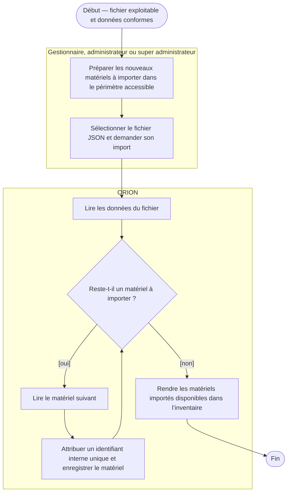
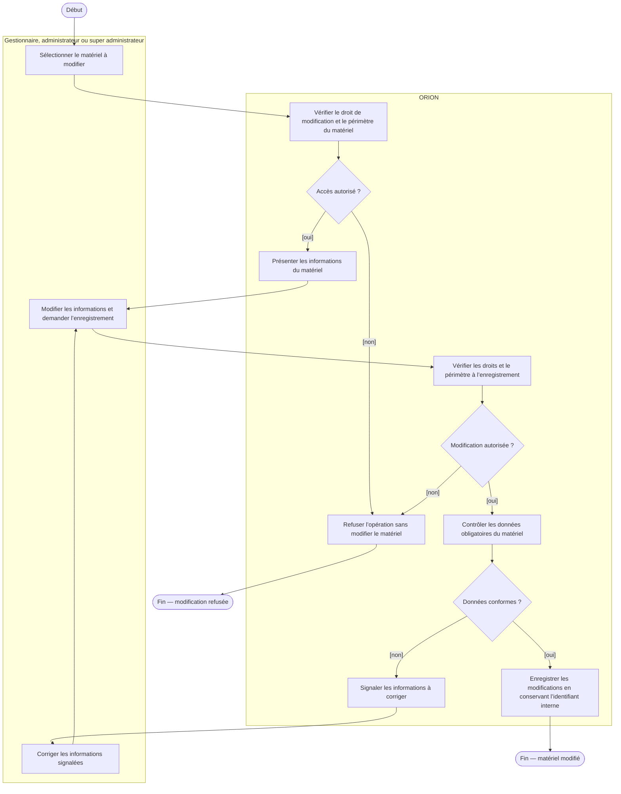
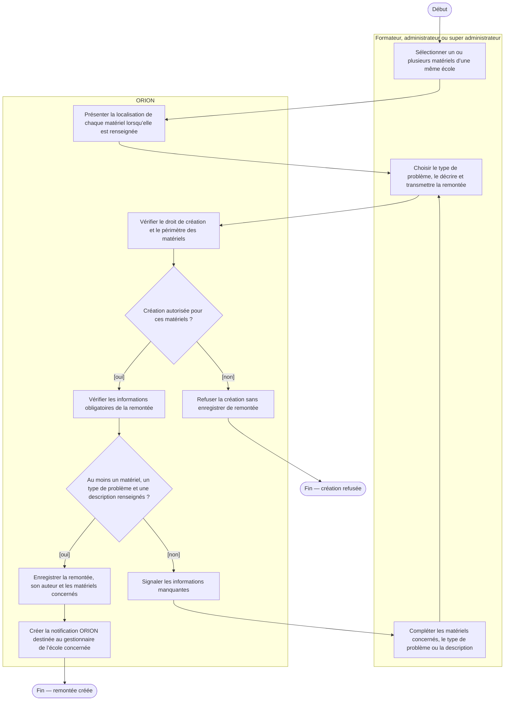
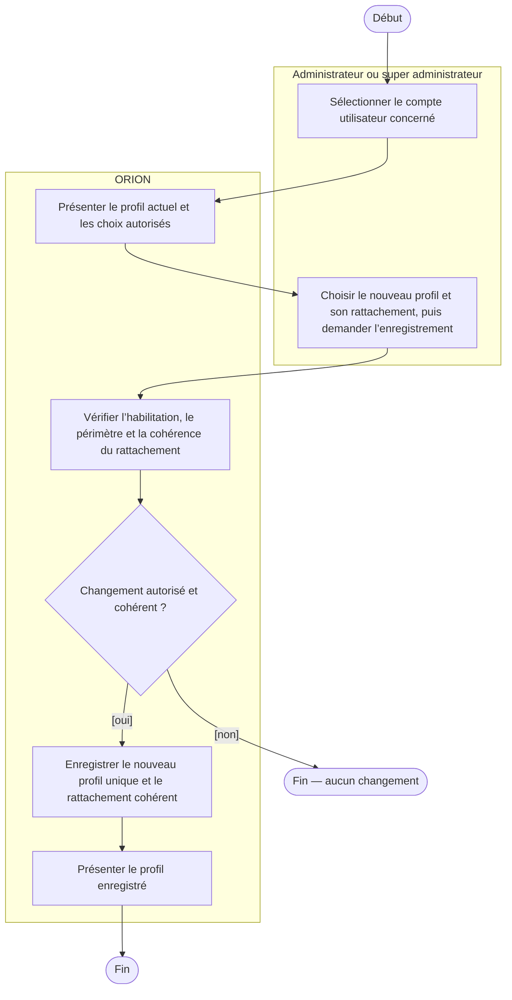
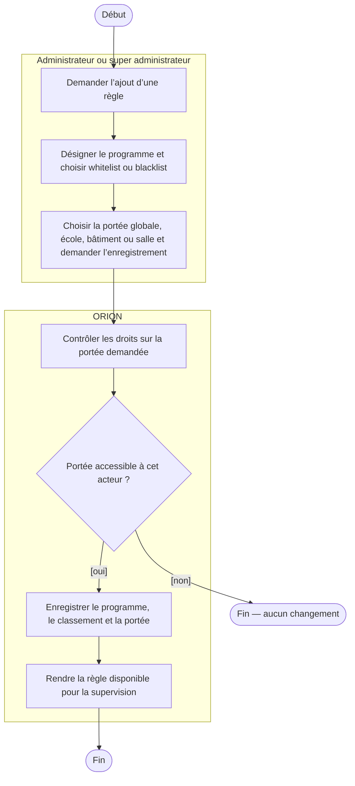
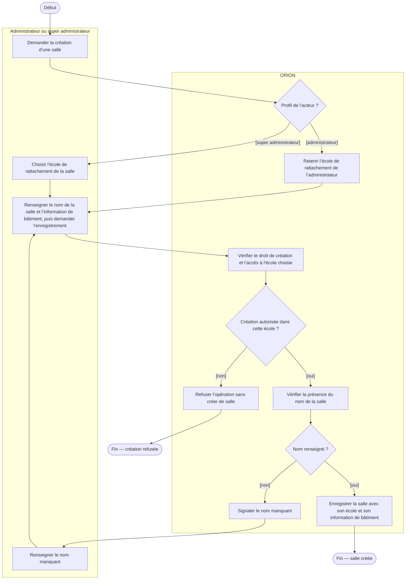
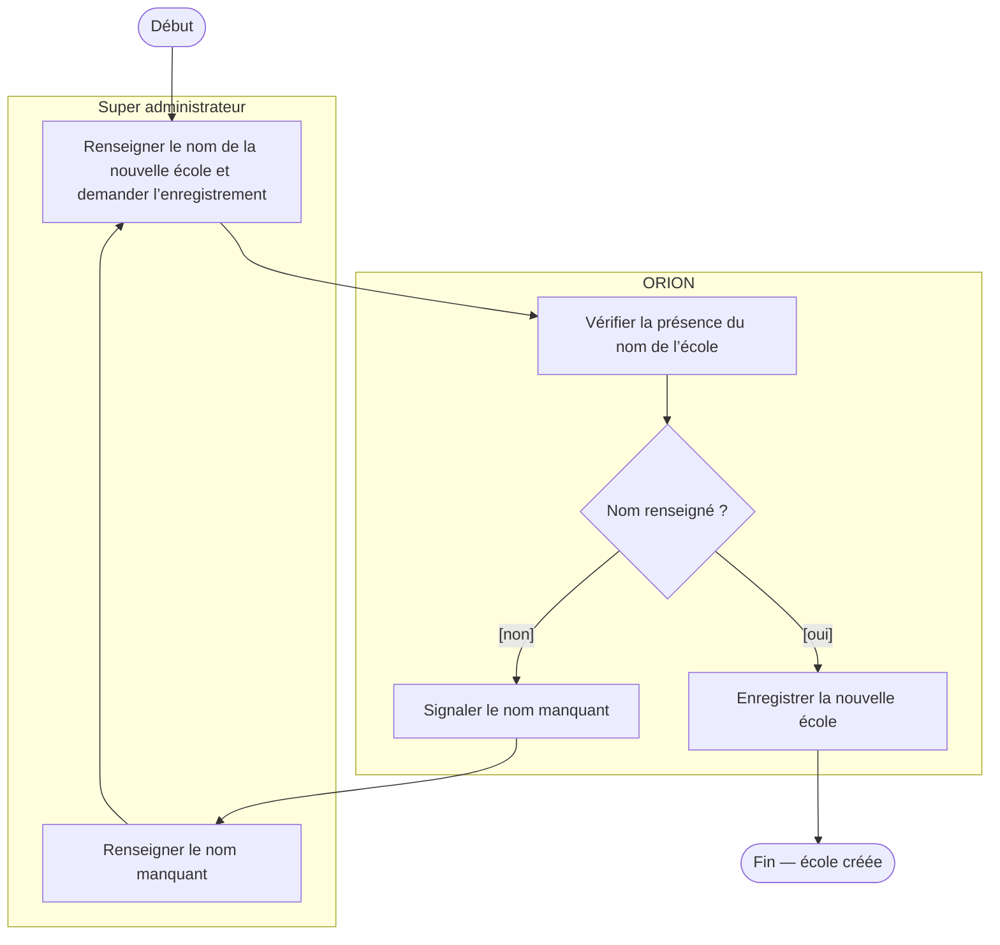

# Diagrammes d’activité des cas d’utilisation ORION — Brouillon V2

<!-- version:debut : généré par versions.py, ne pas modifier à la main -->
| Version | Mise à jour | Destination | Dernière évolution | Historique |
| --- | --- | --- | --- | --- |
| 1.3 | 14/11/2026 | Brouillon interne | PDF à la demande et type de problème obligatoire | [4 versions](../../../archive/README.md#diagrammes-activite-cas-utilisation-brouillon-v2) |
<!-- version:fin -->

## 1. Importer de nouveaux matériels en JSON — scénario nominal, acteur habilité

## 2. Modifier un matériel

## 3. Créer une remontée utilisateur — scénario limité aux matériels d’une même école

## 4. Modifier le profil d’un utilisateur — proposition, transitions à définir

## 5. Ajouter une règle de processus

## 6. Créer une salle — proposition, acteurs et droits à confirmer

## 7. Créer une école — proposition hors V1, scénario nominal sous réserve d’habilitation

