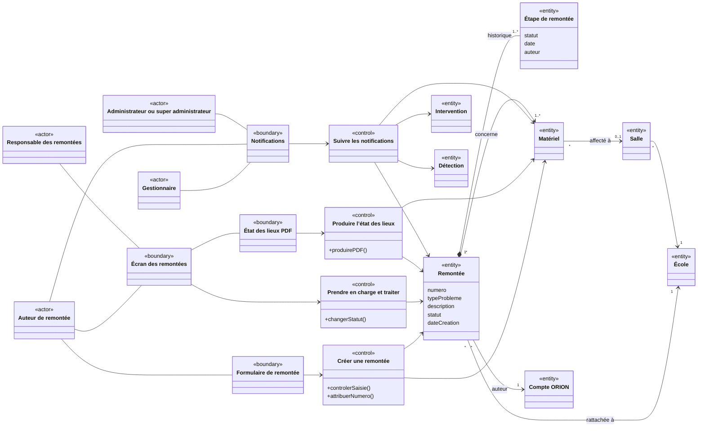
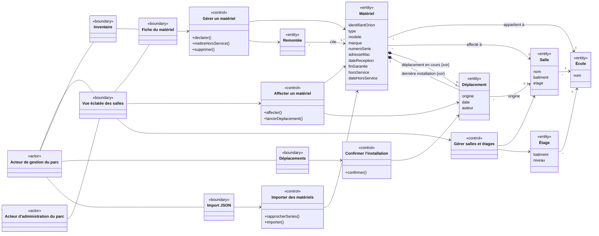
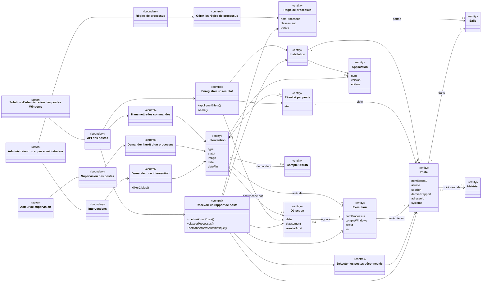
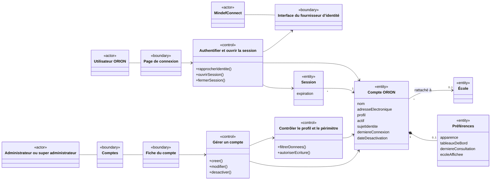
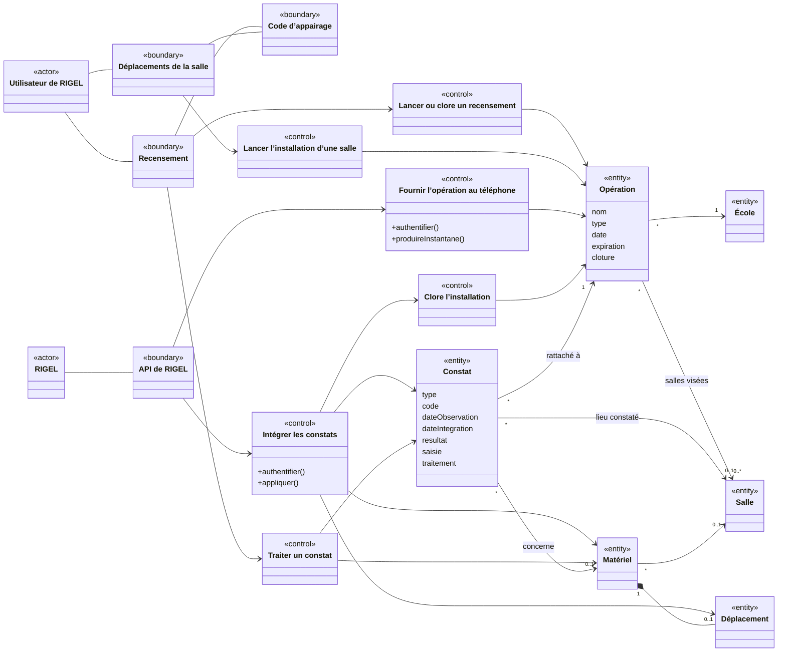

# Diagramme de classes d’analyse

<!-- version:debut : généré par versions.py, ne pas modifier à la main -->
| Version | Mise à jour | Destination | Dernière évolution | Historique |
| --- | --- | --- | --- | --- |
| 4.2 | 17/11/2026 | Production destinée à la remise | Nommer Exécution la classe des processus en cours et aligner les multiplicités sur le code | [8 versions](../../../archive/README.md#02-diagramme-classes-analyse) |
<!-- version:fin -->

## Remontées utilisateur

## Parc, affectations et déplacements

## Supervision et interventions sur les postes

## Comptes et connexion

## Recensement et installation avec RIGEL

