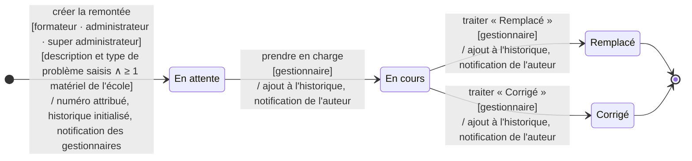

# Diagrammes d'états

<!-- version:debut : généré par versions.py, ne pas modifier à la main -->
| Version | Mise à jour | Destination | Dernière évolution | Historique |
| --- | --- | --- | --- | --- |
| 4.0 | 14/11/2026 | Production destinée à la remise | Promouvoir en livrable de la phase Analyse ; intervention complétée (gardes, effets, fin) | [5 versions](../../../archive/README.md#17-diagrammes-etats) |
<!-- version:fin -->

## Remontée

## Intervention sur les postes

```mermaid
stateDiagram-v2
    direction LR
    [*] --> enregistree : demander l'intervention<br/>[administrateur · super administrateur, ou formateur pour un arrêt]<br/>[1 à 500 postes d'une seule salle]<br/>[arrêt : un seul poste, processus en cours, aucun arrêt déjà demandé]<br/>[installation ou désinstallation : application du catalogue]<br/>/ auteur et date fixés par le serveur, image de référence imposée pour une réinitialisation
    [*] --> enregistree : arrêt automatique<br/>[processus classé blacklist]<br/>/ détection enregistrée

    state enregistree {
        direction LR
        [*] --> en_attente : pour chaque poste cible
        en_attente --> en_attente : poste éteint ou indisponible<br/>/ exécution à son retour
        en_attente --> reussie : résultat du poste « réussie »<br/>/ installation : application ajoutée au poste<br/>désinstallation : application retirée<br/>réinitialisation : processus du poste arrêtés<br/>arrêt : processus arrêté, détection « arrêt réussi »
        en_attente --> echec_poste : résultat du poste « échec »<br/>/ arrêt : détection « arrêt en échec »
        en_attente : En attente
        reussie : Réussie
        echec_poste : Échec
    }

    enregistree --> terminee : [tous les postes en réussite]<br/>/ date de fin ; notification de l'administrateur demandeur<br/>(installation, désinstallation, réinitialisation)
    enregistree --> echec : [aucun poste en attente ∧ ≥ 1 échec]<br/>/ date de fin ; notification de l'administrateur demandeur<br/>(installation, désinstallation, réinitialisation)
    terminee --> [*]
    echec --> [*]

    enregistree : Enregistrée
    terminee : Terminée
    echec : Échec
```

