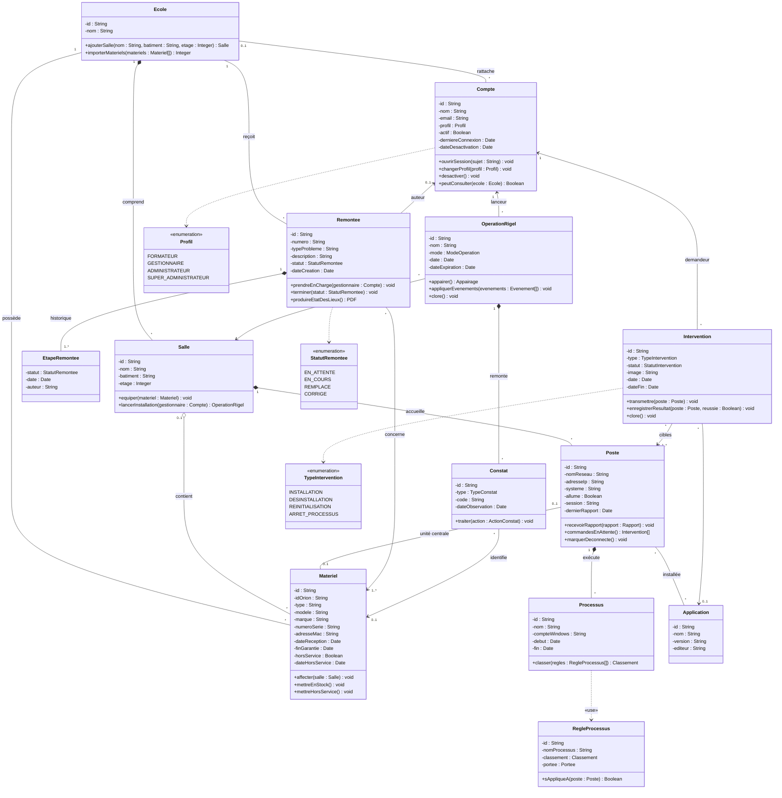

# Diagramme de classes de conception

<!-- version:debut : généré par versions.py, ne pas modifier à la main -->
| Version | Mise à jour | Destination | Dernière évolution | Historique |
| --- | --- | --- | --- | --- |
| 3.0 | 16/11/2026 | Production destinée à la remise | Représenter les classes majeures avec attributs, méthodes et associations | [5 versions](../../../archive/README.md#01-diagramme-classes-conception) |
<!-- version:fin -->

## Classes de conception d'ORION

