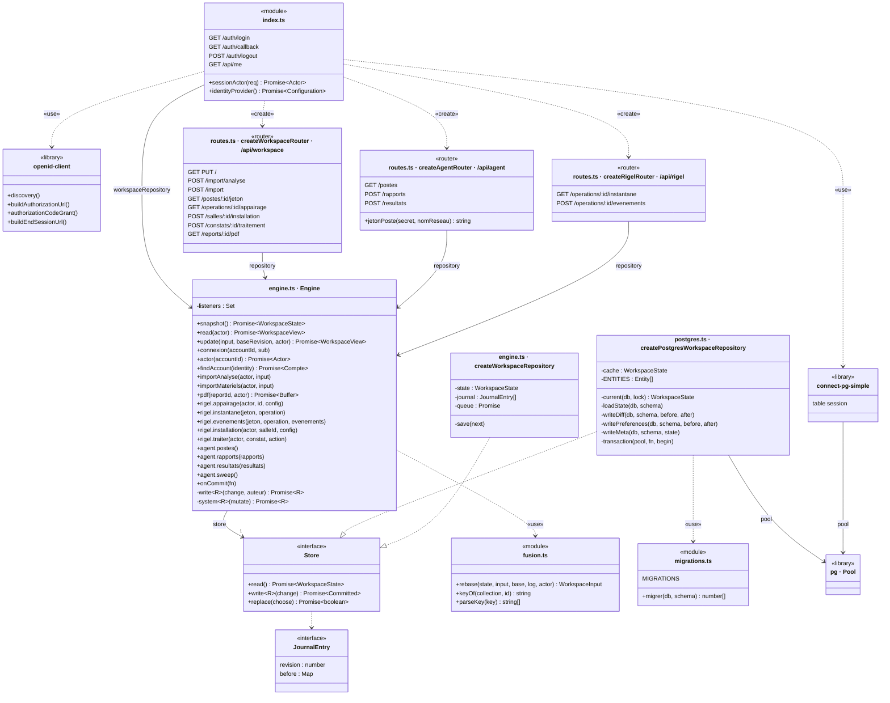
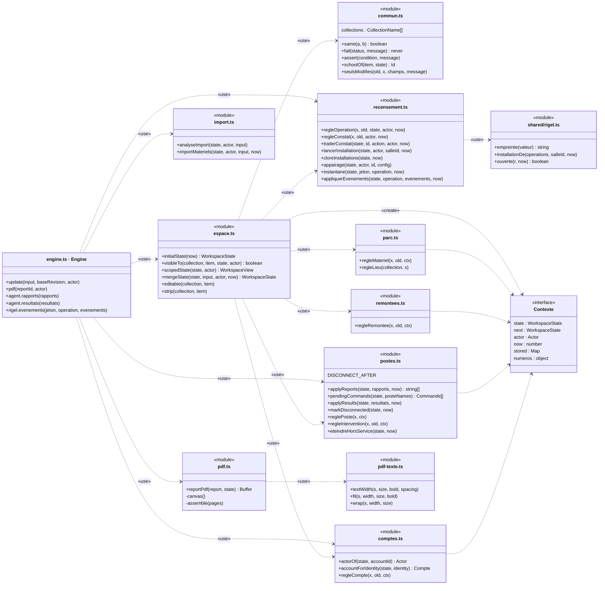
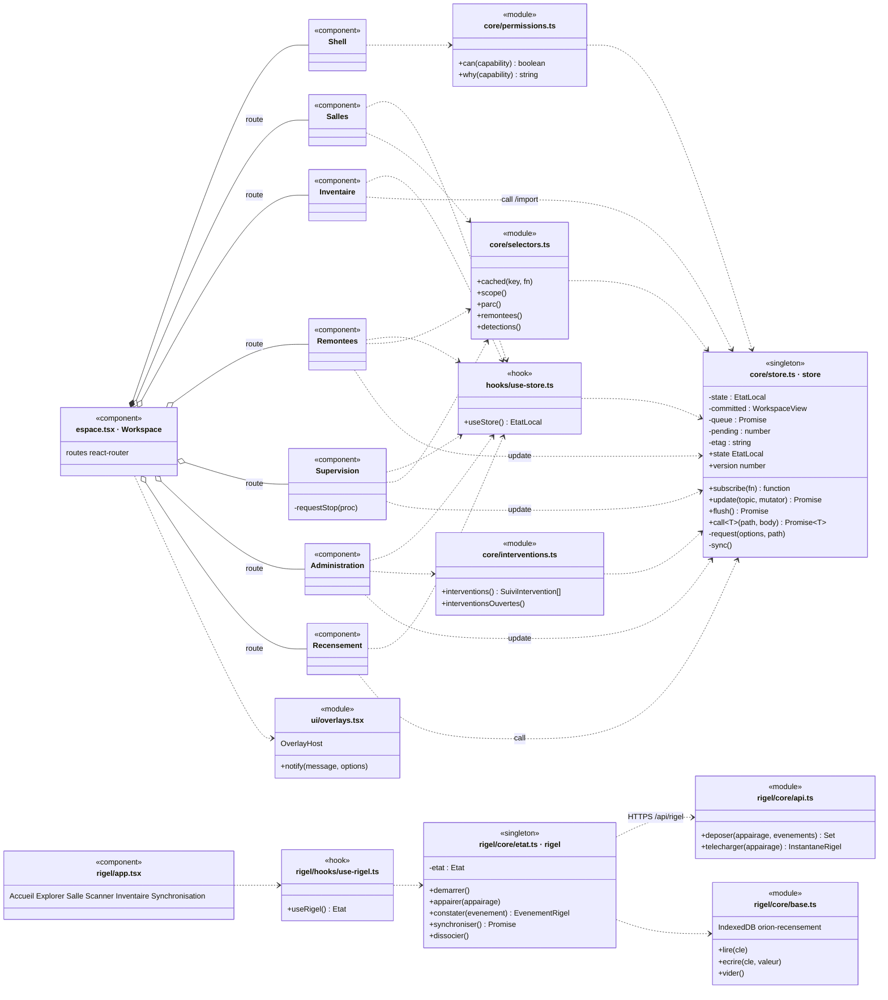

# Diagramme de classes de conception

<!-- version:debut : généré par versions.py, ne pas modifier à la main -->
| Version | Mise à jour | Destination | Dernière évolution | Historique |
| --- | --- | --- | --- | --- |
| 2.2 | 16/11/2026 | Production destinée à la remise | Adopter la numérotation locale du dossier ; Actualiser les liens après la renumérotation | [4 versions](../../../archive/README.md#01-diagramme-classes-conception) |
<!-- version:fin -->

## Serveur : API, moteur d'écriture et persistance

## Serveur : règles du domaine, documents et RIGEL

## Navigateur : espace de travail ORION et application RIGEL

