# Diagramme de classes de conception

<!-- version:debut : généré par versions.py, ne pas modifier à la main -->
| Version | Mise à jour | Destination | Dernière évolution | Historique |
| --- | --- | --- | --- | --- |
| 5.0 | 17/11/2026 | Production destinée à la remise | Ajouter Étage, Déplacement, Détection et Installation ; renommer Operation et Execution | [7 versions](../../../archive/README.md#01-diagramme-classes-conception) |
<!-- version:fin -->

## Classes de conception d’ORION

```mermaid
classDiagram
    direction TB
    class Compte {
        -id : String
        -nom : String
        -email : String
        -profil : Profil
        -actif : Boolean
        -derniereConnexion : Date
        -dateDesactivation : Date
        -sujet : String
        +ouvrirSession(sujet : String) void
        +changerProfil(profil : Profil) void
        +desactiver() void
        +peutConsulter(ecole : Ecole) Boolean
    }
    class Ecole {
        -id : String
        -nom : String
        +ajouterSalle(nom : String, batiment : String, etage : Integer) Salle
        +importerMateriels(materiels : Materiel[]) Integer
    }
    class Salle {
        -id : String
        -nom : String
        -batiment : String
        -etage : Integer
        +equiper(materiel : Materiel) void
        +lancerInstallation(lanceur : Compte) Operation
    }
    class Etage {
        -id : String
        -batiment : String
        -niveau : Integer
    }
    class Materiel {
        -id : String
        -idOrion : String
        -type : TypeMateriel
        -modele : String
        -marque : String
        -numeroSerie : String
        -adresseMac : String
        -dateReception : Date
        -finGarantie : Date
        -horsService : Boolean
        -dateHorsService : Date
        +affecter(salle : Salle) void
        +confirmerInstallation() void
        +mettreEnStock() void
        +mettreHorsService() void
    }
    class Deplacement {
        -date : Date
        -auteur : String
    }
    class Remontee {
        -id : String
        -typeProbleme : String
        -description : String
        -statut : StatutRemontee
        -dateCreation : Date
        +prendreEnCharge(responsable : Compte) void
        +terminer(statut : StatutRemontee) void
        +produireEtatDesLieux() Byte[]
    }
    class EtapeRemontee {
        -statut : StatutRemontee
        -date : Date
        -auteur : String
    }
    class Poste {
        -id : String
        -nomReseau : String
        -adresseIp : String
        -systeme : String
        -allume : Boolean
        -session : String
        -dernierRapport : Date
        +recevoirRapport(executions : Execution[], applications : Application[]) void
        +commandesEnAttente() Intervention[]
        +marquerDeconnecte() void
    }
    class Execution {
        -id : String
        -nomProcessus : String
        -compteWindows : String
        -debut : Date
        -fin : Date
        +classer(regles : RegleProcessus[]) Classement
    }
    class Detection {
        -id : String
        -date : Date
        -nomProcessus : String
        -compteWindows : String
        -classement : Classement
        -resultatArret : String
    }
    class RegleProcessus {
        -id : String
        -nomProcessus : String
        -classement : Classement
        -portee : Portee
        +sAppliqueA(poste : Poste) Boolean
    }
    class Application {
        -id : String
        -nom : String
        -version : String
        -editeur : String
    }
    class Installation {
        -id : String
    }
    class Intervention {
        -id : String
        -type : TypeIntervention
        -statut : StatutIntervention
        -image : String
        -auto : Boolean
        -date : Date
        -dateFin : Date
        -resultats : Map~Poste, ResultatPoste~
        +transmettre(poste : Poste) void
        +enregistrerResultat(poste : Poste, resultat : ResultatPoste) void
        +clore() void
    }
    class Operation {
        -id : String
        -nom : String
        -mode : TypeOperation
        -date : Date
        -dateExpiration : Date
        +appairer() String
        +integrerConstats(constats : Constat[]) void
        +clore() void
    }
    class Constat {
        -id : String
        -type : TypeConstat
        -code : String
        -dateObservation : Date
        -resultat : ResultatConstat
        +traiter(action : ActionConstat) void
    }
    class Profil {
        <<enumeration>>
        formateur
        gestionnaire
        admin
        superadmin
    }
    class StatutRemontee {
        <<enumeration>>
        attente
        encours
        remplace
        corrige
    }
    class TypeIntervention {
        <<enumeration>>
        installation
        desinstallation
        reinstallation
        arret
    }
    class StatutIntervention {
        <<enumeration>>
        enregistree
        terminee
        echec
    }
    class ResultatPoste {
        <<enumeration>>
        en_attente
        reussie
        echec
    }
    class Classement {
        <<enumeration>>
        blacklist
        nonref
        whitelist
    }
    class Portee {
        <<enumeration>>
        global
        ecole
        batiment
        salle
    }
    class TypeOperation {
        <<enumeration>>
        installation
        recensement
    }
    class TypeConstat {
        <<enumeration>>
        vu
        releve
        retour
        stock
        inconnu
    }
    class ResultatConstat {
        <<enumeration>>
        confirme
        present
        ecart
        deplace
        range
        retour
        stock
        ajoute
        inconnu
        refuse
    }
    class ActionConstat {
        <<enumeration>>
        stock
        affectation
        constat
        ajoute
        ecarte
    }
    class TypeMateriel {
        <<enumeration>>
        uc
        videoprojecteur
        reseau
        peripherique
        ecran
        audio
        imprimante
        autre
    }

    Ecole "0..1" -- "*" Compte : rattache
    Ecole "1" *-- "*" Salle : comprend
    Ecole "1" *-- "*" Etage : comprend
    Salle "*" --> "1" Etage : située à
    Ecole "1" -- "*" Materiel : possède
    Ecole "1" -- "*" Remontee : reçoit
    Salle "0..1" o-- "*" Materiel : contient
    Materiel "1" *-- "0..1" Deplacement : déplacement en cours
    Materiel "1" *-- "0..1" Deplacement : dernière installation
    Deplacement "*" --> "0..1" Salle : origine
    Deplacement "*" --> "1" Compte : auteur
    Salle "1" o-- "*" Poste : accueille
    Poste "0..1" -- "0..1" Materiel : unité centrale
    Poste "1" *-- "*" Execution : exécute
    Poste "1" *-- "*" Installation : installe
    Installation "*" --> "1" Application
    Execution ..> RegleProcessus : «use»
    Detection "*" --> "1" Poste : sur
    Remontee "*" --> "1" Compte : auteur
    Remontee "*" --> "1..*" Materiel : concerne
    Remontee "1" *-- "1..*" EtapeRemontee : historique
    Intervention "*" --> "0..1" Compte : demandeur
    Intervention "*" --> "1..*" Poste : cibles
    Intervention "*" --> "0..1" Application
    Intervention "*" --> "0..1" Execution : arrêt de
    Intervention "0..1" --> "0..1" Detection : déclenchée par
    Operation "*" --> "1" Compte : lanceur
    Ecole "1" -- "*" Operation
    Operation "*" --> "0..*" Salle : couvre
    Operation "1" *-- "*" Constat : remonte
    Constat "*" --> "0..1" Materiel : identifie
    Constat "*" --> "0..1" Salle : lieu constaté
```

