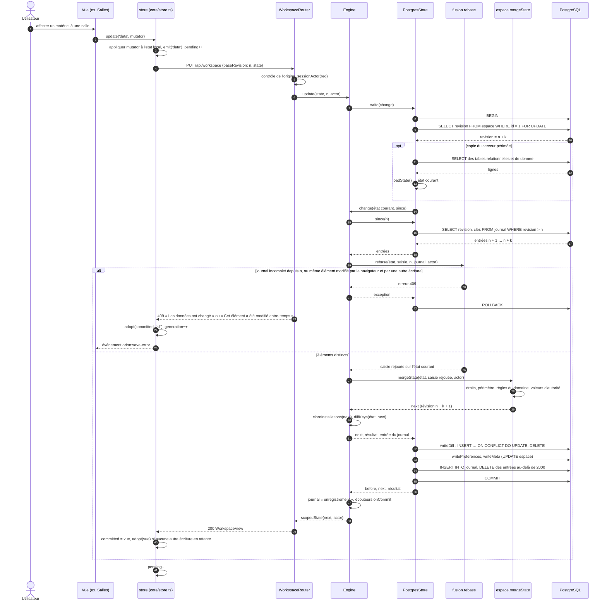
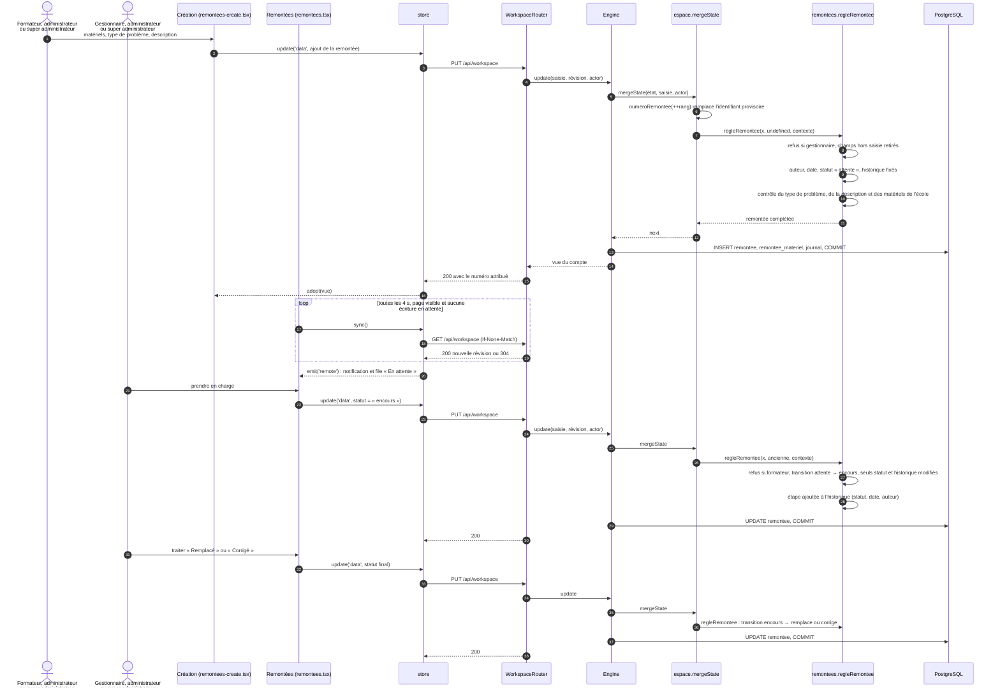
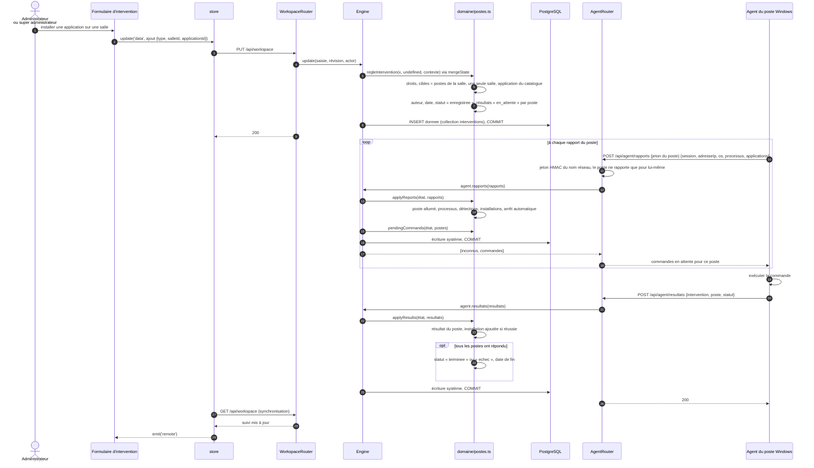
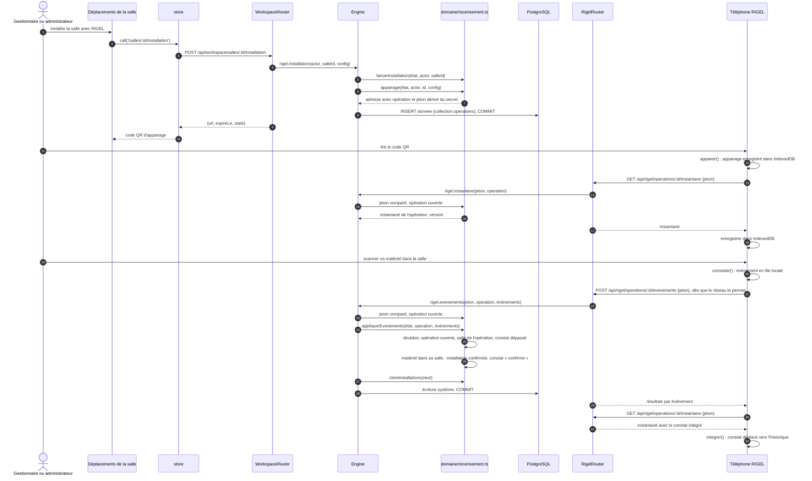
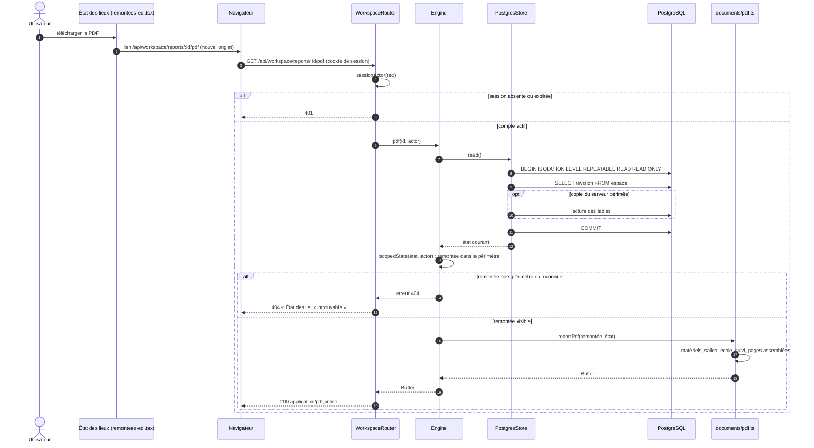
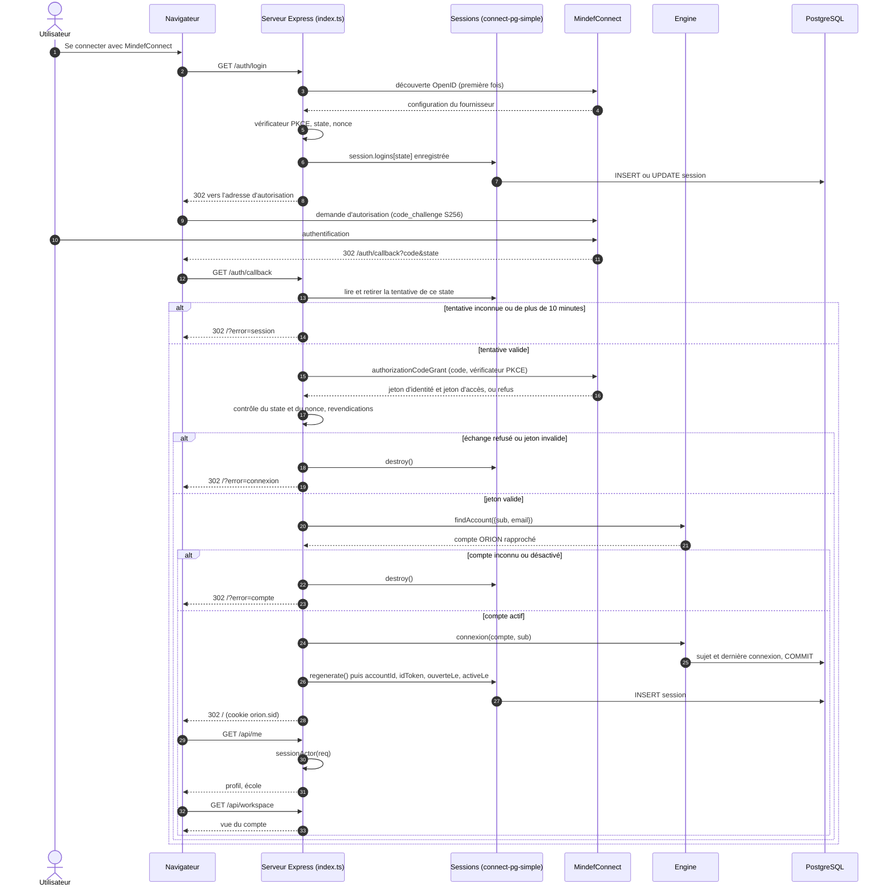

# Diagrammes de séquence détaillés

<!-- version:debut : généré par versions.py, ne pas modifier à la main -->
| Version | Mise à jour | Destination | Dernière évolution | Historique |
| --- | --- | --- | --- | --- |
| 4.0 | 16/11/2026 | Production destinée à la remise | Appliquer les droits de l’administrateur, corriger les écarts avec le code et remettre en page à angles droits | [6 versions](../../../archive/README.md#02-diagrammes-sequence-detailles) |
<!-- version:fin -->

## Écriture concurrente fusionnée

## Création et traitement d'une remontée

## Intervention sur un poste

## Constat RIGEL intégré

## État des lieux PDF à la demande

## Connexion OIDC

