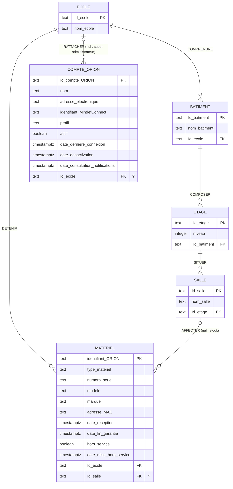
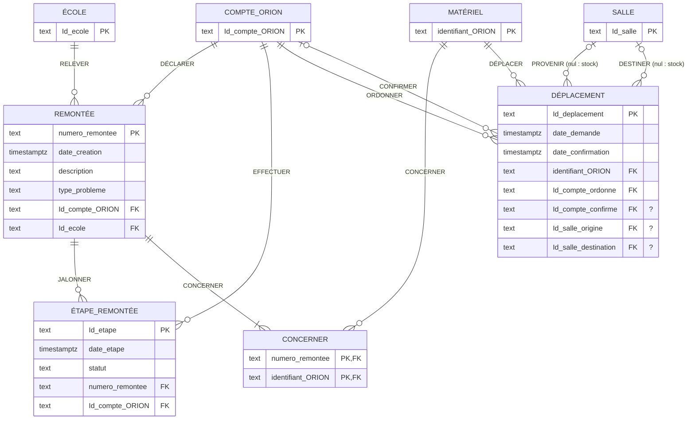
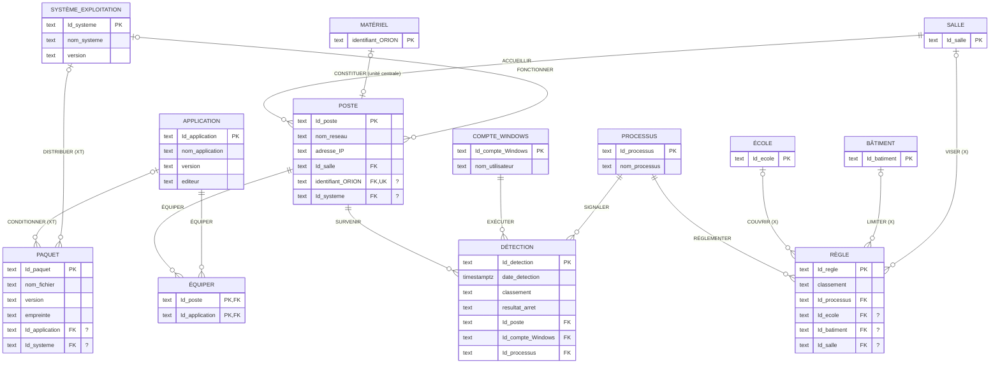
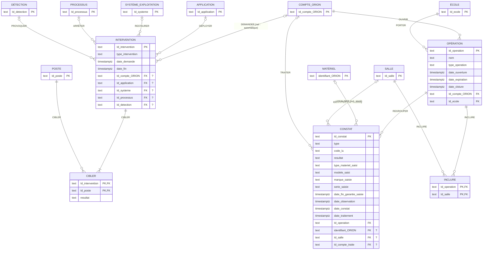

# Modèle logique de données

<!-- version:debut : généré par versions.py, ne pas modifier à la main -->
| Version | Mise à jour | Destination | Dernière évolution | Historique |
| --- | --- | --- | --- | --- |
| 1.0 | 17/11/2026 | Production destinée à la remise | Créer le modèle logique de données et sa correspondance avec le modèle physique ; Créer le modèle logique de données et sa correspondance avec le modèle physique ; Créer le modèle logique de données en quatre vues | [1 version](../../../archive/README.md#03-modele-logique-donnees) |
<!-- version:fin -->

## Organisation, comptes et parc

## Remontées et déplacements

## Postes, applications et supervision

## Interventions, opérations RIGEL et constats

