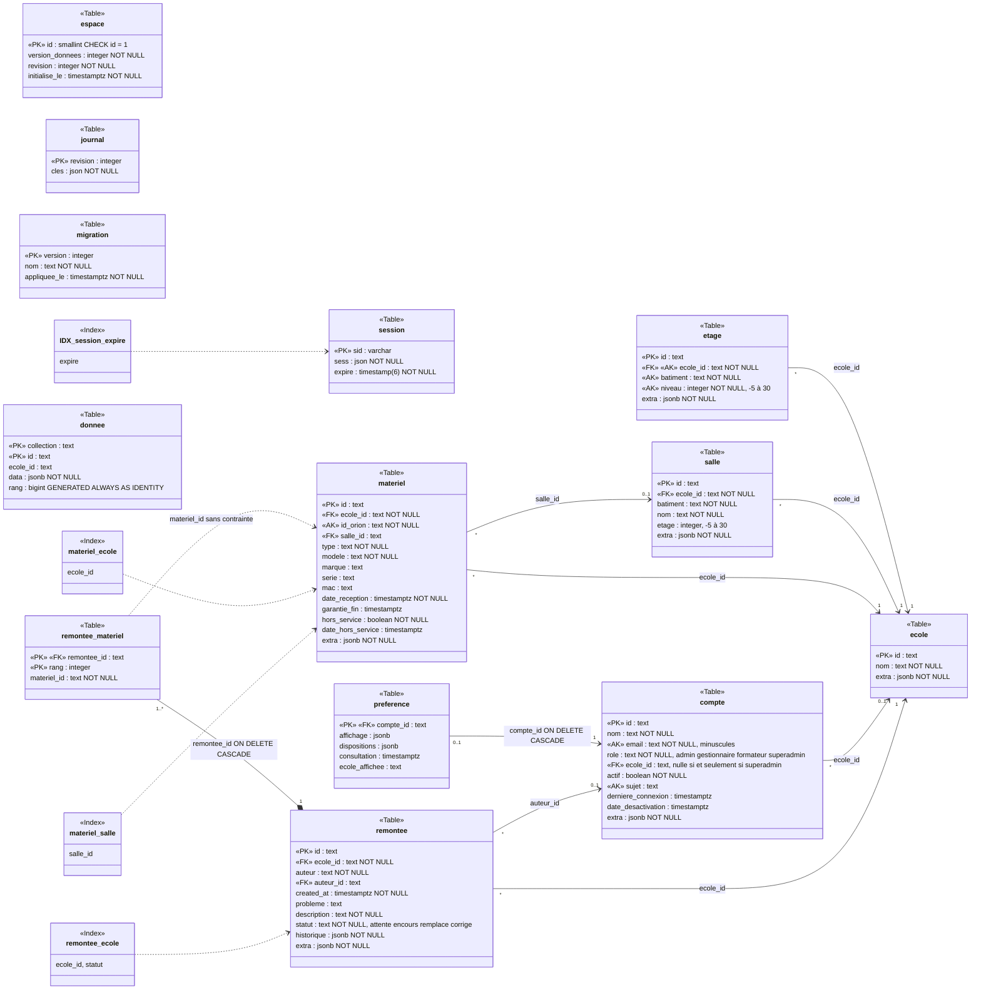
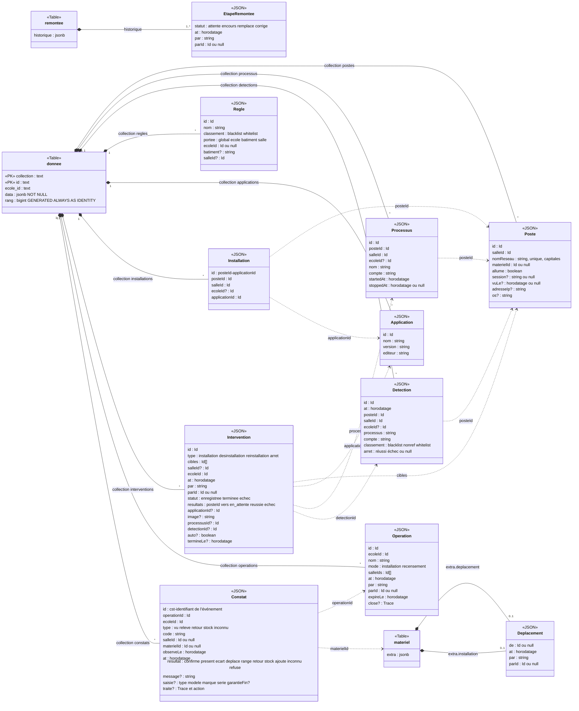

# Modèle physique des données

<!-- version:debut : généré par versions.py, ne pas modifier à la main -->
| Version | Mise à jour | Destination | Dernière évolution | Historique |
| --- | --- | --- | --- | --- |
| 4.1 | 17/11/2026 | Production destinée à la remise | Renuméroter après l’ajout du modèle logique | [6 versions](../../../archive/README.md#04-modele-physique-donnees) |
<!-- version:fin -->

## Base ORION : tables relationnelles

## Base ORION : documents JSONB

