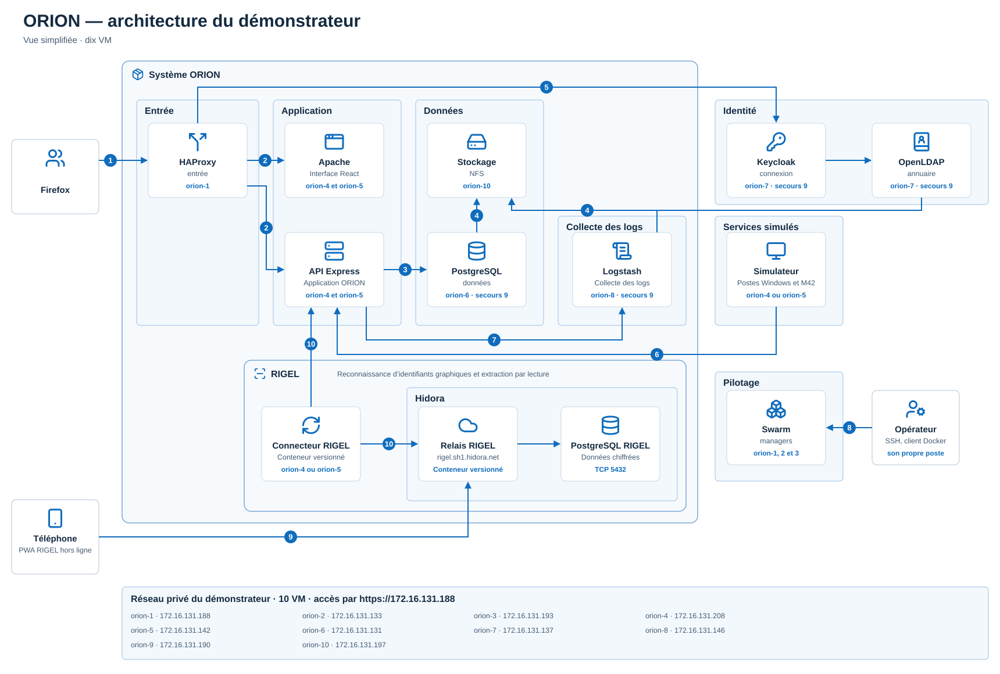
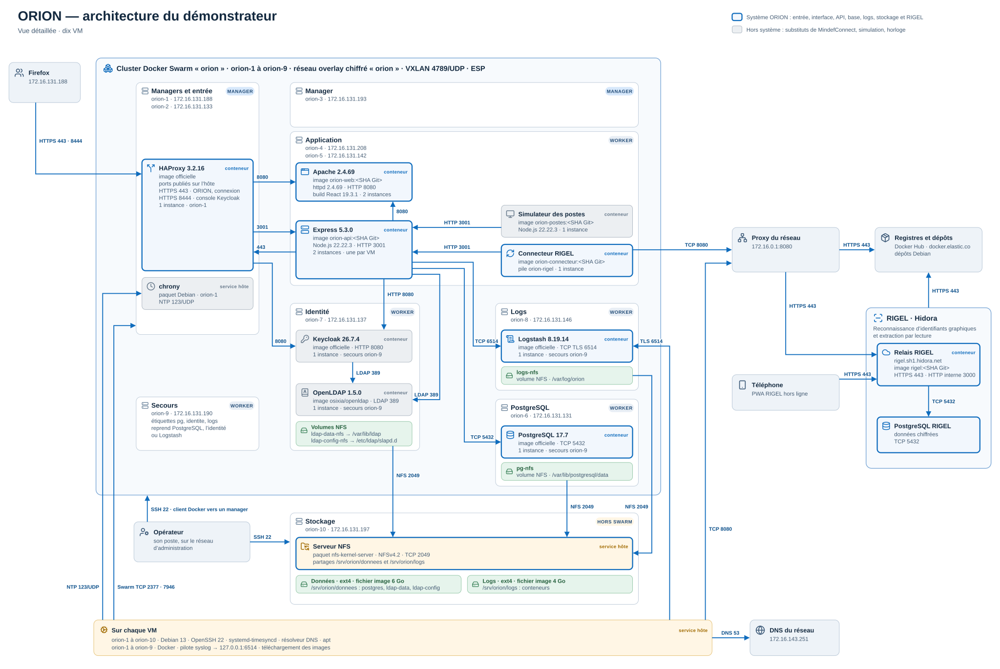
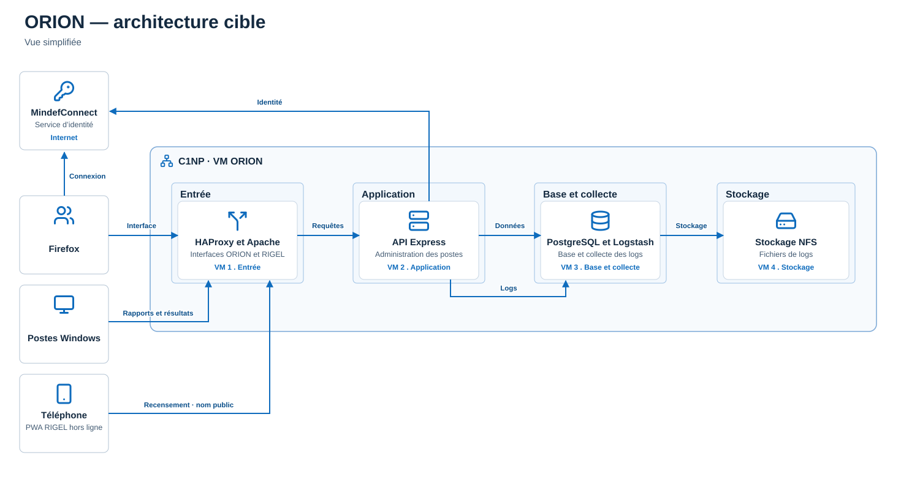
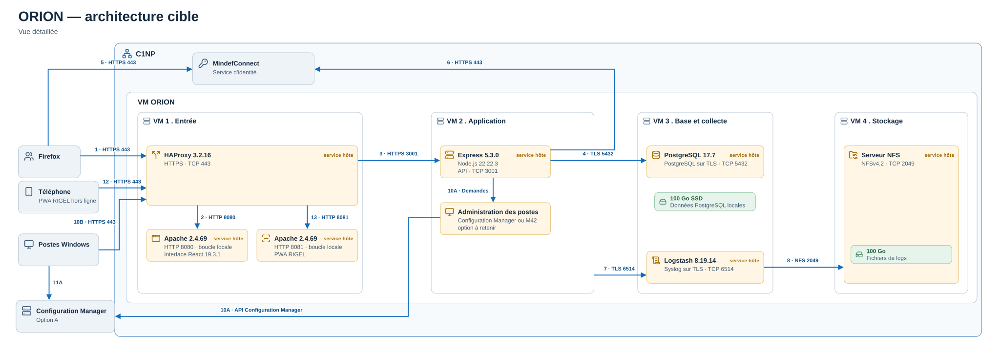

# Diagrammes d’architecture

<!-- version:debut : généré par versions.py, ne pas modifier à la main -->
| Version | Mise à jour | Destination | Dernière évolution | Historique |
| --- | --- | --- | --- | --- |
| 2.4 | 16/11/2026 | Production destinée à la remise | Adopter la numérotation locale du dossier ; Actualiser les liens après la renumérotation | [10 versions](../../archive/README.md#02-diagrammes-architecture) |
<!-- version:fin -->

## Vue simplifiée

## Architecture réelle sur VM

## Architecture cible sur le C1NP

### Vue simplifiée de la cible

### Vue détaillée de la cible

