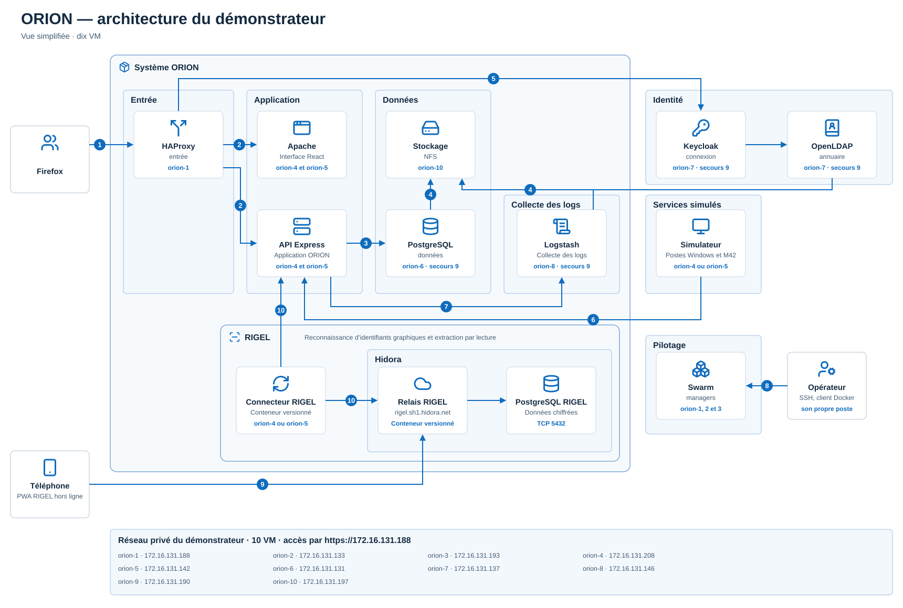
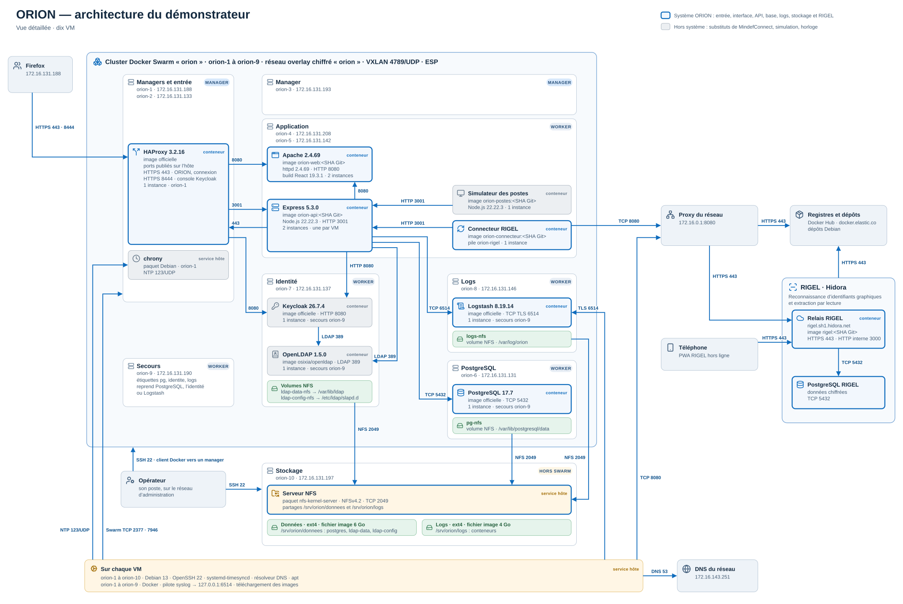
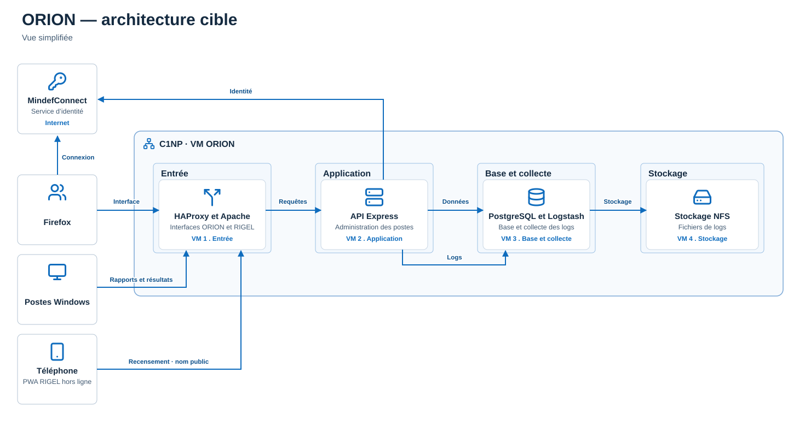
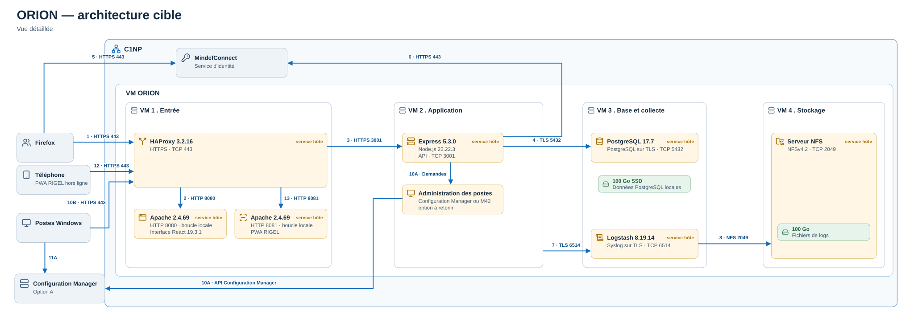

# Diagrammes d’architecture

<!-- version:debut : généré par versions.py, ne pas modifier à la main -->
| Version | Mise à jour | Destination | Dernière évolution | Historique |
| --- | --- | --- | --- | --- |
| 2.3 | 15/11/2026 | Production destinée à la remise | Trace tous les flux réels de la vue complète du démonstrateur ; Trace tous les flux réels de la vue complète et nomme le stockage NFS de la cible ; Trace tous les flux de la vue complète ; cible avec stockage NFS et RIGEL servi par l’entrée d’ORION | [9 versions](../../archive/README.md#19-diagrammes-architecture) |
<!-- version:fin -->

## Vue simplifiée

## Architecture réelle sur VM

## Architecture cible sur le C1NP

### Vue simplifiée de la cible

### Vue détaillée de la cible

