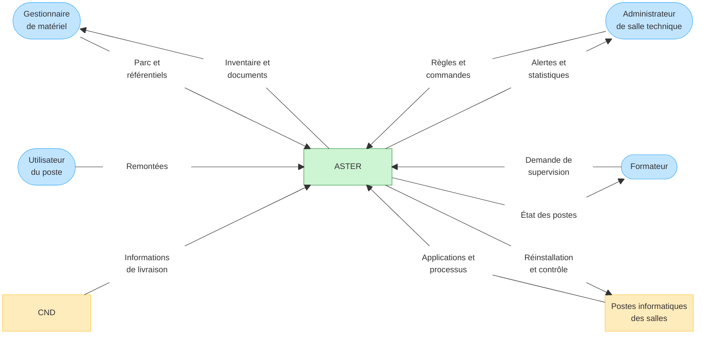

# Diagramme de contexte de l'application ASTER

## Diagramme

## Entités et flux

| Entité externe                    | Flux vers ASTER                                                                          | Flux provenant d'ASTER                                                                      |
| --------------------------------- | ---------------------------------------------------------------------------------------- | ------------------------------------------------------------------------------------------- |
| Gestionnaire de matériel          | matériels, salles, affectations, mouvements, aptitudes et formations induites            | inventaire, localisation, état du parc et documents d'état des lieux                        |
| Administrateur de salle technique | demandes de réinstallation, listes de processus autorisés ou interdits et ordres d'arrêt | applications installées, processus démarrés, alertes, résultats des actions et statistiques |
| Formateur                         | demandes de consultation et de supervision de sa salle                                   | état et données d'utilisation des postes de sa salle                                        |
| Utilisateur du poste              | remontées utilisateur                                                                    | aucun retour n'est explicitement prévu dans les consignes                                   |
| CND                               | informations accompagnant les matériels livrés                                           | aucun flux sortant n'est explicitement prévu dans les consignes                             |
| Postes informatiques des salles   | applications installées, processus démarrés et données d'utilisation                     | commandes de réinstallation et de contrôle des processus                                    |

## Choix de modélisation

- les trois modules fonctionnels ne sont pas affichés : ils appartiennent à l'intérieur d'ASTER ;
- les documents d'état des lieux sont représentés comme un **flux sortant** vers le gestionnaire, et non comme une entité externe ;
- les processus ne sont pas une entité externe : leurs informations proviennent des postes, tandis que les règles et commandes sont échangées avec l'administrateur ;
- les fichiers Excel ne figurent pas dans le diagramme, car les consignes les présentent comme le fonctionnement à remplacer et non comme une intégration à conserver ;
- aucun annuaire, SSO, outil de déploiement ou système du CND n'est ajouté tant que son existence et son intégration ne sont pas confirmées.

## Points à confirmer pendant le cadrage

- la saisie des informations du CND est-elle manuelle, issue d'un fichier ou réalisée par une API ?
- ASTER communique-t-il directement avec les postes ou par l'intermédiaire d'un agent ou d'un outil tiers ?
- quel outil exécute réellement la réinstallation des postes et des salles ?
- quels retours ASTER fournit-il aux utilisateurs ayant créé une remontée ?
- quels acteurs reçoivent les documents d'état des lieux en plus du gestionnaire de matériel ?
