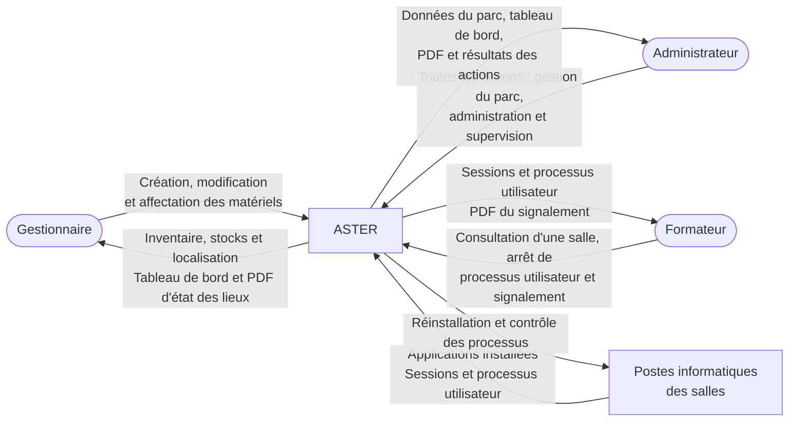

# Diagramme de contexte de l'application ASTER

Cette vue reprend le [sujet](01-CONSIGNES.md), les [entretiens des 22 et 23 octobre](03-COMPTE-RENDU-ENTRETIENS.md) et les réponses en vigueur du [cadrage](02-CADRAGE.md), notamment les précisions du 24 octobre.

## Diagramme

Les échanges de processus et de sessions avec les postes sont **simulés pour la démonstration**. Les liens avec les postes représentent les échanges fonctionnels attendus, sans imposer de connexion réelle ni de mécanisme technique. La collecte des applications installées et l'exécution de la réinstallation restent à préciser.

Les diagrammes utilisent les styles par défaut du moteur Mermaid : aucune couleur de texte, de fond ou de bordure n'est imposée, afin de laisser le thème du lecteur gérer leur affichage.

## Acteurs et échanges

| Acteur ou entité externe | Flux vers ASTER | Flux provenant d'ASTER |
| --- | --- | --- |
| Gestionnaire | Création et modification des matériels, gestion des stocks, affectation et déplacement, y compris opérations groupées ; aucune suppression | Inventaire, localisation, état du parc, tableau de bord global filtrable par salle et consultation des PDF d'état des lieux |
| Administrateur | Toutes les actions, dont gestion du parc, consultation des applications installées, réinstallation d'un poste ou d'une salle et contrôle des processus | Données du parc, applications installées, processus, tableau de bord, PDF d'état des lieux, résultats des actions et statistiques prévues par le sujet |
| Formateur | Accès à une salle, consultation des processus utilisateur, arrêt d'un processus utilisateur et création d'un signalement de problème | Nom de session utilisateur, processus utilisateur et PDF d'état des lieux généré à partir du signalement |
| Postes informatiques des salles | Applications installées ; sessions et processus utilisateur simulés pour la démonstration, hors processus internes | Demandes de réinstallation et de contrôle des processus ; arrêt simulé pour la démonstration |

## Périmètre et choix de modélisation

- Exactement trois profils existent : administrateur, gestionnaire et formateur. Les stagiaires n'ont pas de compte ASTER ; le nom de session est une donnée de supervision, pas un acteur supplémentaire.
- La V1 porte sur une école, deux bâtiments et six à huit salles par bâtiment. La gestion de plusieurs écoles est prévue à terme, hors des attendus de la V1.
- L'école, les bâtiments, les salles et les matériels sont gérés dans ASTER ; ils ne constituent pas des systèmes externes. Aucun niveau « étage » distinct n'est prévu.
- Les nouveaux matériels sont enregistrés individuellement, par saisie manuelle ou import JSON, sans gestion de lots ou de réceptions. L'import met les données à jour immédiatement, sans étape de vérification ; les rôles autorisés à importer restent à préciser. Le CND n'est pas représenté comme un système connecté.
- Chaque matériel reçoit un identifiant interne automatique. Le modèle et la date de réception sont obligatoires ; le statut se limite à « hors service : oui/non », avec « non » par défaut. Le numéro de série et la marque peuvent rester vides. L'affectation se fait à une salle, jamais à une personne ; un matériel peut rester en stock sans localisation.
- ASTER ne gère pas les formations ni un référentiel d'aptitudes. Le rôle ou la destination du matériel reste une information sur celui-ci.
- Le signalement du formateur génère un PDF d'état des lieux. La salle est retrouvée à partir du matériel lorsqu'elle est connue ; sinon, elle peut être saisie ou laissée vide. Le gestionnaire peut consulter ces documents et l'administrateur dispose de tous les droits.
- La gestion de la garantie est un **bonus** : seule la date de fin est renseignée par le gestionnaire ou l'administrateur. Si ce bonus est réalisé, le gestionnaire reçoit les alertes six mois avant l'échéance et à l'échéance ; les deux profils disposent d'indicateurs distincts pour les garanties proches et arrivées à échéance. Les notifications apparaissent dans l'application à la connexion, sans courriel. L'administrateur ne reçoit pas d'alerte ticket.
- Les journaux sont également un **bonus**. Aucun historique des mouvements n'est attendu en dehors d'éventuels journaux.
- Aucun annuaire, SSO, agent ou outil de déploiement n'est ajouté tant que son choix et son intégration ne sont pas confirmés. Aucune reprise Excel n'est à traiter avec les données actuellement fournies.

## Points encore à préciser

- Le système d'authentification et une éventuelle intégration à un annuaire.
- Les rôles autorisés à importer les nouveaux matériels en JSON.
- Le mécanisme de collecte des applications installées et l'outil exécutant la réinstallation.
- La portée des droits du formateur sur les salles et les périodes d'utilisation.
- Le comportement des listes de processus autorisés ou interdits, ainsi que les règles de calcul des statistiques d'utilisation.
- Les responsables et les transitions de traitement des signalements, les retours au formateur après leur création et les modalités de téléchargement des PDF.
