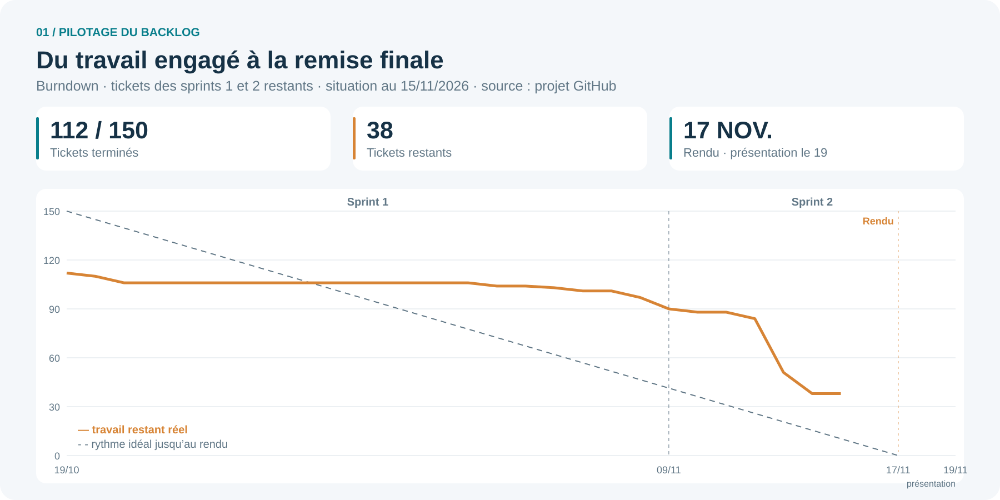
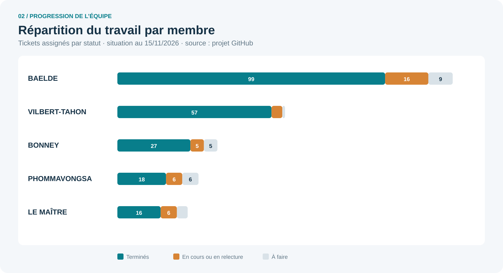

# Dossier d’organisation

<!-- version:debut : généré par versions.py, ne pas modifier à la main -->
| Version | Mise à jour | Destination | Dernière évolution | Historique |
| --- | --- | --- | --- | --- |
| 1.0 | 17/11/2026 | Production destinée à la remise | Créer la source du dossier d’organisation remis en PDF ; Créer la source du dossier d’organisation remis en PDF ; Créer la source du dossier d’organisation remis en PDF ; Créer la source du dossier d’organisation remis en PDF ; Créer la source du dossier d’organisation remis en PDF ; Créer la source du dossier d’organisation remis en PDF ; Créer la source du dossier d’organisation remis en PDF ; Créer la source du dossier d’organisation remis en PDF | [1 version](../../archive/README.md#05-dossier-organisation) |
<!-- version:fin -->

Ce document est la source du livrable PDF du dossier d’organisation (DO). Ses tableaux sont établis à partir du backlog et du journal de bord, repris en annexes ; ses graphiques sont produits depuis le projet GitHub.

## 1. Introduction

### 1.1 Objet du document

Ce dossier d’organisation (DO) décrit comment l’équipe ASTER s’est organisée pour réaliser ORION : rôles, méthode de travail, planification, backlog, suivi de l’avancement, cérémonies et échanges avec le client. Il répond aux attendus « analyse et gestion de projet » des consignes : organisation en équipe Agile, présentation et suivi du backlog, mise en place et traçabilité des cérémonies Scrum-XP. Il prépare aussi la présentation de l’organisation de l’équipe lors de la soutenance.

Aucune norme ne fixe le contenu d’un dossier d’organisation. Sa structure s’inspire du plan de management de projet décrit par l’ISO 21502 et du Guide Scrum 2020, adaptés à un projet de quatre semaines mené par cinq personnes.

### 1.2 Portée

Le dossier couvre la période du 20 octobre au 19 novembre 2026 : lancement, deux sprints, rendu de l’application et du dossier le 17 novembre, présentation le 19 novembre. Il porte sur l’organisation du travail, pas sur le contenu fonctionnel ni technique du produit, décrits respectivement par le dossier de spécifications des exigences (DSE) et le dossier d’architecture technique (DAT).

### 1.3 Définitions et abréviations

*Tableau – Définitions et abréviations*

| Terme | Définition |
| --- | --- |
| DO | Dossier d’organisation, le présent document. |
| DSE, DAT | Dossier de spécifications des exigences, dossier d’architecture technique, remis séparément. |
| PB-nn | Élément du Product Backlog : besoin utilisateur et résultat observable attendu. |
| BL-nn | Tâche de réalisation ou de préparation, avec un responsable, un appui, une priorité et une période. |
| P1, P2 | Priorité d’une tâche : essentielle à la remise, ou consolidation et présentation. |
| Product Owner | Membre qui tient le Product Backlog et prépare les échanges avec le client. |
| Scrum Master | Membre qui facilite les événements et rend les obstacles visibles. |
| Developers | Les cinq membres, qui conçoivent, réalisent, vérifient et documentent les incréments. |
| Sprint | Période de travail à objectif fixé : deux sprints de trois et deux semaines. |
| Definition of Done | Conditions communes pour déclarer une tâche terminée. |
| XP | Extreme Programming, dont certaines pratiques complètent le cadre Scrum. |
| RIGEL | Module mobile d’ORION pour l’installation des salles et le recensement du parc. |

### 1.4 Documents de référence

*Tableau – Documents de référence*

| Réf. | Document |
| --- | --- |
| R1 | Sujet du projet de fin de stage ORION : présentation du besoin, périmètre, livrables attendus et critères d’évaluation (DRHAT / PFORM). |
| R2 | Comptes rendus des entretiens avec le client (22 et 23 octobre, 4 et 12 novembre 2026). |
| R3 | Guide Scrum 2020, version française (Ken Schwaber et Jeff Sutherland). |
| R4 | ISO 21502:2020 – Management de projet, de programme et de portefeuille : recommandations sur le management de projet. |
| R5 | Dossier de spécifications des exigences d’ORION (ORION-DSE) et dossier d’architecture technique (ORION-DAT), remis séparément. |
| R6 | Projet GitHub « ORION development » : tableau de suivi des tickets, source des graphiques d’avancement. |

### 1.5 Conventions

- Les membres de l’équipe sont désignés par leur nom de famille : BAELDE, VILBERT-TAHON, BONEY, PHOMMAVONGSA et LE MAITRE.
- Les besoins du Product Backlog portent un identifiant PB-nn, les tâches un identifiant BL-nn ; les deux sont ceux du backlog (annexe A) et des tickets GitHub.
- Les dates postérieures à l’édition du dossier décrivent des échéances planifiées, pas des faits.
- Une cérémonie ne vaut ni décision du client ni validation d’un document : les décisions du client restent datées et reliées aux entretiens.

### 1.6 Organisation du document

*Tableau – Organisation du document*

| Partie | Contenu |
| --- | --- |
| 2 | Contexte du projet : commanditaire, calendrier, livrables attendus. |
| 3 | Équipe et responsabilités. |
| 4 | Méthode de travail : cadre Scrum adapté, événements, artefacts, pratiques XP, outillage. |
| 5 | Planification : sprints, calendrier des événements, jalons. |
| 6 | Backlog : besoins et tâches. |
| 7 | Suivi du projet : tableau, avancement, progression par membre, clôture. |
| 8 | Journal des cérémonies et des échanges avec le client. |
| 9 | Organisation prévue et organisation réelle. |
| 10 | Bilan et amélioration continue. |
| 11 | Traçabilité avec les critères d’évaluation. |
| A et B | Annexes : backlog et suivi du projet, journal de bord. |

## 2. Contexte du projet

### 2.1 Commanditaire et cadre

ORION est réalisé pour la DRHAT / PFORM au profit des écoles de formation, dans le cadre d’un projet de fin de stage. Le client a exprimé son besoin lors de quatre entretiens ; les cadres évaluateurs apprécient les productions selon les consignes du sujet. L’équipe ASTER, composée de cinq membres, réalise l’application, les dossiers et la présentation.

### 2.2 Calendrier et échéances

*Tableau – Échéances du projet*

| Date | Échéance |
| --- | --- |
| 20 octobre 2026 | Lancement du projet et du sprint 1. |
| 22 et 23 octobre | Entretiens de recueil du besoin. |
| 4 novembre | Point d’étape avec le client : présentation de la maquette. |
| 9 novembre | Lancement du sprint 2. |
| 12 novembre | Entretien d’arbitrage avec le client. |
| 17 novembre, 12 h | Rendu de l’application, du DSE, du DAT et du présent dossier. |
| 18 novembre | Supports de présentation prêts. |
| 19 novembre | Présentation finale ; fin du sprint 2. |

### 2.3 Livrables attendus

*Tableau – Livrables et correspondance avec les consignes*

| Livrable | Attendu des consignes | Responsable de l’assemblage |
| --- | --- | --- |
| Application web ORION et module RIGEL | Produit : gestion du parc, administration et supervision des postes, remontées et états des lieux. | BAELDE |
| Dossier de spécifications des exigences | Capture initiale du besoin et dossier d’analyse. | BONEY, PHOMMAVONGSA |
| Dossier d’architecture technique et configurations | Architecture détaillée, sécurité, contraintes applicatives. | BAELDE |
| Dossier d’organisation | Organisation Agile, backlog et son suivi, cérémonies Scrum-XP. | VILBERT-TAHON |
| Support de présentation | Présentation de l’organisation, du produit et des choix. | LE MAITRE |

## 3. Équipe et responsabilités

### 3.1 Responsabilités Scrum

L’équipe est unique : cinq membres partagent un même objectif, présenter un parcours cohérent de gestion et de supervision du parc, accompagné d’un dossier d’analyse et d’architecture exploitable. Les responsabilités ci-dessous organisent la coordination ; elles ne créent pas de sous-équipes.

*Tableau – Responsabilités Scrum*

| Responsabilité | Membre | Mission |
| --- | --- | --- |
| Product Owner | BAELDE | Tenir le Product Backlog, ordonner les besoins et préparer les échanges avec le client en respectant ses décisions. |
| Scrum Master | LE MAITRE | Faciliter les événements, rendre les obstacles visibles et suivre les actions d’amélioration. |
| Developers | BAELDE, VILBERT-TAHON, BONEY, PHOMMAVONGSA, LE MAITRE | Concevoir, réaliser, vérifier et documenter ensemble les incréments ; les deux responsabilités précédentes n’en dispensent pas. |

Le Product Owner ordonne le backlog ; les Developers choisissent collectivement le travail réalisable pendant le sprint et son organisation ; le Scrum Master facilite cette coopération.

### 3.2 Domaines et entraide

Chaque membre pilote un domaine et quatre tâches, avec un appui désigné pour chacune. Le responsable coordonne ; l’appui relit et assure la continuité. La relecture d’une production est toujours confiée à un autre membre que son auteur.

*Tableau – Domaines par membre*

| Membre | Domaine principal | Tâches pilotées | Contribution transversale |
| --- | --- | --- | --- |
| BAELDE | Intégration et cohérence d’ensemble | BL-01 à BL-04 | Besoin, données, connexion, architecture, déploiement et coordination de la livraison |
| VILBERT-TAHON | Interface et parcours utilisateurs | BL-05 à BL-08 | Navigation, tableaux de bord, salles, cohérence visuelle et organisation |
| BONEY | Modélisation et gestion du parc | BL-09 à BL-12 | Séquences, classes, inventaire, vérification des affectations et dossier de spécifications |
| PHOMMAVONGSA | Cycles de vie et supervision | BL-13 à BL-16 | États, règles de supervision, interventions, recette des profils et dossier de spécifications |
| LE MAITRE | Préparation de la remise et de la présentation | BL-17 à BL-20 | Relecture du dossier technique, assemblage des livrables et support de présentation |

Le nombre de tâches décrit la répartition des responsabilités ; il ne mesure ni le temps consacré ni la contribution totale de chacun. Une difficulté est rendue visible au point quotidien ; un membre disponible aide à lever un blocage avant d’ouvrir une nouvelle tâche.

### 3.3 Parties prenantes

*Tableau – Parties prenantes*

| Partie prenante | Rôle dans le projet | Mode d’échange |
| --- | --- | --- |
| Client (DRHAT / PFORM) | Exprime le besoin, tranche les questions métier, assiste aux points d’étape. | Entretiens datés, questions préparées, réponses consignées dans le cadrage. |
| Cadres évaluateurs | Apprécient les productions selon les consignes. | Rendu du 17 novembre et présentation du 19 novembre. |
| Utilisateurs cibles | Formateurs, gestionnaires et administrateurs des écoles. | Représentés par le client ; parcours vérifiés par profil. |

## 4. Méthode de travail

### 4.1 Cadre Scrum adapté

L’équipe applique Scrum avec deux sprints, un Product Backlog ordonné, un tableau de suivi partagé et les cinq événements du Guide Scrum. Les durées sont réduites à la taille du projet. Le refinement est une activité régulière de préparation du backlog, distincte des événements formels. Un point hebdomadaire de coordination complète le cadre sans constituer un événement Scrum.

### 4.2 Événements

*Tableau – Événements et modalités*

| Événement ou activité | Cadence et durée | Participants et facilitation | Trace attendue |
| --- | --- | --- | --- |
| Sprint Planning | Début de sprint ; 45 minutes | Toute l’équipe ; facilitation LE MAITRE | Objectif de sprint, sélection PB/BL, répartition initiale et dépendances. |
| Daily Scrum | Chaque jour travaillé ; 15 minutes à 9 h | Developers ; facilitation initiale LE MAITRE | Tableau actualisé et action datée pour chaque obstacle. |
| Refinement | Milieu de sprint ; 30 minutes | BAELDE et Developers concernés | Backlog ordonné et éléments prêts à être sélectionnés. |
| Sprint Review | Fin de sprint ; 45 minutes | Équipe ; client invité selon sa disponibilité | Résultats montrés, retours recueillis et suites reliées au backlog. |
| Sprint Retrospective | Après la Review ; 30 minutes | Toute l’équipe ; facilitation LE MAITRE | Action d’amélioration, responsable, échéance et vérification au point suivant. |
| Point hebdomadaire | Chaque semaine ; 30 minutes | Toute l’équipe | Objectif, résultat, risque et action suivante de la semaine. |

### 4.3 Artefacts et Definition of Done

*Tableau – Artefacts*

| Artefact | Contenu | Tenue |
| --- | --- | --- |
| Product Backlog | Besoins PB-01 à PB-09 ordonnés par valeur et dépendances. | Product Owner. |
| Sprint Backlog | Tâches BL sélectionnées pour le sprint, avec responsable et appui. | Developers, au Sprint Planning. |
| Tableau de suivi | Tickets du projet GitHub, par statut, priorité, sprint et dates. | Chaque membre, pour ses tickets. |
| Incrément | Version de l’application et des dossiers conforme à la Definition of Done. | Toute l’équipe. |

Un besoin est sélectionnable quand sa valeur, ses critères, sa source et ses dépendances sont compréhensibles. La Definition of Done commune exige un résultat accessible, les critères applicables vérifiés, une relecture par un autre membre, les contrôles adaptés consignés et la documentation concernée mise à jour. Aucun résultat de test n’est annoncé sans exécution et trace correspondantes ; une tâche non aboutie est accompagnée d’une réserve, elle n’est pas déclarée réalisée par le seul effet de l’échéance.

### 4.4 Pratiques XP

*Tableau – Pratiques XP retenues*

| Pratique | Application | Trace |
| --- | --- | --- |
| Travail en binôme | Responsable et appui traitent ensemble un point risqué ou un blocage. | Tâche, membres concernés et résultat. |
| Petits changements intégrés | Modifications fractionnées en ensembles cohérents et relisibles, intégrées en continu. | Commits et relectures reliés aux tickets. |
| Vérification continue | Tests unitaires, d’interface et de bout en bout rejoués à chaque modification par l’intégration continue. | Résultats exécutés et anomalies associées. |
| Conception simple et amélioration du code | Changements limités au besoin ; code modifié factorisé quand cela se justifie. | Relecture et justification des changements. |
| Retour rapide sur le besoin | Ambiguïtés soumises au client ; backlog réordonné selon ses réponses. | Compte rendu daté et mise à jour du cadrage. |

### 4.5 Outillage

*Tableau – Outillage du projet*

| Outil | Usage |
| --- | --- |
| Projet GitHub « ORION development » | Tableau de suivi : une épopée par type de travail, des tickets avec responsables, statut, priorité, sprint et dates. |
| Dépôt Git | Code, documentation et livrables versionnés ; chaque document suivi porte sa version et son historique. |
| Intégration et déploiement continus | Tests, construction et déploiement automatiques de chaque version publiée. |
| Diagrammes et modèles | Sources éditables des diagrammes UML et Merise, rendues dans les dossiers. |

## 5. Planification

### 5.1 Sprints

*Tableau – Sprints et objectifs*

| Période | Objectif | Sélection du backlog | Résultat à inspecter |
| --- | --- | --- | --- |
| Sprint 1 — 19 octobre au 8 novembre | Comprendre le problème, préparer le travail, puis construire une première traversée de la connexion vers la consultation du parc. | BL-01, BL-02, BL-17, puis PB-01 et PB-02 avec les tâches de conception et d’intégration utiles. | Parcours inspectable, premières données et modèles ; travaux restants réévalués. |
| Sprint 2 — 9 au 19 novembre | Compléter les parcours prioritaires et consolider la version de remise. | Compléments PB-01 et PB-02, PB-03 à PB-07, préparation documentaire PB-08 et PB-09. | Parcours intégrés, résultats de vérification, dossiers et réserves. |

Les tâches peuvent se poursuivre d’un sprint à l’autre ; un élément inachevé est réexaminé lors de la planification suivante.

### 5.2 Calendrier des événements

*Tableau – Calendrier de référence*

| Événement | Sprint 1 | Sprint 2 |
| --- | --- | --- |
| Sprint Planning | 20 octobre, 9 h–9 h 45 | 9 novembre, 9 h–9 h 45 |
| Daily Scrum | Chaque jour travaillé, 9 h–9 h 15 | Chaque jour travaillé, 9 h–9 h 15 |
| Refinement | 4 novembre, 14 h–14 h 30 | 13 novembre, 14 h–14 h 30 |
| Sprint Review | 8 novembre, 14 h–14 h 45 | 18 novembre, 14 h–14 h 45 |
| Sprint Retrospective | 8 novembre, 15 h–15 h 30 | 18 novembre, 15 h–15 h 30 |

### 5.3 Jalons

*Tableau – Jalons*

| Jalon | Orientation | Résultat visé |
| --- | --- | --- |
| 24 octobre | Comprendre le besoin | Base de cadrage et premières représentations. |
| 5 novembre | Détailler la conception | Ensemble de conception utilisable pour organiser les parcours. |
| 10 novembre | Relier conception et parcours | Parcours cohérents et premières relectures croisées. |
| 13 novembre | Consolider | Points restant à traiter et responsabilités de clôture. |
| 16 novembre | Stabiliser les parcours essentiels | Résultats des vérifications regroupés. |
| 17 novembre | Rendre l’application et les dossiers | Version rendue et réserves identifiées. |
| 18 novembre | Préparer la présentation | Support prêt et passages répartis. |
| 19 novembre | Présenter | Résultat et démarche présentés. |

## 6. Backlog

### 6.1 Product Backlog

Le Product Backlog décrit les résultats utiles aux utilisateurs, ordonnés selon la valeur métier et les dépendances. Les critères sont précisés par les règles de gestion et la matrice des droits du DSE ; les questions encore ouvertes ne sont pas transformées en engagements de réalisation.

*Tableau – Product Backlog*

| Ordre | ID | Besoin utilisateur | Résultat observable attendu | Tâches liées |
| --- | --- | --- | --- | --- |
| 1 | PB-01 | En tant qu’utilisateur, accéder à un espace adapté à mon profil. | Connexion par MindefConnect et accès conformes à la matrice des droits. | BL-01, BL-03, BL-05, BL-16 |
| 2 | PB-02 | En tant que gestionnaire, retrouver un matériel et sa localisation. | Inventaire consultable et matériel retrouvé dans son affectation. | BL-02, BL-07, BL-10, BL-11 |
| 3 | PB-03 | En tant que gestionnaire, organiser le stock et les salles. | Affectations et déplacements lisibles et cohérents avec les droits. | BL-07, BL-09, BL-11 |
| 4 | PB-04 | En tant qu’utilisateur autorisé, créer et suivre une remontée. | Remontée suivie et état des lieux consultable selon les droits. | BL-09, BL-13, BL-15, BL-16 |
| 5 | PB-05 | En tant qu’administrateur, demander une intervention et en suivre le résultat. | Demande, exécution par le poste et résultat distingués dans le suivi. | BL-03, BL-13, BL-15 |
| 6 | PB-06 | En tant que formateur, superviser les processus dans mon périmètre. | Processus consultables et règles examinées selon les droits. | BL-06, BL-14, BL-16 |
| 7 | PB-07 | En tant qu’utilisateur, disposer d’une vue de synthèse utile à mon activité. | Tableau de bord lisible et adapté au profil. | BL-06, BL-08, BL-16 |
| 8 | PB-08 | En tant que lecteur du dossier, comprendre le besoin, la conception et l’architecture. | Productions cohérentes, références accessibles et réserves identifiées. | BL-01, BL-02, BL-10, BL-12, BL-17, BL-18 |
| 9 | PB-09 | En tant qu’évaluateur, suivre la démarche et examiner la version remise. | Backlog présenté, traces des cérémonies disponibles et remise identifiée. | BL-04, BL-19, BL-20 |

### 6.2 Tâches de réalisation et de préparation

Les priorités organisent la préparation de l’échéance : P1 pour les parcours et productions essentiels, P2 pour leur consolidation et leur présentation.

*Tableau – Tâches BL-01 à BL-20*

| ID | Tâche | Responsable | Appui | Priorité | Période | Résultat attendu |
| --- | --- | --- | --- | --- | --- | --- |
| BL-01 | Structurer le besoin et les profils | BAELDE | BONEY | P1 | 20/10–03/11 | Périmètre et responsabilités présentés sans confondre décisions et questions ouvertes. |
| BL-02 | Consolider le modèle de données | BAELDE | BONEY | P1 | 02/11–09/11 | MCD, vocabulaire et règles relus ensemble ; écarts identifiés. |
| BL-03 | Intégrer la connexion et les droits | BAELDE | PHOMMAVONGSA | P1 | 06/11–16/11 | Connexion et accès par profil couverts par les vérifications. |
| BL-04 | Préparer la livraison d’ensemble | BAELDE | LE MAITRE | P1 | 11/11–17/11 | Version de remise identifiée, contrôle collectif et réserves consignés. |
| BL-05 | Organiser la navigation des écrans | VILBERT-TAHON | BAELDE | P1 | 06/11–10/11 | Écrans accessibles par leur parcours et leur adresse. |
| BL-06 | Construire les tableaux de bord | VILBERT-TAHON | PHOMMAVONGSA | P2 | 09/11–16/11 | Informations utiles au profil, tableaux et graphiques lisibles. |
| BL-07 | Finaliser les vues salles et stock | VILBERT-TAHON | BONEY | P1 | 09/11–16/11 | Salles lisibles et ordonnées ; stock et affectations compréhensibles. |
| BL-08 | Harmoniser l’interface et les captures | VILBERT-TAHON | LE MAITRE | P2 | 10/11–17/11 | Libellés, tableaux et captures cohérents avec le parcours cible. |
| BL-09 | Décrire les échanges en séquences | BONEY | BAELDE | P1 | 03/11–13/11 | Échanges des principaux parcours représentés et reliés aux cas. |
| BL-10 | Consolider les classes métier | BONEY | LE MAITRE | P1 | 05/11–16/11 | Classes et relations cohérentes avec les données décrites. |
| BL-11 | Vérifier la gestion de l’inventaire | BONEY | VILBERT-TAHON | P1 | 10/11–17/11 | Création, consultation et affectation couvertes. |
| BL-12 | Relire le dossier de conception | BONEY | PHOMMAVONGSA | P2 | 13/11–17/11 | Modèles, droits et fiches cohérents ; ressources de remise sélectionnées. |
| BL-13 | Formaliser les cycles de vie | PHOMMAVONGSA | BONEY | P1 | 05/11–13/11 | États des remontées et interventions représentés, transitions relues. |
| BL-14 | Vérifier la supervision des postes | PHOMMAVONGSA | VILBERT-TAHON | P1 | 10/11–16/11 | Processus et règles examinés avec les droits attendus. |
| BL-15 | Vérifier interventions et remontées | PHOMMAVONGSA | BAELDE | P1 | 12/11–17/11 | Demande, retour du poste, suivi et PDF couverts par les scénarios. |
| BL-16 | Coordonner la recette par profil | PHOMMAVONGSA | LE MAITRE | P1 | 13/11–17/11 | Scénarios par profil, résultats et réserves rassemblés. |
| BL-17 | Décrire l’architecture et les flux | LE MAITRE | BAELDE | P1 | 03/11–13/11 | Architecture réelle et cible distinguées, flux et composants décrits. |
| BL-18 | Relire le dossier technique | LE MAITRE | BONEY | P1 | 12/11–17/11 | Texte, schémas et contraintes concordants. |
| BL-19 | Préparer le support et la présentation | LE MAITRE | VILBERT-TAHON | P2 | 13/11–18/11 | Support cohérent avec les dossiers ; passages répartis entre les cinq membres. |
| BL-20 | Assembler le dossier de remise | LE MAITRE | PHOMMAVONGSA | P1 | 16/11–17/11 | Livrables réunis, liens contrôlés et réserves explicites. |

## 7. Suivi du projet

### 7.1 Tableau de suivi

Le tableau du projet GitHub utilise les états Backlog (à préparer), Ready (prêt), In progress (en cours), In review (à vérifier), Done (terminé) et Archive (terminé, retiré du tableau courant). Chaque ticket porte ses responsables, sa priorité (P0 à P2), son sprint et ses dates de début et de fin, et cite la tâche BL qu’il réalise ainsi que les commits correspondants. Un obstacle est signalé sur la carte avec sa cause, la personne qui le suit et la prochaine action.

### 7.2 Avancement

Les graphiques suivants sont produits depuis le projet GitHub. Au 16 novembre, 137 des 151 tickets des deux sprints sont terminés ; les tickets restants concernent la remise, la présentation et des évolutions reportées après la présentation. La répartition par membre reflète le nombre de tickets assignés, qui n’ont pas tous la même taille.

### 7.3 Progression par membre

Les taux ci-dessous sont des estimations de progression du lot de chaque membre ; 100 % correspond à la clôture visée du lot de remise, avec ses réserves éventuelles.

*Tableau – Progression estimée par membre*

| Membre | 24/10 | 05/11 | 10/11 | 13/11 | 16/11 | 17/11 (prévu) | 19/11 (prévu) |
| --- | --- | --- | --- | --- | --- | --- | --- |
| BAELDE | 15 % | 40 % | 65 % | 80 % | 90 % | 95 % | 100 % |
| VILBERT-TAHON | 10 % | 30 % | 65 % | 80 % | 90 % | 100 % | 100 % |
| BONEY | 15 % | 40 % | 60 % | 75 % | 85 % | 100 % | 100 % |
| PHOMMAVONGSA | 10 % | 30 % | 60 % | 75 % | 85 % | 100 % | 100 % |
| LE MAITRE | 10 % | 35 % | 55 % | 75 % | 85 % | 95 % | 100 % |

### 7.4 Clôture

Le 17 novembre est réservé au contrôle collectif et au rendu, le 18 au support de présentation et à la répétition, le 19 à la présentation. Le plan de clôture jour par jour et par membre figure en annexe A (§ 7). Les éléments inachevés restent dans le backlog au lieu d’être déclarés terminés par effet de l’échéance.

## 8. Journal des cérémonies et des échanges

### 8.1 Chronologie

Le journal de bord (annexe B) retrace les points de l’équipe et les entretiens avec le client. Les entrées postérieures à l’édition du dossier sont planifiées.

*Tableau – Chronologie du projet*

| Date | Type | Sujet | Résultat |
| --- | --- | --- | --- |
| 20/10 | Point hebdomadaire | Lancement du sprint 1 | Objectif commun défini ; répartition initiale BL-01, BL-02 et BL-17. |
| 22 et 23/10 | Entretiens client | Périmètre, priorités, droits et livrables | Gestion des périphériques prioritaire, puis supervision ; profils précisés ; PDF d’état des lieux et DAT demandés. |
| 26/10 | Daily Scrum | Structuration du besoin | Acteurs et vocabulaire consolidés ; ambiguïtés regroupées pour le cadrage. |
| 27/10 | Point hebdomadaire | Dépendances entre besoin et données | Relecture croisée du cadrage, des droits et du premier modèle de données. |
| 02/11 | Daily Scrum | Passage à la conception | Parcours prioritaires reliés aux données ; point d’étape préparé. |
| 03/11 | Point hebdomadaire | Préparation de la démonstration | Prises de parole réparties ; parcours centré sur les usages. |
| 04/11 | Entretien client (Sprint Review 1) | Point d’étape | MVP, maquettes et direction artistique appréciés ; davantage de choix de DA demandés ; présentation recentrée sur les bénéfices ; salle de 40 postes retenue. |
| 06/11 | Daily Scrum | Connexion, salles et interface | Dépendances entre identité, profils, navigation et données rendues visibles. |
| 09/11 | Point hebdomadaire | Lancement du sprint 2 | Priorité aux parcours intégrés, à la recette par profil et à la cohérence documentaire. |
| 10/11 | Daily Scrum | Parcours intégrés | Salles, stock, remontées et supervision soumis à relecture croisée. |
| 12/11 | Entretien client | PDF et remontées | PDF produit à la demande sans conservation ; clôture par l’auteur non retenue. |
| 13/11 | Point hebdomadaire | Préparation de la clôture | Tâches de recette, d’architecture, de documentation et de remise redistribuées. |
| 16/11 | Daily Scrum | Stabilisation avant rendu | Anomalies prioritaires traitées ou consignées ; contrôles finaux répartis. |
| 17/11 | Daily Scrum (planifié) | Rendu | Version à remettre identifiée ; livrables, liens et réserves contrôlés. |
| 18/11 | Review et Retrospective (planifiées, après le rendu) | Préparation de la présentation | Outil de projection, dialogue avec le public, préparation aux questions techniques, répétition. |
| 19/11 | Daily Scrum (planifié) | Présentation | Dernier contrôle du parcours, des rôles et des réponses aux questions. |

### 8.2 Entretiens avec le client

*Tableau – Entretiens et effets sur le projet*

| Entretien | Réponses consignées | Effet sur le backlog |
| --- | --- | --- |
| 22 et 23 octobre | Priorités, profils, organisation du matériel, remontées et état des lieux PDF, dossier d’architecture demandé. | Backlog ordonné selon les deux axes ; matrice des droits ; parcours de remontée ; DAT ajouté aux livrables. |
| 4 novembre (Sprint Review 1) | Très satisfait du MVP de la gestion du parc ; maquettes et direction artistique appréciées, davantage de choix demandés pour celle-ci ; mettre en avant les usages ; chaque membre prend la parole ; montrer la maquette directement ; salle de 40 postes ; identité à simuler dans la démonstration ; administration Windows à proposer. | Variantes de direction artistique préparées ; récit recentré sur les parcours ; données et vues de démonstration adaptées ; choix d’administration maintenu ouvert. |
| 12 novembre | PDF généré à la demande sans conservation ; clôture d’une remontée par son auteur non retenue. | Stockage des PDF retiré du parcours cible ; transition non ajoutée au cycle de vie. |

Les réponses sont classées par date dans le cadrage ; les sujets sans réponse gardent leur statut antérieur. Aucune règle de gestion n’est déduite d’un silence.

### 8.3 Adaptations décidées en cours de sprint

*Tableau – Adaptations*

| Date | Constat | Adaptation |
| --- | --- | --- |
| 26/10 | Terminologie métier instable. | BAELDE et BONEY harmonisent le vocabulaire avant d’étendre les modèles ; les incertitudes restent dans le cadrage. |
| 06/11 | Intégration de l’identité cible non détaillée. | Un substitut d’identité sert à la démonstration, sans être présenté comme la cible. |
| 10/11 | Risque d’écart entre interface et règles. | Chaque parcours est relu par un membre qui n’en est pas l’auteur ; les écarts non arbitrés restent visibles dans le backlog. |
| 13/11 | Charge de synchronisation entre application, modèles et documentation. | Gel des ajouts non essentiels ; contrôles de clôture répartis. |
| 16/11 | Volume de vérifications restantes. | Aucune fonctionnalité non indispensable au rendu n’est ouverte ; le 17 est réservé au contrôle collectif. |

## 9. Organisation prévue et organisation réelle

### 9.1 Ce qui était prévu

Le cadre des chapitres 4 et 5 a été défini au lancement : cinq événements Scrum à cadence fixe, un Daily Scrum quotidien à 9 h, un tableau de suivi tenu par chacun, des relectures croisées et une Definition of Done commune.

### 9.2 Sprint 1 : une mise en place difficile

Le premier sprint s’est déroulé dans un cadre encore mouvant : le périmètre et les livrables n’ont été fixés qu’au fil des entretiens des 22-23 octobre et du 4 novembre, et une semaine de vacances a interrompu le sprint. L’équipe a consacré cette itération à une pré-analyse (acteurs, vocabulaire, premières règles et modèles) et à un MVP de la gestion du parc : matériels, salles, affectations et stock, présenté au client le 4 novembre. L’organisation s’est installée plus lentement que prévu : avec les vacances, les Daily Scrums n’ont pas eu lieu ; la coordination s’est faite par de simples échanges sur la messagerie de l’équipe, au fil des travaux de chacun. Le Sprint Planning a eu lieu et la Sprint Review s’est tenue avec le client sous la forme du point d’étape du 4 novembre (annexe B, § 5.2) : le client s’est déclaré très satisfait du MVP, a apprécié les maquettes et la direction artistique, et a demandé davantage de choix pour cette dernière. La Retrospective du sprint 1, tenue en cours de sprint, a porté sur les idées de chacun, les propositions de direction artistique et les maquettes ; le MVP a été construit à sa suite (annexe B, § 4.2). Le backlog existait sous forme de tâches BL et de jalons, sans tableau partagé tenu à jour, ce qui rendait l’avancement réel difficile à lire.

### 9.3 Sprint 2 : une nette amélioration

Le second sprint a corrigé ces écarts. Les points quotidiens sont devenus réguliers, avec une adaptation décidée à chaque fois (§ 8.3). Le tableau GitHub a été constitué le 13 novembre, puis tenu à jour quotidiennement : tickets par domaine, responsables, statuts, priorités, sprint et dates, d’où sont produits les graphiques du chapitre 7. Les relectures croisées, l’intégration continue et le gel des ajouts non essentiels à partir du 13 novembre ont stabilisé la version de remise. La Review et la Retrospective du sprint 2 sont prévues le 18 novembre.

### 9.4 Écarts et enseignements

*Tableau – Organisation prévue et réalité*

| Élément | Prévu | Sprint 1 | Sprint 2 |
| --- | --- | --- | --- |
| Cadre du projet | Fixé au lancement | Précisé au fil des entretiens ; une semaine de vacances | Stable |
| Objectif de sprint | Première traversée connexion → parc | Pré-analyse et MVP de la gestion du parc, montrés le 4 novembre | Parcours intégrés et version de remise |
| Daily Scrum | Chaque jour, 15 minutes | Non tenu (vacances) ; échanges par messagerie | Régulier, avec adaptation décidée |
| Sprint Planning | Début de sprint | Tenu le 20 octobre | Tenu le 9 novembre |
| Sprint Review | Fin de sprint, client invité | Tenue le 4 novembre avec le client, sur le MVP | Prévue le 18 novembre |
| Sprint Retrospective | Après la Review, compte rendu | Tenue en cours de sprint : idées, direction artistique, maquettes ; MVP construit ensuite | Prévue le 18 novembre |
| Tableau de suivi | Tenu par chacun dès le lancement | Tâches BL sans tableau partagé | Projet GitHub tenu à jour depuis le 13 novembre |
| Relecture croisée | Toute production | Partielle | Systématique |
| Definition of Done | Commune | Appliquée de façon inégale | Appliquée, réserves consignées |

L’enseignement principal est que le cadre ne suffit pas, surtout quand le périmètre bouge et que le calendrier est coupé : il faut un support partagé et visible (le tableau GitHub) et un animateur qui tienne la cadence dès la première semaine. Le MVP du sprint 1 a toutefois rempli son rôle : il a permis au client de réagir sur une maquette réelle et a fixé le périmètre du sprint 2. Le sprint 2 montre que l’équipe sait fonctionner ainsi ; c’est ce fonctionnement qui est retenu pour la suite du projet.

## 10. Bilan et amélioration continue

### 10.1 Enseignements

*Tableau – Enseignements*

| Aspect | Enseignement retenu |
| --- | --- |
| Communication | Un point court doit aboutir à une adaptation observable du plan. |
| Traçabilité | Toute décision du client reste datée et reliée à sa source. |
| Qualité | Une tâche n’est terminée qu’après relecture, contrôles adaptés et mise à jour documentaire. |
| Gestion des risques | Les inconnues et réserves restent visibles ; elles ne sont pas masquées par l’échéance. |
| Travail collectif | Les domaines ont un pilote, mais la recette, la relecture et la remise mobilisent toute l’équipe. |

### 10.2 Améliorations retenues

*Tableau – Améliorations*

| Origine | Amélioration | Suivi |
| --- | --- | --- |
| Retrospective du sprint 1 | Retenir une direction artistique et des maquettes parmi les propositions de chacun, puis construire le MVP. | MVP présenté le 4 novembre. |
| Point d’étape du 4 novembre | Commencer les revues par le bénéfice utilisateur avant les détails techniques. | Appliqué au sprint 2 et à la présentation finale. |
| Sprint 1 | Tenir le point quotidien et un tableau partagé dès la première semaine. | Appliqué au sprint 2 (chapitre 9). |
| Semaine du 9 novembre | Geler les ajouts non essentiels avant la clôture. | Appliqué à partir du 13 novembre. |
| Semaine du 16 novembre | Conserver une trace datée des contrôles et des décisions. | Journal de bord et tickets GitHub. |

### 10.3 Limites de la traçabilité

Les traces disponibles à l’édition du dossier sont le journal de bord, le projet GitHub et l’historique du dépôt. La Review et la Retrospective du sprint 1 sont consignées en annexe B (§ 5.2 et § 4.2). La Review et la Retrospective du sprint 2, prévues le 18 novembre après le rendu de ce dossier, n’y figurent pas : elles porteront sur la préparation de la présentation (outil de projection, dialogue avec le public, questions techniques) ; le chapitre 9 décrit sans les masquer les écarts entre le cadre prévu et sa mise en œuvre.

## 11. Traçabilité avec les critères d’évaluation

*Tableau – Couverture des critères*

| Critère des consignes | Partie du dossier | Pièce ou trace |
| --- | --- | --- |
| Capture initiale du besoin | 2, 8.2 | Entretiens datés, cadrage et DSE. |
| Dossier d’analyse | 2.3 | DSE, remis séparément. |
| Organisation en équipe Agile | 3, 4 | Responsabilités, domaines, méthode et outillage. |
| Présentation et suivi du backlog | 6, 7, annexe A | Product Backlog, tâches, tableau GitHub, graphiques, progression. |
| Mise en place et traçabilité des cérémonies Scrum-XP | 4.2, 5.2, 8, 9, 10, annexe B | Calendrier, journal de bord, adaptations, améliorations. |
| Présentation de l’organisation de l’équipe (soutenance) | 3, 9, 10 | Répartition des passages entre les cinq membres. |

## Annexes

- [Backlog et suivi du projet](01-BACKLOG-ET-SUIVI-PROJET.md) : organisation Agile, Product Backlog, tâches BL-01 à BL-20, sprints, cérémonies, suivi, jalons, progression par membre, plan de clôture et traçabilité.
- [Journal de bord du projet](03-JOURNAL-DE-BORD-PROJET.md) : chronologie, daily scrums, points hebdomadaires, entretiens avec le client et bilan.
