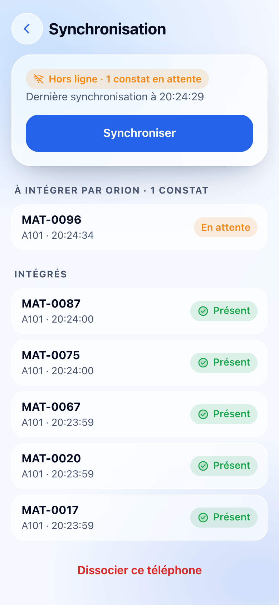

# Audit avant rendu — daily du 16 novembre 2026

<!-- version:debut : généré par versions.py, ne pas modifier à la main -->
| Version | Mise à jour | Destination | Dernière évolution | Historique |
| --- | --- | --- | --- | --- |
| 2.1 | 15/11/2026 | Pilotage interne | Suite donnée à CODE-04 : solution retenue, charge utile écrite, règles de supervision | [3 versions](../../archive/README.md#31-audit-avant-rendu-16-novembre) |
<!-- version:fin -->

Document de pilotage interne, non remis. Situation contrôlée le **15 novembre 2026**, pour le daily du lundi 16 et le rendu du mardi 17. Référence examinée : `3fbaa9a713770c0fb64d35f1ab631fa18860ad10`, après intégration de quatre commits distants sur `dev` ; dépôt propre au départ. Mode d’investigation **VERIFY**, profondeur **audit** ; revue des sources, tests locaux, reproductions isolées et relecture documentaire. Les résultats décrivent ce périmètre vérifié, sans garantie d’exhaustivité de tous les états possibles.

## 1. Synthèse et verdict

**19 écarts confirmés : aucun bloquant pour le rendu établi, 7 majeurs et 12 mineurs. Le bon fonctionnement de l’application déployée sur les VM est confirmé par l’utilisateur le 15 novembre, après vérification par son collègue.** Les mineurs DOC-09 et DOC-11 sont corrigés dans le suivi d’organisation et le script de versionnement ; les 17 autres restent proposés, sans modification du domaine, des règles de gestion ou du DAT. Les réserves de production déjà connues sont distinguées des nouveaux constats au § 3.

| Domaine | Bloquant pour le rendu | Majeur | Mineur | Verdict |
| --- | --- | --- | --- | --- |
| Code et fonctionnement | 0 | 3 | 1 | Risque de volume reproduit localement au-delà de 20 000 processus ; validation des règles et unicité des identifiants à corriger. Aucun blocage du déploiement VM établi. |
| Sécurité | 0 | 1 | 3 | Désactivation RIGEL incomplète ; quota et journalisation à reprendre. Aucune vulnérabilité npm de production signalée. |
| Documentation et cohérence | 0 | 3 | 8 | Sources contradictoires, lieu historique des détections absent du MCD ; DAT à soumettre à son détenteur. |
| **Total** | **0** | **7** | **12** | **Deux mineurs corrigés ; recette VM retenue, réserves de qualité et sécurité conservées.** |

### Précision de l’utilisateur du 15 novembre

Les VM sont sur un réseau fermé. Leur absence d’accès depuis le poste d’audit est normale : elle ne constitue ni une anomalie ni un motif de refus de ticket. L’utilisateur rapporte que son collègue s’est assuré du bon fonctionnement de l’application déployée ; cette vérification de l’équipe complète les 15 parcours VM déjà consignés. Les verdicts #105, #106, #107 et #116 sont rectifiés en conséquence. Les essais locaux et leurs échecs restent conservés comme preuves de leur environnement, sans être attribués aux VM. Le défaut CODE-04 devient majeur et conditionnel à la volumétrie, pas bloquant pour le rendu VM.

### Vérifications exécutées

Depuis `application/`, sauf mention contraire. Les sorties conservées sont liées ci-dessous ; seuls les espaces en fin de ligne et les lignes finales vides sont normalisés pour respecter `git diff --check`.

| Commande / contrôle | Résultat réellement observé | Preuve |
| --- | --- | --- |
| `git fetch origin`, intégration `origin/dev` | Avance de `75615df` à `3fbaa9a` intégrée en avance rapide. `origin/main` était déjà ancêtre de `dev`. Aucun travail local préexistant. | Journal Git : `bc12f63`, `97191e8`, `17220b7`, `3fbaa9a` |
| `npm run typecheck` | Code 0, types serveur et navigateur vérifiés. | [Sortie](assets/audit-16-novembre/typecheck.txt) |
| `npm test` | **89 réussis, 0 échec, 0 ignoré** ; PostgreSQL accessible. | [Sortie](assets/audit-16-novembre/test.txt) |
| `npm run build` | Code 0. | [Sortie](assets/audit-16-novembre/build.txt) |
| `npm run build:rigel` | Code 0. | [Sortie](assets/audit-16-novembre/build-rigel.txt) |
| `npm run test:ui` | **2 réussis**. | [Sortie](assets/audit-16-novembre/test-ui.txt) |
| `npm run test:workspace` | Première exécution : 48/50, deux erreurs ENOENT dans les traces partagées avec e2e ; reprise séquentielle : **50/50**. Les ENOENT sont un incident d’orchestration de l’audit, pas une anomalie métier. | [Initiale](assets/audit-16-novembre/test-workspace.txt), [reprise](assets/audit-16-novembre/test-workspace-reprise.txt) |
| `npm run infra:up` | PostgreSQL, LDAP et Keycloak recréés et sains. L’état public passe de `unavailable` avant démarrage à `ok`. | Compose local ; ports 5432 et 8081 |
| `npm run dev` / serveurs existants | Commande non relancée : Express 3001 et Vite 5173 de l’utilisateur réutilisés, sans les arrêter. Un simulateur utilisateur existait aussi ; voir contexte ci-dessous. | [Processus observés](assets/audit-16-novembre/processus-simulateurs.log) |
| `npm run test:e2e` | Initiale : **18/19**, arrêt resté `enregistree` après 20 s. Reprise : **15/19** ; création matériel, remontée, réactivation du compte et arrêt refusés pendant le dépassement de processus (CODE-04). Aucun succès global de cette exécution e2e locale annoncé ; recette VM de l’équipe distinguée au § 1. | [Initiale](assets/audit-16-novembre/test-e2e.txt), [reprise](assets/audit-16-novembre/test-e2e-reprise.txt) |
| `npm run captures` | Code 0 ; captures ORION produites sur un serveur interface seule isolé à 5175. | [Liste des captures](assets/audit-16-novembre/captures.txt) |
| `npm run captures:rigel` | Initiale : délai de 30 s sur « Associer ce téléphone », dépendances Vite périmées (504). Cache mobile isolé, reprise : **code 0**, appairage, synchronisation et mode hors ligne capturés. | [Initiale](assets/audit-16-novembre/captures-rigel.txt), [reprise](assets/audit-16-novembre/captures-rigel-reprise.txt) |
| Migration `0002` | Base neuve puis 0001 peuplée, 9 tables comparées, 3 documents JSON et journal repris, réouverture du dépôt, idempotence ; ancien relais repris sans perte, dédoublonnage et acquittement vérifiés. Schémas temporaires supprimés. | [Script](assets/audit-16-novembre/migration-0002.mjs), [sortie](assets/audit-16-novembre/migration-0002.log) |
| `npm audit --omit=dev` | **0 vulnérabilité** déclarée pour 123 dépendances de production ; ce résultat ne couvre pas les images ni les défauts applicatifs. | [JSON](assets/audit-16-novembre/npm-audit.json) |
| Vérificateur documentaire, à la racine | Initialement **0 erreur, 0 avertissement** ; contrôle final après publication, voir § 8. | [Sortie initiale](assets/audit-16-novembre/documentation-initial.txt) |
| Versions et liens | 30 en-têtes comparés à la génération depuis le registre : 0 écart avant modifications. Recherche complémentaire des ancres de titres : aucun défaut détecté (algorithme simplifié, pas tous les cas GitHub). | `versions.py`, `archive/registre.json` et documents suivis |
| MCD et quatre schémas d’architecture | 222 libellés/cardinalités draw.io/SVG identiques ; 5 rendus Chrome, images entières relues, pas de troncature ou collision certaine constatée. Cela ne valide pas les cardinalités métier. | [MCD](assets/audit-16-novembre/orion-audit-mcd.png), [réel simplifié](assets/audit-16-novembre/orion-audit-arch-simple.png), [réel complet](assets/audit-16-novembre/orion-audit-arch-vm.png), [cible détaillée](assets/audit-16-novembre/orion-audit-arch-cible.png), [cible simplifiée](assets/audit-16-novembre/orion-audit-arch-cible-simple.png) |

### Contexte et limites des essais

Les tests ont utilisé Node **26.13.0**, macOS et Chrome, les dépendances déjà installées et PostgreSQL local. Les serveurs utilisateur conservés peuvent avoir chargé leur code avant cet audit ; leurs processus n’ont pas été redémarrés. Le contrôle local `curl --connect-timeout 5 --max-time 10 -ks https://172.16.131.188/api/infos` a terminé en **code 28** : résultat attendu depuis ce poste hors du réseau fermé, sans conséquence défavorable sur l’audit. La recette VM consignée dans Git est complétée par la confirmation de l’utilisateur du 15 novembre : son collègue a vérifié le bon fonctionnement du déploiement. Aucun nouveau test distant ni détail de scénario non communiqué n’est revendiqué ici ; cette limite de méthode ne suspend pas la validation des tickets de recette.

Un second simulateur a été lancé à tort pendant l’audit, celui de l’utilisateur n’ayant pas de port d’écoute. Leur coexistence a accéléré la création d’exécutions : 42 143 puis 50 035 processus observés, dont 45 045 pour l’école du numérique. **Le simulateur ajouté a été arrêté, celui de l’utilisateur conservé ; aucune purge du parc n’a été effectuée.** Ces volumes ne mesurent pas une charge nominale. La reproduction isolée à 20 001 processus établit indépendamment CODE-04 ; le blocage des essais locaux est attesté dans cet état précis. Le premier arrêt e2e resté en attente n’a pas de cause définitivement établie.

Les captures ont utilisé un fichier de travail isolé et un relais local en mémoire. Les images de `design/` produites par les scripts ont été sauvegardées comme preuves choisies, puis leurs contenus antérieurs rétablis ; aucune nouvelle version de maquette n’est publiée. Les contrôles visuels portent sur les cinq schémas et les captures sélectionnées ci-dessous, pas sur chaque pixel de chaque ancienne maquette. Les scripts de reproduction sont exécutables depuis `application/` avec `node ../docs/04-ORGANISATION/assets/audit-16-novembre/<script>.mjs` ; ceux utilisant PostgreSQL créent puis suppriment leurs schémas temporaires.

## 2. Écarts et problèmes confirmés

### 2.1. Code et fonctionnement

| ID / gravité | Constat | Preuve | Correction proposée | Ticket / responsable suggéré |
| --- | --- | --- | --- | --- |
| **CODE-04 — Majeur, risque conditionnel de volume reproduit localement** | Plus de 20 000 processus visibles empêchent toute écriture, même les préférences et même si le client omet cette collection système. | `application/backend/domaine/espace.ts:121-124` contrôle la taille avant les droits `:135` ; [reproduction frontière](assets/audit-16-novembre/limite-collections.mjs), [sortie](assets/audit-16-novembre/limite-collections.log) : 20 000 acceptés, 20 001 refusés 400 « Données invalides. ». [Volumes](assets/audit-16-novembre/volumes-processus.log), quatre échecs e2e de reprise. | Borner les entrées réellement modifiables, sans refuser les données serveur inchangées ; vérifier les deux modes et la lecture d’historique. Rejouer le scénario local de volume après correction ; ne pas effacer l’historique pour masquer le défaut. La recette VM confirmée ne dépend pas de ce nouvel essai. | #167 ; BAELDE |
| **CODE-01 — Majeur** | Règles whitelist/blacklist sans validation de nom, portée et classement. Une règle sans nom persistée peut faire échouer les rapports des postes d’autres écoles. | `backend/domaine/espace.ts:171-178`, `shared/referentiels.ts:108` ; [reproduction](assets/audit-16-novembre/validation-regles.mjs), [sortie](assets/audit-16-novembre/validation-regles.log) : règle acceptée, puis TypeError `toLowerCase` ; portée/classement inventés acceptés. | Valider les règles côté serveur avant persistance (RG-47 à RG-50), refuser 400 et tester les rattachements. | #163 ; BAELDE, PHOMMAVONGSA |
| **CODE-02 — Majeur** | Identifiants aléatoires tronqués à 32 bits : collision et écrasement par UPSERT possibles, cache et base divergents. | `backend/domaine/commun.ts:47`, `postes.ts:71-78`, `persistance/postgres.ts:115` ; [génération](assets/audit-16-novembre/generation-identifiants.log) : 7 collisions sur 200 000. [Injection déterministe](assets/audit-16-novembre/collision-identifiants.mjs), [sortie](assets/audit-16-novembre/collision-identifiants.log) : 2 processus/2 détections en cache, 1/1 après réouverture. L’injection est distincte du tirage réel. | Conserver l’UUID complet et empêcher les doublons internes d’écraser une autre donnée. | #164 ; BAELDE |
| **CODE-03 — Mineur** | Résidus « campagne » dans commentaires et sélecteur CSS mort, hors compatibilité historique. | `frontend/src/rigel/styles/ecrans.css:34`, `frontend/src/espace/styles/recensement.css:2,6,28`. Aucun libellé utilisateur actif trouvé dans les TSX examinés. | Renommer/supprimer ces résidus ; conserver les anciens noms indispensables à la reprise des migrations et du stockage mobile. | #162 ; BAELDE, VILBERT-TAHON |

Les chemins abrégés de cette table et de la suivante sont relatifs à `application/`.

### Suite donnée à CODE-04 (à faire, non traité ; relecture de l’utilisateur du 15 novembre)

La correction proposée (limite de 20 000 éléments réservée aux collections modifiables, données des postes refusées en 403 quelle que soit leur taille) est validée : la règle du 403 existe déjà (`espace.ts:136`), seul le contrôle de taille `espace.ts:122` s’applique à tort au repli serveur `visible[c]` des collections `processus`, `detections` et `installations`. Elle ne traite toutefois que le symptôme ; à faire dans l’ordre :

1. **Serveur** : ignorer le contrôle de taille et d’identifiants pour ces trois collections lorsque le navigateur ne les envoie pas (`continue` avant l’assert) ; conserver le 403 si elles sont envoyées modifiées. Test à 20 001 processus : créer un matériel et changer ses préférences passent, altérer un processus est refusé ; vérifier dans les deux modes.
2. **Navigateur** : ne plus renvoyer `processus`, `detections` et `installations` dans l’écriture `PUT /api/workspace` (`store.ts:78-80`, qui envoie aujourd’hui tout l’état sauf pour `prefs`). C’est la réponse au dépassement des 8 Mo : une pagination ne concerne que la lecture et l’affichage, pas la charge utile écrite. Étape suivante, non requise pour le rendu : n’envoyer que les collections modifiées.
3. **Volume** : le pic à 50 000 processus vient de deux simulateurs concurrents, chaque rapport arrêtant les processus de l’autre (`postes.ts:65-72`, arrêtés conservés une heure `:88`). Borner en plus le nombre de processus conservés par poste, et documenter qu’un seul simulateur tourne par espace.
4. **Lecture paginée de `/api/workspace`** : refonte du front (état local complet) ; à inscrire en V2, pas avant le rendu.

Observation liée de l’utilisateur : des règles whitelist/blacklist non modifiables ni supprimables. Deux causes possibles, à distinguer à la reproduction : les règles du référentiel sont toutes de portée globale (`shared/referentiels.ts:102`), donc réservées au super administrateur (boutons masqués pour l’administrateur, conforme à RG-50) ; ou l’écriture a échoué pendant le dépassement de processus (CODE-04, message « Données invalides. »). Évolution d’interface demandée : liste des règles sur `DataPanel` (recherche existante, filtre par classement, 25 par page) comme Administration › Postes ; mettre à jour la fiche 15 (UC listes de processus), la capture correspondante (`npm run captures`) et, si l’interaction change, le DCU 10 ; les séquences 25 et 28 ne changent pas.

### 2.2. Sécurité

| ID / gravité | Constat | Preuve | Correction proposée | Ticket / responsable suggéré |
| --- | --- | --- | --- | --- |
| **SEC-01 — Majeur** | Désactiver le gestionnaire ne révoque pas l’opération RIGEL : téléphone encore alimenté et constats appliqués en son nom, contrairement à RG-85. | `backend/domaine/recensement.ts:177,243` ; [reproduction](assets/audit-16-novembre/orion-security-repro.mjs) : `managerActif:false`, `operationsPubliees:1`, `statut:applique`, matériel passé au stock. | Contrôler activité, rôle et école du lanceur avant publication/intégration ; définir la reprise par un autre gestionnaire. La copie déjà hors ligne ne peut pas être effacée à distance. | #165, #109 ; BAELDE, BONNEY |
| **SEC-02 — Mineur** | Compteur du quota relais et insertion séparés ; plafond non atomique en concurrence. Pas de preuve de remplissage illimité. | `backend/rigel/relais.ts:81-82`, `relais-store.ts:96,101` ; [reproduction PostgreSQL](assets/audit-16-novembre/orion-relay-quota-repro.mjs) avec barrière d’entrelacement : deux 200, plafond réduit à 3, 4 stockés. Rafale naturelle : un succès et 19 refus, donc entrelacement non reproduit sans barrière. | Même transaction/verrou par opération pour compteur et insertion, dédoublonnage pris en compte. | #120 existant fermé, suivi correctif #109 ; BAELDE, BONNEY |
| **SEC-03 — Mineur** | Le parseur JSON invalide expose un extrait du corps dans la réponse et le journal, alors que le guide exclut le contenu des requêtes des logs. | `backend/api/routes.ts:166-167`, `backend/journal.ts:5`, relais `:126` ; [reproduction](assets/audit-16-novembre/orion-json-error-repro.mjs) : sentinelle fictive `CONTENU_PRIVE_AUDIT` dans le motif journalisé et le 400. | Réponse générique « JSON invalide. » ; journaliser type et statut, sans corps. | #109 ; BAELDE, LE MAÎTRE |
| **SEC-04 — Mineur** | Mot de passe en clair dans sessionStorage ; l’expiration d’une minute n’efface pas l’entrée si le parcours est abandonné. | `infra/keycloak/themes/orion-mindef/login/resources/js/login.js:38,44,47` ; [reproduction du script réel avec DOM/horloge simulés](assets/audit-16-novembre/orion-password-cache-repro.mjs) : après 120 s, mot de passe encore stocké. | Éviter le Web Storage pour le mot de passe ; à défaut, nettoyer l’abandon et décrire exactement la durée. | #109 ; BAELDE, LE MAÎTRE |

### 2.3. Documentation et cohérence

| ID / gravité | Constat | Preuve | Correction proposée | Ticket / responsable suggéré |
| --- | --- | --- | --- | --- |
| **DOC-01 — Majeur** | Le §23 du cadrage dit encore que les productions cible suivent la décision client, alors que l’état actuel fait foi. Le suivi21 cochait à tort ce défaut. | `docs/01-CONTEXTE/02-CADRAGE.md:391`, contre son introduction `:15` et AGENTS ; suivi21, §5. | Remplacer la phrase par la proposition du §6, puis solder le suivi. Ne pas changer les règles. | #60 ; BAELDE |
| **DOC-02 — Mineur** | Des questions gardent une ancienne réponse sans l’état actuel : absence de lien POSTE/MATÉRIEL, filtre salle du tableau de bord. | Cadrage `:68` contre `:184` et RG-90 ; `:253` contre son §23. | Reporter les réponses actuelles avec provenance et renvoi au §23, conserver l’historique client. | #143 ; BAELDE |
| **DOC-03 — Mineur** | Installer une salle inclut obligatoirement l’appairage du téléphone, alors que la confirmation est possible dans ORION. | `08-DCU-GESTION-PARC.md:76`, contre RG-92, glossaire `:67`, activité07 `:170`, activité23 `:180`, matrice12 et fiche13. | Représenter RIGEL comme variante, pas comme comportement obligatoire de toute installation. | #63 ; BONNEY, BAELDE |
| **DOC-04 — Mineur** | Les extensions de DCU n’identifient ni condition ni point d’extension. | DCU08 `:73,75,78`, DCU10 `:50-51`, DCU22 `:61-62` ; convention du skill, référence Ambler. | Rattacher chaque variante utile à un point nommé et sa condition ; garder les fichiers diagrammes sans prose annexe. | #63 ; BONNEY |
| **DOC-05 — Mineur** | Propriétaire du PAQUET : deux liens facultatifs avec xor ne représentent pas la totalité XT du MCD. | Classes métier24 `:239-240`, source MCD `:280-282`, glossaire `:72`. | Représenter explicitement exactement un propriétaire Application OU Système ; catalogue toujours V2. | #63 ; BONNEY |
| **DOC-06 — Majeur** | Le MCD et les classes métier ne matérialisent pas la salle historique d’une détection ; passer par le poste donne sa salle actuelle. | MCD drawio `:185-194`, classes24 `:242-244`, RG-56 `:79` ; code `backend/domaine/postes.ts:75` fige la salle, `:147-150` permet le changement de salle du poste ; MPD29 garde `Detection.salleId`. | Ajouter le lieu historique dans le MCD/classes ou une représentation historique équivalente ; corriger l’explication du cadrage `:180`. Aucun changement de RG-56. | #166 ; BONNEY, BAELDE |
| **DOC-07 — Majeur, DAT protégé** | Contrainte générale relais/connecteur contradictoire avec la cible sans ces composants. | DAT18 `:31` contre `:404` ; décision utilisateur du 15 novembre. | Soumettre la rédaction du §6 au détenteur ; aucune modification directe. | #70 ; LE MAÎTRE |
| **DOC-08 — Mineur, DAT protégé** | Le DAT affirme un stockage hors ligne chiffré ; IndexedDB contient instantané déchiffré et constats, chiffrement lors de l’envoi seulement. | DAT18 `:106` ; mobile `core/base.ts:1-2,30`, `core/etat.ts:55,67-68,99`, `core/relais.ts:20,28`. | Décrire séparément stockage local et chiffrement des échanges (proposition §6). Ce constat ne crée pas une exigence de chiffrement local. | #70 ; LE MAÎTRE |
| **DOC-09 — Mineur corrigé** | Le backlog20 excluait encore le scan QR du périmètre de clôture malgré RIGEL réalisé et attendu. | Backlog20 `:19` avant cet audit ; RG-92 à RG-96 et daily30. | Périmètre20 actualisé dans cette livraison ; suivi des commandes maintenu hors clôture. | Suivi d’organisation ; BAELDE |
| **DOC-10 — Mineur, accord RG requis** | Formulation générale de RG-15 et glossaire Administrateur : seule exception remontées mentionnée, alors que confirmation installation et actions RIGEL sont réservées au gestionnaire. | Règles04 `:32`, glossaire00 `:46`, RG-92 à RG-96, matrice12, `parc.ts:40`, `recensement.ts:46`. | Soumettre la rédaction du §6, sans modifier les droits déjà appliqués ni la règle sans accord. | #61 / suivi #63 ; BAELDE, BONNEY |
| **DOC-11 — Mineur corrigé** | Le script de versions refusait une seconde publication d’un nouveau fichier avant son premier commit, contrairement à la convention de publication. | `.agents/skills/orion-documentation/scripts/versions.py:359` avant correction : branche conditionnée à une version précédente ; erreur réelle « absent de l’historique Git, version précédente introuvable » pour le rapport31. | Condition corrigée ; contrôle isolé : une nouvelle 1.0 est complétée sans ajout de version, un document existant est archivé et passe 2.0. | Corrigé dans **fd6fa8b** ; BAELDE |

Les noms courts de documents renvoient aux productions du [sommaire](../../README.md). Les lignes sont celles de la révision auditée, avant la publication des documents d’organisation.

## 3. Contrôles satisfaisants, réserves connues et limites

### Code, droits et données

Les deux modes montent les mêmes routeurs et le même moteur (`outils/interface-seule/ui-development.ts:6-8,71-81`, `persistance/postgres.ts:310`). Les identifiants ORION/numéros de remontée, auteurs, dates, suivis et résultats sont fixés ou repris par le serveur (`espace.ts:153-159`, `parc.ts:18-43`, `remontees.ts:18-34`, `postes.ts:178`, `comptes.ts:55-59`). Le filtre par école et les profils sont relus côté serveur ; les collections agents sont protégées. La validation incomplète des règles est CODE-01, pas un motif pour déclarer toutes les règles correctement validées.

PostgreSQL conserve espace, sessions et journal. Verrou de révision et lecture transactionnelle sous verrou (`postgres.ts:234-309`), cache validé par révision, fusion élément par élément (`fusion.ts:22-59`) : pas d’état mémoire faisant autorité identifié en mode connecté. Le mode fichier est explicitement mono-processus. Aucun écran TSX de `frontend/src/` ne dépasse 300 lignes ; recherche de rendu HTML injecté sans résultat dans ce périmètre. Formulaires par `SheetForm` et submit (`ui/forms.tsx:19,42,58`), formats français centralisés ; aucune nouvelle abstraction requise par cet audit. Pas de domaine `.local` ou libellé de démonstration actif trouvé dans les TSX relus. Les vérifications Playwright de navigation, actions uniques, salles et profils passent dans la suite interface seule.

Traçabilité inverse des principaux mécanismes métier lus :

| Mécanisme du serveur | Règles / contrat |
| --- | --- |
| `comptes.ts`, authentification et profil par requête | RG-01, RG-62, RG-70, RG-82 et RG-85 ; contrat OIDC technique distinct des règles métier. |
| `parc.ts`, import et périmètre `espace.ts` | RG-03 à RG-10, RG-29, RG-61, RG-63, RG-73 à RG-75, RG-78, RG-86 à RG-92 ; formats JSON et bornes d’entrée sont des contrats techniques. |
| `remontees.ts`, PDF serveur | RG-11 à RG-14, RG-32 à RG-35, RG-64, RG-79, RG-80 et RG-89. |
| `postes.ts`, classements et résultats | RG-22, RG-41 à RG-56, RG-77, RG-81, RG-83, RG-88 et RG-90 ; agent simulé pour le démonstrateur, pas nouveau droit utilisateur. |
| `recensement.ts` et constats | RG-92 à RG-100 et RG-85 pour révocation ; transport relais propre à l’architecture réelle. |
| Préférences, tableaux et notifications | RG-36 à RG-39 et RG-84 ; filtrage serveur, rendu partagé côté navigateur. |
| Persistance, fusion, quotas, TLS, journal | Contraintes d’architecture/API et documentation technique ; ne pas créer une règle métier pour chaque détail d’implémentation. |

La différence MCD/MPD n’est pas automatiquement une erreur : PAQUET et SYSTÈME_EXPLOITATION sont explicitement V2 ; DÉPLACEMENT est actuellement représenté par les objets JSON de matériel. Les diagrammes27/28 décrivent la cible RIGEL par décision utilisateur, tandis que le code actuel utilise relais/connecteur. Les anciens noms des migrations et de la reprise IndexedDB sont nécessaires à la compatibilité.

### Sécurité examinée

| Frontière | Contrôles lus / preuves |
| --- | --- |
| `/auth` | State, nonce, PKCE S256, expiration des tentatives et usage unique ; session régénérée, cookie HttpOnly/Secure en production/SameSite Lax, session PostgreSQL. Email rapproché seulement si vérifié. `backend/index.ts:139` et suite, `api/profiles.ts:7`. |
| `/api/workspace` | Session avant parseur, origine stricte pour écritures, corps8 Mo, école et droits serveur (`index.ts:204`, `domaine/espace.ts:133-169`). Les nouvelles anomalies de validation/taille sont détaillées au §2. |
| `/api/agent` | Comparaison constante, jeton HMAC par poste, refus de changement d’identité de poste, rapports4 Mo et lots bornés (`api/agent.ts`, `domaine/postes.ts:58` et suite). |
| `/api/rigel` | Secret avant parseur, corps4 Mo, maximum1 000 événements, taille et base64url, AES-GCM lié à l’opération, salle/école contrôlées ; connecteur lots200 et isolation des erreurs. Révocation incomplète : SEC-01. |
| Health/infos | Anonyme : état/date et description/version seulement ; détail pour super administrateur. Version publique conservée par décision utilisateur. `services.test.ts:76-85`, contrôle de profil dans `index.ts`. |
| Secrets | Recherche `git grep -IlE 'BEGIN (RSA &#124;EC &#124;OPENSSH )?PRIVATE KEY&#124;ghp_[A-Za-z0-9]{30}&#124;github_pat_&#124;AKIA[A-Z0-9]{16}'` hors lock : aucun fichier. Recherche des affectations longues de clés/secrets : aucun secret réel confirmé. Fichiers suivis examinés : `.env.example` et scripts/tests attendus, pas d’environnement réel, clé privée ou certificat généré. Ce n’est pas un audit exhaustif de tout l’historique. |
| Production | Variables requises, HTTPS, refus des valeurs locales connues, longueurs de secrets, provisionnement désactivé par défaut ; secrets Swarm lus dans `/run/secrets`. |
| Proxy/web/identité | HAProxy TLS≥1.2, HSTS, nettoyage X-Forwarded, restrictions de chemins et débit ; Apache CSP/TRACE refusé/lecture seule ; console8444 dédiée sans filtrage réseau, conforme à la décision utilisateur. Jetons de présentation explicitement autorisés jusqu’à #113. |
| Stockage/journal/conteneurs | Rôle PostgreSQL `orion_app` non-superutilisateur ; SQL paramétré ; NFSv4 sur orion-10, root_squash sauf LDAP ; Logstash mTLS ; produits tiers par versions et empreintes, images propres par SHA ; comptes/capacités limités, exception LDAP documentée. Revue source, pas preuve de configuration chargée sur les VM. |

Les risques déjà ouverts au [backlog technique §4](21-BACKLOG-TECHNIQUE-ET-FEUILLE-DE-ROUTE.md#4-sécurité) sont conservés : OpenLDAP1.5.0 sans TLS et liaison administrative, compte technique Keycloak à remplacer/OTP, plage de confiance proxy non fixée, appairage porteur jusqu’à clôture, intégrité du code servi par le relais, transferts/import et énumération/divulgation hors école. Ils ne sont pas déclarés corrigés par cet audit ni recomptés comme nouveaux défauts. Leur traitement reste #109 et les décisions existantes ; ne pas transformer un choix accepté (ports8444/6514 joignables, version publique, dépôt public) en nouvelle non-conformité.

Pas de nouveau scan ZAP/ASVS complet, de scan CVE des six images, de mesure de charge nominale ni de preuve des paramètres chargés sur les VM. Lecture de la protection `main` par API : HTTP404, résultat indécidable (absence ou droits), aucune conclusion de branche non protégée. Les essais d’intrusion antérieurs consignés au backlog21 restent historiques.

### Documentation et méthode

100/100 RG possèdent une référence explicite hors définition ; la matrice individuelle du §9 localise les mécanismes lus et leurs limites, pas100 validations dynamiques. Recherche de comptes et marqueurs locaux dans les textes de remise : aucun résultat nouveau confirmé ; les ressources techniques du DAT réel sont distinguées des livrables métier. Les entretiens datés restent historiques.

La relecture UML/Merise suit les références du README et le skill de modélisation : objectifs acteurs, sens include/extend, responsabilités système/domaine, distinction conceptuel/physique, cardinalités et traces d’événements. [OMG UML2.5.1](https://www.omg.org/spec/UML/2.5.1/) identifié ; le PDF18 Mo n’a pas été chargé intégralement. [Scott Ambler, Reuse in Use-Case Models](https://agilemodeling.com/essays/usecasereuse.htm) consulté pour include/extend/points d’extension. Les ouvrages Roques, Larman et Cockburn n’étaient pas disponibles intégralement : aucune certification de conformité exhaustive à ces livres n’est annoncée.

## 4. Parallèle avec le daily du 16 novembre

| Point du document30 | État constaté | Reste / risque pour le17 |
| --- | --- | --- |
| Lundi1 — déploiement #103/#116 | 15 parcours VM consignés dans bc12f63/97191e8, correctif jeton17220b7 intégré ; bon fonctionnement confirmé par l’utilisateur après vérification de son collègue. | #116 validé. Réseau fermé : aucune pénalité liée à l’accès depuis le poste d’audit. |
| Lundi2 — scénario #108 | Les tests locaux/VM fournissent des parcours techniques ; pas de fil complet par profil avec résultats attendu et passages attesté. | Rédiger le scénario de présentation, pas seulement citer les tests. |
| Lundi3 — recette #105/#106/#107 | Recette VM de l’équipe retenue, complétée par les tests de droits et les 50 parcours interface seule. | #105/#106/#107 validés. Les échecs locaux sous deux simulateurs et CODE-04 restent suivis séparément en #167. |
| Lundi4 — conception #63 | MCD/source et5 rendus relus ; incohérences DOC-03 à06 et10. | Salle historique détection majeure ; variantes/XT/formulation à revoir. |
| Lundi5 — DAT #70 | Schémas lisibles, cible RIGEL représentée. | DOC-07/08 à soumettre au détenteur, DAT inchangé. |
| Lundi6 — sécurité #109 | Audit source/reproductions et npm audit faits ; défauts nouveaux prouvés. | #163-165, quota/log/mot de passe ; pas de validation sécurité globale. |
| Rendu — version #111 | Aucun gel identifié par cet audit. | Aucun blocage nominal sur les VM établi ; prioriser les majeurs et consigner la version remise et ses réserves. |
| Rendu — dossier #112 | Vérificateur structurel passe ; sélection au README connue. | Assembler seulement les productions destinées à la remise, avec ressources ; exclure ce rapport et ses preuves internes. |
| Rendu — documentation #60/#61/#140-143 | #61/#140/#141/#142 validés sur leur liste ; #60/#143 refusés. | Corriger les réponses en vigueur ; nouvelle anomalie MCD #166. |
| Présentation — #110 | Supports attendus le18, présentation19, horaire inconnu. | Répartition et répétition à attester. |
| Cérémonies — #50 | Backlog20§11 prévoit les comptes rendus sans en fournir. | Produire les traces réelles ; ne pas inventer de cérémonie tenue. |
| Prochain rendez-vous — #114 | Ni date ni retour client supplémentaire recueilli. | Préparer les points§23 ; pas de validation client attendue pour les modèles. |
| Après présentation — #113 | Jetons activés volontairement pour le démonstrateur. | Retrait après présentation, avant production. |
| À trancher1 — #162 | Décision avant gel maintenue ; migration locale validée et bon fonctionnement du déploiement confirmé par l’équipe. | Seuls les résidus de vocabulaire CODE-03 restent à nettoyer ; aucun défaut de migration VM établi. |
| À trancher2 — #161 | Décision cible appliquée aux productions listées ; ticket validé. | Contradiction interne DAT distincte #70. |
| À trancher3 — #91 | Retrait daté reportéV2. | Pas de nouvelle RG-91 ni réalisation V1 implicite. |
| À trancher4 — #127/#129/#130 | #130 validé ; #127/#129 restentV2. | Aucun report des deux évolutions dans le gelV1. |
| À trancher5 — RELEVER/RG-79 | Lien direct remontée→école maintenu et justifié. | Décision déjà prise, pas à rouvrir. |
| À trancher6 — paquet/OS | Règles de catalogue prévues à l’ouvertureV2. | Ne pas inventer des exigences de réalisationV1. |
| À trancher7 — rendez-vous/présentation | Date client et horaire19 non établis. | Décision d’organisation encore attendue. |

## 5. Tickets GitHub en revue

Lecture initiale par `gh project item-list 2 --owner bpierrelouis --format json --limit 300` : **158 éléments, 15 In review**, comprenant aussi #105/#106/#107/#116, ajoutés à la liste indicative de la demande. Corps et assignations lus ; sous-tâches de #24 vérifiées par API. Après rectification fondée sur la confirmation de l’utilisateur, les dix validés sont commentés, fermés comme terminés et passés Done ; les cinq refusés sont commentés, laissés ouverts et passés In progress. Les anciens commentaires de refus de #105/#106/#107/#116 sont explicitement remplacés par les commentaires de rectification, sans effacer l’historique. Les cases de #161 sont cochées. Les preuves citent la révision3fbaa9a et le présent rapport.

| Ticket | Verdict | Preuve déterminante |
| --- | --- | --- |
| #24 | **Refusé** | Sous-tâche #60 non conforme et nouveaux écarts MCD ; une épopée n’est pas terminée avant ses sous-tâches. |
| #60 | **Refusé** | DOC-01 : cadrage:391 contraire à la référence état actuel. |
| #61 | **Validé sur les corrections listées** | Notification, RG-81/RG-22, import, bâtiment/étage, identifiants/IP/listes, installation et brouillons corrigés ; nouveaux constats suivis distinctement. |
| #105 | **Validé après rectification** | Recette VM par l’équipe, confirmée par l’utilisateur le 15 novembre ; droits/profils vérifiés localement. L’échec local sous stress est suivi par #167, sans refus du ticket VM. |
| #106 | **Validé après rectification** | Parcours inventaire/affectation/installation dans la recette VM consignée, bon fonctionnement confirmé par l’utilisateur ; tests interface seule réussis. |
| #107 | **Validé après rectification** | Supervision/interventions/remontée/PDF couverts par la recette VM de l’équipe, confirmée par l’utilisateur. Les échecs de stress locaux restent documentés séparément. |
| #109 | **Refusé** | Nouvelles anomalies serveur/sécurité ; npm audit0 ne vaut pas sécurité globale. |
| #116 | **Validé après rectification** | 15 parcours VM consignés, contrôles iOS déjà rapportés et confirmation explicite de l’utilisateur après vérification de son collègue. Réseau fermé attendu ; aucun nouveau test distant revendiqué. |
| #130 | **Validé** | `services.test.ts:76-85`, condition superadmin serveur et89 tests réussis. |
| #140 | **Validé sur la liste exacte** | Ancien include consulter→rechercher retiré ; notification, import, RG-81, bâtiment/listes/étage et brouillon corrigés. DOC-03 est une autre inclusion. |
| #141 | **Validé** | Windows/MAC/IP/dates/listes/réinitialisation reportés. |
| #142 | **Validé** | Journal,30 jours, architecture actuelle/propositions, glossaire reportés. |
| #143 | **Refusé** | DOC-02 : réponses actuelles non reportées aux questions correspondantes. |
| #161 | **Validé** | Glossaire et06/07/26-29 alignés cible ; DAT traité séparément. |
| #162 | **Refusé uniquement pour CODE-03** | Migration/relais locaux réussis, bon fonctionnement du déploiement confirmé. Seuls les résidus « campagne » dans CSS/commentaires hors compatibilité empêchent de solder l’alignement complet des noms ; aucune pénalité liée aux VM. |

Créations ciblées, labels existants et assignations d’après les domaines : **#163CODE-01**, **#164CODE-02**, **#165SEC-01**, **#166DOC-06**, **#167CODE-04**. StatutReady, sprint2 ; priorité P1 pour les cinq majeurs ; #167 requalifié de P0 en P1 après distinction du stress local et de la recette VM. Rattachements respectifs aux épopées#41,#41,#40,#24,#41. Les majeurs DOC-01/DOC-07 ont déjà #60/#70 ; pas de doublon créé. Les mineurs restent aux tickets existants indiqués.

## 6. Décisions et rédactions à soumettre

Aucune règle de gestion, aucun DAT ni entretien modifié par cet audit. Les propositions suivantes ne sont pas des décisions validées.

1. **Gel/rendu** : retenir la recette VM confirmée par l’utilisateur ; aucun blocage du rendu sur les VM n’est établi. Prioriser les majeurs serveur CODE-01/CODE-02/SEC-01 et le risque conditionnel CODE-04, ou consigner les réserves. La montée à 50 000 processus a été accélérée par deux simulateurs locaux, pas mesurée comme charge nominale ; sa reproduction n’annule pas la recette de l’équipe.
2. **RG-15, accord préalable requis** : « L’administrateur réalise les actions autorisées dans son école, à l’exception du traitement des remontées (RG-64), de la confirmation des installations et des actions RIGEL réservées au gestionnaire (RG-92 à RG-96). Le super administrateur dispose des mêmes droits sur l’ensemble des écoles. » Source : décisions utilisateur du14 novembre, RG-92 à96, matrice et contrôles serveur. Compléter ensuite le glossaire. Cette rédaction précise des restrictions déjà appliquées ; ne pas modifier RG-15 sans accord.
3. **DAT — contrainte réseau** : « Dans l’architecture réelle, les téléphones passent par un relais public et un connecteur sortant ; en cible, ils joignent l’entrée publique de RIGEL. » Source : décision du15 novembre et DAT§6. Remplacement ciblé de la phrase:31, sous responsabilité du détenteur.
4. **DAT — stockage mobile** : « Le téléphone conserve l’instantané et les constats hors ligne dans IndexedDB ; les échanges avec le relais sont chiffrés en AES-256-GCM. » Source : code mobile actuel. Ne pas prétendre que le connecteur, qui reçoitRIGEL_SECRET, est incapable de déchiffrer.
5. **Cadrage§23** : proposition « Les productions suivent l’état actuel de l’application et de l’architecture cible ; les écarts avec les demandes du client sont présentés au prochain rendez-vous. » Conserver les écarts client déjà inscrits (filtre salle, notifications, import JSON, installation/recensementRIGEL) et leurs provenances ; aucune acceptation du client inventée.
6. **MCD** : confirmer la représentation du lieu historique des détections avant correction du modèle ; la contrainte de conservation RG-56 est déjà décidée. Le lien RELEVER et les reportsV2 restent tranchés.
7. **Organisation** : fixer la date du prochain rendez-vous client et l’horaire du19, réunir les comptes rendus effectivement tenus, définir la version remise et son dossier. Les modèles à jour ne sont pas en attente de validation client.

## 7. Preuves visuelles sélectionnées

Ces images ne montrent pas de badge de démonstration ni de compte de test. Le texte de chiffrement de l’écran mobile ne prouve pas le chiffrement local d’IndexedDB (DOC-08). Caméra/installation sur téléphone réel : preuve utilisateur déjà consignée dans #116, pas nouveau contrôle matériel ici.

## 8. Livraison de l’audit et contrôles finaux

Correction sûre demandée : classement des fichiersAUDIT en « Pilotage interne » dans `destination()` de `versions.py`, vérifié par assertion, commit **f34b469** `fix(docs): classer les audits en pilotage interne`. Correction minimale supplémentaire : **fd6fa8b**, republication avant premier commit (DOC-11), vérifiée sur document nouveau et existant. Aucun correctif du domaine appliqué. Documents31/30/21/20 et sommaire actualisés ; versions publiées par le script, registre et historique générés. Graphiques du projet régénérés après les verdicts, rendus par Chrome et relus. Les documents métier et le DAT restent inchangés.

Graphiques : 163 éléments dans le projet après mise à jour ; le burndown affiche 112/150 tickets terminés et 38 restants, selon les statuts et les dates de fin enregistrés dans le projet. [Burndown rendu](assets/audit-16-novembre/graphique-burndown.png) et [progression rendue](assets/audit-16-novembre/graphique-equipe.png), relus sans troncature constatée ; [verdicts et liens des commentaires](assets/audit-16-novembre/tickets-verdicts.json). Correction de périmètre DOC-09 et graphiques : commit **067e0b5**.

Contrôles finaux : vérificateur documentaire 0 erreur/0 avertissement ; `git diff --check` et contrôle indexé sans erreur avant les commits. Le rapport est classé en Pilotage interne ; sa révision après précision de l’utilisateur distingue la recette VM du stress local. Les identifiants de commit de livraison et la publication distante sont vérifiés dans l’état Git final, pas auto-inscrits dans leur propre commit. Les processus ajoutés pour les captures sont arrêtés à la fin, les processus utilisateur conservés. Les schémas temporaires des reproductions sont supprimés dans leurs blocsfinally ; aucune suppression du schéma métier.

Les scripts conservés de révocation RIGEL, JSON invalide et mot de passe ont été rejoués depuis leurs chemins livrés, code 0 : [révocation](assets/audit-16-novembre/orion-security-repro.txt), [JSON](assets/audit-16-novembre/orion-json-error-repro.txt), [mot de passe](assets/audit-16-novembre/orion-password-cache-repro.txt). Vérification GitHub après rectification : dix tickets CLOSED/Done, cinq OPEN/In progress et cinq nouveaux OPEN/Ready dans Sprint 2 ; #167 en P1.

## 9. Matrice individuelle RG-01 à RG-100

Révision 3fbaa9a. Chaque référence localise un mécanisme ou un rendu lu ; elle ne signifie pas un test réussi de chacune des propositions de la règle. Les parcours métier des deux modes convergent vers domaine/espace.ts ; les dépendances externes Windows/MindefConnect restent distinctes. Les règles d’affichage ont naturellement des traces navigateur, après filtrage serveur. Les limites observées sont explicites. Aucune RG proposée/modifiée.

| Règle | Référence documentaire explicite (hors définition) | Trace du code | Conclusion de lecture / limite |
| --- | --- | --- | --- |
| RG-01 | `docs/02-ANALYSE/02-CAPTURE-DES-BESOINS/15-FICHE-DESCRIPTIVE-ADMINISTRATEUR.md:214` | `application/backend/domaine/comptes.ts:44` | Profil contrôlé serveur |
| RG-02 | `docs/02-ANALYSE/02-CAPTURE-DES-BESOINS/15-FICHE-DESCRIPTIVE-ADMINISTRATEUR.md:238` | `application/backend/domaine/parc.ts:49` | Bornes étage et bâtiment contrôlés ; entités explicites du MCD représentées par champs/collection étages |
| RG-03 | `docs/02-ANALYSE/02-CAPTURE-DES-BESOINS/13-FICHE-DESCRIPTIVE-GESTIONNAIRE.md:71` | `application/backend/domaine/parc.ts:26` | Numéro fixé serveur ; collision interne à suivre rapport code |
| RG-04 | `docs/02-ANALYSE/02-CAPTURE-DES-BESOINS/13-FICHE-DESCRIPTIVE-GESTIONNAIRE.md:71` | `application/backend/domaine/import.ts:94` | Série facultative ; rapprochement si renseignée |
| RG-05 | `docs/02-ANALYSE/02-CAPTURE-DES-BESOINS/13-FICHE-DESCRIPTIVE-GESTIONNAIRE.md:71` | `application/backend/domaine/parc.ts:16` | Modèle, dateRéception et booléen exigés |
| RG-06 | `docs/02-ANALYSE/02-CAPTURE-DES-BESOINS/13-FICHE-DESCRIPTIVE-GESTIONNAIRE.md:71` | `application/backend/domaine/parc.ts:16` | Désignation texte libre non vide |
| RG-07 | `docs/02-ANALYSE/02-CAPTURE-DES-BESOINS/13-FICHE-DESCRIPTIVE-GESTIONNAIRE.md:71` | `application/backend/domaine/import.ts:94` | Marque absente initialisée à null |
| RG-08 | `docs/02-ANALYSE/02-CAPTURE-DES-BESOINS/13-FICHE-DESCRIPTIVE-GESTIONNAIRE.md:71` | `application/backend/domaine/import.ts:94 ; application/backend/domaine/parc.ts:16` | Défaut false import ; écriture workspace exige booléen, défaut fourni par formulaire |
| RG-09 | `docs/02-ANALYSE/02-CAPTURE-DES-BESOINS/13-FICHE-DESCRIPTIVE-GESTIONNAIRE.md:71` | `application/backend/domaine/parc.ts:17` | Salle de l’école ou stock null |
| RG-10 | `docs/02-ANALYSE/02-CAPTURE-DES-BESOINS/13-FICHE-DESCRIPTIVE-GESTIONNAIRE.md:71` | `application/backend/domaine/parc.ts:17 ; application/shared/types.ts` | Modèle matériel sans destination personne |
| RG-11 | `docs/02-ANALYSE/02-CAPTURE-DES-BESOINS/13-FICHE-DESCRIPTIVE-GESTIONNAIRE.md:140` | `application/backend/domaine/remontees.ts:42` | Description et au moins un matériel exigés |
| RG-12 | `docs/02-ANALYSE/02-CAPTURE-DES-BESOINS/13-FICHE-DESCRIPTIVE-GESTIONNAIRE.md:140` | `application/backend/documents/pdf.ts:145` | Lieu dérivé des matériels du document produit |
| RG-13 | `docs/02-ANALYSE/02-CAPTURE-DES-BESOINS/12-MATRICE-DROITS.md:71` | `application/backend/domaine/remontees.ts:25` | Transitions serveur, étape obligatoire |
| RG-14 | `docs/02-ANALYSE/02-CAPTURE-DES-BESOINS/13-FICHE-DESCRIPTIVE-GESTIONNAIRE.md:140` | `application/backend/documents/pdf.ts:145` | Contenu PDF ; tests PDF principaux exécutés par agent principal |
| RG-15 | `docs/02-ANALYSE/02-CAPTURE-DES-BESOINS/12-MATRICE-DROITS.md:36` | `application/backend/domaine/espace.ts:133 ; application/backend/domaine/remontees.ts:26 ; application/backend/domaine/recensement.ts:46` | Contrôles admin/global/gestionnaire ; RG15 ne rappelle pas exception RIGEL, RG92–94 précisent |
| RG-16 | `docs/02-ANALYSE/02-CAPTURE-DES-BESOINS/12-MATRICE-DROITS.md:44` | `application/backend/domaine/espace.ts:55` | École de rattachement appliquée |
| RG-17 | `docs/02-ANALYSE/02-CAPTURE-DES-BESOINS/12-MATRICE-DROITS.md:34` | `application/backend/domaine/espace.ts:136` | Écritures parc autorisées hors formateur, suppression admin seulement |
| RG-18 | `docs/02-ANALYSE/02-CAPTURE-DES-BESOINS/12-MATRICE-DROITS.md:45` | `application/backend/domaine/parc.ts:33` | Affectation et déplacement serveur |
| RG-19 | `docs/02-ANALYSE/02-CAPTURE-DES-BESOINS/12-MATRICE-DROITS.md:83` | `application/backend/domaine/postes.ts:157` | Formateur autorisé arrêt utilisateur |
| RG-20 | `docs/02-ANALYSE/02-CAPTURE-DES-BESOINS/12-MATRICE-DROITS.md:83` | `application/backend/domaine/postes.ts:62 ; application/outils/simulateur-postes/agents.ts:31` | Contrat agent : processus transmis déclarés utilisateur ; pas classificateur système serveur indépendant |
| RG-21 | `docs/02-ANALYSE/02-CAPTURE-DES-BESOINS/12-MATRICE-DROITS.md:67` | `application/backend/domaine/remontees.ts:19` | Création refusée gestionnaire ; stock refusé formateur |
| RG-22 | `docs/02-ANALYSE/02-CAPTURE-DES-BESOINS/12-MATRICE-DROITS.md:95` | `application/backend/domaine/postes.ts:169` | Cibles d’une seule salle, image imposée |
| RG-23 | `docs/02-ANALYSE/02-CAPTURE-DES-BESOINS/12-MATRICE-DROITS.md:69` | `application/backend/persistance/engine.ts:124 ; application/backend/domaine/espace.ts:60` | PDF limité à remontée visible |
| RG-24 | `docs/02-ANALYSE/02-CAPTURE-DES-BESOINS/12-MATRICE-DROITS.md:47` | `application/frontend/src/espace/core/permissions.ts:30` | Droit d’affichage tableau ; serveur filtre données |
| RG-25 | `docs/02-ANALYSE/02-CAPTURE-DES-BESOINS/13-FICHE-DESCRIPTIVE-GESTIONNAIRE.md:71` | `application/backend/domaine/espace.ts:111` | Écriture directe après contrôles, pas second valideur |
| RG-26 | `docs/02-ANALYSE/02-CAPTURE-DES-BESOINS/12-MATRICE-DROITS.md:45` | `application/backend/domaine/parc.ts:33` | Salle affectée immédiatement, déplacement physique distinct |
| RG-27 | `docs/02-ANALYSE/02-CAPTURE-DES-BESOINS/12-MATRICE-DROITS.md:45` | `application/backend/domaine/espace.ts:120` | Collections traitées ensemble, plusieurs matériels |
| RG-28 | `docs/02-ANALYSE/02-CAPTURE-DES-BESOINS/12-MATRICE-DROITS.md:54` | `application/backend/domaine/import.ts:69` | Import de nouveaux matériels avec droits/perimètre |
| RG-29 | `docs/02-ANALYSE/02-CAPTURE-DES-BESOINS/12-MATRICE-DROITS.md:6` | `application/backend/domaine/import.ts:71 ; application/backend/api/routes.ts:33` | Bornes2000éléments/8 Mo ; validation domaine des nouvelles lignes |
| RG-30 | `docs/02-ANALYSE/02-CAPTURE-DES-BESOINS/12-MATRICE-DROITS.md:95` | `application/backend/domaine/postes.ts:176 ; application/outils/simulateur-postes/agents.ts:116` | Image référence imposée ; exécution réelle Windows hors réalisation M42 |
| RG-31 | `docs/02-ANALYSE/02-CAPTURE-DES-BESOINS/14-FICHE-DESCRIPTIVE-FORMATEUR.md:68` | `application/backend/domaine/postes.ts:48` | Rapport poste utilisateur/processus |
| RG-32 | `docs/02-ANALYSE/02-CAPTURE-DES-BESOINS/12-MATRICE-DROITS.md:83` | `application/backend/domaine/postes.ts:62 ; application/outils/simulateur-postes/agents.ts:31` | Même limite contrat agent que RG20 |
| RG-33 | `docs/02-ANALYSE/02-CAPTURE-DES-BESOINS/12-MATRICE-DROITS.md:84` | `application/backend/domaine/postes.ts:170` | Processus en cours et un arrêt en attente ; résultat applyResults |
| RG-34 | `docs/02-ANALYSE/02-CAPTURE-DES-BESOINS/13-FICHE-DESCRIPTIVE-GESTIONNAIRE.md:140` | `application/backend/documents/pdf.ts:145` | Localisation depuis matériels au moment production |
| RG-35 | `docs/02-ANALYSE/02-CAPTURE-DES-BESOINS/12-MATRICE-DROITS.md:77` | `application/backend/persistance/engine.ts:124` | PDF produit à la demande sans stockage |
| RG-36 | `docs/02-ANALYSE/02-CAPTURE-DES-BESOINS/12-MATRICE-DROITS.md:47` | `application/frontend/src/espace/core/selectors.ts:93` | Agrégats parc ; affichage spécialisé, RG36 mise à jour |
| RG-37 | `docs/02-ANALYSE/02-CAPTURE-DES-BESOINS/12-MATRICE-DROITS.md:121` | `application/frontend/src/espace/core/notifications.ts:46` | Notifications calculées et rendues navigateur, sur données déjà filtrées serveur |
| RG-38 | `docs/02-ANALYSE/02-CAPTURE-DES-BESOINS/12-MATRICE-DROITS.md:75` | `application/frontend/src/espace/core/notifications.ts:46` | Canal interface ; aucun chemin courriel identifié dans périmètre lu |
| RG-39 | `docs/02-ANALYSE/02-CAPTURE-DES-BESOINS/12-MATRICE-DROITS.md:75` | `application/frontend/src/espace/core/notifications.ts:94` | Interventions propres et blacklist ; évolution propres remontées ligne78 |
| RG-40 | `docs/02-ANALYSE/02-CAPTURE-DES-BESOINS/15-FICHE-DESCRIPTIVE-ADMINISTRATEUR.md:155` | `application/backend/domaine/postes.ts:147` | Unité centrale matériel reliée poste, domaines séparés |
| RG-41 | `docs/02-ANALYSE/02-CAPTURE-DES-BESOINS/14-FICHE-DESCRIPTIVE-FORMATEUR.md:68` | `application/shared/referentiels.ts:106 ; application/backend/domaine/postes.ts:71` | Classement par nom insensible casse ; exécutions stockées, programme conceptuel dénormalisé |
| RG-42 | `docs/02-ANALYSE/02-CAPTURE-DES-BESOINS/14-FICHE-DESCRIPTIVE-FORMATEUR.md:68` | `application/backend/domaine/postes.ts:71` | Date première observation serveur ; exécutions arrêtées conservées1h technique, détections30j |
| RG-43 | `docs/02-ANALYSE/02-CAPTURE-DES-BESOINS/14-FICHE-DESCRIPTIVE-FORMATEUR.md:68` | `application/backend/domaine/postes.ts:71` | Compte Windows dénormalisé chaîne nom, aucune table/idCompteurWindows dédiée dans MPD actuel |
| RG-44 | `docs/02-ANALYSE/02-CAPTURE-DES-BESOINS/14-FICHE-DESCRIPTIVE-FORMATEUR.md:68` | `application/backend/domaine/postes.ts:71 ; application/frontend/src/espace/core/selectors.ts` | Contexte poste/lieu/compte ; statut intervention depuis données serveur |
| RG-45 | `docs/02-ANALYSE/02-CAPTURE-DES-BESOINS/14-FICHE-DESCRIPTIVE-FORMATEUR.md:68` | `application/shared/referentiels.ts:111` | Trois classements |
| RG-46 | `docs/02-ANALYSE/02-CAPTURE-DES-BESOINS/14-FICHE-DESCRIPTIVE-FORMATEUR.md:68` | `application/shared/referentiels.ts:111` | Tout absent blacklist autorisé |
| RG-47 | `docs/02-ANALYSE/02-CAPTURE-DES-BESOINS/12-MATRICE-DROITS.md:85` | `application/shared/referentiels.ts:109 ; application/backend/domaine/espace.ts:169` | Portées appliquées ; validation contenu règles lacunaire, anomalie majeure rapport code |
| RG-48 | `docs/02-ANALYSE/02-CAPTURE-DES-BESOINS/14-FICHE-DESCRIPTIVE-FORMATEUR.md:68` | `application/shared/referentiels.ts:111` | Cumul des règles, une blacklist suffit |
| RG-49 | `docs/02-ANALYSE/02-CAPTURE-DES-BESOINS/14-FICHE-DESCRIPTIVE-FORMATEUR.md:68` | `application/shared/referentiels.ts:111` | Blacklist prioritaire |
| RG-50 | `docs/02-ANALYSE/02-CAPTURE-DES-BESOINS/12-MATRICE-DROITS.md:85` | `application/backend/domaine/espace.ts:134 ; application/backend/domaine/espace.ts:169` | Droits admin école/global contrôlés ; lacune validation voir RG47 |
| RG-51 | `docs/02-ANALYSE/02-CAPTURE-DES-BESOINS/14-FICHE-DESCRIPTIVE-FORMATEUR.md:68` | `application/backend/domaine/postes.ts:74` | Whitelist pas de détection ; exécution temporaire de traitement reste1h après arrêt |
| RG-52 | `docs/02-ANALYSE/02-CAPTURE-DES-BESOINS/14-FICHE-DESCRIPTIVE-FORMATEUR.md:68` | `application/backend/domaine/postes.ts:75` | Nonref détection conservée |
| RG-53 | `docs/02-ANALYSE/02-CAPTURE-DES-BESOINS/14-FICHE-DESCRIPTIVE-FORMATEUR.md:68` | `application/backend/domaine/postes.ts:78` | Intervention automatique blacklist liée détection |
| RG-54 | `docs/02-ANALYSE/02-CAPTURE-DES-BESOINS/14-FICHE-DESCRIPTIVE-FORMATEUR.md:68` | `application/backend/domaine/postes.ts:78` | Aucune confirmation utilisateur |
| RG-55 | `docs/02-ANALYSE/02-CAPTURE-DES-BESOINS/12-MATRICE-DROITS.md:86` | `application/frontend/src/espace/core/notifications.ts:94 ; application/backend/domaine/espace.ts:58` | Notification admin ; formateur données de son école accessibles vue salle |
| RG-56 | `docs/02-ANALYSE/02-CAPTURE-DES-BESOINS/14-FICHE-DESCRIPTIVE-FORMATEUR.md:98` | `application/backend/domaine/postes.ts:75 ; application/backend/domaine/postes.ts:89` | Salle figée et30j ; modèle conceptuel ne matérialise pas salle historique(D06) |
| RG-57 | `docs/02-ANALYSE/02-CAPTURE-DES-BESOINS/14-FICHE-DESCRIPTIVE-FORMATEUR.md:68` | `application/outils/simulateur-postes/agents.ts:71` | Émulateur toutes3s ; exigence5s cible non exercée poste réel |
| RG-58 | `docs/02-ANALYSE/02-CAPTURE-DES-BESOINS/14-FICHE-DESCRIPTIVE-FORMATEUR.md:68` | `application/backend/domaine/postes.ts:93` | Déconnexion30s et fin processus |
| RG-59 | `docs/02-ANALYSE/02-CAPTURE-DES-BESOINS/12-MATRICE-DROITS.md:83` | `application/backend/domaine/espace.ts:55 ; application/frontend/src/espace/core/permissions.ts:38` | École serveur ; sélection salle dans vue formateur, données école autorisées |
| RG-60 | `docs/02-ANALYSE/02-CAPTURE-DES-BESOINS/15-FICHE-DESCRIPTIVE-ADMINISTRATEUR.md:214` | `application/backend/domaine/comptes.ts:46` | Superadmin sans école, autres profil école requise |
| RG-61 | `docs/02-ANALYSE/02-CAPTURE-DES-BESOINS/15-FICHE-DESCRIPTIVE-ADMINISTRATEUR.md:238` | `application/backend/domaine/parc.ts:49` | Salle nom/bâtiment/étage obligatoire |
| RG-62 | `docs/02-ANALYSE/02-CAPTURE-DES-BESOINS/15-FICHE-DESCRIPTIVE-ADMINISTRATEUR.md:214` | `application/backend/index.ts:135` | OIDC ; Keycloak substitut local, intégration MindefConnect cible non exercée |
| RG-63 | `docs/02-ANALYSE/02-CAPTURE-DES-BESOINS/14-FICHE-DESCRIPTIVE-FORMATEUR.md:137` | `application/backend/domaine/remontees.ts:21` | Auteur unique fixé serveur |
| RG-64 | `docs/02-ANALYSE/02-CAPTURE-DES-BESOINS/12-MATRICE-DROITS.md:68` | `application/backend/domaine/remontees.ts:25` | Gestionnaire seul et historique transitions |
| RG-65 | `docs/02-ANALYSE/02-CAPTURE-DES-BESOINS/12-MATRICE-DROITS.md:94` | `application/backend/domaine/postes.ts:157 ; application/backend/domaine/postes.ts:175` | Installation/désinstallation admin, application référentiel |
| RG-66 | `docs/02-ANALYSE/02-CAPTURE-DES-BESOINS/12-MATRICE-DROITS.md:75` | `application/frontend/src/espace/core/notifications.ts:78` | Évolution des seules remontées de l’auteur |
| RG-67 | `docs/02-ANALYSE/02-CAPTURE-DES-BESOINS/12-MATRICE-DROITS.md:75` | `application/frontend/src/espace/core/notifications.ts:52` | Nouvelles remontées gestionnaire, fenêtre semaine |
| RG-68 | `docs/02-ANALYSE/02-CAPTURE-DES-BESOINS/12-MATRICE-DROITS.md:87` | `application/frontend/src/espace/core/permissions.ts:30` | Statistiques réservées admin ; indicateurs cible encore à définir selon RG68 |
| RG-69 | `docs/02-ANALYSE/02-CAPTURE-DES-BESOINS/12-MATRICE-DROITS.md:34` | `application/backend/domaine/espace.ts:53 ; application/backend/domaine/espace.ts:55` | Multi-école superadmin et filtrage école pour autres |
| RG-70 | `docs/02-ANALYSE/02-CAPTURE-DES-BESOINS/12-MATRICE-DROITS.md:103` | `application/backend/domaine/comptes.ts:40 ; application/backend/domaine/espace.ts:134` | Gestion comptes admin et rattachement contrôlé |
| RG-71 | `docs/02-ANALYSE/02-CAPTURE-DES-BESOINS/15-FICHE-DESCRIPTIVE-ADMINISTRATEUR.md:214` | `application/backend/domaine/comptes.ts:44` | Un seul champ profil appartenant catalogue |
| RG-72 | `docs/02-ANALYSE/02-CAPTURE-DES-BESOINS/12-MATRICE-DROITS.md:45` | `application/backend/domaine/parc.ts:17 ; application/backend/domaine/import.ts:99` | École matérielle et salle, transfert validé explicite |
| RG-73 | `docs/02-ANALYSE/02-CAPTURE-DES-BESOINS/12-MATRICE-DROITS.md:46` | `application/backend/domaine/espace.ts:138` | Matériel cité conservé |
| RG-74 | `docs/02-ANALYSE/02-CAPTURE-DES-BESOINS/12-MATRICE-DROITS.md:35` | `application/backend/domaine/espace.ts:134` | Gestion lieux admin |
| RG-75 | `docs/02-ANALYSE/02-CAPTURE-DES-BESOINS/12-MATRICE-DROITS.md:35` | `application/backend/domaine/espace.ts:188 ; application/backend/domaine/espace.ts:189` | Suppression salle interdit poste ; passage stock demandé par interface dans même écriture |
| RG-76 | `docs/02-ANALYSE/02-CAPTURE-DES-BESOINS/12-MATRICE-DROITS.md:36` | `application/backend/domaine/espace.ts:133` | Écoles superadmin |
| RG-77 | `docs/02-ANALYSE/02-CAPTURE-DES-BESOINS/12-MATRICE-DROITS.md:97` | `application/backend/domaine/espace.ts:141 ; application/backend/domaine/postes.ts:176` | Administration poste ; catalogue affiché référentiel, gestion UI catalogue absenteV1 |
| RG-78 | `docs/02-ANALYSE/02-CAPTURE-DES-BESOINS/12-MATRICE-DROITS.md:34` | `application/backend/domaine/espace.ts:136` | Parc lecture seule formateur |
| RG-79 | `docs/02-ANALYSE/02-CAPTURE-DES-BESOINS/12-MATRICE-DROITS.md:67` | `application/backend/domaine/remontees.ts:19 ; application/backend/domaine/espace.ts:144 ; application/backend/domaine/espace.ts:168` | Identité/auteur/date/statut, suppression interdite et école inchangée |
| RG-80 | `docs/02-ANALYSE/02-CAPTURE-DES-BESOINS/12-MATRICE-DROITS.md:68` | `application/backend/domaine/espace.ts:60` | Formateur ses remontées, autres école/global |
| RG-81 | `docs/02-ANALYSE/02-CAPTURE-DES-BESOINS/12-MATRICE-DROITS.md:94` | `application/backend/domaine/postes.ts:166 ; application/backend/domaine/postes.ts:138 ; application/backend/domaine/espace.ts:143` | 1–500cibles, résultat par poste, fin succès/échec, suppression refusée |
| RG-82 | `docs/02-ANALYSE/02-CAPTURE-DES-BESOINS/12-MATRICE-DROITS.md:103` | `application/backend/domaine/comptes.ts:49 ; application/backend/domaine/comptes.ts:50 ; application/backend/domaine/espace.ts:142` | Email unique, protections auto-compte, pas suppression |
| RG-83 | `docs/02-ANALYSE/02-CAPTURE-DES-BESOINS/12-MATRICE-DROITS.md:83` | `application/backend/domaine/espace.ts:58` | Supervision exclue gestionnaire |
| RG-84 | `docs/02-ANALYSE/02-CAPTURE-DES-BESOINS/12-MATRICE-DROITS.md:28` | `application/backend/domaine/espace.ts:195` | Préférences compte et école affichée superadmin |
| RG-85 | `docs/02-ANALYSE/02-CAPTURE-DES-BESOINS/15-FICHE-DESCRIPTIVE-ADMINISTRATEUR.md:214` | `application/backend/domaine/comptes.ts:16 ; application/backend/index.ts` | Compte actif relu session ; tests e2e agent principal |
| RG-86 | `docs/02-ANALYSE/02-CAPTURE-DES-BESOINS/12-MATRICE-DROITS.md:119` | `application/frontend/src/espace/core/selectors.ts:45 ; application/frontend/src/espace/core/notifications.ts:65` | Proximité garantie182jours équivaut approximation6mois ; seul gestionnaire notifié |
| RG-87 | `docs/02-ANALYSE/02-CAPTURE-DES-BESOINS/12-MATRICE-DROITS.md:45` | `application/backend/domaine/parc.ts:20 ; application/backend/domaine/recensement.ts:295` | Déplacement HS vers salle refusé ; création HS salle non traitée comme déplacement |
| RG-88 | `docs/02-ANALYSE/02-CAPTURE-DES-BESOINS/14-FICHE-DESCRIPTIVE-FORMATEUR.md:68` | `application/backend/domaine/postes.ts:181` | PosteUC hors service éteint et processus arrêtés |
| RG-89 | `docs/02-ANALYSE/02-CAPTURE-DES-BESOINS/12-MATRICE-DROITS.md:69` | `application/backend/documents/pdf.ts:145 ; application/shared/catalog.ts:81` | Statut et suivi PDF produit sans conservation |
| RG-90 | `docs/02-ANALYSE/02-CAPTURE-DES-BESOINS/12-MATRICE-DROITS.md:97` | `application/backend/domaine/postes.ts:147` | Champ materielId unique par poste ; unicité inverse matériel→poste non contrôlée, MCD cardinalité0..1 à qualifier |
| RG-91 | `docs/02-ANALYSE/02-CAPTURE-DES-BESOINS/12-MATRICE-DROITS.md:46` | `application/backend/domaine/espace.ts:138 ; application/backend/domaine/espace.ts:140` | Suppression stock non cité seulement |
| RG-92 | `docs/02-ANALYSE/02-CAPTURE-DES-BESOINS/12-MATRICE-DROITS.md:48` | `application/backend/domaine/parc.ts:40 ; application/backend/domaine/recensement.ts:132` | Confirmation gestionnaire, clôture auto installation |
| RG-93 | `docs/02-ANALYSE/02-CAPTURE-DES-BESOINS/12-MATRICE-DROITS.md:57` | `application/backend/domaine/recensement.ts:51 ; application/backend/domaine/espace.ts:145` | Recensement gestionnaire14j, suppression/réouverture refusées |
| RG-94 | `docs/02-ANALYSE/02-CAPTURE-DES-BESOINS/12-MATRICE-DROITS.md:55` | `application/backend/domaine/recensement.ts:151 ; application/backend/domaine/recensement.ts:277` | Appairage et refus observation dépassée ; stockage offline mobile |
| RG-95 | `docs/02-ANALYSE/02-CAPTURE-DES-BESOINS/12-MATRICE-DROITS.md:59` | `application/backend/domaine/recensement.ts:255 ; application/backend/domaine/espace.ts:146` | Création code inconnu serveur, constats conservés |
| RG-96 | `docs/02-ANALYSE/02-CAPTURE-DES-BESOINS/12-MATRICE-DROITS.md:58` | `application/backend/domaine/recensement.ts:280` | Lieu ouvert et relocalisation/déplacement selon action |
| RG-97 | `docs/02-ANALYSE/02-CAPTURE-DES-BESOINS/12-MATRICE-DROITS.md:112` | `application/backend/domaine/espace.ts:197` | Affichage propre au compte conservé serveur |
| RG-98 | `docs/02-ANALYSE/02-CAPTURE-DES-BESOINS/12-MATRICE-DROITS.md:110` | `application/frontend/src/espace/views/shell/shell-menus.tsx:121 ; application/backend/domaine/espace.ts:62` | Recherche casse ignorée sur données visibles ; stock exclu formateur |
| RG-99 | `docs/02-ANALYSE/02-CAPTURE-DES-BESOINS/12-MATRICE-DROITS.md:113` | `application/backend/index.ts:190` | Session détruite puis end-sessionOIDC, journalisation |
| RG-100 | `docs/02-ANALYSE/02-CAPTURE-DES-BESOINS/12-MATRICE-DROITS.md:104` | `application/backend/domaine/comptes.ts:33 ; application/backend/index.ts:88` | Amorçage unique sans compte, adresse exploitant |
