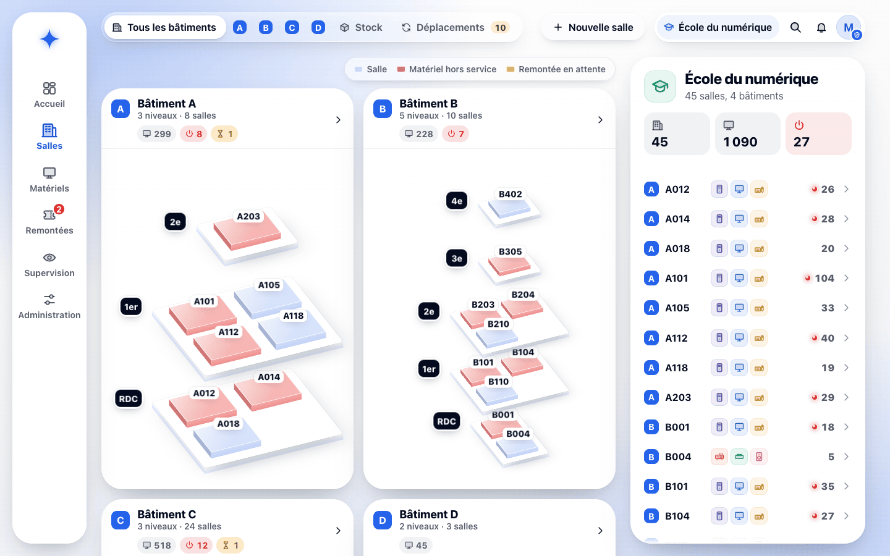

# Audit avant rendu — daily du 16 novembre 2026

<!-- version:debut : généré par versions.py, ne pas modifier à la main -->
| Version | Mise à jour | Destination | Dernière évolution | Historique |
| --- | --- | --- | --- | --- |
| 3.0 | 15/11/2026 | Pilotage interne | Rapport remanié : priorités, incident des simulateurs, cause de CODE-04, verdicts fondés sur la recette de l’équipe, matrice des règles en annexe | [4 versions](../../archive/README.md#31-audit-avant-rendu-16-novembre) |
<!-- version:fin -->

Document de pilotage interne, non remis. Situation contrôlée le 15 novembre 2026, pour le daily du lundi 16 et le rendu du mardi 17. Révision examinée : `3fbaa9a` sur `dev`, dépôt propre au départ. Méthode : revue des sources, tests locaux, reproductions isolées (scripts livrés dans [assets/audit-16-novembre/](assets/audit-16-novembre/)) et relecture documentaire. Les chemins abrégés sont relatifs à `application/` pour le code et à `docs/` pour la documentation. Relecture et corrections du rapport par l’utilisateur le 15 novembre au soir.

## 1. Synthèse

**19 écarts confirmés : 0 bloquant pour le rendu, 7 majeurs, 12 mineurs (2 corrigés).** Le bon fonctionnement de l’application déployée sur les VM est attesté par la recette de l’équipe du 15 novembre, confirmée par l’utilisateur ; cet audit n’a pas eu accès aux VM (réseau fermé) et n’apporte pas de preuve propre sur ce point.

| Domaine | Majeur | Mineur | À retenir |
| --- | --- | --- | --- |
| Code | 3 | 1 | Règles whitelist/blacklist non validées côté serveur (CODE-01), identifiants tronqués (CODE-02), toute écriture bloquée au-delà de 20 000 processus visibles (CODE-04). |
| Sécurité | 1 | 3 | Opération RIGEL non révoquée quand le gestionnaire est désactivé (SEC-01). Aucune vulnérabilité npm de production. |
| Documentation | 3 | 8 | Cadrage § 23 contraire à la règle « l’état actuel fait foi » (DOC-01), salle historique d’une détection absente du MCD (DOC-06), contradiction interne du DAT sur RIGEL (DOC-07). |

**À lire en priorité pour le daily** : les quatre majeurs serveur CODE-01, CODE-02, CODE-04 et SEC-01 (tickets #163, #164, #167, #165), puis DOC-01 (#60) et DOC-06 (#166). Le reste peut attendre le rendu.

**Incident de l’audit à connaître** : un second simulateur de postes a été lancé par erreur à côté de celui de l’utilisateur. Chaque rapport arrêtait les processus de l’autre, d’où un pic à 50 035 processus dans l’espace local (45 045 pour l’École du numérique). Ce volume n’est pas une charge nominale ; il a révélé CODE-04, établi ensuite par une reproduction isolée à 20 001 processus. Conséquences : les résultats e2e locaux de la reprise (15/19) ne sont pas exploitables ; **l’espace local n’a pas été purgé** et reste dans cet état tant que `npm run donnees:demo -- --reinitialiser` n’est pas relancé (décision de l’utilisateur).

## 2. Vérifications exécutées

Depuis `application/`, sauf mention contraire.

| Commande / contrôle | Résultat observé | Preuve |
| --- | --- | --- |
| `git fetch origin`, intégration `origin/dev` | Avance de `75615df` à `3fbaa9a` en avance rapide ; `origin/main` déjà ancêtre de `dev`. | Journal Git : `bc12f63`, `97191e8`, `17220b7`, `3fbaa9a` |
| `npm run typecheck` | Code 0. | [Sortie](assets/audit-16-novembre/typecheck.txt) |
| `npm test` | 89 réussis, 0 échec. | [Sortie](assets/audit-16-novembre/test.txt) |
| `npm run build`, `npm run build:rigel` | Code 0. | [build](assets/audit-16-novembre/build.txt), [rigel](assets/audit-16-novembre/build-rigel.txt) |
| `npm run test:ui` | 2 réussis. | [Sortie](assets/audit-16-novembre/test-ui.txt) |
| `npm run test:workspace` | 48/50 puis 50/50 en reprise séquentielle ; les deux ENOENT venaient des traces partagées avec e2e, pas d’une anomalie métier. | [Initiale](assets/audit-16-novembre/test-workspace.txt), [reprise](assets/audit-16-novembre/test-workspace-reprise.txt) |
| `npm run infra:up` | PostgreSQL, LDAP et Keycloak recréés et sains. | Compose local |
| `npm run dev` | Non relancé : Express 3001 et Vite 5173 de l’utilisateur réutilisés. | [Processus observés](assets/audit-16-novembre/processus-simulateurs.log) |
| `npm run test:e2e` | Initiale 18/19 (un arrêt resté `enregistree` après 20 s, cause non établie) ; reprise 15/19 pendant le dépassement de processus (CODE-04). **Résultats locaux non exploitables comme recette.** | [Initiale](assets/audit-16-novembre/test-e2e.txt), [reprise](assets/audit-16-novembre/test-e2e-reprise.txt) |
| `npm run captures` | Code 0, sur un serveur interface seule isolé (5175). | [Liste](assets/audit-16-novembre/captures.txt) |
| `npm run captures:rigel` | Échec initial (dépendances Vite périmées, 504), puis code 0 avec un cache mobile isolé : appairage, synchronisation et hors ligne capturés. | [Initiale](assets/audit-16-novembre/captures-rigel.txt), [reprise](assets/audit-16-novembre/captures-rigel-reprise.txt) |
| Migration `0002` | Base neuve, puis base `0001` peuplée : 9 tables comparées, documents JSON et journal repris, idempotence ; ancien relais repris sans perte. Schémas temporaires supprimés. | [Script](assets/audit-16-novembre/migration-0002.mjs), [sortie](assets/audit-16-novembre/migration-0002.log) |
| `npm audit --omit=dev` | 0 vulnérabilité sur 123 dépendances de production (ne couvre ni les images ni les défauts applicatifs). | [JSON](assets/audit-16-novembre/npm-audit.json) |
| Vérificateur documentaire | 0 erreur, 0 avertissement, avant et après publication. | [Initiale](assets/audit-16-novembre/documentation-initial.txt), [finale](assets/audit-16-novembre/documentation-final.txt) |
| En-têtes de version | 30 en-têtes identiques à la génération depuis le registre. | `versions.py`, `archive/registre.json` |
| MCD et schémas d’architecture | 222 libellés et cardinalités identiques entre draw.io et SVG ; 5 rendus Chrome relus en entier, sans troncature ni collision. Ne valide pas les cardinalités métier. | [MCD](assets/audit-16-novembre/orion-audit-mcd.png), [réel simplifié](assets/audit-16-novembre/orion-audit-arch-simple.png), [réel complet](assets/audit-16-novembre/orion-audit-arch-vm.png), [cible détaillée](assets/audit-16-novembre/orion-audit-arch-cible.png), [cible simplifiée](assets/audit-16-novembre/orion-audit-arch-cible-simple.png) |
| Accès aux VM | `curl https://172.16.131.188/api/infos` : code 28 (délai), attendu depuis un poste hors du réseau fermé. | — |

Environnement : Node 26.13.0, macOS, Chrome, PostgreSQL local. Les serveurs de l’utilisateur n’ont pas été redémarrés et peuvent avoir chargé un code antérieur à la révision auditée. Non couverts : scan ZAP/ASVS, CVE des images, charge nominale, paramètres réellement chargés sur les VM, protection de la branche `main` (API en 404, indécidable). Les captures ont utilisé un fichier de travail isolé ; les images de `design/` ont été rétablies, aucune maquette republiée.

## 3. Écarts confirmés

### 3.1. Code

| ID / gravité | Constat | Preuve | Correction proposée | Ticket / responsable |
| --- | --- | --- | --- | --- |
| **CODE-01 — Majeur** | Règles whitelist/blacklist enregistrées sans validation du nom, de la portée ni du classement ; une règle sans nom fait ensuite échouer les rapports des postes d’autres écoles. | `backend/domaine/espace.ts:171-178`, `shared/referentiels.ts:108` ; [reproduction](assets/audit-16-novembre/validation-regles.mjs), [sortie](assets/audit-16-novembre/validation-regles.log) : règle acceptée puis `TypeError toLowerCase` ; portée et classement inventés acceptés. | Valider la règle côté serveur avant persistance (RG-47 à RG-50), refuser en 400, tester les rattachements. | #163 ; BAELDE, PHOMMAVONGSA |
| **CODE-02 — Majeur** | Identifiants aléatoires tronqués à 8 hexadécimaux (32 bits) : collision possible, écrasement par UPSERT, cache et base divergents. | `backend/domaine/commun.ts:47`, `postes.ts:71-78`, `persistance/postgres.ts:115` ; [génération](assets/audit-16-novembre/generation-identifiants.log) : 7 collisions sur 200 000 ; [injection déterministe](assets/audit-16-novembre/collision-identifiants.mjs), [sortie](assets/audit-16-novembre/collision-identifiants.log) : 2 processus et 2 détections en cache, 1 et 1 après réouverture. | Conserver l’UUID complet ; empêcher un doublon interne d’écraser une autre donnée. | #164 ; BAELDE |
| **CODE-04 — Majeur, conditionnel au volume** | Au-delà de 20 000 processus visibles, toute écriture de l’école échoue en 400 « Données invalides. », préférences comprises, même quand le navigateur n’envoie pas cette collection. | `backend/domaine/espace.ts:122` applique le contrôle de taille au repli serveur `visible[c]` des collections `processus`, `detections` et `installations`, avant les droits `:136` ; [reproduction](assets/audit-16-novembre/limite-collections.mjs), [sortie](assets/audit-16-novembre/limite-collections.log) : 20 000 acceptés, 20 001 refusés ; [volumes](assets/audit-16-novembre/volumes-processus.log). | Voir la cause et la correction retenue ci-dessous. | #167 ; BAELDE |
| **CODE-03 — Mineur** | Résidus « campagne » dans des commentaires et un sélecteur CSS mort. | `frontend/src/rigel/styles/ecrans.css:34`, `frontend/src/espace/styles/recensement.css:2,6,28` ; aucun libellé utilisateur concerné. | Renommer ou supprimer ; garder les anciens noms nécessaires à la reprise des migrations et du stockage mobile. | #162 ; BAELDE, VILBERT-TAHON |

**CODE-04, cause et correction retenue** (relecture de l’utilisateur, à faire, non traité). Le 403 sur les données des postes existe déjà (`espace.ts:136`) ; le défaut est le contrôle de taille appliqué à des données que le navigateur ne peut pas écrire. Mais le symptôme révèle une cause plus large : le navigateur renvoie **tout l’état** à chaque écriture (`frontend/src/espace/core/store.ts:78-80`, sauf pour les préférences), y compris `processus`, `detections` et `installations`, ce qui explique aussi le dépassement de la limite HTTP de 8 Mo observé. Dans l’ordre :

1. Serveur : pour ces trois collections, sauter le contrôle de taille et d’identifiants quand elles ne sont pas envoyées ; conserver le 403 si elles arrivent modifiées. Test à 20 001 processus, dans les deux modes : créer un matériel et changer ses préférences passent, altérer un processus est refusé.
2. Navigateur : ne plus envoyer ces trois collections dans `PUT /api/workspace`. Une pagination ne répond pas à ce point : elle concerne la lecture et l’affichage, pas la charge utile écrite. Étape suivante, hors rendu : n’envoyer que les collections modifiées.
3. Volume : borner le nombre de processus conservés par poste (`postes.ts:65-72`, arrêtés gardés une heure `:88`) et documenter qu’un seul simulateur tourne par espace.
4. Lecture paginée de `/api/workspace` : refonte du front, V2.

Observation liée de l’utilisateur : des règles whitelist/blacklist ni modifiables ni supprimables. Deux causes possibles, à distinguer en reproduisant : les règles du référentiel sont toutes de portée globale (`shared/referentiels.ts:102`), donc réservées au super administrateur, boutons masqués pour l’administrateur (conforme à RG-50) ; ou l’écriture a échoué pendant le dépassement (CODE-04). Évolution d’interface demandée : liste des règles sur `DataPanel` (recherche existante, filtre par classement, 25 par page), comme Administration › Postes ; fiche 15 et sa capture à mettre à jour, DCU 10 seulement si l’interaction change ; les séquences 25 et 28 ne bougent pas. Inscrite au backlog technique.

### 3.2. Sécurité

| ID / gravité | Constat | Preuve | Correction proposée | Ticket / responsable |
| --- | --- | --- | --- | --- |
| **SEC-01 — Majeur** | Désactiver un gestionnaire ne révoque pas son opération RIGEL : le téléphone reste alimenté et les constats sont appliqués en son nom, contrairement à RG-85. | `backend/domaine/recensement.ts:177,243` (contrôle du profil, pas de l’état actif) ; [reproduction](assets/audit-16-novembre/orion-security-repro.mjs), [sortie](assets/audit-16-novembre/orion-security-repro.txt) : `managerActif:false`, `operationsPubliees:1`, `statut:applique`, matériel passé au stock. | Contrôler l’état actif, le profil et l’école du lanceur avant publication et intégration ; définir la reprise par un autre gestionnaire. La copie hors ligne déjà sur le téléphone ne peut pas être effacée à distance. | #165 ; BAELDE, BONNEY |
| **SEC-02 — Mineur** | Quota du relais non atomique : compteur et insertion séparés. | `backend/rigel/relais.ts:81-82`, `relais-store.ts:96,101` ; [reproduction](assets/audit-16-novembre/orion-relay-quota-repro.mjs) : avec barrière d’entrelacement, 4 stockés pour un plafond de 3 ; sans barrière, non reproduit (1 succès, 19 refus). | Compteur et insertion dans la même transaction ou sous le même verrou. | #109 ; BAELDE, BONNEY |
| **SEC-03 — Mineur** | Un JSON invalide renvoie et journalise un extrait du corps de la requête, contrairement au guide. | `backend/api/routes.ts:166-167`, `backend/journal.ts:5`, relais `:126` ; [reproduction](assets/audit-16-novembre/orion-json-error-repro.mjs), [sortie](assets/audit-16-novembre/orion-json-error-repro.txt). | Réponse générique « JSON invalide. » ; journaliser type et statut, sans corps. | #109 ; BAELDE, LE MAÎTRE |
| **SEC-04 — Mineur** | Mot de passe en clair dans `sessionStorage` ; l’expiration d’une minute n’efface pas l’entrée si le parcours est abandonné. | `infra/keycloak/themes/orion-mindef/login/resources/js/login.js:38,44,47` ; [reproduction](assets/audit-16-novembre/orion-password-cache-repro.mjs), [sortie](assets/audit-16-novembre/orion-password-cache-repro.txt) : encore stocké après 120 s. | Éviter le Web Storage pour le mot de passe ; à défaut, nettoyer à l’abandon. | #109 ; BAELDE, LE MAÎTRE |

### 3.3. Documentation et cohérence

| ID / gravité | Constat | Preuve | Correction proposée | Ticket / responsable |
| --- | --- | --- | --- | --- |
| **DOC-01 — Majeur** | Le § 23 du cadrage dit encore que les productions cible suivent la décision du client, alors que l’état actuel fait foi (introduction du cadrage, AGENTS). Le backlog technique cochait ce point à tort. | `01-CONTEXTE/02-CADRAGE.md:391` contre `:15`. | Remplacer la phrase par la rédaction du § 7 ; décocher au backlog technique. | #60 ; BAELDE |
| **DOC-06 — Majeur** | Ni le MCD ni les classes métier ne conservent la salle où une détection a eu lieu ; passer par le poste donne sa salle actuelle, alors que le code fige la salle à la détection. | MCD `:185-194`, classes 24 `:242-244`, RG-56 ; `backend/domaine/postes.ts:75` (salle figée) et `:147-150` (le poste peut changer de salle) ; le MPD 29 garde bien `Detection.salleId`. | Ajouter le lieu historique dans le MCD et les classes métier ; corriger l’explication du cadrage `:180`. RG-56 inchangée. | #166 ; BONNEY, BAELDE |
| **DOC-07 — Majeur, DAT** | Le DAT pose une contrainte générale « relais et connecteur » contradictoire avec sa propre cible, qui n’a ni l’un ni l’autre. | DAT `:31` contre `:404` ; décision de l’utilisateur du 15 novembre. | Rédaction proposée au § 7, à appliquer par le détenteur du DAT. | #70 ; LE MAÎTRE |
| **DOC-02 — Mineur** | Des questions du cadrage gardent une ancienne réponse sans l’état actuel : lien poste/matériel, filtre par salle du tableau de bord. | Cadrage `:68` contre `:184` et RG-90 ; `:253` contre § 23. | Reporter les réponses actuelles avec leur provenance, conserver l’historique client. | #143 ; BAELDE |
| **DOC-03 — Mineur** | Le DCU 08 fait de l’appairage du téléphone une inclusion obligatoire de l’installation, alors que la confirmation est possible dans ORION. | `08-DCU-GESTION-PARC.md:76` contre RG-92, glossaire, diagrammes 07 et 23, matrice, fiche 13. | Représenter RIGEL comme variante (extension), pas comme inclusion. | #63 ; BONNEY |
| **DOC-04 — Mineur, convention** | Les extensions des DCU ne nomment ni point d’extension ni condition. | DCU 08 `:73,75,78`, DCU 10 `:50-51`, DCU 22 `:61-62` ; Ambler. | Nommer le point d’extension et sa condition pour les variantes utiles. | #63 ; BONNEY |
| **DOC-05 — Mineur** | Propriétaire du paquet : deux liens facultatifs avec `{xor}` ne rendent pas la totalité XT du MCD (exactement un propriétaire). | Classes 24 `:239-240`, MCD `:280-282`. | Rendre explicite « exactement une application ou un système » ; catalogue toujours V2. | #63 ; BONNEY |
| **DOC-08 — Mineur, DAT** | Le DAT annonce un stockage hors ligne chiffré ; IndexedDB contient l’instantané déchiffré et les constats, le chiffrement porte sur les échanges. | DAT `:106` ; mobile `core/base.ts:1-2,30`, `core/etat.ts:55,67-68,99`, `core/relais.ts:20,28`. | Décrire séparément stockage local et chiffrement des échanges (§ 7). | #70 ; LE MAÎTRE |
| **DOC-10 — Mineur, accord RG requis** | RG-15 et la définition « Administrateur » du glossaire ne mentionnent que les remontées comme exception, alors que la confirmation des installations et les actions RIGEL sont aussi réservées au gestionnaire. | Règles `:32`, glossaire `:46`, RG-92 à RG-96, matrice ; `parc.ts:40`, `recensement.ts:46`. | Rédaction proposée au § 7 ; aucun droit modifié. | #61 ; BAELDE, BONNEY |
| **DOC-09 — Mineur, corrigé** | Le backlog 20 excluait encore le scan QR du périmètre de clôture, alors que RIGEL est réalisé. | Backlog 20 `:19` avant l’audit. | Périmètre actualisé dans cette livraison. | Fait ; BAELDE |
| **DOC-11 — Mineur, corrigé** | `versions.py` refusait une seconde publication d’un nouveau fichier avant son premier commit. | `versions.py:359` avant correction ; erreur reproduite sur ce rapport. | Condition corrigée, vérifiée sur un document nouveau et un existant. | Commit `fd6fa8b` |

Les numéros de ligne sont ceux de la révision auditée.

## 4. Contrôles satisfaisants et réserves connues

**Code et données.** Les deux modes montent les mêmes routeurs et le même moteur (`outils/interface-seule/ui-development.ts:6-8,71-81`, `persistance/postgres.ts:310`). Identifiants ORION, numéros de remontée, auteurs, dates, suivis et résultats sont fixés par le serveur (`espace.ts:153-159`, `parc.ts:18-43`, `remontees.ts:18-34`, `postes.ts:178`, `comptes.ts:55-59`). École et profil relus côté serveur ; collections des postes protégées. PostgreSQL porte espace, sessions et journal ; verrou de révision et fusion élément par élément (`postgres.ts:234-309`, `fusion.ts:22-59`) : aucun état mémoire faisant autorité en mode connecté. Aucun écran TSX au-delà de 300 lignes, pas de HTML en chaîne, formulaires en `<form onSubmit>` (`ui/forms.tsx`), formats centralisés, aucun libellé de démonstration ni domaine `.local`.

| Mécanisme serveur | Règles couvertes |
| --- | --- |
| `comptes.ts`, authentification, profil | RG-01, RG-62, RG-70, RG-82, RG-85 |
| `parc.ts`, import, périmètre dans `espace.ts` | RG-03 à RG-10, RG-29, RG-61, RG-63, RG-73 à RG-75, RG-78, RG-86 à RG-92 |
| `remontees.ts`, PDF | RG-11 à RG-14, RG-32 à RG-35, RG-64, RG-79, RG-80, RG-89 |
| `postes.ts`, classements, résultats | RG-22, RG-41 à RG-56, RG-77, RG-81, RG-83, RG-88, RG-90 |
| `recensement.ts`, constats | RG-92 à RG-100 ; RG-85 pour la révocation (SEC-01) |
| Préférences, tableaux, notifications | RG-36 à RG-39, RG-84 |

La matrice complète RG-01 à RG-100 (référence documentaire, trace du code, limite de lecture) est en annexe : [matrice-regles-code.md](assets/audit-16-novembre/matrice-regles-code.md). Elle localise des mécanismes lus, pas cent validations dynamiques.

Les différences MCD/MPD ne sont pas toutes des erreurs : `PAQUET` et `SYSTÈME_EXPLOITATION` sont V2 ; `DÉPLACEMENT` est porté aujourd’hui par les objets JSON du matériel. Les diagrammes 27 et 28 décrivent la cible RIGEL par décision de l’utilisateur, alors que le code actuel passe par le relais et le connecteur.

**Sécurité examinée.**

| Frontière | Contrôles lus |
| --- | --- |
| `/auth` | State, nonce, PKCE S256, tentatives à usage unique et expirées ; session régénérée, cookie HttpOnly, Secure en production, SameSite Lax, session en PostgreSQL ; courriel rapproché seulement s’il est vérifié (`backend/index.ts:139`, `api/profiles.ts:7`). |
| `/api/workspace` | Session avant le parseur, origine stricte pour les écritures, corps 8 Mo, école et droits côté serveur (`index.ts:204`, `espace.ts:133-169`). Anomalies : CODE-01, CODE-04. |
| `/api/agent` | Comparaison en temps constant, jeton HMAC par poste, refus de changement d’identité, rapports 4 Mo et lots bornés (`api/agent.ts`, `postes.ts:58`). |
| `/api/rigel` | Secret avant le parseur, corps 4 Mo, 1 000 événements au plus, AES-GCM lié à l’opération, salle et école contrôlées ; connecteur par lots de 200. Anomalie : SEC-01. |
| `/api/health`, `/api/infos` | Anonyme : état, date, description, version ; détail réservé au super administrateur (`services.test.ts:76-85`). Version publique conservée par décision de l’utilisateur. |
| Secrets | `git grep` des clés privées, jetons GitHub et clés AWS hors lock : aucun résultat ; `.env.example` et scripts de test seulement. Pas d’audit exhaustif de l’historique. |
| Production | Variables requises, HTTPS, refus des valeurs locales connues, longueurs minimales des secrets, provisionnement désactivé par défaut, secrets Swarm lus dans `/run/secrets`. |
| Proxy, web, identité | HAProxy TLS 1.2 minimum, HSTS, nettoyage des `X-Forwarded`, restrictions de chemins et de débit ; Apache CSP, TRACE refusé ; console 8444 sans filtrage réseau (décision de l’utilisateur) ; jetons de présentation autorisés jusqu’à #113. |
| Stockage, journal, conteneurs | Rôle PostgreSQL `orion_app` non superutilisateur, SQL paramétré ; NFSv4 sur orion-10 avec `root_squash` sauf LDAP ; Logstash mTLS ; images épinglées par empreinte ; capacités limitées. Revue des sources, pas des paramètres chargés sur les VM. |

Les risques déjà ouverts au [backlog technique § 4](21-BACKLOG-TECHNIQUE-ET-FEUILLE-DE-ROUTE.md#4-sécurité) restent tels quels (OpenLDAP sans TLS, compte technique Keycloak, plage de confiance du proxy, appairage porteur, intégrité du code servi par le relais, énumération hors école). Un choix accepté (ports 8444 et 6514 joignables, version publique, dépôt public) n’est pas compté comme non-conformité.

**Documentation et méthode.** Les cent règles ont une référence explicite hors de leur définition. Aucun compte ni marqueur de démonstration dans les textes de remise. Relecture UML/Merise d’après [OMG UML 2.5.1](https://www.omg.org/spec/UML/2.5.1/) (consulté partiellement) et [Ambler, Reuse in Use-Case Models](https://agilemodeling.com/essays/usecasereuse.htm) ; les ouvrages de Roques, Larman et Cockburn n’étaient pas disponibles, aucune conformité exhaustive à ces livres n’est revendiquée.

## 5. Parallèle avec le daily du 16 novembre

| Point du [document 30](30-POINTS-DAILY-SCRUM-16-NOVEMBRE.md) | État constaté | Reste ou risque pour le 17 |
| --- | --- | --- |
| Déploiement #103, #116 | 15 parcours VM consignés (`bc12f63`, `97191e8`), correctif du jeton `17220b7` ; bon fonctionnement confirmé par l’équipe. | Aucun, sur la foi de la recette de l’équipe. |
| Scénario complet #108 | Les tests fournissent des parcours techniques, pas un fil par profil avec résultats attendus. | Rédiger le scénario de présentation. |
| Recette #105, #106, #107 | Recette VM de l’équipe ; droits par profil et 50 parcours interface seule vérifiés localement. | Les échecs locaux sous stress restent suivis par #167. |
| Conception #63 | MCD et cinq rendus relus. | DOC-03 à DOC-06, DOC-10 ; DOC-06 est majeur. |
| DAT #70 | Schémas lisibles, cible RIGEL représentée. | DOC-07 et DOC-08 à soumettre au détenteur. |
| Sécurité #109 | Revue des sources, reproductions, `npm audit` faits. | #163 à #165, SEC-02 à SEC-04 ; pas de validation de sécurité globale. |
| Version à remettre #111 | Aucun gel identifié. | Fixer la version et consigner ses réserves. |
| Dossier de remise #112 | Vérificateur structurel passe. | N’assembler que les productions du README, sans ce rapport ni ses preuves. |
| Documentation #60, #61, #140 à #143 | #61, #140, #141, #142 validés ; #60, #143 refusés. | DOC-01, DOC-02 ; nouvelle anomalie MCD #166. |
| Présentation #110, cérémonies #50, rendez-vous #114 | Horaire du 19 et date du rendez-vous client inconnus ; comptes rendus prévus sans traces. | Décisions d’organisation attendues. |
| Après la présentation #113 | Jetons de présentation activés volontairement. | Retrait avant production. |
| Points tranchés 1 à 6 | #162 fait (reste CODE-03) ; #161 appliqué ; #91 V2 ; #130 validé, #127 et #129 V2 ; RELEVER justifié par RG-79 ; règles du catalogue à l’ouverture de la V2. | Rien à rouvrir. |

## 6. Tickets GitHub en revue

Quinze tickets « In review » lus (`gh project item-list 2 --owner bpierrelouis --format json`), dont #105, #106, #107 et #116 ajoutés à la liste initiale. Les dix validés sont commentés, fermés et passés Done ; les cinq refusés sont commentés, laissés ouverts et passés In progress. Les verdicts, commentaires et liens sont dans [tickets-verdicts.json](assets/audit-16-novembre/tickets-verdicts.json).

| Ticket | Verdict | Fondement |
| --- | --- | --- |
| #24 Capture des besoins (épopée) | Refusé | #60 non conforme et nouvel écart MCD (#166) ; une épopée n’est pas close avant ses sous-tâches. |
| #60 Aligner le cadrage | Refusé | DOC-01. |
| #61 Contradictions entre livrables | Validé sur sa liste | Points du ticket corrigés ; nouveaux constats suivis à part. |
| #105, #106, #107 Recettes | Validés sur la recette de l’équipe | Confirmation de l’utilisateur, pas de preuve propre à l’audit ; droits et parcours interface seule vérifiés localement. |
| #109 Sécurité | Refusé | SEC-01 à SEC-04 ; `npm audit` à zéro ne vaut pas sécurité globale. |
| #116 Vérifications après déploiement | Validé sur la recette de l’équipe | 15 parcours VM consignés et confirmation de l’utilisateur ; l’audit n’a pas accédé aux VM. |
| #130 Points d’état | Validé | `services.test.ts:76-85`, 89 tests réussis. |
| #140 Documentation : contradictions | Validé sur sa liste | DOC-03 est une inclusion distincte. |
| #141 Décisions du 13 novembre | Validé | Compte Windows, MAC, IP, dates, listes, réinitialisation reportés. |
| #142 Informations non répercutées | Validé | Journal, 30 jours, architecture, glossaire reportés. |
| #143 Questions du cadrage résolues | Refusé | DOC-02. |
| #161 RIGEL dans la cible | Validé | Glossaire et diagrammes 06, 07, 26 à 29 alignés ; DAT traité par #70. |
| #162 Noms de la base et du code | Refusé pour CODE-03 seulement | Migration et relais validés localement, déploiement confirmé par l’équipe. |

Tickets créés, statut Ready, sprint 2, P1 : #163 (CODE-01, épopée #41), #164 (CODE-02, #41), #165 (SEC-01, #40), #166 (DOC-06, #24), #167 (CODE-04, #41). DOC-01 et DOC-07 restent sur #60 et #70.

## 7. Décisions et rédactions à soumettre à l’utilisateur

Aucune règle de gestion, aucun DAT ni entretien modifié par cet audit. Les propositions suivantes ne sont pas des décisions validées.

1. **Rendu** : prioriser CODE-01, CODE-02, CODE-04 et SEC-01, ou consigner ces réserves avec la version remise.
2. **RG-15, accord requis** : « L’administrateur réalise les actions autorisées dans son école, à l’exception du traitement des remontées (RG-64), de la confirmation des installations et des actions RIGEL réservées au gestionnaire (RG-92 à RG-96). Le super administrateur dispose des mêmes droits sur l’ensemble des écoles. » Source : décisions du 14 novembre, matrice, contrôles serveur. Compléter ensuite le glossaire.
3. **DAT, contrainte réseau** (ligne 31) : « Dans l’architecture réelle, les téléphones passent par un relais public et un connecteur sortant ; en cible, ils joignent l’entrée publique de RIGEL. » Source : décision du 15 novembre et § 6 du DAT.
4. **DAT, stockage mobile** (ligne 106) : « Le téléphone conserve l’instantané et les constats hors ligne dans IndexedDB ; les échanges avec le relais sont chiffrés en AES-256-GCM. » Ne pas prétendre que le connecteur, qui reçoit `RIGEL_SECRET`, est incapable de déchiffrer.
5. **Cadrage § 23** (ligne 391) : « Les productions suivent l’état actuel de l’application et de l’architecture cible ; les écarts avec les demandes du client sont présentés au prochain rendez-vous. » Les écarts déjà inscrits et leurs provenances sont conservés.
6. **MCD** : confirmer la représentation du lieu historique d’une détection avant de corriger le modèle (#166).
7. **Espace local** : relancer ou non `npm run donnees:demo -- --reinitialiser` pour sortir de l’état à 50 000 processus laissé par l’audit.
8. **Organisation** : date du prochain rendez-vous client, horaire du 19, comptes rendus des cérémonies réellement tenues, version remise et son dossier.

## 8. Preuves visuelles

Aucun badge de démonstration ni compte de test sur ces images. Le texte de l’écran mobile sur le chiffrement ne prouve pas le chiffrement local d’IndexedDB (DOC-08).

## 9. Livraison de l’audit

Corrections directes, limitées à l’outillage : `f34b469` (classement des audits en pilotage interne dans `versions.py`) et `fd6fa8b` (DOC-11). Documents 30, 21 et 20 et sommaire du README actualisés, versions publiées par le script. Graphiques du projet régénérés et relus : 112 tickets terminés sur 150, 38 restants ([burndown](assets/audit-16-novembre/graphique-burndown.png), [progression](assets/audit-16-novembre/graphique-equipe.png)). Scripts de reproduction rejouables depuis `application/` : `node ../docs/04-ORGANISATION/assets/audit-16-novembre/<script>.mjs` ; ceux qui utilisent PostgreSQL créent puis suppriment leur schéma. Contrôles finaux : vérificateur documentaire 0 erreur, `git diff --check` propre. Les processus lancés par l’audit sont arrêtés, ceux de l’utilisateur conservés.
