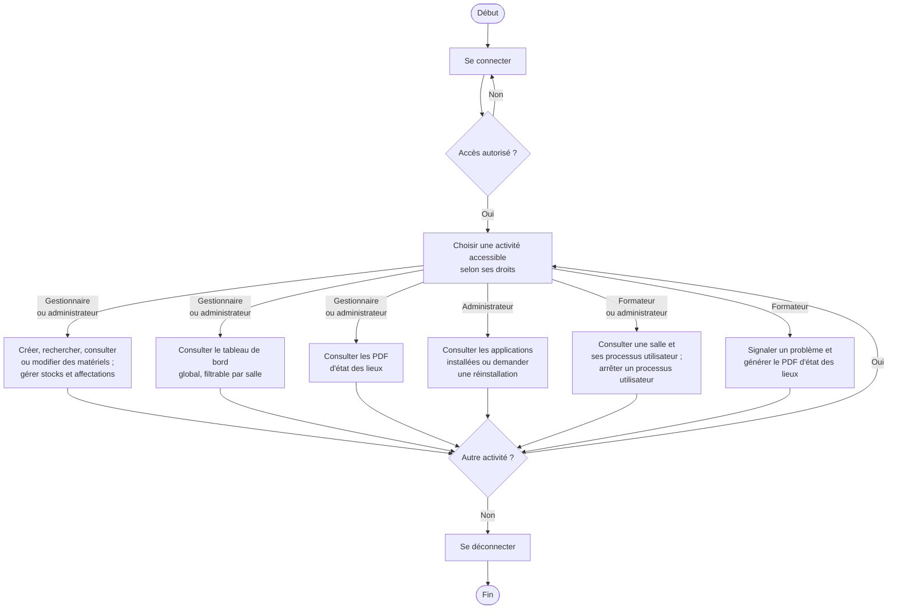
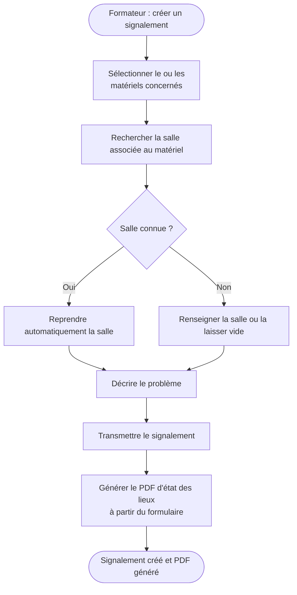
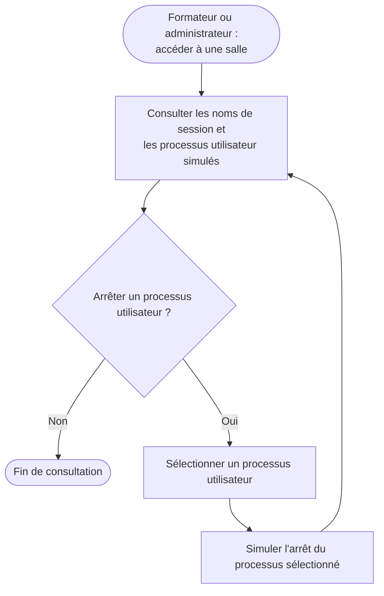

# Diagrammes d'activité de l'application ASTER

Ces parcours s'appuient sur le [sujet](01-CONSIGNES.md), les [entretiens](03-COMPTE-RENDU-ENTRETIENS.md) et les réponses en vigueur du [cadrage](02-CADRAGE.md). Ils détaillent les activités sans fixer les choix techniques encore ouverts. Les styles et couleurs de texte restent ceux du thème Mermaid du lecteur.

## Parcours général

- Le tableau de bord concerne le gestionnaire et l'administrateur. Aucun tableau de bord formateur n'est défini à ce stade.
- Le gestionnaire crée, consulte et modifie les matériels, sans suppression. Les affectations et déplacements peuvent concerner plusieurs matériels ; ils prennent effet directement, sans validation d'une seconde personne. Le matériel est affecté à une salle ou reste en stock sans localisation.
- L'enregistrement initial peut se faire par saisie manuelle ou import JSON. Les droits d'import restent à préciser ; ce parcours ne les attribue pas à un profil.
- L'administrateur dispose de tous les droits. La branche de signalement montre le parcours explicitement décrit pour le formateur ; elle ne restreint pas les droits généraux de l'administrateur.
- La masterisation consiste à réappliquer une image sur un poste ; le sujet prévoit également la réinstallation d'une salle complète. Le mécanisme d'exécution et les modalités de suivi restent à définir.
- Les listes de processus autorisés ou interdits et les statistiques d'utilisation figurent dans le sujet. Leur comportement n'est pas détaillé ici, les règles correspondantes restant ouvertes dans le cadrage.

## Signalement d'un problème par le formateur

Le PDF indique le matériel ou son type, le type de problème et sa description. La salle ou l'emplacement y figure lorsqu'il est renseigné ; son absence ne bloque pas le signalement. Un ticket peut concerner plusieurs périphériques ; les modalités de saisie de leurs emplacements restent à concevoir.

Le gestionnaire consulte les documents d'état des lieux ; l'administrateur dispose de tous les droits. Les statuts de ticket recueillis sont « en attente » et « remplacé », mais leurs transitions et les responsabilités de traitement ne sont pas définies : aucune transition n'est ajoutée au parcours. Aucune alerte ticket n'est envoyée à l'administrateur. Les modalités de téléchargement et de suivi par le formateur restent ouvertes.

## Supervision des processus — simulation de démonstration

Les processus internes ne font pas partie des remontées : ils ne sont pas proposés au formateur pour consultation ou arrêt. L'utilisateur autorisé agit directement dans la limite de ses droits, sans accord d'une seconde personne. La simulation ne suppose ni agent installé ni connexion réelle à un poste Windows. La fréquence de collecte et la portée exacte des droits du formateur restent à préciser.

## Notifications de garantie — bonus

Si la gestion de la garantie est réalisée, le gestionnaire et l'administrateur peuvent renseigner ou modifier sa date de fin. Le matériel est signalé comme « hors garantie » à l'échéance. Le gestionnaire reçoit les alertes de garantie six mois avant l'échéance et à l'échéance, sous forme de fenêtre contextuelle à la connexion, sans courriel.

Le gestionnaire et l'administrateur disposent chacun de deux indicateurs de tableau de bord : garanties proches de l'échéance et garanties arrivées à échéance. Ce bonus ne constitue pas un passage obligatoire dans les parcours précédents.
