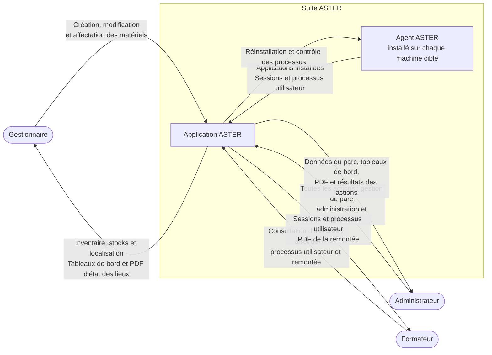

# Diagramme de contexte de l'application ASTER

Cette vue reprend le [sujet](01-CONSIGNES.md), les [entretiens des 22 et 23 octobre](03-COMPTE-RENDU-ENTRETIENS.md) et les réponses en vigueur du [cadrage](02-CADRAGE.md), notamment les précisions du 24 octobre.

## Diagramme

L'agent installé sur chaque machine cible est un composant de la suite ASTER. Les données de processus et les actions associées sont **simulées pour la démonstration**, mais leurs échanges fonctionnels passent par cet agent. Le protocole, la collecte des applications installées et l'exécution exacte de la réinstallation restent à préciser.

Les diagrammes utilisent les styles par défaut du moteur Mermaid : aucune couleur de texte, de fond ou de bordure n'est imposée, afin de laisser le thème du lecteur gérer leur affichage.

## Acteurs et échanges

| Acteur ou composant | Flux vers l'application ASTER | Flux provenant de l'application ASTER |
| --- | --- | --- |
| Gestionnaire | Création et modification des matériels, gestion des stocks, affectation et déplacement, y compris opérations groupées ; aucune suppression | Inventaire, localisation, état du parc, tableaux de bord spécialisés du parc et des remontées, et consultation des PDF d'état des lieux |
| Administrateur | Toutes les actions, dont gestion du parc, consultation des applications installées, réinstallation d'un poste ou d'une salle et contrôle des processus | Données du parc, applications installées, processus, tableaux de bord spécialisés, PDF d'état des lieux et résultats des actions ; l'accès à des statistiques d'utilisation est proposé mais reste à valider |
| Formateur | Accès à une salle, consultation des processus utilisateur, arrêt d'un processus utilisateur et création d'une remontée de problème | Nom de session utilisateur, processus utilisateur et PDF d'état des lieux généré à partir de la remontée |
| Agent ASTER | Applications installées ; sessions et processus utilisateur simulés pour la démonstration, hors processus internes | Demandes de réinstallation et de contrôle des processus ; arrêt simulé pour la démonstration |

## Périmètre et choix de modélisation

- Exactement trois profils existent : administrateur, gestionnaire et formateur. Les stagiaires n'ont pas de compte ASTER ; le nom de session est une donnée de supervision, pas un acteur supplémentaire.
- La V1 porte sur une école, deux bâtiments et six à huit salles par bâtiment. La gestion de plusieurs écoles est prévue à terme, hors des attendus de la V1.
- L'école, les bâtiments, les salles et les matériels sont gérés dans ASTER ; ils ne constituent pas des systèmes externes. Aucun niveau « étage » distinct n'est prévu.
- Les nouveaux matériels sont enregistrés individuellement, par saisie manuelle ou import JSON, sans gestion de lots ou de réceptions. Le gestionnaire et l'administrateur peuvent effectuer un import, qui met les données à jour immédiatement sans étape de vérification. Le CND n'est pas représenté comme un système connecté.
- Chaque matériel reçoit un identifiant interne automatique. Le modèle et la date de réception sont obligatoires ; le statut se limite à « hors service : oui/non », avec « non » par défaut. Le numéro de série et la marque peuvent rester vides. L'affectation se fait à une école, un bâtiment ou une salle, jamais à une personne ; un matériel peut rester en stock sans localisation.
- ASTER ne gère pas les formations ni un référentiel d'aptitudes. Le rôle ou la destination du matériel reste une information sur celui-ci.
- La remontée du formateur ou de l'administrateur génère un PDF d'état des lieux. Elle n'est pas directement rattachée à une salle : la localisation affichée provient de chaque matériel concerné lorsqu'elle est renseignée. Le gestionnaire peut consulter ces documents et l'administrateur dispose de tous les droits.
- La gestion de la garantie est un **bonus** : seule la date de fin est renseignée par le gestionnaire ou l'administrateur. Si ce bonus est réalisé, le gestionnaire reçoit les alertes six mois avant l'échéance et à l'échéance ; les deux profils disposent d'indicateurs distincts pour les garanties proches et arrivées à échéance. Les notifications apparaissent dans l'application à la connexion, sans courriel. L'administrateur ne reçoit pas d'alerte concernant une remontée.
- Les journaux sont également un **bonus**. Aucun historique des mouvements n'est attendu en dehors d'éventuels journaux.
- Aucun annuaire, SSO ou outil de déploiement tiers n'est ajouté tant que son choix et son intégration ne sont pas confirmés. L'agent ASTER installé sur les machines cibles fait en revanche partie de la suite. Aucune reprise Excel n'est à traiter avec les données actuellement fournies.

## Points encore à préciser

- Le système d'authentification et une éventuelle intégration à un annuaire.
- Le protocole de l'agent ASTER, son déploiement, ses mises à jour, le mécanisme de collecte des applications installées et l'outil exécutant la réinstallation.
- La définition, les indicateurs et les règles de calcul des statistiques d'utilisation proposées pour l'administrateur, cette fonctionnalité restant à valider.
- Les responsables et les transitions de traitement des remontées, les retours au formateur après leur création et les modalités de téléchargement des PDF.
