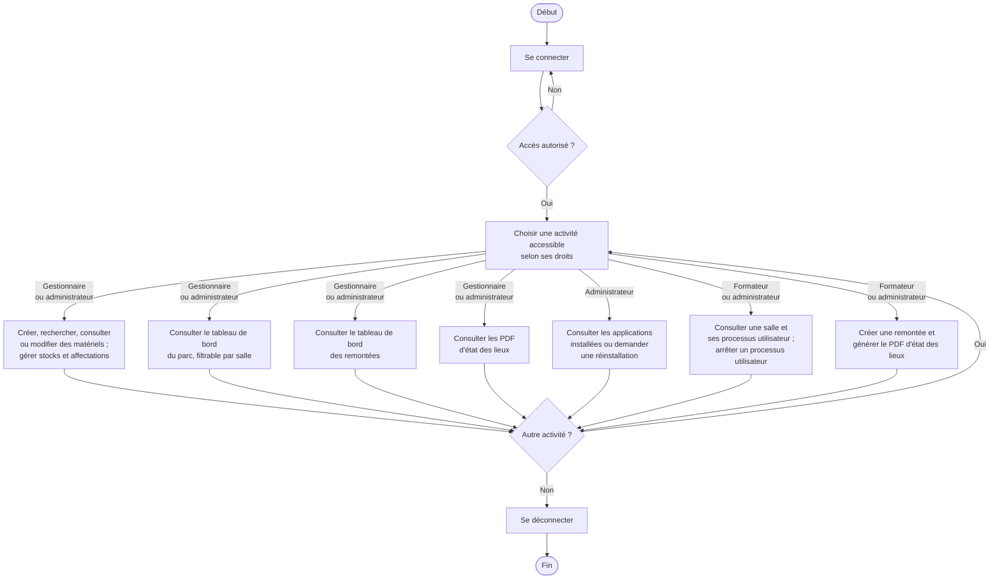
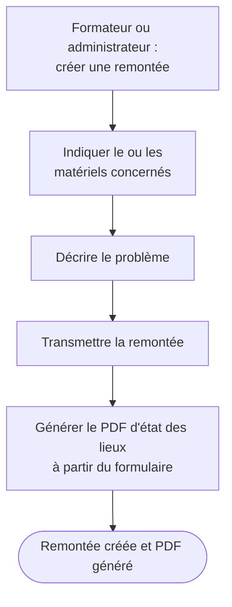
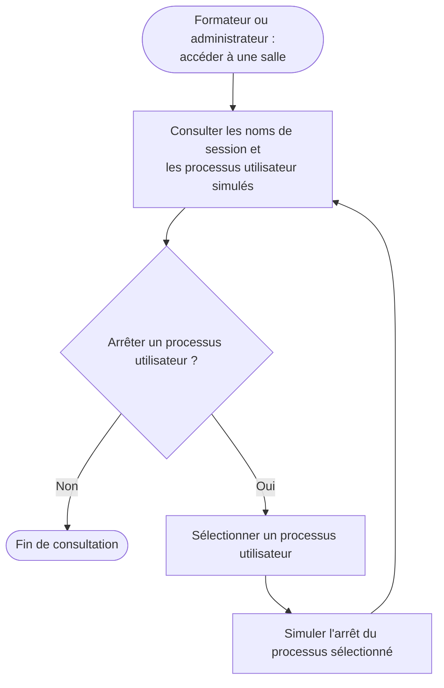

# Diagrammes d'activité de l'application ASTER

Ces parcours s'appuient sur le [sujet](01-CONSIGNES.md), les [entretiens](03-COMPTE-RENDU-ENTRETIENS.md) et les réponses en vigueur du [cadrage](02-CADRAGE.md). Ils détaillent les activités sans fixer les choix techniques encore ouverts. Les styles et couleurs de texte restent ceux du thème Mermaid du lecteur.

## Parcours général

- Plusieurs tableaux de bord spécialisés sont prévus pour le gestionnaire et l'administrateur, notamment un pour le parc et un pour les remontées. Aucun tableau de bord formateur n'est défini à ce stade. Des statistiques d'utilisation accessibles à l'administrateur sont proposées, mais restent à valider et ne sont donc pas ajoutées comme activité acquise.
- Le gestionnaire crée, consulte et modifie les matériels, sans suppression. Les affectations et déplacements peuvent concerner plusieurs matériels ; ils prennent effet directement, sans validation d'une seconde personne. Le matériel est affecté à une école, un bâtiment ou une salle, ou reste en stock sans localisation.
- L'enregistrement initial peut se faire par saisie manuelle ou import JSON. Le gestionnaire et l'administrateur peuvent réaliser cet import.
- L'administrateur dispose de tous les droits, y compris la création d'une remontée.
- La masterisation consiste à réappliquer une image sur un poste ; le sujet prévoit également la réinstallation d'une salle complète. Le mécanisme d'exécution et les modalités de suivi restent à définir.
- Les listes de processus sont gérées par l'administrateur. Les règles peuvent être globales ou portées par une école, un bâtiment ou une salle ; la blacklist est prioritaire et déclenche l'arrêt automatique du processus ainsi qu'une alerte.

## Création d'une remontée

Le PDF indique le matériel ou son type, le type de problème et sa description. La remontée ne possède pas de rattachement direct à une salle : la localisation affichée provient de chacun des matériels concernés lorsqu'elle est renseignée.

Le gestionnaire consulte les documents d'état des lieux ; l'administrateur dispose de tous les droits. Les statuts de remontée recueillis sont « en attente », « remplacé » et « corrigé », mais leurs transitions et les responsabilités de traitement ne sont pas définies : aucune transition n'est ajoutée au parcours. Aucune alerte concernant une remontée n'est envoyée à l'administrateur. Les modalités de téléchargement et de suivi par le formateur restent ouvertes.

## Supervision des processus — simulation de démonstration

Les processus internes ne font pas partie des données de supervision : ils ne sont pas proposés au formateur pour consultation ou arrêt. L'utilisateur autorisé agit directement dans la limite de ses droits, sans accord d'une seconde personne. Un agent de la suite ASTER est installé sur chaque machine cible ; les données et actions de processus restent simulées pour la démonstration. Les informations sont actualisées toutes les cinq secondes. Le formateur peut entrer dans toutes les salles, une salle à la fois, sans vue globale de supervision.

## Notifications de garantie — bonus

Si la gestion de la garantie est réalisée, le gestionnaire et l'administrateur peuvent renseigner ou modifier sa date de fin. Le matériel est signalé comme « hors garantie » à l'échéance. Le gestionnaire reçoit les alertes de garantie six mois avant l'échéance et à l'échéance, sous forme de fenêtre contextuelle à la connexion, sans courriel.

Le gestionnaire et l'administrateur disposent chacun de deux indicateurs de tableau de bord : garanties proches de l'échéance et garanties arrivées à échéance. Ce bonus ne constitue pas un passage obligatoire dans les parcours précédents.
