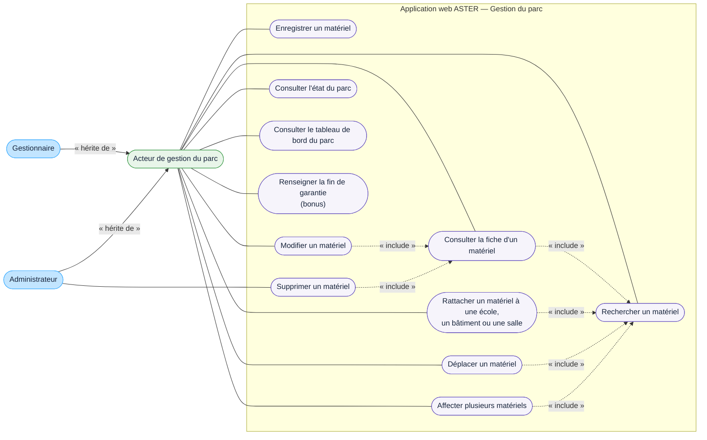

# DCU — Gérer le parc

## Acteurs

- **Acteur de gestion du parc** : acteur général portant les actions communes de gestion du parc.
- **Gestionnaire** : crée, consulte et modifie les matériels, gère les stocks et réalise les affectations, sans pouvoir supprimer de matériel.
- **Administrateur** : dispose de tous les droits et peut donc réaliser les mêmes actions de gestion du parc.

## Règles représentées

- un matériel peut être rattaché directement à une école, un bâtiment ou une salle, ou rester sans localisation lorsqu'il est en stock ;
- une affectation ou un déplacement prend effet immédiatement et peut concerner plusieurs matériels ;
- le gestionnaire ne peut pas supprimer de matériel ; l'administrateur, qui dispose de tous les droits, porte seul ce cas ;
- le numéro de série est facultatif, tandis que le modèle, la date de réception et l'état « hors service : oui/non » sont obligatoires ;
- la gestion de la garantie est un bonus limité à une date de fin, renseignée par le gestionnaire ou l'administrateur ;
- ASTER ne gère ni formations induites ni durées d'aptitude ;
- le CND n'est pas un système connecté à ASTER.

## Limites

- l'enregistrement peut être manuel ou provenir d'un import JSON réalisé par le gestionnaire ou l'administrateur ;
- la prévention des doublons et les critères détaillés de recherche restent à définir.
