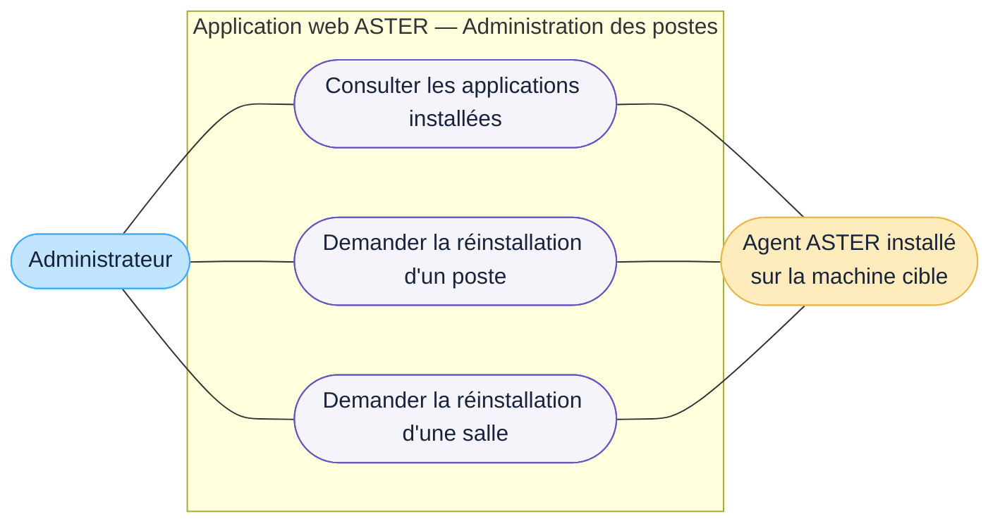

# DCU — Administrer les postes

## Acteurs

- **Administrateur** : consulte les applications installées et réalise la masterisation d'un poste ou d'une salle.
- **Agent ASTER** : composant de la suite ASTER installé sur chaque machine cible ; il porte les échanges fonctionnels liés aux applications installées et à la réinstallation.

## Règles représentées

- la masterisation consiste à réappliquer une image système sur un poste Windows ;
- seul l'administrateur réalise la masterisation ;
- le sujet prévoit la réinstallation d'un poste ainsi que celle d'une salle complète ;
- l'agent installé sur la machine cible appartient à la suite ASTER.

## Limites

- le format et le protocole de collecte des applications installées par l'agent restent à définir ;
- il reste à décider si ASTER exécute la réinstallation, la déclenche dans un outil tiers ou crée seulement une demande ;
- le déploiement, la configuration, l'authentification et la mise à jour de l'agent restent à préciser ;
- le choix de l'image, la planification, la confirmation, l'annulation, la progression et le compte rendu d'une réinstallation restent ouverts ;
- aucun suivi de résultat n'est représenté tant que son comportement n'est pas confirmé.
