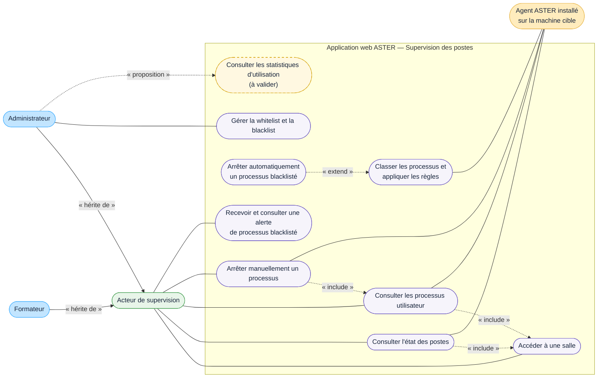

# DCU — Superviser les postes

## Acteurs

- **Acteur de supervision** : acteur général portant les consultations et l'arrêt manuel communs au formateur et à l'administrateur.
- **Formateur** : peut entrer dans toutes les salles, une salle à la fois, consulter les processus utilisateur et les arrêter. Il ne dispose pas d'une vue globale de supervision.
- **Administrateur** : possède les mêmes droits de supervision et gère seul la whitelist et la blacklist. La consultation des statistiques d'utilisation lui est proposée, mais reste à valider.
- **Agent ASTER** : composant de la suite ASTER installé sur chaque machine cible ; il porte les remontées de supervision et les commandes d'arrêt, simulées pour la démonstration.

## Règles représentées

- les processus internes du système d'exploitation sont exclus des données de supervision ;
- les données d'un poste connecté sont actualisées toutes les cinq secondes ; après environ quinze secondes sans remontée, le poste reste visible mais sans processus ;
- un processus absent de la blacklist est autorisé ; un processus absent des deux listes est classé « non référencé » ;
- un processus blacklisté est arrêté automatiquement, sans confirmation ni justification, puis génère une alerte et un historique ;
- l'alerte est destinée à l'administrateur et au formateur qui supervise la salle concernée ;
- les détections blacklistées et non référencées sont historisées, contrairement aux exécutions whitelistées.

## Limites

- les données de supervision et les arrêts sont simulés pour la démonstration, mais un agent de la suite ASTER est installé sur chaque machine cible ; son protocole et ses modalités de déploiement restent à définir ;
- la durée de conservation de l'historique reste à confirmer ;
- la présence même des statistiques d'utilisation, leurs indicateurs et leurs règles de calcul restent à valider.
