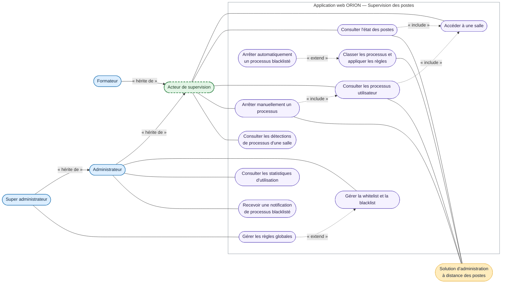

# DCU — Superviser les postes

<!-- version:debut : généré par versions.py, ne pas modifier à la main -->
| Version | Mise à jour | Destination | Dernière évolution | Historique |
| --- | --- | --- | --- | --- |
| 1.4 | 12/11/2026 | Production destinée à la remise | Renommer ASTER en ORION dans tout le dépôt | [5 versions](../archive/README.md#10-dcu-supervision-postes) |
<!-- version:fin -->

