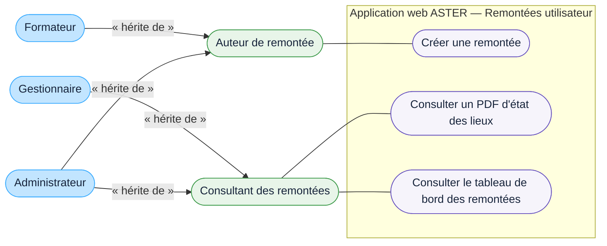

# DCU — Créer une remontée et consulter son état des lieux

## Acteurs

- **Auteur de remontée** : acteur abstrait portant la création d'une remontée, commune au formateur et à l'administrateur.
- **Consultant des remontées** : acteur abstrait portant la consultation des PDF d'état des lieux et du tableau de bord spécialisé des remontées, commune au gestionnaire et à l'administrateur.
- **Formateur** : hérite des actions de l'auteur de remontée.
- **Gestionnaire** : hérite des actions du consultant des remontées.
- **Administrateur** : hérite des deux acteurs abstraits et dispose ainsi des actions de création et de consultation.

## Règles représentées

- une remontée est créée par un utilisateur ASTER authentifié et concerne un ou plusieurs matériels ;
- le ou les matériels et la description du problème sont obligatoires ;
- la remontée n'est rattachée directement ni à une salle ni à un poste ; la localisation affichée provient de chaque matériel concerné ;
- la transmission de la remontée génère automatiquement un PDF d'état des lieux ;
- le PDF contient le matériel ou son type, le type de problème, sa description et les localisations renseignées ;
- les statuts de la remontée sont « en attente », « remplacé » et « corrigé », sans cycle de transition défini.

## Limites

- le contenu, les indicateurs et les filtres du tableau de bord spécialisé des remontées restent à définir ;
- la qualification, l'affectation, le traitement, le suivi et les notifications de changement de statut restent à définir ;
- les modalités de téléchargement des PDF ne sont pas précisées.
