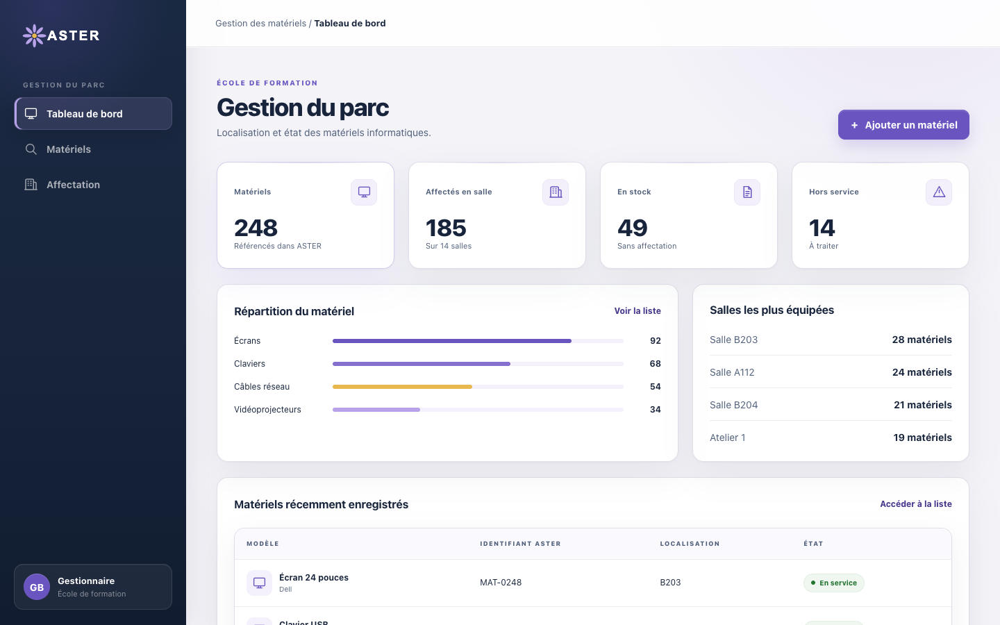
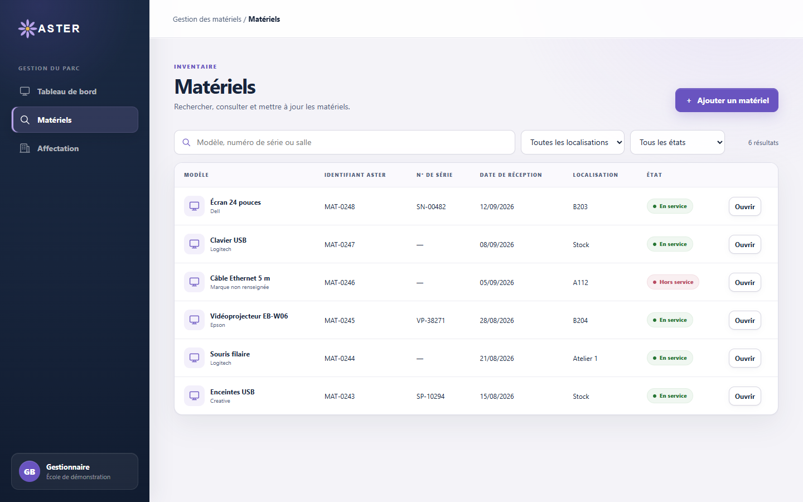
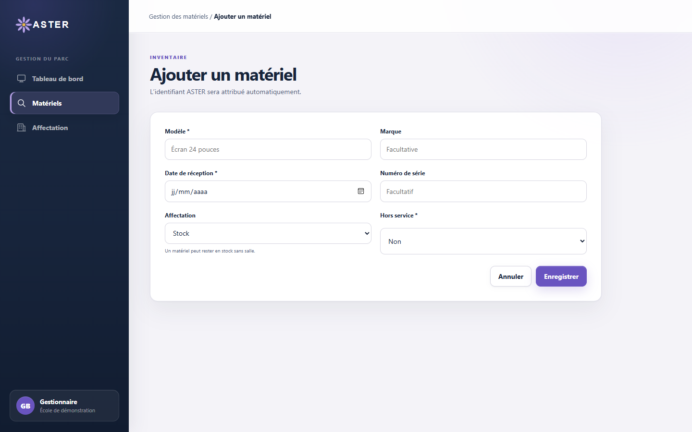
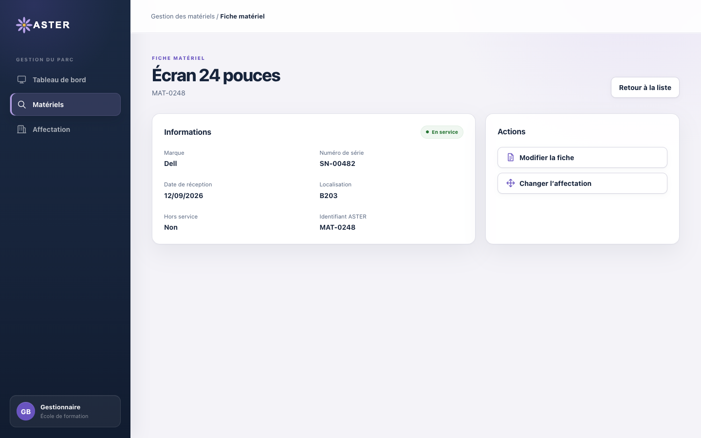
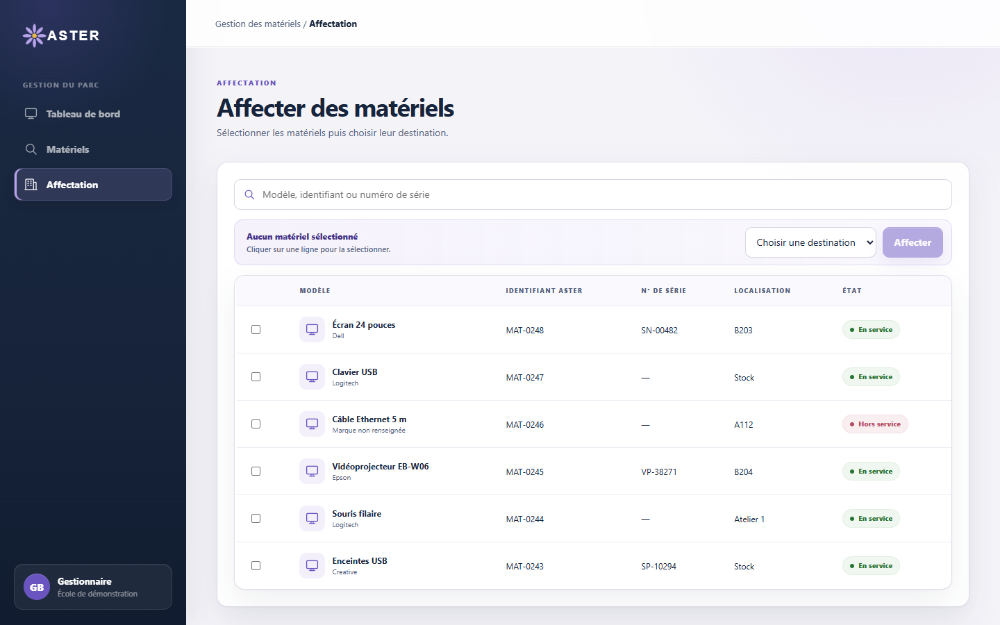

# Fiche descriptive — Gestionnaire

<!-- version:debut : généré par versions.py, ne pas modifier à la main -->
| Version | Mise à jour | Destination | Dernière évolution | Historique |
| --- | --- | --- | --- | --- |
| 3.0 | 13/11/2026 | Production destinée à la remise | Traitement des remontées réservé au gestionnaire, prise en charge obligatoire ; règles RG-13, 15, 21, 39, 40, 64, 66, 72 mises à jour et RG-87 à RG-91 ajoutées | [7 versions](../archive/README.md#13-fiche-descriptive-gestionnaire) |
<!-- version:fin -->

- **Statut :** établie à partir des décisions en vigueur.
- **Profil :** gestionnaire.
- **Rattachement :** une école.
- **Périmètre :** toutes les données de son école, sans restriction à un bâtiment.
- **Finalité :** maintenir l'inventaire du parc et traiter les remontées utilisateur.

## Périmètre fonctionnel

| Domaine | Capacités |
| --- | --- |
| Parc matériel | Rechercher un matériel (recherche globale ou inventaire filtré par type, état, salle ou stock et garantie) ; consulter les salles par bâtiment et par étage, et le matériel de chaque salle ; créer, consulter et modifier un matériel ; consulter le stock ; affecter un ou plusieurs matériels à une salle ou les remettre en stock ; importer de nouveaux matériels en JSON |
| Suppression | Interdite au gestionnaire ; la gestion des salles et des étages est réservée aux administrateurs |
| Tableaux de bord | Consulter son tableau de bord personnel, qu'il peut composer, ainsi que les tableaux de bord du parc et des remontées |
| Remontées | Consulter, rechercher et filtrer par bâtiment toutes les remontées de son école ; consulter, télécharger et imprimer les PDF ; prendre en charge une remontée (« en cours ») puis la terminer en « remplacé » ou « corrigé » ; recevoir une notification dans ORION à chaque nouvelle remontée |
| Garanties | Renseigner la date de fin, consulter son état (échue, à échéance, en cours, non renseignée) et recevoir une notification dans ORION lorsque la garantie est échue ou arrive à échéance dans les six mois |
| Administration et supervision | Aucun accès aux postes, à la supervision des processus, aux listes de processus, à la modification des salles ni aux comptes ORION |

Les droits détaillés sont consolidés dans la [matrice des droits](12-MATRICE-DROITS.md).

## UC-GEST-01 — Gérer le parc matériel

- **Objectif :** maintenir un inventaire fiable et connaître la localisation des équipements de l'école.
- **Déclencheur :** un matériel doit être enregistré, retrouvé, corrigé, affecté ou déplacé.
- **Préconditions :** le gestionnaire est authentifié ; les salles utilisées comme destinations appartiennent à son école.

### Scénario nominal

1. Le gestionnaire recherche un matériel, ouvre l'inventaire ou consulte les salles par bâtiment et par étage pour voir le matériel présent dans une salle.
2. ORION limite les résultats à son école.
3. Le gestionnaire consulte une fiche, crée un matériel ou modifie ses informations.
4. Pour une création, il renseigne le modèle, la date de réception et l'état hors service ; le type, la marque, le numéro de série, l'affectation et la date de fin de garantie restent facultatifs.
5. ORION attribue automatiquement l'identifiant interne et enregistre le matériel.
6. Le gestionnaire peut ensuite affecter ou déplacer un ou plusieurs matériels vers une salle de son école.
7. ORION applique immédiatement l'affectation ou le déplacement.
8. Pour affecter, il sélectionne un ou plusieurs matériels et choisit une salle ou le stock, depuis l'inventaire ou en déplaçant les matériels vers une salle ou vers le stock.

### Variantes et limites

- Un matériel peut rester en stock sans localisation ; il reste rattaché à son école.
- L'état est limité à « hors service : oui/non » et vaut « non » par défaut à la création.
- L'import JSON est appliqué immédiatement, sans validation métier préalable. Le format est contrôlé : un fichier comportant une ligne invalide est refusé en entier. Un import comporte au plus 2 000 matériels.
- L'inventaire peut être trié par identifiant, matériel ou date de réception et se parcourt par pages.
- Un matériel hors service ne peut être déplacé que vers le stock.
- Un matériel d'une autre école peut être transféré dans la sienne par un import JSON dont il valide le transfert.
- Le gestionnaire ne peut pas supprimer un matériel.
- Aucun historique des mouvements n'est exigé.
- Le gestionnaire renseigne la date de fin de garantie. Une notification est créée six mois avant l'échéance et le matériel est signalé hors garantie à l'échéance.

### Résultats attendus

- Le matériel possède un identifiant ORION et respecte les données obligatoires.
- Il est affecté au maximum à une salle ou reste en stock.
- Une opération peut porter sur plusieurs matériels.

### Questions ouvertes

- Exports de l'inventaire.
- Contrôle des doublons de numéro de série.

### Règles applicables

RG-03 à RG-10, RG-16 à RG-18, RG-25 à RG-29, RG-69, RG-72 et RG-87.

## UC-GEST-02 — Consulter et traiter les remontées

- **Objectif :** suivre les problèmes déclarés sur les matériels et leur résolution.
- **Déclencheur :** une nouvelle remontée est créée ou une remontée doit être traitée.
- **Préconditions :** le gestionnaire est authentifié ; la remontée appartient au périmètre de son école.

### Scénario nominal

1. Lorsqu'une remontée est créée, ORION crée une notification destinée au gestionnaire.
2. Le gestionnaire reçoit cette notification dans ORION.
3. Le gestionnaire ouvre le tableau de bord ou la liste des remontées (en attente, traitées ou toutes), qu'il peut rechercher et filtrer par bâtiment.
4. Il consulte la remontée, son suivi, les matériels concernés, leur localisation éventuelle et le PDF d'état des lieux.
5. Il peut télécharger ou imprimer le PDF.
6. Il prend en charge la remontée en la faisant passer à « en cours ».
7. Après intervention, il la termine en « remplacé » s’il a remplacé le matériel, ou en « corrigé » s’il a corrigé le problème.
8. À chaque changement, ORION enregistre le statut commun à toute la remontée dans son historique et crée la notification destinée à son auteur.

### Variantes et limites

- Une remontée peut concerner plusieurs matériels mais possède un statut unique.
- Les statuts possibles sont « en attente », « en cours », « remplacé » et « corrigé ».
- Une remontée est créée « en attente » ; la prise en charge est obligatoire avant « remplacé » ou « corrigé ». Une remontée terminée ne change plus de statut.
- Le gestionnaire est seul à traiter les remontées ; l'administrateur et le super administrateur les créent et en suivent l'avancement sans les traiter.
- Le gestionnaire ne crée pas de remontée.
- Aucun courriel n'est envoyé.

### Résultats attendus

- Le gestionnaire peut consulter et télécharger tous les PDF de son école.
- Le statut modifié s'applique à l'ensemble de la remontée.
- L'auteur de la remontée, quel que soit son profil, est informé dans ORION de chaque changement de statut.

### Questions ouvertes

- Plusieurs gestionnaires d'une même école reçoivent chacun la notification ; aucune répartition entre eux n'est définie.
- Qualification, affectation à un intervenant, priorités et délais de traitement.
- Doublons et pièces jointes.
- Règles de calcul des indicateurs du tableau de bord.

### Règles applicables

RG-11 à RG-14, RG-23 à RG-25, RG-34 à RG-38, RG-64, RG-66, RG-67, RG-69, RG-73 et RG-89.

## IHM issues de la maquette

Les maquettes ci-dessous illustrent les écrans de gestion des matériels.

### Tableau de bord du parc

### Liste des matériels

### Ajout d'un matériel

### Fiche matériel

### Affectation

## Besoins en interface

- Tableau de bord du parc avec état des stocks et filtre par salle.
- Tableau de bord personnel composable.
- Vue des salles par bâtiment et par étage, avec le matériel de chaque salle et le stock.
- Inventaire avec recherche, filtres, tri et fiche détaillée des matériels.
- Formulaire de création et de modification conforme aux champs confirmés.
- Interface d'affectation d'un ou plusieurs matériels à une salle ou au stock.
- Import JSON avec description du format attendu.
- Tableau de bord et liste des remontées avec accès aux PDF.
- Vue de traitement d'une remontée et affichage des notifications dans ORION.
- Aucune action de suppression, d'administration des postes, de supervision ou de gestion des comptes.

## Contraintes transversales

- Application web utilisée avec les versions de Firefox installées sur les postes de l'équipe.
- Réseau interne NP disposant d'un accès à Internet.
- Authentification via MindefConnect ; modalités d’intégration à préciser (cadrage § 18).
- Un seul profil par utilisateur.

## Sources

[Consignes du projet](01-CONSIGNES.md), [cadrage §§ 3 à 7 et 13 à 18](02-CADRAGE.md), [règles de gestion](04-REGLES-DE-GESTION.md), [DCU — Gestion du parc](08-DCU-GESTION-PARC.md), [DCU — Remontées utilisateur](11-DCU-REMONTEES-UTILISATEUR.md) et [matrice des droits](12-MATRICE-DROITS.md).
