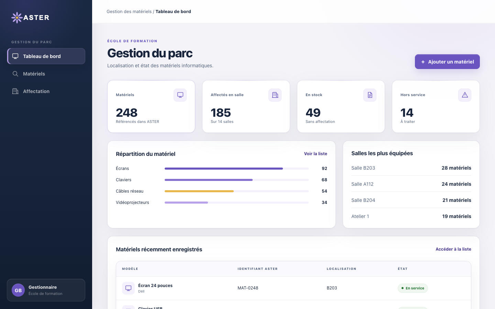
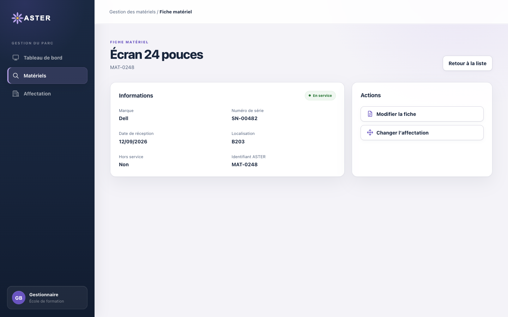

# Fiche descriptive — Administrateur

<!-- version:debut : généré par versions.py, ne pas modifier à la main -->
| Version | Mise à jour | Destination | Dernière évolution | Historique |
| --- | --- | --- | --- | --- |
| 2.1 | 13/11/2026 | Production destinée à la remise | Remplacer « masterisation » et « réinstallation » par « réinitialisation » (réinstallation du système par réapplication d’une image) | [7 versions](../archive/README.md#15-fiche-descriptive-administrateur) |
<!-- version:fin -->

- **Statut :** établie à partir des décisions en vigueur.
- **Profil :** administrateur.
- **Rattachement :** une école.
- **Périmètre :** toutes les données et fonctionnalités de son école.
- **Finalité :** administrer le parc, les salles, les postes, la supervision, les remontées et les comptes de son école.

## Périmètre fonctionnel

| Domaine | Capacités |
| --- | --- |
| Parc matériel | Toutes les actions, y compris l'import JSON et la suppression d'un ou plusieurs matériels |
| Salles | Créer, modifier et supprimer une salle ; ajouter, renuméroter ou supprimer un étage vide d'un bâtiment |
| Administration des postes | Consulter les postes, leur état et leurs applications ; installer ou désinstaller une application sur un poste ou une salle ; demander la réinitialisation d'un ou plusieurs postes ; suivre les demandes d'intervention |
| Supervision | Consulter les postes et processus de toutes les salles, arrêter un processus utilisateur, gérer les règles d'école, de bâtiment et de salle, consulter les détections, recevoir une notification de processus blacklisté et consulter les statistiques |
| Remontées | Créer une remontée et suivre les siennes ; prendre en charge une remontée (« en cours ») puis la terminer en « remplacé » ou « corrigé » ; consulter, télécharger et imprimer tous les PDF ; consulter le tableau de bord des remontées |
| Tableaux de bord | Consulter son tableau de bord personnel, qu'il peut composer, ainsi que les tableaux de bord du parc et des remontées |
| Comptes ORION | Créer, modifier, désactiver et réactiver les comptes rattachés à son école |
| Notifications | Évolution de ses propres remontées, fin des interventions qu’il a lancées, lancement d’applications interdites |

Les droits détaillés sont consolidés dans la [matrice des droits](12-MATRICE-DROITS.md).

## UC-ADMIN-01 — Administrer le parc matériel

- **Objectif :** maintenir l'inventaire de l'école, y compris lorsque la suppression d'un matériel est nécessaire.
- **Déclencheur :** un matériel doit être créé, retrouvé, modifié, affecté, déplacé, importé ou supprimé.
- **Préconditions :** l'administrateur est authentifié ; les données concernées appartiennent à son école.

### Scénario nominal

1. L'administrateur recherche ou ouvre un matériel.
2. Il crée ou modifie sa fiche conformément aux données obligatoires.
3. ORION attribue l'identifiant interne lors d'une création.
4. L'administrateur affecte ou déplace un ou plusieurs matériels vers une salle ou le stock si nécessaire.
5. ORION applique immédiatement l'opération autorisée.

### Variantes et limites

- L'administrateur peut importer de nouveaux matériels en JSON ; les données sont appliquées immédiatement sans validation métier préalable, et un fichier comportant une ligne invalide est refusé en entier.
- Il peut supprimer un ou plusieurs matériels ; un matériel cité par une remontée ne peut pas être supprimé (RG-73).
- Un matériel reste en stock sans localisation ou est affecté au maximum à une salle de son école.
- Il renseigne la date de fin de garantie et consulte l'état des garanties.

### Questions ouvertes

- Contrôle des doublons de numéro de série.
- Journalisation éventuelle des opérations sur le parc.

### Règles applicables

RG-03 à RG-10, RG-15, RG-25 à RG-29, RG-69, RG-72 et RG-73.

## UC-ADMIN-02 — Administrer les applications d'un poste ou d'une salle

- **Objectif :** consulter les applications installées et déclencher leur installation ou leur désinstallation.
- **Déclencheur :** l'administrateur sélectionne un poste, une salle ou une application de son école.
- **Préconditions :** la cible appartient à son école ; la solution d’administration à distance est disponible et autorisée.

### Scénario nominal

1. L'administrateur ouvre un poste, ou une application du catalogue (nom, éditeur, version, nombre de postes équipés).
2. ORION présente les applications installées, remontées par les postes.
3. Il choisit l'installation ou la désinstallation et la cible : un poste ou une salle entière.
4. ORION enregistre la demande d'intervention ; chaque poste cible l'exécute et renvoie son résultat.
5. L'administrateur suit la demande : en attente des postes, en cours, terminée ou en échec avec le nombre de postes concernés.

### Variantes et limites

- La cible peut être un poste ou l'ensemble des postes d'une salle.
- Une demande d'intervention ne peut pas être supprimée ; son suivi est mis à jour par les postes.

### Questions ouvertes

- Solution d’administration à distance, protocole, compte technique et gestion des secrets.
- Origine, validation et version des paquets ; gestion du catalogue des applications.
- Reprise d'une intervention en échec.

### Règles applicables

RG-15, RG-25, RG-65 et RG-69.

## UC-ADMIN-03 — Réinitialiser un poste ou une salle

- **Objectif :** demander depuis ORION la réapplication d'une image système.
- **Déclencheur :** l'administrateur sélectionne un ou plusieurs postes, ou une salle, à replaquer.
- **Préconditions :** les postes appartiennent à son école ; un mécanisme de déploiement est disponible et autorisé.

### Scénario nominal

1. L'administrateur sélectionne un ou plusieurs postes, éventuellement tous ceux d'une salle.
2. Il demande leur réinitialisation et confirme.
3. ORION enregistre la demande avec l'image de référence ; chaque poste l'exécute et renvoie son résultat.
4. L'administrateur suit l'avancement poste par poste.

### Variantes et limites

- La cible peut être une partie des postes d'une salle ou la salle entière.
- ORION ne développe pas son propre moteur d'image.
- L'annulation et l'interruption ne sont pas demandées dans ORION.

### Questions ouvertes

- Outil existant et interface d'automatisation.
- Images de référence, sélection de l'image et données locales.
- Planification, reprise et capacité simultanée.

### Règles applicables

RG-15, RG-22, RG-25, RG-30 et RG-69.

## UC-ADMIN-04 — Superviser les postes et gérer les règles de processus

- **Objectif :** superviser les postes de l'école, intervenir sur les processus utilisateur et définir les règles de classement.
- **Déclencheur :** l'administrateur ouvre une salle, les détections, la gestion des listes ou les statistiques.
- **Préconditions :** les postes sont connus dans ORION ; la solution d’administration à distance est disponible.

### Scénario nominal

1. L'administrateur sélectionne une salle et consulte l'état de ses postes.
2. ORION présente les processus utilisateur et les actualise en quelques secondes.
3. L'administrateur peut demander l'arrêt manuel d'un processus utilisateur affiché.
4. Il peut créer, modifier ou supprimer une entrée de whitelist ou de blacklist dans les portées école, bâtiment ou salle ; les règles globales lui sont présentées sans modification.
5. ORION applique les règles cumulées et arrête automatiquement un processus blacklisté.
6. ORION enregistre la détection et conserve l'historique confirmé.
7. L'administrateur consulte les détections de toutes les salles et les statistiques d'utilisation.
8. Il reçoit une notification dans ORION pour chaque processus blacklisté détecté.

### Variantes et limites

- Les processus système ne sont pas proposés comme cible d'un arrêt manuel.
- La blacklist est prioritaire et une interdiction héritée ne peut pas être annulée localement.
- Après trente secondes sans remontée, un poste est déconnecté et reste visible sans processus.
- Les statistiques présentent les postes connectés, les processus utilisateur actifs, les détections conservées et le classement des processus les plus détectés.

### Questions ouvertes

- Solution d’administration à distance, flux et sécurisation.
- Périodes, filtres et exports statistiques.
- Statuts, traitement et durée de conservation des détections et historiques.

### Règles applicables

RG-15, RG-31 à RG-33, RG-40 à RG-58, RG-68 et RG-69.

## UC-ADMIN-05 — Créer, consulter et traiter les remontées

- **Objectif :** déclarer un problème, consulter les états des lieux et intervenir dans le traitement.
- **Déclencheur :** l'administrateur crée ou ouvre une remontée de son école.
- **Préconditions :** l'administrateur est authentifié ; les matériels concernés appartiennent à son périmètre.

### Scénario nominal

1. L'administrateur sélectionne un ou plusieurs matériels, choisit le type de problème (obligatoire) et saisit la description.
2. ORION enregistre la remontée « en attente ».
3. L'administrateur consulte, télécharge ou imprime le PDF d'état des lieux, qu'ORION génère à chaque demande avec les informations actuelles de la remontée.
4. Il peut traiter la remontée : prise en charge (« en cours »), puis fin du traitement en « remplacé » ou « corrigé » ; une remontée terminée ne change plus de statut.
5. ORION enregistre le statut commun à toute la remontée.

### Variantes et limites

- L'administrateur peut consulter et télécharger tous les PDF de son école.
- Il suit ses propres remontées dans un espace dédié.
- Il peut consulter le tableau de bord des remontées.
- Il est notifié de l’évolution des remontées qu’il a créées, pas des remontées créées par d’autres.

### Questions ouvertes

- Qualification, affectation et délais.
- Signature du PDF.

### Règles applicables

RG-11 à RG-15, RG-21, RG-23 à RG-25, RG-34 à RG-39, RG-64, RG-69 et RG-73.

## UC-ADMIN-06 — Gérer les comptes ORION de l'école

- **Objectif :** créer et maintenir les comptes rattachés à l'école de l'administrateur.
- **Déclencheur :** un compte doit être créé, modifié, désactivé ou réactivé.
- **Préconditions :** l'administrateur est authentifié ; le compte appartient à son école.

### Scénario nominal

1. L'administrateur renseigne le nom et l'adresse électronique du compte, unique dans ORION.
2. Il attribue exactement un profil parmi administrateur, gestionnaire et formateur.
3. ORION rattache le compte à son école et l'enregistre ; le compte est rapproché de l'identité MindefConnect lors de la connexion.

### Variantes et limites

- L'administrateur peut modifier, désactiver ou réactiver un compte de son école.
- Il ne peut ni modifier son propre profil ni désactiver son propre compte.
- Il ne gère pas les comptes super administrateur.
- Un compte se désactive ; il n'est pas supprimé.

### Questions ouvertes

- Modalités d’intégration à MindefConnect (cadrage § 18).
- Sessions actives et revue des droits.
- Traçabilité des opérations sur les comptes.

### Règles applicables

RG-01, RG-15, RG-60, RG-62 et RG-69 à RG-71.

## UC-ADMIN-07 — Gérer les salles et les étages

- **Objectif :** tenir à jour les salles de l'école par bâtiment et par étage.
- **Déclencheur :** une salle ou un étage doit être créé, modifié ou supprimé.
- **Préconditions :** l'administrateur est authentifié ; la salle ou l'étage appartient à son école.

### Scénario nominal

1. L'administrateur ouvre les salles d'un bâtiment.
2. Il crée ou modifie une salle : nom, bâtiment existant ou nouveau, étage.
3. ORION enregistre la salle dans son école.

### Variantes et limites

- Une salle qui accueille des postes supervisés ne peut pas être supprimée.
- À la suppression d'une salle, ses matériels passent en stock.
- Un étage peut exister sans salle ; un étage sans salle peut être ajouté, renuméroté ou supprimé.
- Le rattachement d'une salle à une école ne peut pas être modifié.

### Règles applicables

RG-02, RG-15, RG-61 et RG-69.

## IHM issues de la maquette

Les maquettes ci-dessous illustrent le volet de gestion du parc commun à l’administrateur et au gestionnaire.

### Tableau de bord du parc

### Fiche matériel

Les autres écrans disponibles sont présentés dans la [fiche Gestionnaire](13-FICHE-DESCRIPTIVE-GESTIONNAIRE.md#ihm-issues-de-la-maquette).

## Besoins en interface

- Tous les écrans du parc, avec suppression réservée aux profils administrateurs.
- Gestion des salles et des étages depuis la vue des bâtiments.
- Sélection d'un ou plusieurs postes, ou d'une salle, pour l'administration distante.
- Consultation des applications, installation, désinstallation, réinitialisation et suivi des demandes d'intervention.
- Supervision des postes et processus, gestion des listes, détections et statistiques.
- Création, consultation et traitement des remontées avec accès aux PDF.
- Gestion des comptes limitée à l'école.
- Affichage des notifications dans ORION.
- Aucun écran ne doit laisser penser que l'administrateur possède un périmètre global sur toutes les écoles.

## Contraintes transversales

- Application web utilisée avec les versions de Firefox installées sur les postes de l'équipe.
- Réseau interne NP disposant d'un accès à Internet.
- Authentification via MindefConnect ; modalités d’intégration à préciser (cadrage § 18).
- Un seul profil par utilisateur.

## Sources

[Consignes du projet](01-CONSIGNES.md), [cadrage consolidé](02-CADRAGE.md), [règles de gestion](04-REGLES-DE-GESTION.md), [DCU — Gestion du parc](08-DCU-GESTION-PARC.md), [DCU — Administration des postes](09-DCU-ADMINISTRATION-POSTES.md), [DCU — Supervision des postes](10-DCU-SUPERVISION-POSTES.md), [DCU — Remontées utilisateur](11-DCU-REMONTEES-UTILISATEUR.md) et [matrice des droits](12-MATRICE-DROITS.md).
