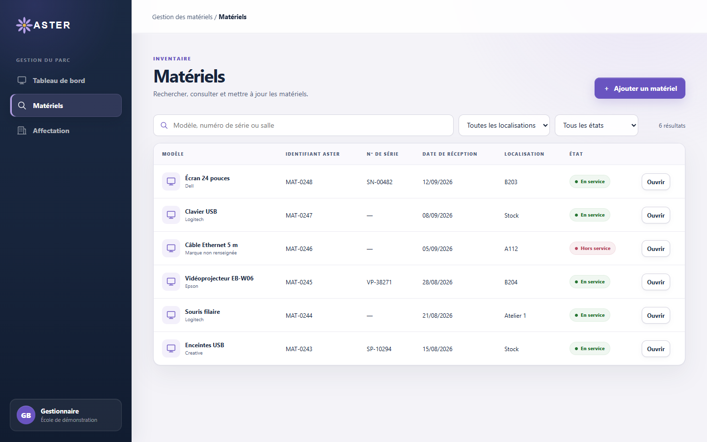

# Fiche descriptive — Super administrateur

<!-- version:debut : généré par versions.py, ne pas modifier à la main -->
| Version | Mise à jour | Destination | Dernière évolution | Historique |
| --- | --- | --- | --- | --- |
| 2.0 | 13/11/2026 | Production destinée à la remise | Prise en charge « en cours » puis « remplacé » ou « corrigé » par le gestionnaire ; remontées et notifications des administrateurs ; type de problème obligatoire | [6 versions](../archive/README.md#16-fiche-descriptive-super-administrateur) |
<!-- version:fin -->

- **Statut :** établie à partir des décisions en vigueur.
- **Profil :** super administrateur.
- **Rattachement :** aucune école.
- **Périmètre :** toutes les écoles.
- **Finalité :** exercer à l'échelle globale les droits fonctionnels de l'administrateur, gérer les écoles et les règles globales.

## Différence avec l'administrateur

Le super administrateur possède les mêmes capacités que l'administrateur, sur toutes les écoles. Il dispose en outre de capacités propres au périmètre global : choix de l'école affichée, gestion des écoles, gestion des règles globales de processus et gestion des comptes super administrateur.

Afin d'éviter de dupliquer les scénarios, les parcours fonctionnels détaillés sont décrits dans la [fiche Administrateur](15-FICHE-DESCRIPTIVE-ADMINISTRATEUR.md). Ils s'appliquent au super administrateur avec les adaptations de périmètre ci-dessous.

## Périmètre fonctionnel

| Domaine | Capacités globales |
| --- | --- |
| Écoles | Choisir l'école affichée ou toutes les écoles ; créer et renommer une école |
| Parc matériel | Toutes les actions sur les matériels de toutes les écoles, y compris suppression et import JSON |
| Salles | Gestion des salles et des étages de toutes les écoles |
| Administration des postes | Consultation des applications, installation, désinstallation, réinstallation et suivi des demandes d'intervention sur les postes ou salles accessibles |
| Supervision | Consultation et arrêt des processus utilisateur, détections, notifications de processus blacklisté et statistiques |
| Règles de processus | Gérer les règles globales en plus des règles d'école, de bâtiment et de salle |
| Remontées | Création et traitement ; consultation et téléchargement de tous les PDF ; tableau de bord |
| Comptes ORION | Création, modification, désactivation et réactivation des comptes de toutes les écoles, y compris des comptes super administrateur |
| Notifications | Comme l’administrateur : évolution de ses propres remontées, fin des interventions qu’il a lancées, lancement d’applications interdites |

## Adaptation des parcours administrateur

### Écoles

Le super administrateur choisit l'école affichée, ou toutes les écoles, depuis la barre supérieure ; ce choix est conservé pour ses connexions suivantes. Il crée et renomme les écoles ; la suppression d'une école n'est pas proposée.

### Parc matériel

Les opérations de [UC-ADMIN-01](15-FICHE-DESCRIPTIVE-ADMINISTRATEUR.md#uc-admin-01--administrer-le-parc-matériel) portent sur les matériels de toutes les écoles. L'interface doit permettre d'identifier l'école avant d'agir et d'éviter toute ambiguïté sur le périmètre de l'opération. Une affectation groupée porte sur des matériels d'une même école, et un import JSON est rattaché à l'école choisie.

### Salles

Le parcours [UC-ADMIN-07](15-FICHE-DESCRIPTIVE-ADMINISTRATEUR.md#uc-admin-07--gérer-les-salles-et-les-étages) s'applique aux salles et aux étages de toutes les écoles.

### Administration des postes

Les opérations de [UC-ADMIN-02](15-FICHE-DESCRIPTIVE-ADMINISTRATEUR.md#uc-admin-02--administrer-les-applications-dun-poste-ou-dune-salle) et [UC-ADMIN-03](15-FICHE-DESCRIPTIVE-ADMINISTRATEUR.md#uc-admin-03--réinstaller-un-poste-ou-une-salle) s'appliquent aux postes et salles de toutes les écoles. Une demande d'intervention concerne des postes d'une seule école.

### Supervision

Le parcours [UC-ADMIN-04](15-FICHE-DESCRIPTIVE-ADMINISTRATEUR.md#uc-admin-04--superviser-les-postes-et-gérer-les-règles-de-processus) couvre toutes les écoles. Le super administrateur est seul à gérer les règles globales ; il gère aussi celles portant sur une école, un bâtiment ou une salle.

### Remontées

Le parcours [UC-ADMIN-05](15-FICHE-DESCRIPTIVE-ADMINISTRATEUR.md#uc-admin-05--créer-consulter-et-traiter-les-remontées) permet de consulter et télécharger les PDF de toutes les écoles et de traiter les remontées accessibles. Une remontée réunit des matériels d'une seule école. Le super administrateur ne reçoit pas de notification liée aux remontées.

### Comptes ORION

Le parcours [UC-ADMIN-06](15-FICHE-DESCRIPTIVE-ADMINISTRATEUR.md#uc-admin-06--gérer-les-comptes-orion-de-lécole) est étendu aux comptes de toutes les écoles. Seul le super administrateur peut attribuer le profil super administrateur ; un compte super administrateur n'est rattaché à aucune école. Il ne peut pas modifier son propre profil ni désactiver son propre compte.

## Questions ouvertes propres au périmètre global

- Filtres et indicateurs attendus au niveau global.
- Possibilité de comparer les écoles ou d'agréger leurs statistiques.
- Traçabilité des opérations globales sensibles.

## IHM issues de la maquette

La maquette ci-dessous illustre le parcours de gestion du parc d’une école, commun à l’administrateur et au super administrateur. Le super administrateur sélectionne l’école sur laquelle il intervient et dispose d’un périmètre global.

Le parcours complet du parc est présenté dans la [fiche Gestionnaire](13-FICHE-DESCRIPTIVE-GESTIONNAIRE.md#ihm-issues-de-la-maquette).

## Besoins en interface

- Sélecteur de l'école affichée, avec le choix de toutes les écoles.
- Identification visible de l'école sur les listes, fiches, salles, postes et remontées.
- Confirmation du périmètre avant une opération distante ou groupée.
- Accès aux écrans de l'administrateur avec filtres globaux adaptés.
- Gestion des écoles et des règles globales.
- Gestion des comptes de toutes les écoles sans rattacher le super administrateur à une école.

## Contraintes transversales

- Application web utilisée avec les versions de Firefox installées sur les postes de l'équipe.
- Réseau interne NP disposant d'un accès à Internet.
- Authentification via MindefConnect ; modalités d’intégration à préciser (cadrage § 18).
- Un seul profil par utilisateur.

## Règles applicables

RG-01, RG-15, RG-47, RG-60, RG-62 et RG-69 à RG-72, complétées par toutes les règles applicables aux parcours de l'administrateur.

## Sources

[Cadrage §§ 2, 3 et 18](02-CADRAGE.md), [règles de gestion](04-REGLES-DE-GESTION.md), [fiche Administrateur](15-FICHE-DESCRIPTIVE-ADMINISTRATEUR.md), DCU [gestion du parc](08-DCU-GESTION-PARC.md), [administration des postes](09-DCU-ADMINISTRATION-POSTES.md), [supervision](10-DCU-SUPERVISION-POSTES.md) et [remontées utilisateur](11-DCU-REMONTEES-UTILISATEUR.md), ainsi que la [matrice des droits](12-MATRICE-DROITS.md).
