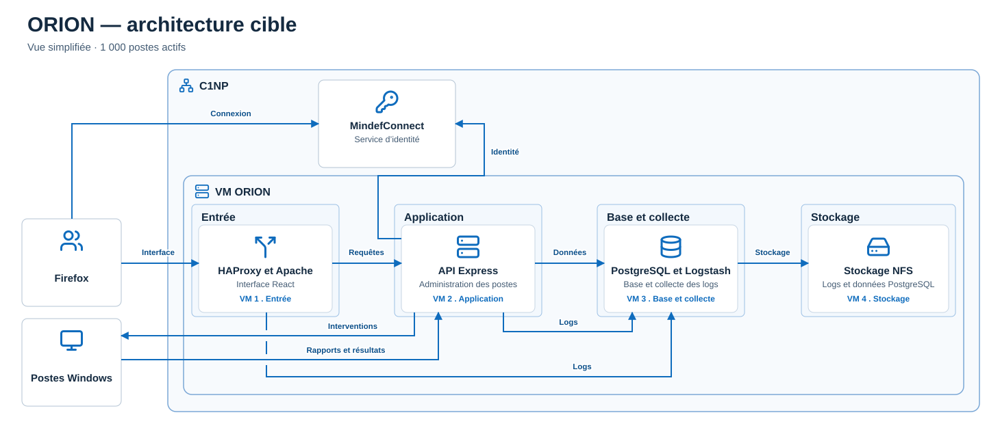
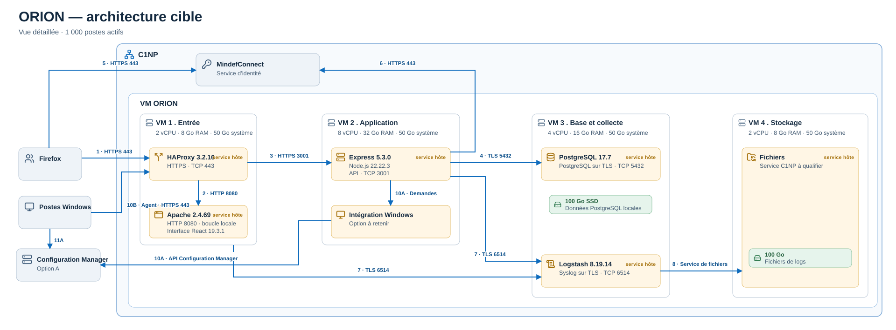

# Architecture réelle du démonstrateur

<!-- version:debut : généré par versions.py, ne pas modifier à la main -->
| Version | Mise à jour | Destination | Dernière évolution | Historique |
| --- | --- | --- | --- | --- |
| 1.3 | 13/11/2026 | Production destinée à la remise | Documenter la cible C1NP et unifier les vues | [4 versions](../archive/README.md#18-diagrammes-architecture) |
<!-- version:fin -->

## Vue simplifiée

## Architecture réelle sur VM

## Architecture cible sur le C1NP

### Vue simplifiée de la cible

### Vue détaillée de la cible

