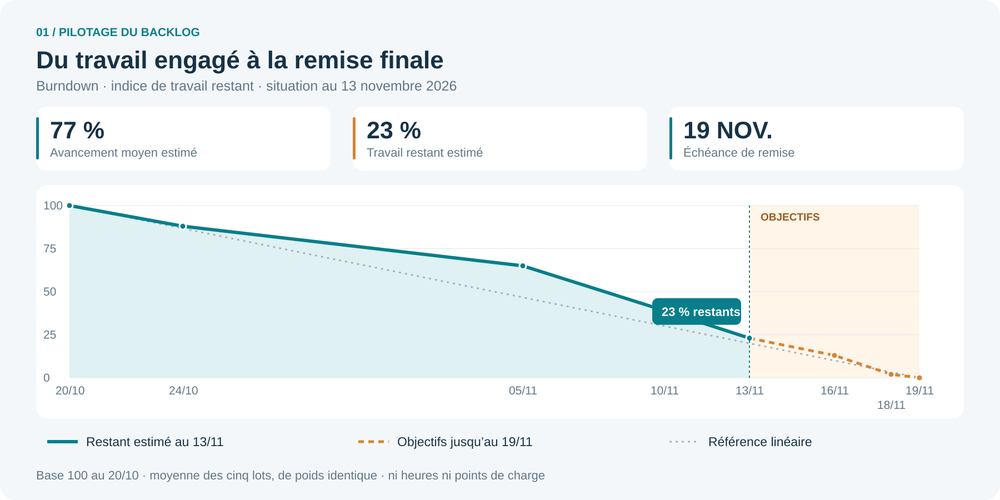
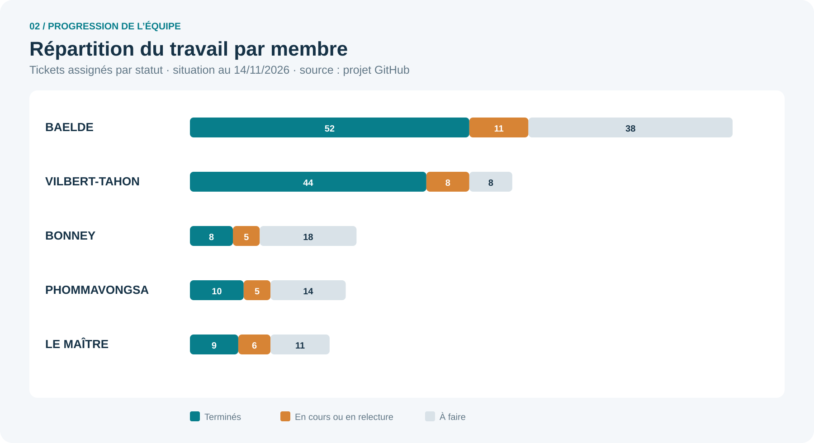

# ORION — Backlog et suivi du projet

<!-- version:debut : généré par versions.py, ne pas modifier à la main -->
| Version | Mise à jour | Destination | Dernière évolution | Historique |
| --- | --- | --- | --- | --- |
| 2.0 | 14/11/2026 | Production destinée à la remise | Deux sprints (19/10–08/11, 09/11–19/11), suivi dans le projet GitHub ORION et graphiques produits depuis GitHub | [3 versions](../archive/README.md#19-backlog-et-suivi-projet) |
<!-- version:fin -->

**Période : du 20 octobre au 19 novembre 2026.**

**Version préparée le 13 novembre 2026 — échéance de remise : 19 novembre 2026.**

Ce livrable présente l’organisation Agile de l’équipe, le backlog et le dispositif des cérémonies Scrum-XP pour préparer la remise du 19 novembre. Il répond au § 7.1 des [consignes du projet](01-CONSIGNES.md) : capture du besoin, dossier d’analyse, organisation collective, présentation et suivi du backlog, mise en place et traçabilité des cérémonies. Il constitue un support de gestion de projet, distinct des consignes de développement.

## 1. Objectif et périmètre

Le backlog organise le projet en vingt tâches : compréhension du besoin, conception, réalisation des parcours, vérification et préparation de la remise. Chaque tâche possède un responsable, un appui, un résultat attendu et une échéance. Le responsable coordonne la tâche ; l’appui contribue à la relecture et à la continuité du travail.

Le périmètre couvre la gestion du parc, les salles et affectations, la supervision, les interventions, les remontées et leurs états des lieux, les profils, l’architecture et les productions de conception. Les fonctionnalités encore ouvertes dans le cadrage ne sont pas considérées comme acquises : les propositions de scan QR et de suivi des commandes restent en dehors du périmètre de clôture présenté ici.

La connexion cible repose sur MindefConnect. Les choix d’outillage local, les comptes de test et les consignes de lancement ne font pas partie de ce livrable.

## 2. Organisation de l’équipe Agile

### 2.1. Responsabilités Scrum

L’organisation proposée repose sur une équipe unique de cinq membres, avec un objectif commun : présenter un parcours cohérent de gestion et de supervision du parc, accompagné d’un dossier d’analyse et d’architecture exploitable. La répartition ci-dessous précise les responsabilités de coordination ; elle ne crée pas de sous-équipes séparées.

| Responsabilité | Membre | Mission dans le projet |
| --- | --- | --- |
| Product Owner | BAELDE | Tenir le Product Backlog, ordonner les besoins et préparer les échanges avec le client en respectant ses décisions. |
| Scrum Master | LE MAÎTRE | Faciliter les événements, rendre les obstacles visibles et suivre les actions d’amélioration. |
| Developers | BAELDE, VILBERT-TAHON, BONNEY, PHOMMAVONGSA, LE MAÎTRE | Concevoir, réaliser, vérifier et documenter ensemble les incréments. Les responsabilités de Product Owner et de Scrum Master ne dispensent pas de contribuer à ces travaux. |
| Parties prenantes | Client et cadres évaluateurs | Le client apporte les décisions métier ; les cadres évaluateurs apprécient les productions suivant les consignes. |

Le Product Owner ordonne le backlog ; les Developers choisissent collectivement le travail réalisable pendant le sprint et son organisation. Le Scrum Master facilite cette coopération. Une modification du besoin reste reliée à sa source ; une cérémonie ne vaut pas décision client ni validation documentaire.

### 2.2. Répartition des domaines et entraide

| Membre | Domaine principal | Tâches pilotées | Contribution transversale |
| --- | --- | --- | --- |
| BAELDE | Intégration et cohérence d’ensemble | BL-01 à BL-04 | Besoin, données, connexion et coordination de la livraison |
| VILBERT-TAHON | Interface et parcours utilisateurs | BL-05 à BL-08 | Navigation, tableaux de bord, salles et cohérence visuelle |
| BONNEY | Modélisation et gestion du parc | BL-09 à BL-12 | Séquences, classes, inventaire et vérification des affectations |
| PHOMMAVONGSA | Cycles de vie et supervision | BL-13 à BL-16 | États, règles de supervision, interventions et recette des profils |
| LE MAÎTRE | Architecture et préparation de la remise | BL-17 à BL-20 | Architecture, flux, dossier technique et assemblage des livrables |

Les tâches n’ont pas toutes la même taille. Leur nombre décrit la répartition des responsabilités ; il ne mesure ni le temps consacré ni la contribution individuelle totale.

Le responsable d’un domaine coordonne le travail avec son appui, sans en avoir l’exclusivité. Une difficulté est rendue visible au point quotidien ; une personne disponible peut aider à lever un blocage avant de commencer une nouvelle tâche. La relecture est confiée à un autre membre que l’auteur.

## 3. Backlog de référence pour la remise

### 3.1. Product Backlog : besoins et valeur attendue

Le Product Backlog décrit les résultats utiles aux utilisateurs. Il est ordonné selon la valeur métier et les dépendances. Les identifiants PB ci-dessous regroupent les tâches BL ; ils sont propres au présent document.

| Ordre | ID | Besoin utilisateur | Résultat observable attendu | Tâches liées |
| --- | --- | --- | --- | --- |
| 1 | PB-01 | En tant qu’utilisateur, accéder à un espace adapté à mon profil. | Connexion cible MindefConnect et accès conformes à la matrice des droits. | BL-01, BL-03, BL-05, BL-16 |
| 2 | PB-02 | En tant que gestionnaire, retrouver un matériel et sa localisation. | Inventaire consultable et matériel retrouvé dans son affectation. | BL-02, BL-07, BL-10, BL-11 |
| 3 | PB-03 | En tant que gestionnaire, organiser le stock et les salles. | Affectations et déplacements lisibles et cohérents avec les droits. | BL-07, BL-09, BL-11 |
| 4 | PB-04 | En tant qu’utilisateur autorisé, créer et suivre une remontée. | Remontée suivie et état des lieux consultable selon les droits en vigueur. | BL-09, BL-13, BL-15, BL-16 |
| 5 | PB-05 | En tant qu’administrateur, demander une intervention et en suivre le résultat. | Demande, exécution par le poste et résultat distingués dans le suivi. | BL-03, BL-13, BL-15 |
| 6 | PB-06 | En tant que formateur, superviser les processus dans mon périmètre. | Processus consultables et règles examinées selon les droits applicables. | BL-06, BL-14, BL-16 |
| 7 | PB-07 | En tant qu’utilisateur, disposer d’une vue de synthèse utile à mon activité. | Tableau de bord lisible et adapté au profil, avec les indicateurs définis au cadrage. | BL-06, BL-08, BL-16 |
| 8 | PB-08 | En tant que lecteur du dossier, comprendre le besoin, la conception et l’architecture. | Productions cohérentes, références accessibles et réserves identifiées. | BL-01, BL-02, BL-10, BL-12, BL-17, BL-18 |
| 9 | PB-09 | En tant qu’évaluateur, suivre la démarche et examiner la version remise. | Backlog présenté, traces des cérémonies disponibles et remise identifiée. | BL-04, BL-19, BL-20 |

Les critères sont précisés par les règles et les droits en vigueur. Les questions encore ouvertes ne sont pas transformées en engagements de réalisation.

### 3.2. Tâches de réalisation et de préparation

Les priorités organisent la préparation de l’échéance : **P1** pour les parcours et productions essentiels, **P2** pour leur consolidation et leur présentation. Les critères ci-dessous définissent le résultat attendu pour chaque tâche.

| ID | Tâche | Responsable | Appui | Priorité | Période prévue | Résultat attendu à la clôture |
| --- | --- | --- | --- | --- | --- | --- |
| BL-01 | Structurer le besoin et les profils | BAELDE | BONNEY | P1 | 20/10–03/11 | Périmètre et responsabilités présentés sans confondre décisions et questions ouvertes. |
| BL-02 | Consolider le modèle de données | BAELDE | BONNEY | P1 | 02/11–09/11 | MCD, vocabulaire et règles relus ensemble ; écarts identifiés. |
| BL-03 | Intégrer la connexion et les droits | BAELDE | PHOMMAVONGSA | P1 | 06/11–16/11 | Parcours de connexion et accès par profil couverts par les vérifications prévues. |
| BL-04 | Préparer la livraison d’ensemble | BAELDE | LE MAÎTRE | P1 | 11/11–19/11 | Version de remise identifiée, contrôle collectif et réserves consignés. |
| BL-05 | Organiser la navigation des écrans | VILBERT-TAHON | BAELDE | P1 | 06/11–10/11 | Écrans accessibles par leur parcours et leur adresse ; navigation cohérente. |
| BL-06 | Construire les tableaux de bord | VILBERT-TAHON | PHOMMAVONGSA | P2 | 09/11–16/11 | Informations utiles au profil, tableaux et graphiques lisibles. |
| BL-07 | Finaliser les vues salles et stock | VILBERT-TAHON | BONNEY | P1 | 09/11–16/11 | Salles lisibles et ordonnées ; stock et affectations compréhensibles. |
| BL-08 | Harmoniser l’interface et les captures | VILBERT-TAHON | LE MAÎTRE | P2 | 10/11–18/11 | Libellés, tableaux et captures cohérents avec le parcours cible. |
| BL-09 | Décrire les échanges en séquences | BONNEY | BAELDE | P1 | 03/11–13/11 | Échanges des principaux parcours représentés et reliés aux cas concernés. |
| BL-10 | Consolider les classes métier | BONNEY | LE MAÎTRE | P1 | 05/11–16/11 | Responsabilités des classes et relations cohérentes avec les données décrites. |
| BL-11 | Vérifier la gestion de l’inventaire | BONNEY | VILBERT-TAHON | P1 | 10/11–17/11 | Création, consultation et affectation couvertes ; écart sur l’import distingué de la demande client. |
| BL-12 | Relire le dossier de conception | BONNEY | PHOMMAVONGSA | P2 | 13/11–18/11 | Modèles, droits et fiches cohérents ; ressources de remise sélectionnées. |
| BL-13 | Formaliser les cycles de vie | PHOMMAVONGSA | BONNEY | P1 | 05/11–13/11 | États des remontées et interventions représentés, transitions relues. |
| BL-14 | Vérifier la supervision des postes | PHOMMAVONGSA | VILBERT-TAHON | P1 | 10/11–16/11 | Consultation des processus et règles examinées avec les droits attendus. |
| BL-15 | Vérifier interventions et remontées | PHOMMAVONGSA | BAELDE | P1 | 12/11–17/11 | Demande, retour du poste, suivi et consultation du PDF couverts par les scénarios. |
| BL-16 | Coordonner la recette par profil | PHOMMAVONGSA | LE MAÎTRE | P1 | 13/11–18/11 | Scénarios par profil, résultats et réserves rassemblés. |
| BL-17 | Décrire l’architecture et les flux | LE MAÎTRE | BAELDE | P1 | 03/11–13/11 | Architecture réelle et cible distinguées, flux et composants décrits. |
| BL-18 | Relire le dossier technique | LE MAÎTRE | BONNEY | P1 | 12/11–17/11 | Texte, schémas et contraintes concordants ; hypothèses de capacité explicites. |
| BL-19 | Préparer le support et la présentation | LE MAÎTRE | VILBERT-TAHON | P2 | 13/11–18/11 | Support cohérent avec le dossier et passages répartis entre les cinq membres. |
| BL-20 | Assembler le dossier de remise | LE MAÎTRE | PHOMMAVONGSA | P1 | 16/11–19/11 | Livrables et ressources nécessaires réunis, liens contrôlés et réserves explicites. |

## 4. Sprints et cérémonies Scrum

### 4.1. Découpage et objectifs

Le projet s’est déroulé en deux sprints : le premier, du 19 octobre au 8 novembre, inclut le lancement ; le second, du 9 au 19 novembre, se termine par la remise. Les tâches peuvent être poursuivies d’un sprint à l’autre ; un élément inachevé est réexaminé lors de la planification suivante. Les dates décrivent le cadre d’organisation retenu pour la présentation, pas un registre de réunions effectivement tenues.

| Période | Objectif | Sélection du backlog | Résultat à inspecter |
| --- | --- | --- | --- |
| Sprint 1 — 19 octobre au 8 novembre | Comprendre le problème, préparer le travail, puis construire une première traversée de la connexion vers la consultation du parc. | Capture du besoin, acteurs, premières règles (BL-01, BL-02, BL-17), puis PB-01 et PB-02 avec les tâches de conception et d’intégration utiles à ce parcours. | Parcours inspectable, premières données et modèles associés ; travaux restants réévalués. |
| Sprint 2 — 9 au 19 novembre | Compléter les parcours prioritaires et consolider la version de remise. | Compléments PB-01/PB-02, PB-03 à PB-07 et préparation documentaire PB-08/PB-09, selon la capacité. | Parcours intégrés, résultats de vérification, dossier et réserves. |
| Remise — 19 novembre, fin du sprint 2 | Présenter le résultat et la démarche. | PB-08 et PB-09 ; clôture BL-04 et BL-20. | Version remise, présentation et limites identifiées. |

### 4.2. Cérémonies et modalités de mise en place

Les durées ci-dessous sont choisies pour ce projet court. Le refinement est une activité régulière de préparation du backlog, distincte des événements formels Scrum.

| Événement ou activité | Cadence et durée | Participants et facilitation | Déroulement | Trace attendue |
| --- | --- | --- | --- | --- |
| Sprint Planning | Début de sprint ; 45 minutes | Toute l’équipe ; facilitation LE MAÎTRE | BAELDE rappelle les priorités ; les Developers définissent l’objectif, choisissent les éléments et découpent le travail. | Objectif de sprint, sélection PB/BL, répartition initiale et dépendances. |
| Daily Scrum | Chaque jour travaillé du sprint ; 15 minutes à 9 h | Developers ; facilitation initiale LE MAÎTRE | Examiner la progression vers l’objectif, les blocages et les adaptations du plan. Les discussions détaillées suivent avec les seuls intéressés. | Tableau actualisé et action datée pour chaque obstacle. |
| Refinement | Milieu de sprint ; 30 minutes | BAELDE et Developers concernés | Clarifier les besoins, critères, dépendances et taille des éléments ; préparer la prochaine sélection. | Backlog ordonné et éléments suffisamment précis pour être sélectionnés. |
| Sprint Review | Fin de sprint ; 45 minutes | Équipe ; client invité selon sa disponibilité | Montrer le résultat utilisable, examiner les écarts et adapter les priorités. Une remise documentaire n’attend pas une validation client. | Résultats montrés, retours recueillis et suites reliées au backlog. |
| Sprint Retrospective | Après la Review ; 30 minutes | Toute l’équipe ; facilitation LE MAÎTRE | Examiner ce qui aide ou freine le groupe ; retenir une amélioration concrète et son responsable. | Action d’amélioration, responsable, échéance et vérification au point suivant. |

### 4.3. Calendrier de référence

| Rendez-vous | Sprint 1 | Sprint 2 | Préparation et sortie |
| --- | --- | --- | --- |
| Planning | 20 octobre, 9 h–9 h 45 | 9 novembre, 9 h–9 h 45 | Objectif et Sprint Backlog disponibles à la sortie. |
| Daily Scrum | Chaque jour travaillé, hors créneau de Planning | Chaque jour travaillé, hors créneau de Planning | 9 h–9 h 15 ; mise à jour du tableau avant ou pendant le point. |
| Refinement | 4 novembre, 14 h–14 h 30 | 13 novembre, 14 h–14 h 30 | Questions et critères préparés par BAELDE. |
| Review | 8 novembre, 14 h–14 h 45 | 18 novembre, 14 h–14 h 45 | Invitations à adapter aux disponibilités ; à défaut de client, revue interne sans lui attribuer de retour. |
| Retrospective | 8 novembre, 15 h–15 h 30 | 18 novembre, 15 h–15 h 30 | Une amélioration suivie pour la période suivante. |

### 4.4. Tableau de suivi et règles de clôture

Le tableau de travail utilise les états **Backlog** (à préparer), **Ready** (prêt), **In progress** (en cours), **In review** (à vérifier), **Done** (terminé) et **Archive** (terminé, retiré du tableau courant). Un obstacle est signalé sur la carte avec sa cause, la personne qui le suit et la prochaine action ; il n’est pas masqué par un pourcentage. Une personne termine ou aide à vérifier une tâche engagée avant de multiplier les travaux simultanés.

Un besoin est sélectionnable quand sa valeur, ses critères, sa source et ses dépendances sont compréhensibles. La **Definition of Done** commune exige un résultat accessible, les critères applicables vérifiés, une relecture par un autre membre, les contrôles adaptés consignés et la documentation concernée mise à jour. Une tâche de planification peut être close quand son support est livré ; cela ne clôture pas automatiquement le besoin utilisateur associé.

La Sprint Review inspecte le résultat ; elle ne dispense pas de la Definition of Done. Les réserves et les éléments inachevés restent visibles dans le backlog. Aucun résultat de test n’est annoncé sans exécution et trace correspondantes.

### 4.5. Pratiques XP associées

| Pratique | Application prévue | Trace utile |
| --- | --- | --- |
| Travail en binôme | Responsable et appui traitent ensemble un point risqué ou un blocage. | Sujet, membres concernés, résultat et référence à la tâche. |
| Petits changements intégrés | Fractionner les modifications en ensembles cohérents et relisibles. | Commits et relectures reliés aux tâches. |
| Vérification continue | Vérifier les critères du parcours et rejouer les contrôles adaptés aux modifications. | Résultats réellement exécutés et anomalies associées. |
| Conception simple et amélioration du code | Limiter les changements au besoin et factoriser le code modifié quand cela se justifie. | Relecture et justification des changements utiles. |
| Retour rapide sur le besoin | Soumettre les ambiguïtés au client et réordonner le backlog selon ses réponses. | Compte rendu daté et mise à jour du cadrage. |

Ces pratiques complètent les événements Scrum ; elles ne constituent pas des cérémonies supplémentaires. Leur mise en œuvre se constate dans les traces de travail, pas dans leur seule mention dans ce document.

### 4.6. Suivi dans le projet GitHub

Le backlog est tenu dans le projet GitHub [« ORION development »](https://github.com/users/bpierrelouis/projects/2) : une épopée par type de travail (pilotage, capture des besoins, analyse, conception, architecture, design et IHM, réalisation par domaine, recette, présentation et remise, feuille de route) et ses tâches, chacune avec ses responsables, son statut, sa priorité (P0 à P2), son sprint et ses dates de début et de fin. Chaque ticket cite la tâche BL ou le point du backlog technique qu’il réalise, ainsi que les commits correspondants. Les graphiques suivants sont produits depuis ce projet.

## 5. Jalons et évolution du travail

| Jalon | Orientation | Progression du travail | Résultat visé |
| --- | --- | --- | --- |
| 24 octobre | Comprendre le besoin | Recueillir les attentes, identifier les acteurs et poser les premiers parcours. | Base de cadrage et premières représentations. |
| 5 novembre | Détailler la conception | Préciser les données, droits, profils et échanges ; préparer la présentation du projet. | Ensemble de conception utilisable pour organiser les parcours. |
| 10 novembre | Relier conception et parcours | Approfondir les écrans, tableaux, salles, remontées et cycles de vie. | Parcours cohérents et premières relectures croisées. |
| 13 novembre | Consolider | Répartir les dernières vérifications et préparer l’assemblage des productions. | Liste des points restant à traiter et responsabilités de clôture. |
| 16 novembre — prévision | Stabiliser les parcours essentiels | Terminer la revue de la connexion, des salles, des tableaux de bord et de la supervision. | Résultats des premières vérifications regroupés. |
| 18 novembre — prévision | Préparer la remise | Achever les relectures, réunir les captures et répéter la présentation. | Dossier préparé et réserves identifiées. |
| 19 novembre — prévision | Clôturer le périmètre de remise | Contrôler le contenu retenu et identifier la version remise. | Remise du dossier et présentation collective. |

## 6. Progression par membre

Les taux ci-dessous sont des estimations de progression du lot de chaque membre. Les colonnes datées après le 13 novembre indiquent les objectifs d’avancement. Une valeur de 100 % correspond à la clôture visée du lot de remise, avec ses réserves éventuelles.

| Membre | 24/10 | 05/11 | 10/11 | 13/11 | 16/11 prévu | 18/11 prévu | 19/11 prévu |
| --- | --- | --- | --- | --- | --- | --- | --- |
| BAELDE | 15 % | 40 % | 65 % | 80 % | 90 % | 95 % | 100 % |
| VILBERT-TAHON | 10 % | 30 % | 65 % | 80 % | 90 % | 100 % | 100 % |
| BONNEY | 15 % | 40 % | 60 % | 75 % | 85 % | 100 % | 100 % |
| PHOMMAVONGSA | 10 % | 30 % | 60 % | 75 % | 85 % | 100 % | 100 % |
| LE MAÎTRE | 10 % | 35 % | 55 % | 75 % | 85 % | 95 % | 100 % |

### BAELDE — du cadrage à l’intégration

La progression commence par la structuration du besoin et des droits, puis se concentre sur les données et la connexion. Une fois le socle disponible, le travail se déplace vers la cohérence entre les parcours et les règles. Entre le 13 et le 19 novembre, l’objectif est de traiter les derniers points d’intégration et de coordonner la version de remise. La progression finale est plus lente, car elle dépend des retours de recette des autres lots.

### VILBERT-TAHON — des écrans aux parcours harmonisés

La première phase prépare la navigation et la présentation des informations. La progression s’accélère avec les tableaux de bord et les vues salles et stock, qui rendent les parcours directement lisibles. La dernière période porte sur les ajustements d’interface et les captures. La clôture du lot est visée le 18 novembre pour laisser le dernier jour au contrôle collectif.

### BONNEY — des modèles à la vérification du parc

La conception des séquences et des classes structure la première partie du lot. Le travail se poursuit par une confrontation avec les parcours d’inventaire et d’affectation, puis par la relecture du dossier de conception. Du 13 au 18 novembre, la progression dépend de la résolution des écarts entre représentations, vocabulaire et règles. Le résultat attendu est un ensemble de modèles cohérents et sélectionnés pour la remise.

### PHOMMAVONGSA — des états à la recette métier

Les cycles de vie donnent d’abord une vue des étapes d’une remontée et d’une intervention. La supervision et le suivi des opérations permettent ensuite de construire des scénarios de vérification complets. La fin du lot est consacrée à la recette par profil : examiner les actions permises, les changements d’état et les résultats visibles. L’objectif du 18 novembre est de disposer d’une synthèse des vérifications et des réserves.

### LE MAÎTRE — de l’architecture à la remise

Le lot commence par la description des composants et des échanges, puis précise la distinction entre architecture réelle et architecture cible. La progression se poursuit avec la relecture des schémas et du dossier technique. Entre le 13 et le 19 novembre, l’effort se déplace vers le support de présentation, les liens et la sélection des productions. La clôture dépend de la disponibilité des contributions et résultats des quatre autres lots.

## 7. Plan de clôture du 14 au 19 novembre

| Date prévue | BAELDE | VILBERT-TAHON | BONNEY | PHOMMAVONGSA | LE MAÎTRE |
| --- | --- | --- | --- | --- | --- |
| 14/11 | Revoir connexion et droits | Revoir tableaux de bord | Relire classes et séquences | Préparer les scénarios par profil | Relire composants et flux |
| 15/11 | Examiner les points d’intégration | Ajuster salles et stock | Vérifier les parcours d’inventaire | Examiner les règles de supervision | Vérifier les schémas et références |
| 16/11 | Consolider les retours sur les accès | Stabiliser les parcours essentiels | Croiser modèles et affectations | Vérifier interventions et remontées | Préparer le plan du dossier |
| 17/11 | Participer à la recette croisée | Préparer les captures retenues | Finaliser la revue de l’inventaire | Rassembler les résultats métier | Finaliser la revue technique |
| 18/11 | Préparer la version à remettre | Finaliser interface et captures | Clôturer la relecture de conception | Clôturer la synthèse de recette | Assembler le support et organiser la répétition |
| 19/11 | Identifier la version remise | Contrôler le parcours présenté | Contrôler la présence des modèles | Présenter les vérifications et réserves | Contrôler le dossier et assurer la remise |

Le contrôle final et la présentation mobilisent les cinq membres. Une tâche non aboutie est accompagnée d’une réserve ; elle n’est pas déclarée réalisée par le seul effet de l’échéance.

## 8. Dépendances et points de vigilance

| Sujet | Conséquence sur le suivi | Traitement prévu |
| --- | --- | --- |
| Cohérence données, classes et règles | Une évolution peut affecter plusieurs représentations. | Relecture croisée BAELDE–BONNEY avant clôture de la conception. |
| États et affichage des interventions | Un écran seul ne suffit pas à décrire le résultat d’une opération. | Croisement des parcours VILBERT-TAHON–PHOMMAVONGSA avec les règles et retours des postes. |
| Architecture et dossier de remise | Les schémas doivent correspondre au périmètre qu’ils décrivent. | Relecture LE MAÎTRE–BAELDE et distinction explicite entre réel et cible. |
| Import JSON et notifications | Des écarts entre demande client et application sont consignés au cadrage. | Conserver ces écarts comme réserves tant qu’une réponse n’est pas recueillie. |
| Volumétrie et hébergement cible | Les hypothèses ne constituent pas des capacités mesurées. | Ne pas annoncer de dimensionnement confirmé dans la clôture du projet. |
| Dépendances entre les lots | La remise dépend de la disponibilité des modèles, captures et vérifications. | Regrouper les contributions le 18 novembre et réserver le 19 au contrôle final. |

## 9. Références et traçabilité

Les références suivantes retracent les travaux déposés dans le projet. Les estimations d’avancement et la répartition des responsabilités sont présentées séparément dans les tableaux de suivi.

| Domaine | Références historiques |
| --- | --- |
| Besoin et profils | [Cadrage initial — 288c524](https://github.com/bpierrelouis/aster/commit/288c524), [droits — f7310c1](https://github.com/bpierrelouis/aster/commit/f7310c1), [fiches — c757f41](https://github.com/bpierrelouis/aster/commit/c757f41) |
| Modélisation | [MCD — 23cb750](https://github.com/bpierrelouis/aster/commit/23cb750), [séquences — bde906a](https://github.com/bpierrelouis/aster/commit/bde906a), [classes — 31f7e5b](https://github.com/bpierrelouis/aster/commit/31f7e5b), [états — fcdc0b8](https://github.com/bpierrelouis/aster/commit/fcdc0b8) |
| Connexion et intégration | [Connexion — 55e41d4](https://github.com/bpierrelouis/aster/commit/55e41d4), [règles partagées — 59bcae8](https://github.com/bpierrelouis/aster/commit/59bcae8), [API — 660a1ca](https://github.com/bpierrelouis/aster/commit/660a1ca) |
| Parcours utilisateurs | [Tableaux de bord — d3b256d](https://github.com/bpierrelouis/aster/commit/d3b256d), [salles — dafc7e8](https://github.com/bpierrelouis/aster/commit/dafc7e8), [supervision — 22ada18](https://github.com/bpierrelouis/aster/commit/22ada18), [suivi — a1032c8](https://github.com/bpierrelouis/aster/commit/a1032c8) |
| Architecture | [Dossier initial — 51bd591](https://github.com/bpierrelouis/aster/commit/51bd591), [cible C1NP — f0c6dea](https://github.com/bpierrelouis/aster/commit/f0c6dea) |

Le projet GitHub [« ORION development »](https://github.com/users/bpierrelouis/projects/2) est la référence de tableau demandée pour le suivi (§ 4.6) : ses tickets reprennent les identifiants BL-01 à BL-20 de ce document et ceux du backlog technique.

## 10. Contenu attendu de la remise du 19 novembre

- Backlog, répartition des responsabilités et évolution des lots.
- Glossaire, règles de gestion, modèles, diagrammes, matrice des droits et fiches retenus pour la remise.
- Dossier d’architecture et ressources nécessaires à sa lecture.
- Synthèse des vérifications effectivement réalisées et des réserves restantes.
- Support de présentation et répartition des passages entre les cinq membres.

La clôture porte sur le périmètre remis. Les questions métier encore ouvertes et les évolutions ultérieures restent identifiables, sans être présentées comme décidées ou achevées.

## 11. Traçabilité et correspondance avec le § 7.1

L’organisation distingue les responsabilités, les événements et les artefacts selon le [Guide Scrum 2020, version française](https://scrumguides.org/docs/scrumguide/v2020/2020-Scrum-Guide-French.pdf). Les créneaux et durées du présent document sont adaptés au contexte du projet ; les pratiques XP complètent ce cadre.

### 11.1. Traces des cérémonies

Pour chaque cérémonie, conserver : type, sprint, date prévue, date effective, présents, objectif, éléments PB/BL examinés, décisions, obstacles et actions avec responsable et échéance. Une invitation ou une date de calendrier prouve une planification ; un compte rendu renseigné établit ce qui a effectivement été discuté. Les commits attestent des dépôts de travail, sans prouver la tenue d’une cérémonie.

| Trace | Contenu à renseigner | Utilité pour l’évaluation |
| --- | --- | --- |
| CR-PLAN-S1 et CR-PLAN-S2 | Objectif, sélection du backlog, capacité et dépendances. | Expliquer pourquoi le groupe a choisi ce travail. |
| Suivi quotidien | Date, adaptation du Sprint Backlog et action sur les obstacles. | Montrer l’ajustement collectif du plan. |
| CR-REV-S1 et CR-REV-S2 | Résultat montré, participants réels, retours et éléments à reprendre. | Relier les retours à l’évolution du backlog. |
| CR-RETRO-S1 et CR-RETRO-S2 | Constat, amélioration choisie, responsable et vérification. | Montrer comment le groupe améliore sa manière de travailler. |

Ces identifiants définissent les traces à constituer ; aucun compte rendu de cérémonie n’a été fourni avec les sources consultées. Le calendrier et les rôles présentés ne suffisent donc pas à attester une mise en œuvre passée.

### 11.2. Couverture des critères d’évaluation

| Attendu du § 7.1 | Présentation et référence | Pièce ou trace à présenter |
| --- | --- | --- |
| Capture initiale du besoin | Périmètre, PB-01 à PB-09 et décisions client. | [Cadrage](02-CADRAGE.md) et [entretiens datés](03-COMPTE-RENDU-ENTRETIENS.md), en sources internes de préparation. |
| Dossier d’analyse — DSE | PB-08 ; tâches de modèles, droits et relecture. | Productions sélectionnées au [sommaire](../README.md), assemblées pour la remise ; ce suivi ne remplace pas leur contenu. |
| Organisation en équipe Agile | § 2 : responsabilités, domaines et entraide. | Répartition, coordination et contributions présentées par les seuls noms de famille. |
| Présentation et suivi du backlog | § 3, § 5 à 8 et graphiques Word. | Product Backlog, tâches, estimations d’avancement, réserves et références Git. |
| Cérémonies Scrum-XP et leur traçabilité | § 4 et § 11.1. | Calendrier, modalités, pratiques XP et comptes rendus effectivement renseignés. |
