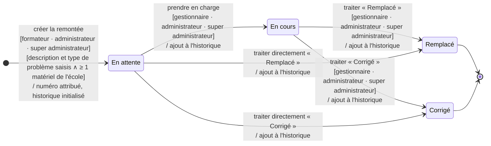
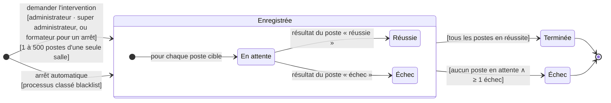

# Diagrammes d'états — brouillon V1

<!-- version:debut : généré par versions.py, ne pas modifier à la main -->
| Version | Mise à jour | Destination | Dernière évolution | Historique |
| --- | --- | --- | --- | --- |
| 2.0 | 13/11/2026 | Brouillon interne | Aligner sur l’application : état « en cours », traitement direct possible, PDF à la demande, type obligatoire, interventions sur une seule salle | [2 versions](../../archive/README.md#diagrammes-etats-brouillon-v1) |
<!-- version:fin -->

## Remontée

## Intervention sur les postes

